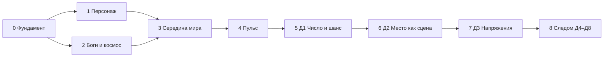

# Дорожная карта DM Cockpit

Рабочий план для нас самих — владельца и агента, не для показа. Порядок этапов — срез 28.10.2026; «Где мы сейчас» и состояние этапов — 30.10.2026.

Как читать:
- Номера задач (Q, M, E) — из `TASKS.md`, там короткие критерии.
- Сущности — по `ENTITIES.md`.
- Направления после этапа 3 — `DESIGN.md` (28.10): этапы 4–6 пересобираются под выбранные владельцем.
- Здесь — порядок, шаги внутри задач, файлы, данные, события, тесты, риски и что нужно решить.

Проверка в действии за столом отложена (решение владельца 28.10). У каждого этапа записан сценарий, который проверим потом.

Размер работ — в **заходах**. Заход — одна рабочая сессия агента: задача доведена до зелёного `npm test` и `npm run check`, документы обновлены. Это порядок величины, не обещание.

---

## 1. Где мы сейчас

Срез 30.10.2026 по рабочей копии. Этапы 0 и 2–8 и хронология (Х1–Х3) закрыты, из этапа 1 открыты 1.1, 1.4 и 1.5 (§3). Пересчитать: `npx vitest run --maxWorkers=4`, `node scripts/bundle-report.mjs --budget 500`, `EVENT_TYPES` в `src/engine/events.ts`.

**Работает:**

| Область | Что есть |
|---|---|
| Стол | партия, карта персонажа по образцу владельца (полоса боя, урон и лечение числом, вкладки), бой с инициативой, состояниями и легендарными действиями, концентрация из листа, броски с шансами и деревом вывода, журнал с нитями и хроникой по дням, отдых, ресурсы, режим игроков; виды «Пульс» (W, ветки «что если»), «Хроника» (H, линза года), «Тетрадь» (N), стол прошлого дня |
| Персонаж | редактор-карточка (имя, раса, класс, point buy, предыстория, навыки на одной карте) и прежние шаги; повышение уровня и правка листа с причиной; вкладка «Путь» — 20 уровней; бог на листе |
| Мир | модель мира (фракции ↔ организации, отношения, цены, встречи), правила симуляции, место как сцена («Сейчас»), напряжения → нити, известность партии; знание игроков (`KNOWLEDGE_REVEALED`) |
| Карта | схема по умолчанию (местность полигонами, дороги, подписи держав и мест), растр кнопкой «Карта», глобус колесом до региона; поход A5E (занятия, погода, опасность, припасы), новое место щелчком, план Neverwinter, мост к MapTool (ждёт ручной проверки) |
| Космос | планетарий Realmspace, течения флогистона, Великое колесо (1492 DR) и Великое древо (1372 DR), уделы богов на схемах |
| Справочники | SRD 5.1 целиком, Black Flag 360 и A5E 586 монстров, компендиум таблиц владельца; из FR Wiki: 504 бога и 65 пантеонов, 2 840 организаций, 20 611 NPC, 442 державы (вид `kingdom`, 30.10), 863 места на карте и 1 057 карточек мест; хронология — 6 837 событий статей-годов и 1 581 из летописей и статей (30.10) |
| Компендиум | Расы × фасеты, Уровни × подклассы, Черты × эффекты, Боги × пантеоны, Державы (год, правитель на год, история) |

- Событий 31 (`src/engine/events.ts`).
- Тестов 1 363 в 137 файлах (30.10, с ядром процессов).
- Основной кусок бандла 499 КБ (gzip 160), бюджет 500 — сторож `bundle-report.mjs --budget 500`; запаса нет, новое — отдельными кусками.

**Узкие места:**

| Что | Почему мешает |
|---|---|
| Сессия за столом не сыграна (Q3) | отложена владельцем 28.10; всё после MVP строится без обратной связи со стола, проверка — сценариями этапов в браузере |
| Не закоммичено много | последний коммит `042a657` (Д2, 6.1–6.2, 29.10); в рабочей копии — этапы 6 (6.3–6.4), 7, 8, M16, Д9, Q18, тема, редактор-карточка, державы и данные хронологии |
| Старт тяжелее основного куска | до первой отрисовки грузится 1,38 МБ (gzip 368 КБ): справочники и иконки нужны первому экрану, Q18 их разнёс по кускам, но не убрал со старта |
| Ждут решения | события вещей (E7, 1.1), где лежат портреты (Q12, 1.4), спасброски от смерти (новое событие), вид для слоя летописей хронологии |
| Полный `npm test` под нагрузкой | при работающей локальной LLM ловит таймауты 5 с; с `--maxWorkers=4` проходит, одиночный красный тест стола под нагрузкой — перепроверять отдельно |

---

## 2. Основы плана

Восемь правил, по которым принимаются решения внутри этапов. Первые два уже действуют, остальные — предложения этого плана.

**2.1. Мерило — три вопроса экрана.** Чей ход и что с партией, что вокруг, что изменилось в мире. Приоритет — мир вне боя (решение 21.09). Новая панель, которая не помогает ответить ни на один вопрос, — в «Шире» или в отказ.

**2.2. Справочник и состояние.** Справочник — `content/`, только чтение, у записи источник. Состояние — `State`, меняется только событиями и патчами предложений. Сущность мира бывает и тем и другим: запись справочника плюс изменяемая часть в состоянии. Например, организация — справочник, а известность партии у неё — состояние. Состояние хранит ссылку и разницу, не копию.

**2.3. Адресация `вид:id`.** У каждой сущности — ссылка-строка (виды — `ENTITIES.md`). Резолвер по ссылке даёт одно представление для карточки, поиска и связей. Все новые сущности заводятся через него.

**2.4. Год кампании — фильтр канона.** Кампания идёт в 1492 DR. Канон вики разложен по эпохам:
- поля богов по редакциям (5e — 1492, 3e — 1372);
- годы рождения и смерти у персонажей;
- основание и роспуск у организаций.

Год кампании задаётся в сиде (не событие) и выбирает, что показывать: какие NPC живы, какие организации есть, где дом бога. Линза Колесо/Древо — то же для космологии: по умолчанию она следует году кампании.

**2.5. Данные — кусками по требованию.** Каждый вид справочника — свой кусок, грузится при первом обращении. Образец — справочник мест (`src/map/gazetteer.ts`). Бюджет: основной кусок сначала ≤ 1,5 МБ, к этапу 3 — ≤ 500 КБ (Q18). *30.10.2026 — 491 КБ; старт до первой отрисовки — 1 378 КБ, gzip 367 КБ (`scripts/bundle-report.mjs`). Дальше старт режут только данные, без которых первый экран обходится: планы и святые дни (≈ 90 КБ) — кандидаты, их читают сцена и «Пульс».*

**2.6. Импорт из вики — по одному образцу.** Общий разбор инфобоксов — в `scripts/wikilib.py`, вынесенный из `import-spelljammer.py` и `import-planes.py`. Правила:
- поля — по редакции под год кампании, с отметкой редакции;
- источник — первая сноска поля;
- значения-ссылки — в ссылки `вид:id`, где цель есть, иначе текстом;
- непереведённое значение — ошибка импорта, как у планов.

Русский текст карточек — только из ночной разметки по фактам статьи.

**2.7. Ночная разметка — постоянный конвейер.**

| Слой | Что даёт |
|---|---|
| L3 | места |
| L4 | планы |
| L5 | боги (новый) |
| L6 | NPC (новый) |
| L7 | организации (новый) |
| L8 | державы для симуляции (новый, 30.10): сила войска и флота числом с цитатой из статьи (SIMULATION.md С4) |
| L9 | вид события слоя летописей (новый, 30.10): `ChronoKind` для 1 581 события `content/chronology/articles/` |

После каждого прогона — экспорт и импорт:
- `export-place-cards.py`;
- `import-planes.py`;
- новые импортёры.

Ограничения: одна модель в памяти, тяжёлое по одному, без описания — не сочинять.

**2.8. Контрольная точка этапа.** Этап закрывается:
- зелёными тестами;
- строками в HANDOFF §14;
- записанным сценарием проверки;
- коммитом по слову владельца.

Сыгранная сессия — не позже конца этапа 3.

---

## 3. Этапы коротко

| Этап | Суть | Заходов |
|---|---|---|
| 0 Фундамент | адресация, одна карточка, ленивые справочники, год кампании, Q1 — закрыт 29.10 | 6–8 |
| 1 Персонаж | вещи, уровень, концентрация из SRD, портрет — уровень и концентрация сделаны 29.10; открыты вещи (1.1), портрет (1.4), групповая проверка (1.5) | 6–8 |
| 2 Боги и космос | боги и пантеоны, уделы, бог на листе, святые дни — закрыт 28.10; русские карточки (2.6) — ночной разметкой | 5–7 |
| 3 Середина мира | организации, церкви, NPC, храмы, модель мира, известность, новое место — закрыт 28.10; 3.7 — ночной разметкой, 3.8 (сессия) отложена | 8–10 |
| 4 Пульс | правила симуляции, вид F5 — закрыт 28.10 | 5 |
| 5 Д1 Число и шанс | математика d20, шансы в блоке и на листе, дерево вывода, концентрация — закрыт 29.10 | 5–6 |
| Х Хронология (ядро Д5) | статьи-годы вики, слепок мира на год, панель хронологии, одна ось с кампанией — Х1–Х3 сделаны 29.10, слой летописей 30.10; Х4 открыт | 5–7 |
| 6 Д2 Место как сцена | проекция сцены, вкладка «Сейчас», сцена дороги, слои опасности и погоды — закрыт 29.10 | 5 |
| 7 Д3 Напряжения | поиск, панель и пины, «Сделать нитью», слой влияния — закрыт 29.10 | 5 |
| 8 Следом | Д4 ветки, Д5 время, Д6 знание, Д7 слои правил, Д8 путь — закрыт 29.10 | 12–14 |
| Шире | по запросу | — |

Направления этапов 5–8 — из `DESIGN.md`; выбор владельца 28.10.2026: Д1 + Д2 + Д3. Сессия за столом исключена владельцем 28.10, проверка — сценарием этапа в браузере.

Этапы 1 и 2 идут параллельно после этапа 0. Они сходятся в шаге 2.4 — боге на листе.

---

## 4. Этап 0 · Фундамент

Цель: всё следующее строится на одной адресации, одной карточке и лёгком старте.

**Ход на 28.10 (вечер):**

| Шаг | Состояние |
|---|---|
| 0.1 | сделано: коммит `ac16baf` на `main`, без пуша |
| 0.2 | сделано |
| 0.3 | сделано 29.10: лист персонажа; чип состояния — карточка состояния SRD, чип концентрации и эффекта — заклинание по имени; карточка места справочника на карте — «Карточка»; тела планетария и сферы Флогистона — «Карточка» (планы — уже через PlaneInfo). Чипы в корешке партии — без входа: строка корешка выбирает персонажа |
| 0.4 | сделано для заклинаний; монстры и места уже ведут на свои карточки через актёров и места кампании |
| 0.5 | сделано 29.10: основной кусок 3,30 → 1,50 МБ (1 497 031 байт; замер rollup `renderedLength` по модулям). Тексты компендиума, заклинаний и блоков монстров — отдельным куском: плагин сборки `dm-text-split` делит JSON с диска на ядро и тексты (`src/rules/textSplit.ts`), `loadTexts()` возвращает тексты в те же объекты после первой отрисовки; блоки SRD сверх сида (Bandit, Bandit Captain) догружаются с библиотеками, сессия с другим блоком ждёт загрузки; служебные страницы, экран создания, «Хроника», «Пульс», «Сравнить» и схемы космоса — ленивыми частями с предзагрузкой (`src/lazyParts.tsx`). Тесты грузят всё в setup. «Добавить» — фильтр по библиотеке и CR; итог встречи A5E — строкой под регионом и кнопкой «Появился» (блок A5E по имени, затем SRD и Black Flag) |
| 0.6 | сделано: год из времени мира, эпоха и линза по умолчанию |
| 0.7 | сделано: решение Q1 «по умолчанию агента», реализация Q2 |
| 0.8 | сделано: `maxWorkers: 4` |

### 0.1 Фиксация (владелец)

- Коммит и пуш накопленного.
- До этого проверю `.gitignore`: `maps/ocr`, `maps/llm`, `maps/world`, `maps/gis`, `maps/tiles` не в git; `content/maps/toril-cards.json` (580 КБ, CC BY-SA) — в git.
- Ветка — по слову владельца.

### 0.2 Адресация и резолвер — 2 захода

- Новый модуль `src/entities/`:
  - тип `EntityRef = \`${EntityKind}:${string}\``;
  - список видов;
  - `resolve(ref)` → `EntityView`: `{ ref, kind, name, nameRu?, source: { kind, cite, url?, license }, summary, sections, links: EntityRef[] }`.
- Справочные виды и откуда данные:

  | Вид | Источник |
  |---|---|
  | `condition`, `skill`, `ability`, `damage` | константы `src/rules/srd` |
  | `spell` | `content/srd/spells.json` |
  | `item` | снаряжение и магические предметы |
  | `monster` | SRD, BF, A5E — приставки id уже есть |
  | `race`, `subrace`, `class`, `subclass`, `feature`, `trait`, `feat`, `background` | компендиум |
  | `resource` | `resources.ts` |
  | `place` | справочник мест и реестр |
  | `plane` | Колесо и Древо |
  | `body`, `sphere` | Realmspace, флогистон |

- Виды состояния — `actor`, `location`, `faction`, `thread`. Резолвер берёт их из `State` и, если есть, подмешивает справочную запись по ссылке.
- Тесты (`src/entities/entities.test.ts`):
  - каждый вид резолвится на образце;
  - у каждой справочной записи есть `source`: правило «записи без источника не существует» — теперь тестом;
  - ссылки уникальны;
  - битая ссылка даёт видимую заглушку, а не пустоту.

### 0.3 Одна карточка — 2 захода

- `EntityCard` (`src/components/EntityCard.tsx`, типы уже есть) рисует любое `EntityView`. Тело по виду — зарегистрированная секция: `PlaneInfo`, `PlaceOverview`, `MonsterActions` и другие становятся телами по виду, а не отдельными путями.
- На странице — один вход `openEntity(ref)`, слот карточки или оверлей 720px по правилам F3.
- Переводим на него:
  - `IconGrid` (умения, черты, особенности, заклинания);
  - тултип чипа состояния — по щелчку;
  - пины и карточки мест;
  - узлы схем космоса.
- Тест стола: щелчок по заклинанию в листе, монстру в «Противниках», состоянию на чипе, месту в «Здесь» открывает одну карточку с источником.

### 0.4 Ссылки и упоминания — 1 заход

- `JournalPart` (`src/engine/journal.ts`): `entity` становится `EntityRef`.
- Новые упоминания:
  - монстр по `monsterId` у `ACTOR_SPAWNED`;
  - заклинание по `CONCENTRATION_STARTED`;
  - место по `PARTY_TRAVELED`.
- В текстах SRD ссылок не расставляем: текст дословный. Связи — только из структурных полей: у заклинания — классы, у монстра — состояния в иммунитетах.

### 0.5 Ленивые справочники — 2 захода

- Сначала замер состава основного куска: `vite build` с отчётом rollup, без новых зависимостей, если хватит встроенного.
- `monsters.ts`, `spells.ts`, `magicItems.ts`, `a5e/journey.ts` — на загрузчики по виду (`loadKind`) с кэшем. Синхронные константы (`MONSTERS` в `desk/bodies.tsx`) — через хук.
- Компендиум нужен при старте: сид собирает персонажей через `derive.ts`. Поэтому делим его на ядро для вывода листа (таблицы уровней, спасброски, кости) и тексты умений и черт отдельным куском. Если деление окажется хрупким — оставляем компендиум целиком и выносим всё остальное.
- Совмещаем с M15: список «Добавить» с фильтром по библиотеке и CR, итог встречи A5E — кнопкой «появился».
- Готово:
  - основной кусок ≤ 1,5 МБ;
  - стол рисуется до загрузки монстров;
  - тесты не знают о ленивости — загрузка в тестах синхронная через тот же кэш.

### 0.6 Год кампании — 0,5 захода

- Поле `year` в сиде кампании (`src/campaign/seed.ts`) — 1492.
- Функция `eraOf(year)`: 1492 → поля 5e, 1372 → 3e.
- Линза космологии по умолчанию — от года.
- Тест: смена года в сиде меняет линзу по умолчанию.

### 0.7 Q1 → Q2 (владелец, затем агент) — 1 заход после решения

### 0.8 Стабильный `npm test` — 0,25 захода

- Предлагаю `maxWorkers` в конфиге тестов: половина ядер, не больше 4.
- Полный прогон не должен зависеть от того, работает ли LLM.

**Сценарий этапа 0** (проверим потом):
1. Открыть стол — карта и партия видны сразу.
2. Щелчок по «Hunter's Mark» на карточке Bo, по Bandit Captain, по чипу «Отравлен», по Neverwinter в «Здесь» — каждый раз одна и та же карточка с источником.
3. В журнале «Bandit 4» после появления — ссылка на блок монстра.

---

## 5. Этап 1 · Персонаж до конца (снизу вверх)

Цель: персонаж живёт всю кампанию — вещи, уровни, правки, портрет.

### 1.1 Вещь как сущность (E7) — 2 захода

- Данные: снаряжение SRD (122) и магические предметы (239) через резолвер. На листе уже есть `equipment: {id, qty}`.
- Вкладка «Снаряжение» карточки:
  - список со ссылками на карточки предметов;
  - вес и грузоподъёмность по SRD (STR × 15);
  - деньги;
  - настройка — не больше трёх предметов, по SRD.
- **Нужно решение:** вещи, полученные и потерянные в сессии, — это события. Предлагаю три:
  - `ITEM_GAINED`;
  - `ITEM_LOST`;
  - `ATTUNEMENT_CHANGED`.

  Деньги — `ITEM_GAINED` с id монеты. До решения — только показ данных сида и редактора.
- Тесты:
  - вес и предел по SRD;
  - четвёртая настройка запрещена;
  - отмена каждого события.

### 1.2 Концентрация из листа и SRD (Q9) — 1 заход

*С 28.10 — в этапе 5 (5.5), вместе с шансом удержать концентрацию. Сделано 29.10.2026 — см. 5.5.*

- `ConcentrationForm` предлагает заклинания персонажа с концентрацией.
- Срок берётся из `duration` SRD: «Concentration, up to 1 minute» → 60 с.
- Свободный ввод остаётся для предметов и умений.
- Тест: Hunter's Mark → 1 час.

### 1.3 Повышение уровня и правка созданного (Q10) — 3 захода

- **Нужно решение по §7.** Предлагаю два события:
  - `CHARACTER_LEVELED` `{ actorId, level, hp, choices }` — хиты броском или средним, ASI или черта, подкласс, новые заклинания и умения;
  - `SHEET_EDITED` `{ actorId, patch }` — исправления листа вне механики, с причиной в журнале.
- Экран — тот же экран создания в режиме «повышение», над `draft.ts`.
- Q20, остаток: пробел в паспорте листа заполняется щелчком через `SHEET_EDITED`.
- Тесты:
  - реплей до и после;
  - `Ctrl+Z` возвращает уровень, хиты и ресурсы;
  - максимум ресурсов пересчитан из таблицы класса.

### 1.4 Портрет картинкой (Q12) — 1 заход

- **Нужно решение:** где лежит файл. Варианты:
  - `public/portraits/` в репо — просто, но картинки в git;
  - IndexedDB браузера — не в git, но не переживёт смену машины без файла сессии;
  - файл сессии с картинкой внутри — тяжелеет.

  Предлагаю каталог рядом с кампанией вне git и путь в листе.
- Портрет — в окне портретов, корешке и шапке карточки. Аватар расы остаётся запасным.
- Книжные иллюстрации не воспроизводим, свои картинки владельца — можно.

### 1.5 Групповая проверка из подвала партии (Q20) — 1 заход

Отмеченные персонажи бросают одну проверку; итог — в журнал одной записью с каскадом.

**Сценарий этапа 1:**
1. Создать жреца.
2. Выдать кольчугу и щит — вес и AC на карточке.
3. Поднять до 5-го уровня — новые ячейки на листе.
4. `Ctrl+Z` возвращает 4-й.
5. Концентрация — из его заклинаний.
6. Портрет в окне партии.

---

## 6. Этап 2 · Боги и космос (сверху вниз)

Цель: верх иерархии — боги, пантеоны, уделы — доходит до стола и до листа.

### 2.1 Импорт богов и пантеонов (E1) — 2 захода

*Сделано 28.10.2026 за один заход (HANDOFF §14). Отличия от плана: разбор не вынесен в `wikilib.py` — импорт берёт `clean`, `named_refs` и `refs_in` из `import-spelljammer.py`, как `import-planes.py`; пантеонов 65, а не около 20 (вики группирует и «Seelie Court», и «Nine trickster gods»); сила — строкой под именем; апофеоз и смерть — текстом.*

- `scripts/import-deities.py <dump>` → `content/cosmos/deities.json` (кусок по требованию). Разбор — общий из `scripts/wikilib.py` (вынести из `import-planes.py`).
- Поля по эпохе. Для 1492: 5eR → 5e → 4e → 3e → 2e → без редакции. Для 1372: 3e → 2e → без редакции. У значения — отметка редакции.
- Поля:
  - имя и титулы (первые три);
  - мировоззрение, символ;
  - сферы влияния (portfolio);
  - домены жреца (5e — к id подклассов компендиума, где совпадают);
  - почитатели;
  - пантеон;
  - кому служит и кто служит ему;
  - аспекты;
  - родной план и удел — к id планов Колеса и Древа, иначе текстом;
  - ранг: overgod, greater, intermediate, lesser, demigod;
  - смерть и апофеоз;
  - святые дни (текст для 2.5);
  - сноски — книга и страница.
- Пантеоны — из поля `pantheon` и категорий вики, около 20: Faerûnian, Mulhorandi, Untheric, Zakharan, Maztican, Draconic, Giant, Seldarine, Morndinsamman и другие.
- Тесты:
  - у каждого бога источник;
  - Lathander в 1492 — дом Elysium; в 1372 — другое значение по 3e (проверить импортом);
  - Ao — overgod без пантеона Faerûn;
  - служение без висячих ссылок либо со ссылкой-текстом.
- Риск: 418 карточек неоднородны (галереи в полях, `{{Former}}`, ` `). Против этого — `current()` и `clean()` из импорта планов и список исключений в скрипте с причинами.

### 2.2 Карточка бога и граф пантеона (E2) — 2 захода

*Сделано 28.10.2026 за один заход (HANDOFF §14): схема — общая для карточек (`EntityView.diagram`, `NeighborhoodGraph`), служение — с обеих сторон; домены ведут на подклассы жреца уже с E1. В компендиуме — матрица «Боги × пантеоны» с эпохой.*

- Тело карточки бога: титулы, мировоззрение, символ, сферы, домены (ссылки на подклассы), почитатели, дом и удел (ссылка на план), ранг, сноски.
- Граф — окрестность бога, а не весь пантеон (в Faerûnian около 100 богов): служит → бог → служат ему, плюс аспекты. SVG на `src/cosmos/svg.tsx`, Forum и Plex Mono по правилам кегля.
- Вход:
  - с карточки плана — «Боги плана» по линзе;
  - из поиска;
  - из листа (2.4).

### 2.3 Уделы на схемах (E3) — 1 заход

*Сделано 28.10.2026 (HANDOFF §14): число в узле, список в карточке плана свёрнут (у Arborea 53 удела), данные богов — по требованию.*

- У узла плана на Колесе и Древе — число богов с домом там.
- В карточке плана — список уделов и богов.
- Тест: на Древе у Arvandor — Corellon (по данным импорта).

### 2.4 Бог на листе (E8) — 1 заход

*Сделано 28.10.2026 (HANDOFF §14), кроме правки в идущей кампании — ждёт `SHEET_EDITED` (1.3). Домены — по полю 5e вики при любой эпохе: домен — механика 5e, а не история мира.*

- Поле `deityId` в листе. Редактор: шаг «Божество» — жрецу обязательно, фильтр по домену подкласса; остальным по желанию. Почитатели расы — подсказка: Seldarine для эльфов, Morndinsamman для дварфов.
- На карточке — символ и имя бога со ссылкой.
- Правка в кампании — через `SHEET_EDITED` (1.3).

### 2.5 Святые дни (E4) — 1 заход

*Сделано 28.10.2026 (HANDOFF §14). Правила разбирает импорт, а не код стола: в основной кусок едет только маленький `holy-days.json`. «Ближайший святой день его бога» из сценария ждёт E8 (`deityId` на листе) — пока ближайший среди богов Faerûn.*

- Разбор поля святых дней: праздники Харптоса (Greengrass, Midsummer…), даты «Marpenoth 15», «каждое полнолуние».
- Что не разобралось — остаётся текстом в карточке.
- Календарь: отметка на дне, в панели — «ближайший святой день». Пустые входящие («Мир спокоен») показывают ближайший праздник или святой день.

### 2.6 L5 — русские карточки богов (ночью)

Вступление статьи → карточка по фактам; формат — как L4.

**Сценарий этапа 2:**
1. Великое колесо → Elysium → Lathander → кому служит и кто служит ему.
2. На Древе — другой дом (1372).
3. Жрец с доменом Life выбирает из богов с Life.
4. В календаре ближайший святой день его бога.

---

## 7. Этап 3 · Середина мира

Цель: верх и низ встречаются в поселении — церковь, храм, жрец, организации, известность.

### 3.1 Импорт организаций — 2 захода

- `scripts/import-organizations.py` → `content/world/organizations.json`. Из `{{Organization}}` (415):
  - тип, база (ссылка на место), глава (ссылка на NPC);
  - союзники и враги (ссылки на организации);
  - бог (`favoreddeity`) — так организация становится **церковью**;
  - мировоззрение, расы, символ;
  - основание и роспуск — фильтр по году кампании;
  - сноски.
- Тест: Lords' Alliance есть в 1492; распущенные к 1492 — скрыты, но доступны поиском с отметкой.
- *Сделано 28.10.2026: карточек `{{Organization}}` в дампе 2 840, а не 415 — взяты все (`content/world/organizations.json`, 0,7 МБ, отдельным куском). Церковь — организация с богом, религиозная по типу или имени: 140 (у Harpers боги есть, но это не церковь). Глава сведена к NPC у 749, база — к месту карты у 1 701, союзники и враги — к организациям. В `{{Person}}` поля организаций нет — членство взято из категорий «Members of …» (5 283 NPC, `org-members.json`); категория не различает нынешних и бывших, в карточке NPC — «Состоял». Вид `organization`: карточка с годами «в 1492 DR есть / распущена / ещё не основана», союзниками, врагами и членами, живыми в год мира; NPC ссылается на свои организации. Списка и поиска организаций пока нет — «скрыты, но доступны поиском» ждёт общего поиска; связь фракции состояния с организацией — 3.3.*

### 3.2 Импорт NPC — 2 захода

- `scripts/import-people.py` → `content/world/people/*.json`, куски по области дома: Toril по регионам, Подземье, планы. Из `{{Person}}` (9 636):
  - раса, дом, бог-покровитель, род занятий, языки, титулы;
  - годы рождения и смерти — фильтр «жив в 1492»;
  - сноски.
- Компактно, без текста статьи. Текст — L6 ночью.
- Риск — объём. Решение — куски по области и индекс имён отдельно для поиска.
- *Сделано 28.10.2026 (E9): карточек `{{Person}}` в дампе оказалось 20 611 — взяты все. Куски — не по области, а по хэшу id (8 по ~0,5 МБ, вне основного бандла; первая карточка NPC грузит все восемь параллельно — по одному куску на id можно позже), а индекс «место → жители» (547 КБ, 13 080 NPC в 642 местах) — отдельно, только для карточки места у мастера. Языков нет — в карточках вики поле редкое. Связь с фракцией — после организаций (3.1). Поиска NPC по имени пока нет.*

### 3.3 Модель мира (Q6) — 3 захода

- `World.factions[id]` получает `ref?: EntityRef` на организацию. В состоянии только:
  - известность и влияние (уже есть);
  - отношения между фракциями (новое, число −3…+3).
- `World.locations[id]` получает `ref` на место справочника и цены по товарам (индекс %).
- Таблицы встреч с весами — справочник: A5E плюс свои по месту. Веса меняются только патчем.
- Новые виды `patch`:
  - отношение фракций;
  - цена товара;
  - вес встречи;
  - новое место (для 3.5).

  Каждый проверяется редьюсером и откатывается.
- Сид §13 дополняется по этой модели: Neverwinter, Triboar Trail, Zhentarim, Lords' Alliance, храмы.
- *Сделано 28.10.2026, до контрольной сессии — решение владельца («пока исключаем игровую сессию, продолжаем так»), предложения по пунктам приняты. `Faction.ref` (организация) и `relations` (симметрично, 0 не хранится), `Location.ref` (место справочника), `prices` по шести товарам — разделам таблиц снаряжения SRD (`GOODS`), `encounters` — множитель по имени («Werewolf ×2»). Патчи `relation`, `price`, `encounter`, `newLocation` (и обратный `removeLocation` — снимок для отката): `checkPatch` проверяет и числа (отношение — целое −3…+3, вес ≥ 0, товар из списка), `patchTargets` — кого пульсировать. Сид: ссылки у Neverwinter, Neverwinter Wood, Faerûn (Sword Coast North, Triboar Trail, Old Owl Well в справочнике нет — без ссылки), отношения по союзникам и врагам вики, Church of Lathander и Church of Helm фракциями, у «цен на оружие» и «ликантропов» — патчи. Стол: «Отношения» и «По вики» в карточке фракции, «Товары» и (мастеру) «Встречи» в карточке места; место с `ref` берёт карточку справочника по ссылке, а не по имени. Таблицы встреч остаются A5E — своих не выдумываю; срок «на 3 ночи» — словами. Не сделано: пантеон кампании для графа F5.*

### 3.4 Храмы и жрецы на карте (E5, E9) — 1 заход

- Значок «храм» справочника мест (эталоны `toril-icons.json`) → место с церковью: по базе организации или по имени места. Не нашлось — без связи, не угадываем.
- Карточка поселения: церкви и организации, NPC с домом здесь (живые в год кампании), ссылки.
- *Сделано 28.10.2026: значков храма на растре 68, но почти все без подписи или в Kara-Tur — привязка «ближайшее место» была бы угадыванием, её нет. Путь к церкви — через место: поле religion статьи о месте (213 мест с богами из справочника, `content/world/place-faiths.json`) и база организаций. Карточка места справочника: «Почитают» текстом поля, свёрнутые «Боги места», «Церкви» (с базой здесь и церкви одного бога из богов места — у Cult of the Dragon девять богов, это не церковь ни одного), «Организации в N DR», «Жители в N DR». На столе мастера карточка места кампании показывает те же группы из карточки справочника (блок «По вики»): Neverwinter — 9 богов, 12 церквей, 30 организаций, 362 жителя; храм → церковь → бог — щелчками. Не сделано: значки храмов на растре без связи; церковь как фракция состояния — 3.3.*

### 3.5 Новое место щелчком (M8) — 1 заход

- Щелчок по карте → форма: имя и класс из справочника под щелчком, иначе ввод.
- Дальше — `WORLD_DELTA_PROPOSED` с патчем «новое место» → «Принять» → место с `geo`. `Ctrl+Z` убирает.
- *Сделано 28.10.2026: инструмент «Место» на карте (только мастеру, не в бою). Щелчок по значку справочника — его имя, уровень по классу и ссылка `ref` на место справочника; мимо — точка и ввод имени. Уровни — ниже фокуса карты (у региона — и подрегион), от региона до здания. Предложение собирает чистая `newPlaceDelta` (`src/campaign/newPlace.ts`): id из имени, совпадение — с номером, причина — место-родитель. Пока предложение ждёт, на карте пин симуляции (никуда не ведёт); после «Принять» — место с `geo`, `Ctrl+Z` убирает.*

### 3.6 Известность партии (E10) — 0,5 захода

Известность у церквей и организаций — тем же патчем, что у фракций сида. Показ — в карточке организации и подвале партии.

*Сделано 28.10.2026: в карточке фракции мастеру — «Известность +1 / −1»: предложение во входящие (`renownDelta`), пока оно ждёт — кнопки недоступны. Карточка организации справочника: уже фракция кампании — «В кампании · известность партии N» со ссылкой; нет — «В кампанию фракцией» (`organizationFactionDelta`, патч `newFaction` и обратный `removeFaction`). Подвал партии — раздел «Известность» в доке сводки. Правило симуляции для известности не заводил: что партия сделала для фракции, решает мастер.*

### 3.7 L6 и L7 — русские карточки NPC и организаций (ночью)

### 3.8 Контрольная сессия (Q3 → Q4)

Одна сессия за столом на сиде §13 плюс то, что успели. Замечания — строками в очередь (Q4). Этап 4 начинается после разбора.

**Сценарий этапа 3:**
1. Neverwinter → храмы на карте → Church of Lathander → жрец-NPC → бог.
2. Lords' Alliance: известность партии +1 принятием предложения, `Ctrl+Z` возвращает.
3. Новое место щелчком.

---

## 8. Этап 4 · Пульс мира (шаг C)

Цель: мир движется сам и предлагает, мастер решает — экран F5. **Закрыт 28.10.2026:** 4.1 и 4.2 сделаны, слои карты (бывшая 4.3, M7) разошлись по направлениям Д2 и Д3 (6.4, 7.4).

### 4.1 Правила симуляции (Q7) — 3 захода

`src/campaign/simulation.ts`, каждое правило — чистая функция «состояние + отрезок времени → предложения»:

| Правило | Как работает |
|---|---|
| Цены | индекс товара по месту дрейфует от сезона, праздника, дорог (торговый путь перекрыт — растёт) |
| Отношения фракций | сдвиг от столкновений интересов в одном месте и от известности партии |
| Встречи | веса от фазы Selûne (ликантропы в полнолуние — как в сиде), сезона, опасности места |
| Святые дни и праздники | толпы, цены, активность церкви |

- У каждого предложения — `causeId` и патч. Мир правило не меняет.
- Детерминизм: случайность — из лога (предложение — событие со снимком).
- *Сделано 28.10.2026 (Q7): правила детерминированы — случайности нет, те же состояние и отрезок дают те же id. Числа — `SIM_RULES` в `simulation.ts` (правила стола, спецификация их не задаёт): цена еды и ночлега в поселениях — за сменой цели (сезон: зима +10, весна +5, лето 0, осень −5; день праздника Харптоса +10, толпы; на следующий день обратно); отношения раз в десятидневку — растущая фракция (тренд > 0) углубляет вражду со своими врагами на 1 до −3, партия с известностью от 5 у обеих сторон сближает тех, кто не выше 0; луна — ликантропы ×2 в Neverwinter Wood теперь патчем веса, через три ночи после полнолуния — предложение вернуть ×1. Не сделано: встречи от сезона и опасности места (нет основы, кого — таблицы A5E по уровню не про сезон), активность церкви в святые дни (у церкви нет числа, которое она двигает), «торговый путь перекрыт» — общий; цены каравана в Neverwinter остаются правилом сида.*

### 4.2 Вид F5 «Пульс» (Q8) — 2 захода

- Три десятидневки календаря (на `HarptosCalendar`).
- Графы фракций и пантеона (на графе 2.2).
- Индексы цен, веса встреч, «требует решения» справа.
- У игроков вида нет.
- Сверка с `reference/screens/F5-pulse.png`, блок «пульс» в тесте стола, адверсарный набор игроков.
- *Сделано 28.10.2026: вид «Пульс» (клавиша W, только мастеру) — `src/pages/desk/PulseView.tsx` над чистой проекцией `src/campaign/pulse.ts` (`pulseOf`). Календарь — три колонки по десять дней от сегодня: праздники, полнолуние и новолуние (день фазы, как в полосе часов), святые дни богов партии, смена сезона, остывание нитей. Граф фракций — `components/FactionGraph.tsx`: узлы по эллипсу (влияние с трендом, известность), рёбра — союз сплошной, соперничество пунктиром, вражда двойной, число на ребре; ждущее «→ −3» бирюзой. Цены — индекс 100 + надбавка места + товара, ▲/▼, ждущее «→ 120». Встречи — полосы множителя. «Требует решения» — входящие правой колонки, не повторяются. Вместо графа пантеона — «Боги партии» (кто молится, ближайший святой день): у богов в данных вики нет союзников и врагов, только служение. Адверсарный набор игроков — по-прежнему: вида у игроков нет, W не открывает.*

**Сценарий этапа 4:**
1. Шаг «Десятидневка» → предложения с причинами.
2. «Принять» → граф фракций меняется.
3. `Ctrl+Z` возвращает.
4. Полнолуние поднимает вес ликантропов.

---

## 9. Этап 5 · Д1 Число с выводом и шансом

Цель: любое число листа, блока и боя отвечает «откуда» и «какой шанс». Это разбор самой механики d20 (`DESIGN.md` Д1). Выбор владельца 28.10.2026: Д1 → Д2 → Д3.

### 5.1 Математика d20 — 1 заход

`src/rules/srd/odds.ts`, чистые функции, точные дроби:

| Функция | Правило SRD |
|---|---|
| шанс попадания: бонус против AC, обычно, с преимуществом, с помехой | d20 + бонус ≥ AC; «Rolling 1 or 20»: 20 попадает всегда, 1 промахивается всегда; преимущество — лучший из двух |
| шанс крита | 20 на кости (с преимуществом — хотя бы одна из двух) |
| шанс провала спасброска против DC | у спасброска 1 и 20 не автоматичны — правило только для атак |
| среднее строки костей «2d6 + 3» и урон крита | «Critical Hits»: кости урона бросаются дважды, модификатор один раз |
| ожидаемый урон атаки | промах 0, попадание — среднее, крит — среднее плюс кости |
| шанс удержать концентрацию | спасбросок Constitution против DC 10 или половины урона, что больше |

- Сопротивление и уязвимость — только при точном совпадении типа урона в блоке. Сложная строка («from nonmagical attacks») — пометка «смотри блок», без числа.
- Тест — таблица ручных значений: +4 против AC 15 = 50 %, с преимуществом 75 %, с помехой 25 %; среднее «1d6 + 2» = 5,5.
- *Сделано 28.10.2026: `src/rules/srd/odds.ts`, правила дословно (Open5e sections). Сопротивление — по точному распределению с округлением вниз.*

### 5.2 Шансы в блоке монстра — 1 заход

- Под атакой блока, только у мастера: строка по каждому из партии — «Aldric · AC 18 · 35 % · 2,4».
- Действие со спасброском: «DC 13 Dexterity» снимается из текста SRD регуляркой — шанс провала каждого.
- Линза «обычно · преимущество · помеха» — не событие, как фильтр.
- Мультиатаку не складываем: её состав — текст, разбирать его — значит сочинять.
- *Сделано 28.10.2026: `src/campaign/odds.ts`, `components/OddsTable.tsx`, вкладка «Действия»; добавочный урон «plus … damage» — из текста блока.*

### 5.3 Шансы на листе — 1 заход

- Атаки листа против противников на столе: в бою — участники, вне боя — выставленные. «Goblin · AC 15 · 55 % · 4,4».
- Заклинания со спасброском (текст SRD: «must succeed on a … saving throw»): DC листа против спасбросков блоков — кто провалит и с каким шансом.
- У игроков AC и спасбросков монстров нет (Q1), поэтому строк шанса у игроков нет.
- *Сделано 28.10.2026: секция «Шансы по противникам» в карточке персонажа, одинаковые блоки одной строкой. 29.10 партии сида дано стартовое снаряжение SRD (решение владельца): атаки и шансы видны сразу, лук Bo — с помехой (Heavy у Маленького); затем и заклинания SRD, у Aldric — домен Life.*

### 5.4 Дерево вывода — 2 захода

- `derive.ts` отдаёт не только число, но и шаги: AC, инициатива, бонус атаки, спасброски, навыки, пассивная Внимательность, DC и атака заклинаний, максимум хитов.
- Шаг — подпись, значение и строка SRD, откуда он.
- Щелчок по медальону или числу листа раскрывает вывод. `Esc` закрывает.
- Тест: сумма шагов равна числу — у всех листов сида и у созданных в редакторе.
- *Сделано 29.10.2026 за один заход (HANDOFF §14). Отличие от плана: шаги считает не `derive.ts`, а `campaign/explain.ts` над листом актёра — в логе лежит лист, а не PcSpec; правила те же (общие константы и `weaponAbility`), тест сверяет сумму шагов с числами `derive.ts` у партии сида и шести персонажей редактора (варвар, монах, драконий чародей, «Оборона», «Стрельба», компетентность). Щелчком раскрываются AC, ИНИЦ, PP и КХ (максимум хитов) — панель под полосой показателей; спасброски, навыки, атаки и Сл заклинаний — выводом в подсказке (щелчок по ним — бросок). Старый лист без Mage Armor не подгоняется: разница — шагом «не из правил листа».*

### 5.5 Концентрация из листа (Q9) — 0,5 захода

- Форма концентрации берёт заклинание с концентрацией из листа и срок SRD.
- Урон по концентрирующемуся — строка «удержит с шансом 65 %» (5.1).
- *Сделано 29.10.2026 (HANDOFF §14), вместе с 1.2 (Q9). Срок — из `duration` SRD («Up to 1 hour» → 3600 с; у всех 126 заклинаний с концентрацией разбирается, «1 раунд» и «2 ч» — своей кнопкой срока); срок от ячейки выше (Hunter's Mark 3-го круга — 8 ч) — не считаем, он в тексте SRD. Шанс — спасбросок CON листа или блока, только в попапе хитов мастера. У Lyra после урона 7: CON +2 против DC 10 — 65 %. Этап 5 закрыт.*

**Сценарий этапа 5:**
1. Goblin в бою: под Scimitar — шанс и средний урон по каждому из партии.
2. Линза «преимущество» меняет числа.
3. На листе Aldric — шанс по Goblin; щелчок по AC 18 → «доспех 16 + щит 2» со строками SRD.
4. Урон по концентрирующемуся → шанс удержать.

---

## 9.1 Этап Х · Хронология канона (ядро Д5)

Идея владельца 29.10.2026: громоздкую хронологию Forgotten Realms — в таймлайн со своей панелью; выбор даты подгружает слепок планеты с состоянием сущностей на тот момент. Это основа и для изучения лора мастером, и для машинной обработки данных мира. Решение владельца 29.10: строки событий — английские, как в вики.

Слепок — проекция, а не хранимый дамп: справочник (NPC, организации, боги по редакции) и события на год. Чего у записи нет, то «без дат», не «жив». Год — линза, не событие. Сцена места Д2 — срез того же слепка в одной точке, поэтому предлагаю Х3 до Д2.

### Х1 Статьи-годы вики — сделано 29.10

- `scripts/import-chronology.py`: 3068 статей «N DR» → 6837 событий (`content/chronology/events/0…9.json`, куски по 110–380 КБ) и индекс (`index.json`, 264 КБ: годы с именем из Roll of Years, метка эпохи, счётчики).
- Вид события — раздел `{{Yearbox/…}}`: политика, конфликты, смерти, рождения, магия, боги…; «in-publications» — изданное об этом годе, не событие мира.
- Дата Харптоса — у 327 событий («'''2 Mirtul:'''», «[[Hammer (month)|Hammer]]:», праздники); ссылки на справочник — у 4829 (NPC, организации, места карты, божества); источники сносок — у 6054.
- Эпохи — по большинству меток статей-годов: метки в вики непоследовательны («Present Age» вкраплено в «Age of Humanity»). Вышли восемь эпох Grand History: Days of Thunder … Present Age (1490+).

### Х2 Слепок мира на год — ядро сделано 29.10

- `src/world/chronology.ts`: `loadEvents(from, to)` — только нужные куски; `snapshotAt(year)` — имя года, эпоха, редакция полей (3e/4e/5e), события года, статусы NPC (жив, умер, не родился, без дат) и организаций (есть, распущена, ещё нет, без дат); `eventsAbout(events, ref)` — события места или NPC; `snapshotExport(year)` — JSON схемы `cockpit.canon-snapshot/1` с авторством вики.
- Осталось: правители и владельцы по годам (поле `leaders` с «when» у организаций), руины и основание мест — когда понадобятся панели.
- Годы жизни NPC из разделов смертей и рождений не дописываем: прибавка 62 года, и 31 из них расходится с карточкой.

### Х3 Панель «Хронология» — 2–3 захода

- Шкала эпох и плотность событий по годам; приближение эпоха → век → десятилетие → год; имя года и эпоха.
- Фильтры: вид события, место, NPC, организация — по ссылкам строк.
- Выбор года — линза для всего стола: карточки NPC, организаций и мест на этот год, на карте — события года у своих мест.
- Только мастеру; строки — по-английски, вид и дата — по-русски; у каждой — источник.
- *Сделано 29.10.2026 (HANDOFF §14). Вид «Хроника» главной зоны (`pages/desk/ChronologyView.tsx`, клавиша H): год, имя года, эпоха; шкала — восемь эпох кнопками и плотность событий столбиками (`densityBins`: шаг тысячелетие → век → десятилетие → год по ширине окна), щелчок по столбику приближает, «Шире» отдаляет; виды событий — переключатели со счётом года; поиск по месту, NPC, организации — по всему окну шкалы; ссылки строки открывают карточки справочника на год линзы; «Выгрузить слепок» (из Х4) — JSON за 10 лет с NPC и организациями. Линза: выбранный год ≠ году кампании — карточки справочника на этот год (`useEntity` с годом), на карте — отметки событий года справа от точек мест и плашка «Канон N DR» (щелчок — год кампании). Не событие, у игроков ни вида, ни линзы.*

### Х4 Одна ось с кампанией — 1–2 захода

*Частично 29.10.2026 в Д5 и Х3: стол прошлого дня реплеем лога (`EventLog.prefixUntil`), «Выгрузить слепок» — JSON. Открыто: вид «Хроника» после даты старта продолжает журнал кампании на той же шкале; слой летописей (30.10) в виде «Хроника» ещё не показан — пока только в истории державы.*

- После даты старта кампании ось продолжает журнал: просмотр стола на прошлый день реплеем лога (бывшая 5.4).
- «Выгрузить слепок» — файл JSON из панели.

**Сценарий этапа:** выбрать 1479 DR → «Year of the Ageless One · Era of Upheaval», события по датам (Tarsakh — вторжение в Tymanther); на карте у Neverwinter Wood — Fireguard; карточка Elminster — «умер в этом году»; «Выгрузить» — JSON слепка.

---

## 10. Этап 6 · Д2 Место как сцена

Цель: любое место в любой день уже чем-то наполнено, готовить не нужно (`DESIGN.md` Д2).

### 6.1 Проекция сцены — 1 заход

`src/campaign/scene.ts`: `sceneOf(state, место, секунда)` — чистая, все строки — ссылки `вид:id`:

| Секция | Из чего |
|---|---|
| Сейчас | день, сезон, луна, погода, праздник Харптоса |
| Вера | боги места, церкви и храмы, святые дни местных богов на десятидневку вперёд |
| Силы | организации места в год кампании, фракции кампании, их отношения между собой |
| Люди | жители, живые в год кампании; у кого есть организация — первыми |
| Рынок | индексы цен против базовых, ждущее рядом |
| Округа | веса встреч места, регион A5E и его таблица по уровню партии |
| Нити | открытые нити партии, где упомянуто место |

Пустая секция не показывается.

*Сделано 29.10.2026 (HANDOFF §14). `src/campaign/scene.ts`: `sceneOf(state, {location | place}, sec, canon?, {players, tier})`; справочник места — `src/world/sceneCanon.ts` (`loadSceneCanon(placeId, year)`: боги и церкви, организации с базой, жители с организациями по категориям вики, канон места из хронологии за 30 лет, класс GIS, поход A5E). Сверх таблицы — секция «Канон места»: пять последних событий хронологии о месте до года сцены, по-английски (Х). Силы — пары вики «враги/союзники», где обе стороны здесь или вторая — фракция кампании (Neverwinter's Rangers и Ashmadai; Soft Claws и Harpers), отношения фракций кампании числом; организация из пары списком не повторяется. Регион A5E — по классу места GIS словами описаний A5E (City и Town — Urban Township, Village — Country Shire, лес, горы, болото…; руины — нет). Святых дней богов места на десятидневку с 15 Mirtul 1492 нет — секция «Вера» начинается с богов.*

### 6.2 Вкладка «Сейчас» — 1 заход

- В карточке места и у пина карты.
- Игрокам — только открытое место и только открытое в нём: без встреч, без ждущего, без секретных заметок.
- *Сделано 29.10.2026. Вкладка «Сейчас» (`TAB_NOW`) у места кампании (карточка и оверлей) и у места справочника карты (общая карточка: «Обзор» по вики и «Сейчас»); у пина — кнопка «Сейчас здесь» в карточке места под щелчком (`WorldMap` `onScene`, только мастеру). `components/SceneView.tsx` — секции, строка ссылкой, вторая сторона пары второй ссылкой, «ждёт: …» рядом, длинные секции свёрнуты после 8 строк; `pages/desk/useScene.ts` — справочник грузится, только когда вкладка открыта. Год сцены — линза «Хроники»: тот же день в выбранном году. Игрокам — «Сейчас», рынок без ждущего и нити по открытым фактам (вики канона у игроков нет и в обзоре места).*

### 6.3 Сцена дороги (M14) — 2 захода

- На походе: регион A5E, занятия в пути с DC по уровню опасности, исходы дословно.
- Погода d20 по региону, припасы — ресурс партии, убывают по дням.
- Регионы дорог, поселений и Подземья (Open Roads, Country Shire / Urban Township, Underland Realm).
- *Сделано 29.10.2026: занятия в пути (`components/JourneyActivities.tsx`) — поправки региона из поля A5E дословно, бросок лучшим навыком выбранного героя, преимущество — двумя d20, натуральные 20 и 1 — выбор мастера (порога критического исхода проверки в A5E SRD нет), исход с текстом — в журнал; погода d20 по региону, зимой +5, кроме тёплых; припасы — общий запас партии, событие `SUPPLY_CHANGED` (решение владельца, HANDOFF §7): поход ест календарные дни × рты, долгий отдых — когда запас есть, «Hunt and Gather» добывает. Не сделано: поправка «Cook» к расходу — текстом.*
- *Сделано 29.10.2026 (вечер), регионы дорог, поселений и Подземья. Дороги — пунктир растра по цвету (`scripts/roads-from-map.py` → `maps/tiles/toril/roads.png`, клетка 4 px; малиновые подписи стран и блики скал снимаются; слой Pathways Toril GIS не годится — дорог меньше, а ложатся с ошибкой ~35 px, Waterdeep → Daggerford шла по морю), V6 закрыта. Путь: шаг у дороги (допуск 10 px, отрезок с долей дороги от 0,6 — весь дорога) — Open Roads, не трудная местность, дни с Fast Travel дословно («one mile per hour faster»: обычным темпом 32 мили — день); шаг в круге значка справочника — Urban Township (City 2 мили, Town 1) или Country Shire (Village 3 мили), как у сцены места; радиусы и допуск — решения кокпита. Подземье — галочка мастера «под землёй»: весь путь — Underland Realm, местность и дороги поверхности не в счёт; под путём — владения Toril GIS (`scripts/underdark-from-gis.py` → `content/maps/toril-underdark.json`, 28 областей, привязка «без одной точки» — медиана 37 px). Живая проверка: Neverwinter → Leilon по High Road — 46 миль Open Roads, под Neverwinter — Northdark. Чтобы основной кусок остался ≤ 1,5 МБ, глобус с маской планеты — ленивой частью (`map/PlanetGlobe.tsx`): 1 478 450 байт.*

### 6.4 Слои карты: опасность и погода (часть M7) — 1 заход

- Опасность — веса встреч и регион A5E; погода — по региону и дню.
- Слой — линза, не событие. У игроков — только открытое.
- *Сделано 29.10.2026 (вечер). Кнопки «Опасность» и «Погода» на панели карты (нужна сетка местности); слой один за раз — подкраска окна регионами A5E тем же порядком, что путь похода (поселение → дорога → местность, `regionAt`; издали дороги и города не берутся — клетка шире их), легенда — регионы окна по доле. «Опасность» — только мастеру: уровень опасности партии и DC занятий, «Tiers» региона дословно в подсказке, «встреча» — d100 по таблице региона без похода; на пинах — веса встреч мест кампании, ждущее — стрелкой (×1→2, ликантропы Neverwinter Wood). «Погода» — d20 региона на этот день из лога (`campaign/mapLayers.ts` `regionWeatherOf`: последний неотменённый DICE_ROLLED «Погода · регион» за день, зимой +5 кроме тёплых): A5E велит бросать раз на регион, поэтому погоду дня не выдумывает проекция — не брошено, так и написано, у мастера «бросить». Игрокам — только погода, только открытые броски и только под открытым туманом. Слой — ленивая часть (`map/RegionLayer.tsx`, 4 КБ); основной кусок 1 481 380 байт.*

**Сценарий этапа 6:** Neverwinter, 15 Mirtul 1492 DR → «Сейчас»: Selûne, погода, боги и ближайший святой день, организации и их вражды, цены, ликантропы в Neverwinter Wood. Шаг «Десятидневка» → сцена другая. Глазами игроков — только открытое.

---

## 11. Этап 7 · Д3 Напряжения

Цель: машина находит, где сталкиваются интересы, и показывает цепочку фактов; сюжет пишет мастер (`DESIGN.md` Д3).

### 7.1 Поиск напряжений — 2 захода

`src/campaign/tensions.ts`, чистая; у напряжения — вид, место, вес (сколько фактов держит) и факты ссылками:

| Вид | Из чего |
|---|---|
| враги в одном месте | две организации, обе с базой или местом здесь, враги по вики (в любую сторону), обе есть в год кампании |
| двойная верность | NPC, живой в год кампании, — член двух враждующих организаций (по категориям вики, без дат членства — так и подписано) |
| соперничество вер | в месте церкви двух богов, и церкви — враги по вики |
| сила растёт | фракция кампании растёт, а партия известна её врагу (отношение ≤ −2, известность от 5) |

- Считается в куске справочника мира, не в старте.
- Вражды богов нет: в карточках вики её нет.

### 7.2 Где видно — 1 заход

- Панель «Напряжения» в «Пульсе», порядок — по весу.
- Секция «Напряжения» в сцене места (6.1).
- Значок на пине карты, только у мастера.

### 7.3 «Сделать нитью» — 1 заход

- Новый вид патча `newThread`: предложение во входящие, `causeId` на факты напряжения.
- «Принять» → нить в журнале; `Ctrl+Z` убирает.

### 7.4 Слой карты: влияние и напряжения (остаток M7) — 1 заход

- Зоны влияния фракций кампании вокруг их мест, напряжения значками.

**Сценарий этапа 7:** «Пульс» → «Напряжения»: Neverwinter — Zhentarim и Harpers враги, обе здесь, факты ссылками. «Сделать нитью» → входящие → «Принять» → нить в журнале с причиной. `Ctrl+Z` возвращает.

- *Сделано 29.10.2026, все четыре шага.* Поиск — `campaign/tensions.ts` (чистая), справочник — куском мира `world/tensions.ts`, грузится, когда мастеру нужен «Пульс», карта или сцена; в 1492 DR на сиде — 99 напряжений: 52 враги в одном месте, 34 соперничества вер, 12 двойных верностей, 1 «сила растёт»; кампании — 19 (место кампании или сторона — её фракция). Пороги «силы» — правило стола: отношение ≤ −2, известность от 5. Вес — число фактов; факты вики и кампании (секрет мастера, отношение, тренд, известность) — ссылками. Видно: панель «Напряжения» в «Пульсе» (кампания по умолчанию, «весь мир» переключателем), секция «Напряжения» в сцене места, значок на пине места кампании, слой «Влияние» на карте — базы фракций кампании по местам их организаций в вики и места напряжений (зон в милях нет: радиуса не дают ни вики, ни кампания). «Сделать нитью» — патч `newThread` с откатом `removeThread`; причина — факты словами, `causeId` — секрет мастера, если он держит напряжение, иначе первая сторона.
- *Сценарий данными не держится дословно:* по вики база Zhentarim — Darkhold, Harpers — Everlund, Silverymoon, Shadowdale; в Neverwinter их нет. Пара Zhentarim — Harpers в Neverwinter приходит как «сила растёт» (тренд +1, отношение −2, известность 5, вражда по вики в обе стороны, секрет «Агент Zhentarim замечен у ворот Neverwinter» — он и ставит место); враги в одном месте по вики там — Blackriver Bandits и Bloodsailors, Ashmadai и Neverwinter's Rangers; соперничество вер — Church of Helm и Church of Torm.
- *Не сделано:* «святой день бога, а сильна церковь чужого» из DESIGN Д3 — у церкви нет числа силы в месте; слой влияния на картах, кроме Toril, — справочник мест есть только у неё.

---

## 12. Этап 8 · Следом

Порядок — после этапа 7, по слову владельца. Объём и данные — `DESIGN.md`.

| Направление | Что входит | Заходов | Нужно |
|---|---|---|---|
| Д4 Ветки «что если» | ветка лога в памяти, три десятидневки вперёд, разница «две колонки» | 3 | — |
| Д5 Время как ось | ползунок года в карточке, переход времени к выбранному дню (бывшая 5.2: те же предложения, что у шагов «День»), хроника по дням (бывшая 5.4), просмотр стола на прошлый день | 2–3 | решение по Shieldmeet: високосный день после Midsummer, 1492 — такой год; предлагаю вести |
| Д6 Знание как ресурс | `FACT_REVEALED`, тетрадь игроков, «Проверка знаний» по таблице типичных DC SRD | 3 | новое событие |
| Д7 Правила как слои | манифест источников кампании, расхождения таблиц владельца с SRD, метка слоя в выводе 5.4 | 2 | — |
| Д8 Персонаж как путь | 20 уровней дорогой, пробелы партии по уровням, «что даст» (ASI или черта) | 2 + Q10 | события Q10 |

- *Сделано 29.10.2026, все пять направлений; 120 файлов тестов, 1226 тестов, tsc чисто; проверено в браузере.*
  - *Д4:* ветки «что если» в «Пульсе» — до двух веток в памяти (`engine/branch.ts`, `EventLog.adopt`), «Три десятидневки», «Принять всё ждущее», «Оставить» переносит события ветки в журнал с теми же id, разница с основной линией — таблицей (`campaign/branchDiff.ts`).
  - *Д5:* Shieldmeet ведём (решение владельца): 1492 DR — такой год, день после Midsummer, длина года по году, шаг «Год» — тот же день календаря; хроника по дням в журнале (заголовок дня, «Стол на этот день» у мастера), стол прошлого дня — реплей лога до конца дня отдельным стором в памяти (`EventLog.prefixUntil`), плашка и «Вернуться к сегодня», сделанное там в сессию не попадает; «перейти к этому дню» — будущий день календаря во вкладке «Время» кнопкой, шаг днями. *Не сделано:* ползунок года в карточке — линза года есть в «Хронике», в карточке своего нет.
  - *Д6:* событие `KNOWLEDGE_REVEALED` (а не `FACT_REVEALED` — решение владельца), «Узнать» на строке паспорта у мастера — проверка (кто, навык, Сл из таблицы SRD, итог вводом или броском) или воля мастера; навык по виду сущности — правило стола, подписано; у игроков карточка сущности мира — только узнанное; вид «Тетрадь» (N); в паспорт монстра добавлены уязвимости, сопротивления и иммунитеты к урону из блока.
  - *Д7:* `rules/layers.ts` — манифест 14 механик по слоям (SRD, A5E, Black Flag, таблицы владельца, вики, правило стола), экран «Правила кампании» (#/rules): расхождения таблиц владельца с SRD (Драконорождённый +2 STR, +2 INT против +2 STR, +1 CHA), 18 замечаний импорта дословно из отчёта; у шага вывода числа листа — метка слоя. *Не сделано:* «смена слоя — предложение» — второго слоя ни для одной механики в данных нет, менять не на что.
  - *Д8:* вкладка «Путь» в карточке персонажа — 20 уровней класса, умения подкласса, выбор подкласса, увеличения SRD, «подклассов рядом», «Следующий уровень даст…»; в сводке партии — «Возможности» (лечение, тёмное зрение, ловушки: у кого сейчас, у кого с какого уровня, «ни у кого»; правило стола); Q10 — `CHARACTER_LEVELED` (форма во вкладке «Путь» у мастера) и `SHEET_EDITED` (пробел паспорта кнопкой, с причиной). *Не сделано:* черта вместо увеличения и новые заклинания при повышении — нужен редактор в режиме «повышение»; Изобретатель не повышается — нет кости хитов SRD.

---

## 13. Шире (по запросу)

| # | Что |
|---|---|
| M10 | планы городов и зданий — свои растры поселений тем же конвейером тайлов. *Сделано 29.10.2026 для Neverwinter:* растр владельца (1440×1015, © Wizards of the Coast, art by Mike Schley) — в `maps/plans/neverwinter/`, не в git (`.gitignore`), копия и ИСТОЧНИК.txt — на внешнем диске; паспорт `content/maps/neverwinter.json`: `plan.place` — ref места справочника, чей это план, `units: feet`, калибровка по линейке плана (1000 футов = 279 px, 3,58 фута на пиксель). `tile-map.py` режет небольшие растры (WebP, PNG, JPEG) через Pillow — GDAL Postgres.app WebP не читает. `levelMap`: у поселения с планом уровень показывает план целиком, пины — места внутри с координатами на плане (новое место щелчком ставится сразу на план), знак партии — если её место на плане; «Карта мира» / «План» — переключатель, состояние экрана. Масштаб и линейка на плане — футами, похода и гексов нет. Туман игроков: план открыт целиком, пока партия в городе или город открыт. *Не сделано:* ни одного здания с координатами плана в сиде (Южные ворота — без них), планы зданий; второй план из загрузок (номерной 1–50) — не Neverwinter 1492, не подключён. |
| M13 | места растра без GIS — класс правилами и L1 |
| M16 | глобус → схема → карта (задумка владельца 29.10.2026, TASKS M16). *Сделано 29.10.2026:* `scripts/schema-from-grids.py` — сетка местности сглаживается большинством 5 × 5 (два прохода), каждый класс обводится по границам клеток, Дуглас — Пекер 1,2 клетки и Чайкин; кольца класса — один путь even-odd (дыры без иерархии), суша — подложка цветом равнины, чтобы швы классов не светили водой; дороги — смыкание пунктира радиусом 2, скелет Чжана — Суэна, связка концов, что смотрят друг на друга ближе 60 px. `map/schema.ts` (разбор, порядок заливки), `map/SchemaLayer.tsx` (ленивый кусок: пути один раз, кадр — смена преобразования), «Схема / Карта» в панели карты — состояние экрана; в режиме схемы тайлы не грузятся. Глобус: колесо — точка под курсором в центр, клеток поперёк диска больше до w/2 маски (×1,82 для Toril); шаг сверх — `onZoomIn` → плоская карта с `start` (точка `lonLatToMap`, масштаб `mapScaleForGlobe` — градус у центра глобуса равен градусу карты); колесо дальше целой карты — `onZoomOut` → глобус над её центром. Цвета — токены `terrain-*` (новые `terrain-h`, `terrain-s`). *Сделано 30.10.2026 (вторая половина):* **подписи** — `scripts/labels-from-gis.py` (6 с): полигоны Toril GIS (Continent, Macroregion/Region/Subregion, моря, озёра, леса, горы, холмы, болота, пустыни, ледники; слой srf_*, записи одного имени — вместе) переводятся в пиксели растра привязкой Подземья (753 места справочника на значке — опорные; «без одной точки» медиана ~35 px), точка подписи — самая глубокая точка полигона внутри той же местности схемы (лес GIS ∩ лес terrain.png, море — в воде, держава — на суше), r — радиус вписанного круга; державы без полигона (Evermeet, Durpar, Kozakura…, 11) — подписи растра из карточек, если описание карточки называет государство; места — `toril-places.json` (863), поселения только подписью растра — без точки (250); область того же имени, что вода или город, уступает (Lake of Steam, Waterdeep — 5). Итог — `content/maps/toril-labels.json`, 1 560 строк, 57 КБ, грузится отдельным куском только схемой. `map/schemaLabels.ts`: область видна, пока подпись не шире fit × поперечника вписанного круга на экране и круг не шире окна, точка — по порогу масштаба вида (город 0,08, городок 0,35, урочище 0,8); очередь — континент, океан, держава, море, город, природа, городок; жадная раскладка без наложений, у точки — справа, слева, сверху, снизу; занятое — по DOM (плашки пинов со значками, партия, метки слоёв, панели стола и карты), имена пинов кампании не повторяются. Forum, ореол `wl`, текст `tx`/`t2`; кегли и пороги — решение кокпита. **Легенда** (`map/schemaLegend.ts`) — классы схемы подписями TERRAIN_NAMES, вода, берег, дорога; справа под панелью карты (снизу справа — карточка места и легенда слоёв), сворачивается, при «Опасности» и «Погоде» прячется. **Дороги:** разрывы теряла не маска, а два места — `roads-from-map.py` снимал штрихи за разрывом шире клетки как обрывки (теперь сначала перемычки до 20 px между концами кусков, что смотрят друг на друга, потом снятие обрывков: клеток 36 377 → 46 001, перемычек 2 833), и скелет схемы — Чжан — Суэн оставлял на косых ступеньки, каждая — «развилка», куски по две клетки снимал ROAD_MIN_LEN (теперь простые точки по Йокои снимаются, короткая связка двух развилок остаётся: линий 2 397 → 3 692, вершин 7 134 → 10 560). High Road Luskan → Waterdeep и Long Road Longsaddle → Triboar → Red Larch — сплошные; Triboar Trail на растре не нарисован (отросток на запад от Triboar), его нет и на схеме. Поход читает тот же roads.png — тесты src/map и src/rules зелёные. **Глобус:** с `maxZoom / 1,2²` (для Toril — шаги 1,44, 1,73 и предел 1,82) — та же схема: видимая полусфера — полоса по x плоской карты (ось без наклона), кольца режутся по ней до проекции (иначе even-odd ломается за горизонтом), ночь — полигоном терминатора, за краем исходника — клетки маски; подписи — тем же отбором, масштаб — у центра диска. *Не сделано:* реки; на глобусе смена клеток на схему — между шагами 1,2 и 1,44; масштаб глобуса и карты совпадает по долготе у центра, вдали от центра орфография сжимает — карта после перехода крупнее по краям. **Перепроверка 30.10 (вечер), замер против растра** (скрипты замера — scratchpad агента, не в репо): берег схемы → растр медиана 4 → 2 px, p95 12 → 4; берег растра → схема медиана 8 → 2, p95 122 (предел замера) → 4, дальше 20 px — 24 % → 0,4 % точек; острова 16×16…50×50 px — 44 → 561 из 561, 50…158 px — 137 → 187 из 187; озёра 16…50 px — 1 → 197 из 199 (суша — по воде тайлов z6 клеткой 4 px, а не сетка 8 px с большинством вместе с водой); реки сделаны — по цвету воды z7 (5 724 линии; 66 % длины рек Toril GIS в 50 px от них; бледные серые ручьи не сняты); дороги: блики гор сняты в roads-from-map.py (линий без места рядом 265 → 121, из них в горах 106 → 12; глазами по 48 точкам дорог в горах ложных ~35 → ~20), пунктир roads.png под линиями 92,5 → 95,4 %; подписи: за краем карты 3 → 0, одно имя дважды ближе 300 px 10 → 0, озёра и моря на суше схемы 45 → 25 из 96, города в воде схемы 9 → 0, городки 47 → 7; классы — без изменений по сути (схема ↔ terrain.png 94,2 → 94,0 %; классификатор ↔ глубина полигонов GIS 37 % — предел terrain-from-map.py). Глобус: клетки до векторных шагов — цветами схемы (маска совпадала со схемой у 81 % клеток экстента: путала равнины с пустыней), схема проявляется за 240 мс; масштаб перехода — с cos широты и средним осей карты (у Waterdeep карта была в 1,7 раза крупнее глобуса, стала ±6 %). Triboar Trail нет ни на растре, ни в слое Pathways GIS — не нарисован. Границы держав сделаны 30.10 (вечер): бордовый штрих-пунктир растра по цвету, `scripts/borders-from-map.py` → `borders.png` (подписи держав и долин того же цвета сняты по форме букв), в схеме — поле `borders` (877 линий ≈ 44 300 миль), легенда «граница»; глазами 39 из 40 точек на штрих-пунктире, Cormyr, Amn/Tethyr, Thay и провинции Shou Lung есть. Не сделано: 140 висячих концов на суше (разрывы под буквами и вдоль рек — там граница точками в синем), вдоль рек местами две параллельные линии, на масштабе континента граница бледная; глобус глазами не проверен. |
| Д9 | физичные карточки и колода (задумка владельца 29.10.2026, TASKS Д9): карточка 63 × 88 без прокрутки, сводка на кромках, стопка по кромкам. *Шаг 1 сделан 29.10.2026:* карта персонажа 360 × 503 (пропорция игральной — решение агента). Кромки: верх — уровень, имя, иконки расы и класса, «Лист»; бок (48 px) — хиты с полосой (щелчок — тот же попап хитов), AC, инициатива, PP, ресурсы пипками; низ — состояния, концентрация, эффекты. Лицо: шапка листа, шесть характеристик иконками со спасброском, под каждой — её навыки иконками с модификатором и золотым квадратом владения (имя — в подсказке; CON без навыков), «Владение +N», атаки (до трёх) и «Заклинания Сл · атака». Броски — щелчком, как в листе. Монстры и NPC без листа — прежней карточкой. Тесты стола проверяют лист (`mount(…, 'sheet')`), карту — `card.test.tsx` и `CharacterCard.test.tsx`. *30.10.2026 — по образцу владельца* (`design/reference/dnd-character-card.jsx`): корешок, полоса боя (КД, инициатива броском, внимательность, кость хитов, владение), ряд хитов с уроном и лечением числом, строка статуса (умения и черты иконками, пипки ресурсов, «…» — состояния), вкладки «Обзор» / «Снаряжение» / «Заклинания» / «История»; боковой кромки больше нет. Стиль образца — на всю тему через `design/tokens.json` (сливовые поверхности, числа пиксельным шрифтом, бронзовая черта под плитой). Тем же днём — редактор-карточка (`pages/editor/EditorCard.tsx`, образец `dnd-character-editor.jsx`). Нет: спасбросков от смерти (новое событие — решение владельца), черт характера (на листе нет). *Дальше:* шаг 2 — стопка по кромкам |
| Q18 | бандл. *Сделано 30.10.2026:* основной кусок 1 499 → 491–495 КБ (gzip 158); справочники и иконки — кусками через `await import()` на верхнем уровне модуля (цель сборки ES2022), карта мира, формы, календарь, «Время» и «Журнал» — ленивые части; старт до первой отрисовки — 1,38 МБ (см. §1). Сторож — `node scripts/bundle-report.mjs --budget 500` |
| С | симуляция мира процессами на всех масштабах (просьба пользователя 30.10.2026, `SIMULATION.md`): войны, торговля, города, внутренние процессы, космос. *С1 (ядро) сделано 30.10.2026:* реестр видов, такты по масштабу, сидированный d20, одно предложение на процесс составным патчем, «Сводка мира» для дальнего. *С2 (граф мира) сделано 30.10.2026:* поселения, дороги, вода и «напрямик» рёбрами с милями, держава места, место справочника в кампанию патчем. *Дальше:* С3 торговля → С4 война → С5 города и внутренние → С6 космос → С7 где видно → С8 слухи |
| К | державы — свой вид сущности `kingdom:` (решение пользователя 30.10.2026, `ENTITIES.md` E11). *Сделано 30.10.2026:* 442 державы из статей вики (`scripts/import-kingdoms.py`), карточка (столица, правитель на год, правление, народ, вера, торговля, вехи, связи), компендиум «Державы» с линзой года, история державы из обоих слоёв хронологии. *Дальше:* открыть с подписи карты (после проверки векторного слоя, M16), «в кампанию фракцией», «родом из» на листе *30.10: «В кампанию фракцией» у державы — предложением, как у организации.* |
| M11 | вторая кампания, Planetos — паспорт, тайлы, свой сид; проверка, что ничего не завязано на Toril. *Отложено 29.10.2026 — после того, как система достроена и отлажена на Forgotten Realms (TASKS M11: календарь — счёт дней, растр — `i.webp`).* |
| Q17 | мост к MapTool. *Сделан 29.10.2026* (`vtt-maptool.md`, раздел «Мост сделан»): аддон опрашивает стол раз в секунду, клетка — правда MapTool (`TOKEN_MOVED`), хиты и состояния — правда лога; живая проверка в MapTool — за мастером |
| Q13 | логово и легендарные действия на полосе инициативы. *Легендарные сделаны 29.10.2026* (TASKS Q13): пипки из вводного абзаца блока, варианты дословно, `RESOURCE_SPENT` / `RESOURCE_RESTORED` ресурса `legendary-actions`. *Логово — нет данных:* ни у одного блока трёх библиотек нет lair actions |
| Q15 | вордмарк (владелец) |

---

## 14. Параллельно всем этапам

**Данные владельца:**
- Q14 — правки таблиц;
- Q19 — обогащение для экрана создания.

Не блокируют, но каждая правка таблиц — повторный `import-compendium.py` и прогон тестов.

**Ночная разметка:**
- порядок L3/L4 → L5 → L6/L7;
- после прогона — экспорт и импорт (2.7).

**Источники:** новый источник сначала идёт в `SOURCES.md`. Книги и PDF без лицензии не берём (DND.7z — только стол владельца).

**Техдолг:**
- раздел «Мир» `DeskPage` (около 35 пропсов) — вынести, когда в него придёт модель мира (3.3);
- дубли путей карточек уходят в 0.3.

**Документы:**
- закрытое — в HANDOFF §14;
- новые сущности — в `ENTITIES.md`;
- этот файл — при смене порядка.

---

## 15. Решения владельца

| Когда | Решение | Что предлагаю |
|---|---|---|
| сейчас | коммит и пуш накопленного | **пуш остановлен 30.10** (И1, `research/setting-package.md`): репозиторий `dmitry00-00/cockpit` на GitHub публичный; 9 из 32 неотправленных коммитов несут данные вики под CC BY-SA, а на GitHub с 21.09 уже лежат переводы книг WotC (`content/compendium`, «только для своего стола»), две таблицы xlsx и фанатские растры `maps/abeir toril/`, `maps/ASOIAF/`. Сначала решение пользователя: закрыть репозиторий, переписать историю или держать закрытое вне git. **30.10 пользователь: закроет репозиторий позже** — до того не пушим; закрытие не отзывает то, что было открыто с 21.09 (клоны и форки) |
| этап 0 | Q1: видимость заметок и чисел монстров игрокам | заметка по умолчанию секретна, флаг «показать игрокам»; у монстра игроки видят состояние словами («ранен»), без чисел |
| этап 0 | `maxWorkers` в конфиге тестов | да, не больше 4 |
| этап 1 | события вещей (`ITEM_GAINED`, `ITEM_LOST`, `ATTUNEMENT_CHANGED`) | да |
| этап 1 | `CHARACTER_LEVELED` и `SHEET_EDITED` (Q10) | **29.10 владелец: да** (с этапом 8, Д8), правка — с причиной в журнале |
| этап 1 | где лежат портреты | каталог кампании вне git, путь в листе |
| этап 1 | русские имена заклинаний; черта человека; черта вместо ASI | висят с прошлых сессий |
| этап 3 | когда играем контрольную сессию | **28.10 владелец: пока исключаем** — этапы идут без неё; Q6 (3.3) сделан до сессии |
| этап 8 (Д5) | Shieldmeet | **29.10 владелец: вести** — год 1492 его год |
| этап 8 (Д6) | событие открытия факта карточки | **29.10 владелец: `KNOWLEDGE_REVEALED`** {ссылка, факт, кто, проверка} |
| 28.10 | направления после этапа 3 | **выбрано Д1 + Д2 + Д3** (`DESIGN.md`) — этапы 5–7 |
| 30.10 | держава — свой вид сущности | **30.10 пользователь: `kingdom:`** |
| 30.10 | правитель державы без дат в статье | **30.10 пользователь: только в срезе 1492 DR**, в 3e и 4e — пусто |
| Д9 | спасброски от смерти на карте персонажа | новое событие; в образце карточки они есть, в состоянии — нет |
| Х | вид раздела для слоя летописей (`content/chronology/articles/`) | новый вид «из летописи» или `misc` — агент данных 30.10 |
| 30.10 | процессы мира (`SIMULATION.md`): хранение и патчи | **30.10 пользователь: да** — `world.processes`, патчи `process` и `batch`, событий нет |
| 30.10 | процессы вдали от партии | **30.10 пользователь: сводкой** — группа «Сводка мира» |
| 30.10 | случайность процессов | **30.10 пользователь: сидированный d20** |
| 30.10 | канон и симуляция | **30.10 пользователь: канон — подсказка** (процессы-сценарии из хронологии) |
| любое | удалить `~/cockpit-editor` | — |

---

## 16. Риски

| Риск | Чем грозит | Что делаем |
|---|---|---|
| Работа без стола | строим не то, что нужно мастеру | контрольная сессия не позже этапа 3, сценарии записываем на каждом этапе |
| 30.10, решение пользователя | материалы под CC BY-SA | **только внутри: разработка и тестирование.** Вовне — никогда и нигде, даже для внешнего тестирования; продукт вовне строится на том, что можно раздавать (SRD 5.1, A5E, Black Flag — CC BY 4.0) и на своём |
| 30.10, решение кокпита (пользователь поручил решить самому) | эталон карты и глобуса (`MAP_ENGINE_RESEARCH.md` §4) | **эталон — растр как нарисован.** Им пользуются мастера сеттинга; мили, поход, туман и граф мира считаются по нему. Глобус — та же картинка, перетекающая на шар при отдалении до масштаба планеты (морфинг, а не смена картинки), на глобусе не мерим |
| 30.10, решение кокпита | калибровка против размера планеты | **калибровку 0,37 мили/px оставляем** (сверена с каноном: Waterdeep → Baldur's Gate ≈ 750 миль, Neverwinter → Phandalin ≈ 3 дня), **охват растра на шаре — как есть**. Следствие: шар по меридиану вдвое меньше канонического радиуса 3 980 миль — расхождение живёт только на глобусе. Пересмотреть, если найдётся каноническое изображение глобуса Toril |
| 30.10, пользователь | каким быть глобусу | глобус показывается при отдалении на его масштаб, в представлении, общепринятом у мастеров сеттинга или каноническом; *решение кокпита:* вращение мышью и ограниченный наклон, картинка — та же, что у плоской карты |
| 30.10, решение кокпита | ядро карты: свой WebGL2 или PixiJS (`MAP_ENGINE_RESEARCH.md`) | **свой WebGL2** только для подложки (схема, растр, глобус одним шейдером), отдельным куском, Canvas2D — запасной; шейдер переносится в Pixi Mesh без переписывания — вернуться к Pixi с боевой сеткой токенов или приборами на канвасе |
| 30.10, решение кокпита (И5) | чем рисовать приборы ПР* | **SVG в React слоями** (решётка и линейка — свои слои с CSS-поворотом), отдельным куском; Canvas, WebGL и Pixi для приборов не нужны — к Pixi возвращаемся только ради боевой сетки токенов. Замер на CPU: 0,03 мс растра на кадр против 9,9 у одного листа SVG; пересмотреть, если на GPU или Windows кадр выйдет за 16 мс |
| 30.10, решение пользователя (И6) | механики за столом из открытых правил | **по рекомендациям И6** (`research/game-mechanics.md` §7): стресс A5E Strife — второе состояние с уровнями тем же `CONDITION_ADDED`, `source: a5e` (Д11); отдых — переключатель слоя SRD / A5E с укрытием, по умолчанию SRD (Д7); отношение NPC — три отношения SRD 5.2.1 всем, счёт PF1 спутникам, подарок раз в десятидневку, у фракции `standing` −3…+3 (Д12); часы для процессов и нитей, тик нити — предложением (Д15); промежуток — десятидневка, свёртка дословно A5E, «развеяться» в укрытии раз за период (Д10); Prestige A5E — второе число у фракции (Д14); голоса навыков — строка мастеру без новых событий, «красная проверка» — отложена (Д13); розыск — с С5 |
| 30.10, решение пользователя (И6) | тяжёлые темы и лицензии механик | стресс, безумие, ужас — тема кампании, выключатель вместе со слухами С8, как работорговля: выключено — Strife и Madness не предлагаются. ORC (BRP, открытый Pendragon) **пока не берём**: страсти и черты — идеей и правилом стола, без текста. Оракулы соло П11 — Ironsworn (CC BY 4.0) |
| 30.10, исправлено (И6) | слой правил `wiki` был `public: true` | `false` — по решению «CC BY-SA только внутри» (`rules/layers.ts`) |
| 30.10, пользователь | на чём играют | Mac — основной, Windows — доступен: замер движка карты повторить на Windows |
| 30.10, решение пользователя | товары торговли (С3, `research/world-models.md`) | **12 товаров:** старые id `food`, `gear`, `weapons`, `armor`, `mounts`, `potions` остаются (сохранения и `reduce.ts` не ломаются; `gear` — «ремесло и снаряжение», `mounts` — «верховые, скот и повозки», `potions` — «зелья и магия»), новые — `wine`, `cloth`, `timber`, `metal`, `precious`, `spices`. Люди (рабы, наёмники) — не товар, а признак державы |
| 30.10, решение пользователя | суровость мира | **оставить как предложено:** голод −1 к порядку и −1 % населения за десятидневку без еды, эпидемия по SRD Sewer Plague (умирает около 1/6 заболевших) |
| 30.10, решение пользователя | решимость державы на войне | **считать** из порядка державы; мастер правит вручную, если нужно |
| 30.10, решение пользователя | работорговля | как в каноне FR — примета злых держав (Thay, Calimshan, города дроу, Moonsea) и повод к освобождению, как в современной игре. **Люди не товар:** в рынке их нет, цены нет. **Признак державы** `peopleTrade` (`world/kingdoms.ts`, рабы и наёмники из полей вики с цитатой; рабы у 20 держав). В симуляции — причина: С4 (наёмники — сила при мобилизации), С5 (рабы — бунт, процесс «освобождение» как завязка). **Игрокам не виден, пока мастер не включит тему в кампании;** переключатель — вместе со слухами С8, тип события для него — вопрос владельцу тогда же. Сейчас к игрокам он попадает только руками мастера (тетрадь партии) |
| 30.10, решение кокпита (И3) | где живут население, запас, порядок, богатство, сила | полями мест и фракций со своими патчами, как цены; караван — 12,8 мили в день (A5E Wagon 16 и день отдыха из пяти, совпадает с каноном); население без данных — правилом стола по классу места, подогнанным под канонические города, числа DMG не берём; область на войне — A5E Wartorn Kingdom |
| Объём справочников | бандл и память браузера | куски по требованию (0.5), NPC по областям (3.2), бюджеты кусков в тестах сборки |
| Неоднородность вики | импорт ломается на краях | общий разбор, исключения в скрипте с причинами, ошибка вместо тихого пропуска |
| LM Studio нестабильна | ночная разметка встаёт | защита от серий ошибок уже есть (`MAX_FAILS`); перезапуск — руками владельца; 16 ГБ — одна модель |
| Лицензии | нельзя показывать вовне то, что взяли | у каждой записи источник и лицензия, CC BY-SA — с авторством; книги не берём |
| Незакоммиченная работа | потеря при сбое | коммит в 0.1 и на каждой контрольной точке |
