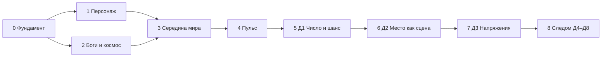

# Дорожная карта DM Cockpit

Рабочий план для нас самих — владельца и агента, не для показа. Срез 28.10.2026.

Как читать:
- Номера задач (Q, M, E) — из `TASKS.md`, там короткие критерии.
- Сущности — по `ENTITIES.md`.
- Направления после этапа 3 — `DESIGN.md` (28.10): этапы 4–6 пересобираются под выбранные владельцем.
- Здесь — порядок, шаги внутри задач, файлы, данные, события, тесты, риски и что нужно решить.

Проверка в действии за столом отложена (решение владельца 28.10). У каждого этапа записан сценарий, который проверим потом.

Размер работ — в **заходах**. Заход — одна рабочая сессия агента: задача доведена до зелёного `npm test` и `npm run check`, документы обновлены. Это порядок величины, не обещание.

---

## 1. Где мы сейчас

**Работает:**

| Область | Что есть |
|---|---|
| Стол | партия (корешки и портреты), карточки, бой с инициативой и состояниями, броски, журнал с нитями, шаг времени с предложениями мира, отмена, режим игроков, отдых, ресурсы |
| Персонаж | лист по макетам 27.10, экран создания из компендиума (раса, класс, point buy, навыки, заклинания, снаряжение), сравнение и сводка партии |
| Карта | тайлы Toril, уровни планеты, континента, региона и поселения, поход с днями пути и трудной местностью, туман знаний, глобус; справочник мест — 863 точки, 1057 карточек L3, поиск |
| Космос | планетарий Realmspace, течения флогистона, Великое колесо (1492 DR) и Великое древо (1372 DR) с карточками планов |
| Время | календарь Харптоса: циферблат, месяц, год, Selûne, праздники |
| Данные | SRD 5.1 целиком (334 монстра, 239 магических предметов, 319 заклинаний, снаряжение); Black Flag 360 и A5E 586 монстров; поход A5E; компендиум (38 рас, 13 классов, 172 черты) |
| Конвейер | дамп FR Wiki на внешнем диске; ночная разметка через llm-gateway (L1–L4); реестр локаций 11 478 |

- Событий 26 (`src/engine/events.ts`).
- Тестов 980.

**Узкие места:**

| Что | Почему мешает |
|---|---|
| Сессия за столом не сыграна (Q3) | всё после MVP строится без обратной связи со стола |
| Q1 не решён | секретность заметок и чисел монстров у игроков — открыта с 19.09 |
| Основной кусок бандла 5,6 МБ | `monsters.ts`, `spells.ts`, `magicItems.ts`, `compendium/index.ts` импортируют JSON напрямую: около 5 МБ данных в старте |
| Справочники разрознены | у каждого вида свой путь к тексту: `IconGrid`, тултип чипа, `PlaceInfo`, `PlaneInfo`, тела в `desk/bodies.tsx`. Связи — строками; упоминания журнала знают только актёров, места и фракции |
| Не закоммичено много | карта, космос, разметка, разрез стола, портреты, календарь |
| Полный `npm test` под нагрузкой | при работающей локальной LLM ловит таймауты 5 с; с `--maxWorkers=4` проходит |

---

## 2. Основы плана

Восемь правил, по которым принимаются решения внутри этапов. Первые два уже действуют, остальные — предложения этого плана.

**2.1. Мерило — три вопроса экрана.** Чей ход и что с партией, что вокруг, что изменилось в мире. Приоритет — мир вне боя (решение 21.09). Новая панель, которая не помогает ответить ни на один вопрос, — в «Шире» или в отказ.

**2.2. Справочник и состояние.** Справочник — `content/`, только чтение, у записи источник. Состояние — `State`, меняется только событиями и патчами предложений. Сущность мира бывает и тем и другим: запись справочника плюс изменяемая часть в состоянии. Например, организация — справочник, а известность партии у неё — состояние. Состояние хранит ссылку и разницу, не копию.

**2.3. Адресация `вид:id`.** У каждой сущности — ссылка-строка (виды — `ENTITIES.md`). Резолвер по ссылке даёт одно представление для карточки, поиска и связей. Все новые сущности заводятся через него.

**2.4. Год кампании — фильтр канона.** Кампания идёт в 1492 DR. Канон вики разложен по эпохам:
- поля богов по редакциям (5e — 1492, 3e — 1372);
- годы рождения и смерти у персонажей;
- основание и роспуск у организаций.

Год кампании задаётся в сиде (не событие) и выбирает, что показывать: какие NPC живы, какие организации есть, где дом бога. Линза Колесо/Древо — то же для космологии: по умолчанию она следует году кампании.

**2.5. Данные — кусками по требованию.** Каждый вид справочника — свой кусок, грузится при первом обращении. Образец — справочник мест (`src/map/gazetteer.ts`). Бюджет: основной кусок сначала ≤ 1,5 МБ, к этапу 3 — ≤ 500 КБ (Q18).

**2.6. Импорт из вики — по одному образцу.** Общий разбор инфобоксов — в `scripts/wikilib.py`, вынесенный из `import-spelljammer.py` и `import-planes.py`. Правила:
- поля — по редакции под год кампании, с отметкой редакции;
- источник — первая сноска поля;
- значения-ссылки — в ссылки `вид:id`, где цель есть, иначе текстом;
- непереведённое значение — ошибка импорта, как у планов.

Русский текст карточек — только из ночной разметки по фактам статьи.

**2.7. Ночная разметка — постоянный конвейер.**

| Слой | Что даёт |
|---|---|
| L3 | места |
| L4 | планы |
| L5 | боги (новый) |
| L6 | NPC (новый) |
| L7 | организации (новый) |

После каждого прогона — экспорт и импорт:
- `export-place-cards.py`;
- `import-planes.py`;
- новые импортёры.

Ограничения: одна модель в памяти, тяжёлое по одному, без описания — не сочинять.

**2.8. Контрольная точка этапа.** Этап закрывается:
- зелёными тестами;
- строками в HANDOFF §14;
- записанным сценарием проверки;
- коммитом по слову владельца.

Сыгранная сессия — не позже конца этапа 3.

---

## 3. Этапы коротко

| Этап | Суть | Заходов |
|---|---|---|
| 0 Фундамент | адресация, одна карточка, ленивые справочники, год кампании, Q1 | 6–8 |
| 1 Персонаж | вещи, уровень, концентрация из SRD, портрет | 6–8 |
| 2 Боги и космос | боги и пантеоны, уделы, бог на листе, святые дни | 5–7 |
| 3 Середина мира | организации, церкви, NPC, храмы, модель мира, известность, новое место | 8–10 |
| 4 Пульс | правила симуляции, вид F5 — закрыт 28.10 | 5 |
| 5 Д1 Число и шанс | математика d20, шансы в блоке и на листе, дерево вывода, концентрация — закрыт 29.10 | 5–6 |
| 6 Д2 Место как сцена | проекция сцены, вкладка «Сейчас», сцена дороги, слои опасности и погоды | 5 |
| 7 Д3 Напряжения | поиск, панель и пины, «Сделать нитью», слой влияния | 5 |
| 8 Следом | Д4 ветки, Д5 время, Д6 знание, Д7 слои правил, Д8 путь | 12–14 |
| Шире | по запросу | — |

Направления этапов 5–8 — из `DESIGN.md`; выбор владельца 28.10.2026: Д1 + Д2 + Д3. Сессия за столом исключена владельцем 28.10, проверка — сценарием этапа в браузере.

Этапы 1 и 2 идут параллельно после этапа 0. Они сходятся в шаге 2.4 — боге на листе.

---

## 4. Этап 0 · Фундамент

Цель: всё следующее строится на одной адресации, одной карточке и лёгком старте.

**Ход на 28.10 (вечер):**

| Шаг | Состояние |
|---|---|
| 0.1 | сделано: коммит `ac16baf` на `main`, без пуша |
| 0.2 | сделано |
| 0.3 | сделано для листа персонажа; чипы состояний, пины и узлы космоса — осталось |
| 0.4 | сделано для заклинаний; монстры и места уже ведут на свои карточки через актёров и места кампании |
| 0.5 | наполовину: основной кусок 5,6 → 2,98 МБ (библиотеки Black Flag и A5E, магические предметы, поход A5E — отдельно); осталось деление компендиума на ядро и тексты (≈1,15 МБ), фильтр «Добавить» по библиотеке и CR |
| 0.6 | сделано: год из времени мира, эпоха и линза по умолчанию |
| 0.7 | сделано: решение Q1 «по умолчанию агента», реализация Q2 |
| 0.8 | сделано: `maxWorkers: 4` |

### 0.1 Фиксация (владелец)

- Коммит и пуш накопленного.
- До этого проверю `.gitignore`: `maps/ocr`, `maps/llm`, `maps/world`, `maps/gis`, `maps/tiles` не в git; `content/maps/toril-cards.json` (580 КБ, CC BY-SA) — в git.
- Ветка — по слову владельца.

### 0.2 Адресация и резолвер — 2 захода

- Новый модуль `src/entities/`:
  - тип `EntityRef = \`${EntityKind}:${string}\``;
  - список видов;
  - `resolve(ref)` → `EntityView`: `{ ref, kind, name, nameRu?, source: { kind, cite, url?, license }, summary, sections, links: EntityRef[] }`.
- Справочные виды и откуда данные:

  | Вид | Источник |
  |---|---|
  | `condition`, `skill`, `ability`, `damage` | константы `src/rules/srd` |
  | `spell` | `content/srd/spells.json` |
  | `item` | снаряжение и магические предметы |
  | `monster` | SRD, BF, A5E — приставки id уже есть |
  | `race`, `subrace`, `class`, `subclass`, `feature`, `trait`, `feat`, `background` | компендиум |
  | `resource` | `resources.ts` |
  | `place` | справочник мест и реестр |
  | `plane` | Колесо и Древо |
  | `body`, `sphere` | Realmspace, флогистон |

- Виды состояния — `actor`, `location`, `faction`, `thread`. Резолвер берёт их из `State` и, если есть, подмешивает справочную запись по ссылке.
- Тесты (`src/entities/entities.test.ts`):
  - каждый вид резолвится на образце;
  - у каждой справочной записи есть `source`: правило «записи без источника не существует» — теперь тестом;
  - ссылки уникальны;
  - битая ссылка даёт видимую заглушку, а не пустоту.

### 0.3 Одна карточка — 2 захода

- `EntityCard` (`src/components/EntityCard.tsx`, типы уже есть) рисует любое `EntityView`. Тело по виду — зарегистрированная секция: `PlaneInfo`, `PlaceOverview`, `MonsterActions` и другие становятся телами по виду, а не отдельными путями.
- На странице — один вход `openEntity(ref)`, слот карточки или оверлей 720px по правилам F3.
- Переводим на него:
  - `IconGrid` (умения, черты, особенности, заклинания);
  - тултип чипа состояния — по щелчку;
  - пины и карточки мест;
  - узлы схем космоса.
- Тест стола: щелчок по заклинанию в листе, монстру в «Противниках», состоянию на чипе, месту в «Здесь» открывает одну карточку с источником.

### 0.4 Ссылки и упоминания — 1 заход

- `JournalPart` (`src/engine/journal.ts`): `entity` становится `EntityRef`.
- Новые упоминания:
  - монстр по `monsterId` у `ACTOR_SPAWNED`;
  - заклинание по `CONCENTRATION_STARTED`;
  - место по `PARTY_TRAVELED`.
- В текстах SRD ссылок не расставляем: текст дословный. Связи — только из структурных полей: у заклинания — классы, у монстра — состояния в иммунитетах.

### 0.5 Ленивые справочники — 2 захода

- Сначала замер состава основного куска: `vite build` с отчётом rollup, без новых зависимостей, если хватит встроенного.
- `monsters.ts`, `spells.ts`, `magicItems.ts`, `a5e/journey.ts` — на загрузчики по виду (`loadKind`) с кэшем. Синхронные константы (`MONSTERS` в `desk/bodies.tsx`) — через хук.
- Компендиум нужен при старте: сид собирает персонажей через `derive.ts`. Поэтому делим его на ядро для вывода листа (таблицы уровней, спасброски, кости) и тексты умений и черт отдельным куском. Если деление окажется хрупким — оставляем компендиум целиком и выносим всё остальное.
- Совмещаем с M15: список «Добавить» с фильтром по библиотеке и CR, итог встречи A5E — кнопкой «появился».
- Готово:
  - основной кусок ≤ 1,5 МБ;
  - стол рисуется до загрузки монстров;
  - тесты не знают о ленивости — загрузка в тестах синхронная через тот же кэш.

### 0.6 Год кампании — 0,5 захода

- Поле `year` в сиде кампании (`src/campaign/seed.ts`) — 1492.
- Функция `eraOf(year)`: 1492 → поля 5e, 1372 → 3e.
- Линза космологии по умолчанию — от года.
- Тест: смена года в сиде меняет линзу по умолчанию.

### 0.7 Q1 → Q2 (владелец, затем агент) — 1 заход после решения

### 0.8 Стабильный `npm test` — 0,25 захода

- Предлагаю `maxWorkers` в конфиге тестов: половина ядер, не больше 4.
- Полный прогон не должен зависеть от того, работает ли LLM.

**Сценарий этапа 0** (проверим потом):
1. Открыть стол — карта и партия видны сразу.
2. Щелчок по «Hunter's Mark» на карточке Bo, по Bandit Captain, по чипу «Отравлен», по Neverwinter в «Здесь» — каждый раз одна и та же карточка с источником.
3. В журнале «Bandit 4» после появления — ссылка на блок монстра.

---

## 5. Этап 1 · Персонаж до конца (снизу вверх)

Цель: персонаж живёт всю кампанию — вещи, уровни, правки, портрет.

### 1.1 Вещь как сущность (E7) — 2 захода

- Данные: снаряжение SRD (122) и магические предметы (239) через резолвер. На листе уже есть `equipment: {id, qty}`.
- Вкладка «Снаряжение» карточки:
  - список со ссылками на карточки предметов;
  - вес и грузоподъёмность по SRD (STR × 15);
  - деньги;
  - настройка — не больше трёх предметов, по SRD.
- **Нужно решение:** вещи, полученные и потерянные в сессии, — это события. Предлагаю три:
  - `ITEM_GAINED`;
  - `ITEM_LOST`;
  - `ATTUNEMENT_CHANGED`.

  Деньги — `ITEM_GAINED` с id монеты. До решения — только показ данных сида и редактора.
- Тесты:
  - вес и предел по SRD;
  - четвёртая настройка запрещена;
  - отмена каждого события.

### 1.2 Концентрация из листа и SRD (Q9) — 1 заход

*С 28.10 — в этапе 5 (5.5), вместе с шансом удержать концентрацию. Сделано 29.10.2026 — см. 5.5.*

- `ConcentrationForm` предлагает заклинания персонажа с концентрацией.
- Срок берётся из `duration` SRD: «Concentration, up to 1 minute» → 60 с.
- Свободный ввод остаётся для предметов и умений.
- Тест: Hunter's Mark → 1 час.

### 1.3 Повышение уровня и правка созданного (Q10) — 3 захода

- **Нужно решение по §7.** Предлагаю два события:
  - `CHARACTER_LEVELED` `{ actorId, level, hp, choices }` — хиты броском или средним, ASI или черта, подкласс, новые заклинания и умения;
  - `SHEET_EDITED` `{ actorId, patch }` — исправления листа вне механики, с причиной в журнале.
- Экран — тот же экран создания в режиме «повышение», над `draft.ts`.
- Q20, остаток: пробел в паспорте листа заполняется щелчком через `SHEET_EDITED`.
- Тесты:
  - реплей до и после;
  - `Ctrl+Z` возвращает уровень, хиты и ресурсы;
  - максимум ресурсов пересчитан из таблицы класса.

### 1.4 Портрет картинкой (Q12) — 1 заход

- **Нужно решение:** где лежит файл. Варианты:
  - `public/portraits/` в репо — просто, но картинки в git;
  - IndexedDB браузера — не в git, но не переживёт смену машины без файла сессии;
  - файл сессии с картинкой внутри — тяжелеет.

  Предлагаю каталог рядом с кампанией вне git и путь в листе.
- Портрет — в окне портретов, корешке и шапке карточки. Аватар расы остаётся запасным.
- Книжные иллюстрации не воспроизводим, свои картинки владельца — можно.

### 1.5 Групповая проверка из подвала партии (Q20) — 1 заход

Отмеченные персонажи бросают одну проверку; итог — в журнал одной записью с каскадом.

**Сценарий этапа 1:**
1. Создать жреца.
2. Выдать кольчугу и щит — вес и AC на карточке.
3. Поднять до 5-го уровня — новые ячейки на листе.
4. `Ctrl+Z` возвращает 4-й.
5. Концентрация — из его заклинаний.
6. Портрет в окне партии.

---

## 6. Этап 2 · Боги и космос (сверху вниз)

Цель: верх иерархии — боги, пантеоны, уделы — доходит до стола и до листа.

### 2.1 Импорт богов и пантеонов (E1) — 2 захода

*Сделано 28.10.2026 за один заход (HANDOFF §14). Отличия от плана: разбор не вынесен в `wikilib.py` — импорт берёт `clean`, `named_refs` и `refs_in` из `import-spelljammer.py`, как `import-planes.py`; пантеонов 65, а не около 20 (вики группирует и «Seelie Court», и «Nine trickster gods»); сила — строкой под именем; апофеоз и смерть — текстом.*

- `scripts/import-deities.py <dump>` → `content/cosmos/deities.json` (кусок по требованию). Разбор — общий из `scripts/wikilib.py` (вынести из `import-planes.py`).
- Поля по эпохе. Для 1492: 5eR → 5e → 4e → 3e → 2e → без редакции. Для 1372: 3e → 2e → без редакции. У значения — отметка редакции.
- Поля:
  - имя и титулы (первые три);
  - мировоззрение, символ;
  - сферы влияния (portfolio);
  - домены жреца (5e — к id подклассов компендиума, где совпадают);
  - почитатели;
  - пантеон;
  - кому служит и кто служит ему;
  - аспекты;
  - родной план и удел — к id планов Колеса и Древа, иначе текстом;
  - ранг: overgod, greater, intermediate, lesser, demigod;
  - смерть и апофеоз;
  - святые дни (текст для 2.5);
  - сноски — книга и страница.
- Пантеоны — из поля `pantheon` и категорий вики, около 20: Faerûnian, Mulhorandi, Untheric, Zakharan, Maztican, Draconic, Giant, Seldarine, Morndinsamman и другие.
- Тесты:
  - у каждого бога источник;
  - Lathander в 1492 — дом Elysium; в 1372 — другое значение по 3e (проверить импортом);
  - Ao — overgod без пантеона Faerûn;
  - служение без висячих ссылок либо со ссылкой-текстом.
- Риск: 418 карточек неоднородны (галереи в полях, `{{Former}}`, ` `). Против этого — `current()` и `clean()` из импорта планов и список исключений в скрипте с причинами.

### 2.2 Карточка бога и граф пантеона (E2) — 2 захода

*Сделано 28.10.2026 за один заход (HANDOFF §14): схема — общая для карточек (`EntityView.diagram`, `NeighborhoodGraph`), служение — с обеих сторон; домены ведут на подклассы жреца уже с E1. В компендиуме — матрица «Боги × пантеоны» с эпохой.*

- Тело карточки бога: титулы, мировоззрение, символ, сферы, домены (ссылки на подклассы), почитатели, дом и удел (ссылка на план), ранг, сноски.
- Граф — окрестность бога, а не весь пантеон (в Faerûnian около 100 богов): служит → бог → служат ему, плюс аспекты. SVG на `src/cosmos/svg.tsx`, Forum и Plex Mono по правилам кегля.
- Вход:
  - с карточки плана — «Боги плана» по линзе;
  - из поиска;
  - из листа (2.4).

### 2.3 Уделы на схемах (E3) — 1 заход

*Сделано 28.10.2026 (HANDOFF §14): число в узле, список в карточке плана свёрнут (у Arborea 53 удела), данные богов — по требованию.*

- У узла плана на Колесе и Древе — число богов с домом там.
- В карточке плана — список уделов и богов.
- Тест: на Древе у Arvandor — Corellon (по данным импорта).

### 2.4 Бог на листе (E8) — 1 заход

*Сделано 28.10.2026 (HANDOFF §14), кроме правки в идущей кампании — ждёт `SHEET_EDITED` (1.3). Домены — по полю 5e вики при любой эпохе: домен — механика 5e, а не история мира.*

- Поле `deityId` в листе. Редактор: шаг «Божество» — жрецу обязательно, фильтр по домену подкласса; остальным по желанию. Почитатели расы — подсказка: Seldarine для эльфов, Morndinsamman для дварфов.
- На карточке — символ и имя бога со ссылкой.
- Правка в кампании — через `SHEET_EDITED` (1.3).

### 2.5 Святые дни (E4) — 1 заход

*Сделано 28.10.2026 (HANDOFF §14). Правила разбирает импорт, а не код стола: в основной кусок едет только маленький `holy-days.json`. «Ближайший святой день его бога» из сценария ждёт E8 (`deityId` на листе) — пока ближайший среди богов Faerûn.*

- Разбор поля святых дней: праздники Харптоса (Greengrass, Midsummer…), даты «Marpenoth 15», «каждое полнолуние».
- Что не разобралось — остаётся текстом в карточке.
- Календарь: отметка на дне, в панели — «ближайший святой день». Пустые входящие («Мир спокоен») показывают ближайший праздник или святой день.

### 2.6 L5 — русские карточки богов (ночью)

Вступление статьи → карточка по фактам; формат — как L4.

**Сценарий этапа 2:**
1. Великое колесо → Elysium → Lathander → кому служит и кто служит ему.
2. На Древе — другой дом (1372).
3. Жрец с доменом Life выбирает из богов с Life.
4. В календаре ближайший святой день его бога.

---

## 7. Этап 3 · Середина мира

Цель: верх и низ встречаются в поселении — церковь, храм, жрец, организации, известность.

### 3.1 Импорт организаций — 2 захода

- `scripts/import-organizations.py` → `content/world/organizations.json`. Из `{{Organization}}` (415):
  - тип, база (ссылка на место), глава (ссылка на NPC);
  - союзники и враги (ссылки на организации);
  - бог (`favoreddeity`) — так организация становится **церковью**;
  - мировоззрение, расы, символ;
  - основание и роспуск — фильтр по году кампании;
  - сноски.
- Тест: Lords' Alliance есть в 1492; распущенные к 1492 — скрыты, но доступны поиском с отметкой.
- *Сделано 28.10.2026: карточек `{{Organization}}` в дампе 2 840, а не 415 — взяты все (`content/world/organizations.json`, 0,7 МБ, отдельным куском). Церковь — организация с богом, религиозная по типу или имени: 140 (у Harpers боги есть, но это не церковь). Глава сведена к NPC у 749, база — к месту карты у 1 701, союзники и враги — к организациям. В `{{Person}}` поля организаций нет — членство взято из категорий «Members of …» (5 283 NPC, `org-members.json`); категория не различает нынешних и бывших, в карточке NPC — «Состоял». Вид `organization`: карточка с годами «в 1492 DR есть / распущена / ещё не основана», союзниками, врагами и членами, живыми в год мира; NPC ссылается на свои организации. Списка и поиска организаций пока нет — «скрыты, но доступны поиском» ждёт общего поиска; связь фракции состояния с организацией — 3.3.*

### 3.2 Импорт NPC — 2 захода

- `scripts/import-people.py` → `content/world/people/*.json`, куски по области дома: Toril по регионам, Подземье, планы. Из `{{Person}}` (9 636):
  - раса, дом, бог-покровитель, род занятий, языки, титулы;
  - годы рождения и смерти — фильтр «жив в 1492»;
  - сноски.
- Компактно, без текста статьи. Текст — L6 ночью.
- Риск — объём. Решение — куски по области и индекс имён отдельно для поиска.
- *Сделано 28.10.2026 (E9): карточек `{{Person}}` в дампе оказалось 20 611 — взяты все. Куски — не по области, а по хэшу id (8 по ~0,5 МБ, вне основного бандла; первая карточка NPC грузит все восемь параллельно — по одному куску на id можно позже), а индекс «место → жители» (547 КБ, 13 080 NPC в 642 местах) — отдельно, только для карточки места у мастера. Языков нет — в карточках вики поле редкое. Связь с фракцией — после организаций (3.1). Поиска NPC по имени пока нет.*

### 3.3 Модель мира (Q6) — 3 захода

- `World.factions[id]` получает `ref?: EntityRef` на организацию. В состоянии только:
  - известность и влияние (уже есть);
  - отношения между фракциями (новое, число −3…+3).
- `World.locations[id]` получает `ref` на место справочника и цены по товарам (индекс %).
- Таблицы встреч с весами — справочник: A5E плюс свои по месту. Веса меняются только патчем.
- Новые виды `patch`:
  - отношение фракций;
  - цена товара;
  - вес встречи;
  - новое место (для 3.5).

  Каждый проверяется редьюсером и откатывается.
- Сид §13 дополняется по этой модели: Neverwinter, Triboar Trail, Zhentarim, Lords' Alliance, храмы.
- *Сделано 28.10.2026, до контрольной сессии — решение владельца («пока исключаем игровую сессию, продолжаем так»), предложения по пунктам приняты. `Faction.ref` (организация) и `relations` (симметрично, 0 не хранится), `Location.ref` (место справочника), `prices` по шести товарам — разделам таблиц снаряжения SRD (`GOODS`), `encounters` — множитель по имени («Werewolf ×2»). Патчи `relation`, `price`, `encounter`, `newLocation` (и обратный `removeLocation` — снимок для отката): `checkPatch` проверяет и числа (отношение — целое −3…+3, вес ≥ 0, товар из списка), `patchTargets` — кого пульсировать. Сид: ссылки у Neverwinter, Neverwinter Wood, Faerûn (Sword Coast North, Triboar Trail, Old Owl Well в справочнике нет — без ссылки), отношения по союзникам и врагам вики, Church of Lathander и Church of Helm фракциями, у «цен на оружие» и «ликантропов» — патчи. Стол: «Отношения» и «По вики» в карточке фракции, «Товары» и (мастеру) «Встречи» в карточке места; место с `ref` берёт карточку справочника по ссылке, а не по имени. Таблицы встреч остаются A5E — своих не выдумываю; срок «на 3 ночи» — словами. Не сделано: пантеон кампании для графа F5.*

### 3.4 Храмы и жрецы на карте (E5, E9) — 1 заход

- Значок «храм» справочника мест (эталоны `toril-icons.json`) → место с церковью: по базе организации или по имени места. Не нашлось — без связи, не угадываем.
- Карточка поселения: церкви и организации, NPC с домом здесь (живые в год кампании), ссылки.
- *Сделано 28.10.2026: значков храма на растре 68, но почти все без подписи или в Kara-Tur — привязка «ближайшее место» была бы угадыванием, её нет. Путь к церкви — через место: поле religion статьи о месте (213 мест с богами из справочника, `content/world/place-faiths.json`) и база организаций. Карточка места справочника: «Почитают» текстом поля, свёрнутые «Боги места», «Церкви» (с базой здесь и церкви одного бога из богов места — у Cult of the Dragon девять богов, это не церковь ни одного), «Организации в N DR», «Жители в N DR». На столе мастера карточка места кампании показывает те же группы из карточки справочника (блок «По вики»): Neverwinter — 9 богов, 12 церквей, 30 организаций, 362 жителя; храм → церковь → бог — щелчками. Не сделано: значки храмов на растре без связи; церковь как фракция состояния — 3.3.*

### 3.5 Новое место щелчком (M8) — 1 заход

- Щелчок по карте → форма: имя и класс из справочника под щелчком, иначе ввод.
- Дальше — `WORLD_DELTA_PROPOSED` с патчем «новое место» → «Принять» → место с `geo`. `Ctrl+Z` убирает.
- *Сделано 28.10.2026: инструмент «Место» на карте (только мастеру, не в бою). Щелчок по значку справочника — его имя, уровень по классу и ссылка `ref` на место справочника; мимо — точка и ввод имени. Уровни — ниже фокуса карты (у региона — и подрегион), от региона до здания. Предложение собирает чистая `newPlaceDelta` (`src/campaign/newPlace.ts`): id из имени, совпадение — с номером, причина — место-родитель. Пока предложение ждёт, на карте пин симуляции (никуда не ведёт); после «Принять» — место с `geo`, `Ctrl+Z` убирает.*

### 3.6 Известность партии (E10) — 0,5 захода

Известность у церквей и организаций — тем же патчем, что у фракций сида. Показ — в карточке организации и подвале партии.

*Сделано 28.10.2026: в карточке фракции мастеру — «Известность +1 / −1»: предложение во входящие (`renownDelta`), пока оно ждёт — кнопки недоступны. Карточка организации справочника: уже фракция кампании — «В кампании · известность партии N» со ссылкой; нет — «В кампанию фракцией» (`organizationFactionDelta`, патч `newFaction` и обратный `removeFaction`). Подвал партии — раздел «Известность» в доке сводки. Правило симуляции для известности не заводил: что партия сделала для фракции, решает мастер.*

### 3.7 L6 и L7 — русские карточки NPC и организаций (ночью)

### 3.8 Контрольная сессия (Q3 → Q4)

Одна сессия за столом на сиде §13 плюс то, что успели. Замечания — строками в очередь (Q4). Этап 4 начинается после разбора.

**Сценарий этапа 3:**
1. Neverwinter → храмы на карте → Church of Lathander → жрец-NPC → бог.
2. Lords' Alliance: известность партии +1 принятием предложения, `Ctrl+Z` возвращает.
3. Новое место щелчком.

---

## 8. Этап 4 · Пульс мира (шаг C)

Цель: мир движется сам и предлагает, мастер решает — экран F5. **Закрыт 28.10.2026:** 4.1 и 4.2 сделаны, слои карты (бывшая 4.3, M7) разошлись по направлениям Д2 и Д3 (6.4, 7.4).

### 4.1 Правила симуляции (Q7) — 3 захода

`src/campaign/simulation.ts`, каждое правило — чистая функция «состояние + отрезок времени → предложения»:

| Правило | Как работает |
|---|---|
| Цены | индекс товара по месту дрейфует от сезона, праздника, дорог (торговый путь перекрыт — растёт) |
| Отношения фракций | сдвиг от столкновений интересов в одном месте и от известности партии |
| Встречи | веса от фазы Selûne (ликантропы в полнолуние — как в сиде), сезона, опасности места |
| Святые дни и праздники | толпы, цены, активность церкви |

- У каждого предложения — `causeId` и патч. Мир правило не меняет.
- Детерминизм: случайность — из лога (предложение — событие со снимком).
- *Сделано 28.10.2026 (Q7): правила детерминированы — случайности нет, те же состояние и отрезок дают те же id. Числа — `SIM_RULES` в `simulation.ts` (правила стола, спецификация их не задаёт): цена еды и ночлега в поселениях — за сменой цели (сезон: зима +10, весна +5, лето 0, осень −5; день праздника Харптоса +10, толпы; на следующий день обратно); отношения раз в десятидневку — растущая фракция (тренд > 0) углубляет вражду со своими врагами на 1 до −3, партия с известностью от 5 у обеих сторон сближает тех, кто не выше 0; луна — ликантропы ×2 в Neverwinter Wood теперь патчем веса, через три ночи после полнолуния — предложение вернуть ×1. Не сделано: встречи от сезона и опасности места (нет основы, кого — таблицы A5E по уровню не про сезон), активность церкви в святые дни (у церкви нет числа, которое она двигает), «торговый путь перекрыт» — общий; цены каравана в Neverwinter остаются правилом сида.*

### 4.2 Вид F5 «Пульс» (Q8) — 2 захода

- Три десятидневки календаря (на `HarptosCalendar`).
- Графы фракций и пантеона (на графе 2.2).
- Индексы цен, веса встреч, «требует решения» справа.
- У игроков вида нет.
- Сверка с `reference/screens/F5-pulse.png`, блок «пульс» в тесте стола, адверсарный набор игроков.
- *Сделано 28.10.2026: вид «Пульс» (клавиша W, только мастеру) — `src/pages/desk/PulseView.tsx` над чистой проекцией `src/campaign/pulse.ts` (`pulseOf`). Календарь — три колонки по десять дней от сегодня: праздники, полнолуние и новолуние (день фазы, как в полосе часов), святые дни богов партии, смена сезона, остывание нитей. Граф фракций — `components/FactionGraph.tsx`: узлы по эллипсу (влияние с трендом, известность), рёбра — союз сплошной, соперничество пунктиром, вражда двойной, число на ребре; ждущее «→ −3» бирюзой. Цены — индекс 100 + надбавка места + товара, ▲/▼, ждущее «→ 120». Встречи — полосы множителя. «Требует решения» — входящие правой колонки, не повторяются. Вместо графа пантеона — «Боги партии» (кто молится, ближайший святой день): у богов в данных вики нет союзников и врагов, только служение. Адверсарный набор игроков — по-прежнему: вида у игроков нет, W не открывает.*

**Сценарий этапа 4:**
1. Шаг «Десятидневка» → предложения с причинами.
2. «Принять» → граф фракций меняется.
3. `Ctrl+Z` возвращает.
4. Полнолуние поднимает вес ликантропов.

---

## 9. Этап 5 · Д1 Число с выводом и шансом

Цель: любое число листа, блока и боя отвечает «откуда» и «какой шанс». Это разбор самой механики d20 (`DESIGN.md` Д1). Выбор владельца 28.10.2026: Д1 → Д2 → Д3.

### 5.1 Математика d20 — 1 заход

`src/rules/srd/odds.ts`, чистые функции, точные дроби:

| Функция | Правило SRD |
|---|---|
| шанс попадания: бонус против AC, обычно, с преимуществом, с помехой | d20 + бонус ≥ AC; «Rolling 1 or 20»: 20 попадает всегда, 1 промахивается всегда; преимущество — лучший из двух |
| шанс крита | 20 на кости (с преимуществом — хотя бы одна из двух) |
| шанс провала спасброска против DC | у спасброска 1 и 20 не автоматичны — правило только для атак |
| среднее строки костей «2d6 + 3» и урон крита | «Critical Hits»: кости урона бросаются дважды, модификатор один раз |
| ожидаемый урон атаки | промах 0, попадание — среднее, крит — среднее плюс кости |
| шанс удержать концентрацию | спасбросок Constitution против DC 10 или половины урона, что больше |

- Сопротивление и уязвимость — только при точном совпадении типа урона в блоке. Сложная строка («from nonmagical attacks») — пометка «смотри блок», без числа.
- Тест — таблица ручных значений: +4 против AC 15 = 50 %, с преимуществом 75 %, с помехой 25 %; среднее «1d6 + 2» = 5,5.
- *Сделано 28.10.2026: `src/rules/srd/odds.ts`, правила дословно (Open5e sections). Сопротивление — по точному распределению с округлением вниз.*

### 5.2 Шансы в блоке монстра — 1 заход

- Под атакой блока, только у мастера: строка по каждому из партии — «Aldric · AC 18 · 35 % · 2,4».
- Действие со спасброском: «DC 13 Dexterity» снимается из текста SRD регуляркой — шанс провала каждого.
- Линза «обычно · преимущество · помеха» — не событие, как фильтр.
- Мультиатаку не складываем: её состав — текст, разбирать его — значит сочинять.
- *Сделано 28.10.2026: `src/campaign/odds.ts`, `components/OddsTable.tsx`, вкладка «Действия»; добавочный урон «plus … damage» — из текста блока.*

### 5.3 Шансы на листе — 1 заход

- Атаки листа против противников на столе: в бою — участники, вне боя — выставленные. «Goblin · AC 15 · 55 % · 4,4».
- Заклинания со спасброском (текст SRD: «must succeed on a … saving throw»): DC листа против спасбросков блоков — кто провалит и с каким шансом.
- У игроков AC и спасбросков монстров нет (Q1), поэтому строк шанса у игроков нет.
- *Сделано 28.10.2026: секция «Шансы по противникам» в карточке персонажа, одинаковые блоки одной строкой. 29.10 партии сида дано стартовое снаряжение SRD (решение владельца): атаки и шансы видны сразу, лук Bo — с помехой (Heavy у Маленького); затем и заклинания SRD, у Aldric — домен Life.*

### 5.4 Дерево вывода — 2 захода

- `derive.ts` отдаёт не только число, но и шаги: AC, инициатива, бонус атаки, спасброски, навыки, пассивная Внимательность, DC и атака заклинаний, максимум хитов.
- Шаг — подпись, значение и строка SRD, откуда он.
- Щелчок по медальону или числу листа раскрывает вывод. `Esc` закрывает.
- Тест: сумма шагов равна числу — у всех листов сида и у созданных в редакторе.
- *Сделано 29.10.2026 за один заход (HANDOFF §14). Отличие от плана: шаги считает не `derive.ts`, а `campaign/explain.ts` над листом актёра — в логе лежит лист, а не PcSpec; правила те же (общие константы и `weaponAbility`), тест сверяет сумму шагов с числами `derive.ts` у партии сида и шести персонажей редактора (варвар, монах, драконий чародей, «Оборона», «Стрельба», компетентность). Щелчком раскрываются AC, ИНИЦ, PP и КХ (максимум хитов) — панель под полосой показателей; спасброски, навыки, атаки и Сл заклинаний — выводом в подсказке (щелчок по ним — бросок). Старый лист без Mage Armor не подгоняется: разница — шагом «не из правил листа».*

### 5.5 Концентрация из листа (Q9) — 0,5 захода

- Форма концентрации берёт заклинание с концентрацией из листа и срок SRD.
- Урон по концентрирующемуся — строка «удержит с шансом 65 %» (5.1).
- *Сделано 29.10.2026 (HANDOFF §14), вместе с 1.2 (Q9). Срок — из `duration` SRD («Up to 1 hour» → 3600 с; у всех 126 заклинаний с концентрацией разбирается, «1 раунд» и «2 ч» — своей кнопкой срока); срок от ячейки выше (Hunter's Mark 3-го круга — 8 ч) — не считаем, он в тексте SRD. Шанс — спасбросок CON листа или блока, только в попапе хитов мастера. У Lyra после урона 7: CON +2 против DC 10 — 65 %. Этап 5 закрыт.*

**Сценарий этапа 5:**
1. Goblin в бою: под Scimitar — шанс и средний урон по каждому из партии.
2. Линза «преимущество» меняет числа.
3. На листе Aldric — шанс по Goblin; щелчок по AC 18 → «доспех 16 + щит 2» со строками SRD.
4. Урон по концентрирующемуся → шанс удержать.

---

## 10. Этап 6 · Д2 Место как сцена

Цель: любое место в любой день уже чем-то наполнено, готовить не нужно (`DESIGN.md` Д2).

### 6.1 Проекция сцены — 1 заход

`src/campaign/scene.ts`: `sceneOf(state, место, секунда)` — чистая, все строки — ссылки `вид:id`:

| Секция | Из чего |
|---|---|
| Сейчас | день, сезон, луна, погода, праздник Харптоса |
| Вера | боги места, церкви и храмы, святые дни местных богов на десятидневку вперёд |
| Силы | организации места в год кампании, фракции кампании, их отношения между собой |
| Люди | жители, живые в год кампании; у кого есть организация — первыми |
| Рынок | индексы цен против базовых, ждущее рядом |
| Округа | веса встреч места, регион A5E и его таблица по уровню партии |
| Нити | открытые нити партии, где упомянуто место |

Пустая секция не показывается.

### 6.2 Вкладка «Сейчас» — 1 заход

- В карточке места и у пина карты.
- Игрокам — только открытое место и только открытое в нём: без встреч, без ждущего, без секретных заметок.

### 6.3 Сцена дороги (M14) — 2 захода

- На походе: регион A5E, занятия в пути с DC по уровню опасности, исходы дословно.
- Погода d20 по региону, припасы — ресурс партии, убывают по дням.
- Регионы дорог, поселений и Подземья (Open Roads, Country Shire / Urban Township, Underland Realm).

### 6.4 Слои карты: опасность и погода (часть M7) — 1 заход

- Опасность — веса встреч и регион A5E; погода — по региону и дню.
- Слой — линза, не событие. У игроков — только открытое.

**Сценарий этапа 6:** Neverwinter, 15 Mirtul 1492 DR → «Сейчас»: Selûne, погода, боги и ближайший святой день, организации и их вражды, цены, ликантропы в Neverwinter Wood. Шаг «Десятидневка» → сцена другая. Глазами игроков — только открытое.

---

## 11. Этап 7 · Д3 Напряжения

Цель: машина находит, где сталкиваются интересы, и показывает цепочку фактов; сюжет пишет мастер (`DESIGN.md` Д3).

### 7.1 Поиск напряжений — 2 захода

`src/campaign/tensions.ts`, чистая; у напряжения — вид, место, вес (сколько фактов держит) и факты ссылками:

| Вид | Из чего |
|---|---|
| враги в одном месте | две организации, обе с базой или местом здесь, враги по вики (в любую сторону), обе есть в год кампании |
| двойная верность | NPC, живой в год кампании, — член двух враждующих организаций (по категориям вики, без дат членства — так и подписано) |
| соперничество вер | в месте церкви двух богов, и церкви — враги по вики |
| сила растёт | фракция кампании растёт, а партия известна её врагу (отношение ≤ −2, известность от 5) |

- Считается в куске справочника мира, не в старте.
- Вражды богов нет: в карточках вики её нет.

### 7.2 Где видно — 1 заход

- Панель «Напряжения» в «Пульсе», порядок — по весу.
- Секция «Напряжения» в сцене места (6.1).
- Значок на пине карты, только у мастера.

### 7.3 «Сделать нитью» — 1 заход

- Новый вид патча `newThread`: предложение во входящие, `causeId` на факты напряжения.
- «Принять» → нить в журнале; `Ctrl+Z` убирает.

### 7.4 Слой карты: влияние и напряжения (остаток M7) — 1 заход

- Зоны влияния фракций кампании вокруг их мест, напряжения значками.

**Сценарий этапа 7:** «Пульс» → «Напряжения»: Neverwinter — Zhentarim и Harpers враги, обе здесь, факты ссылками. «Сделать нитью» → входящие → «Принять» → нить в журнале с причиной. `Ctrl+Z` возвращает.

---

## 12. Этап 8 · Следом

Порядок — после этапа 7, по слову владельца. Объём и данные — `DESIGN.md`.

| Направление | Что входит | Заходов | Нужно |
|---|---|---|---|
| Д4 Ветки «что если» | ветка лога в памяти, три десятидневки вперёд, разница «две колонки» | 3 | — |
| Д5 Время как ось | ползунок года в карточке, переход времени к выбранному дню (бывшая 5.2: те же предложения, что у шагов «День»), хроника по дням (бывшая 5.4), просмотр стола на прошлый день | 2–3 | решение по Shieldmeet: високосный день после Midsummer, 1492 — такой год; предлагаю вести |
| Д6 Знание как ресурс | `FACT_REVEALED`, тетрадь игроков, «Проверка знаний» по таблице типичных DC SRD | 3 | новое событие |
| Д7 Правила как слои | манифест источников кампании, расхождения таблиц владельца с SRD, метка слоя в выводе 5.4 | 2 | — |
| Д8 Персонаж как путь | 20 уровней дорогой, пробелы партии по уровням, «что даст» (ASI или черта) | 2 + Q10 | события Q10 |

---

## 13. Шире (по запросу)

| # | Что |
|---|---|
| M10 | планы городов и зданий — свои растры поселений тем же конвейером тайлов |
| M13 | места растра без GIS — класс правилами и L1 |
| M11 | вторая кампания, Planetos — паспорт, тайлы, свой сид; проверка, что ничего не завязано на Toril |
| Q17 | мост к MapTool — когда стол в нём понадобится |
| Q13 | логово и легендарные действия на полосе инициативы |
| Q15 | вордмарк (владелец) |

---

## 14. Параллельно всем этапам

**Данные владельца:**
- Q14 — правки таблиц;
- Q19 — обогащение для экрана создания.

Не блокируют, но каждая правка таблиц — повторный `import-compendium.py` и прогон тестов.

**Ночная разметка:**
- порядок L3/L4 → L5 → L6/L7;
- после прогона — экспорт и импорт (2.7).

**Источники:** новый источник сначала идёт в `SOURCES.md`. Книги и PDF без лицензии не берём (DND.7z — только стол владельца).

**Техдолг:**
- раздел «Мир» `DeskPage` (около 35 пропсов) — вынести, когда в него придёт модель мира (3.3);
- дубли путей карточек уходят в 0.3.

**Документы:**
- закрытое — в HANDOFF §14;
- новые сущности — в `ENTITIES.md`;
- этот файл — при смене порядка.

---

## 15. Решения владельца

| Когда | Решение | Что предлагаю |
|---|---|---|
| сейчас | коммит и пуш накопленного | одним коммитом по областям или несколькими — как удобнее |
| этап 0 | Q1: видимость заметок и чисел монстров игрокам | заметка по умолчанию секретна, флаг «показать игрокам»; у монстра игроки видят состояние словами («ранен»), без чисел |
| этап 0 | `maxWorkers` в конфиге тестов | да, не больше 4 |
| этап 1 | события вещей (`ITEM_GAINED`, `ITEM_LOST`, `ATTUNEMENT_CHANGED`) | да |
| этап 1 | `CHARACTER_LEVELED` и `SHEET_EDITED` (Q10) | да, правка — с причиной в журнале |
| этап 1 | где лежат портреты | каталог кампании вне git, путь в листе |
| этап 1 | русские имена заклинаний; черта человека; черта вместо ASI | висят с прошлых сессий |
| этап 3 | когда играем контрольную сессию | **28.10 владелец: пока исключаем** — этапы идут без неё; Q6 (3.3) сделан до сессии |
| этап 8 (Д5) | Shieldmeet | вести: год 1492 его год |
| 28.10 | направления после этапа 3 | **выбрано Д1 + Д2 + Д3** (`DESIGN.md`) — этапы 5–7 |
| любое | удалить `~/cockpit-editor` | — |

---

## 16. Риски

| Риск | Чем грозит | Что делаем |
|---|---|---|
| Работа без стола | строим не то, что нужно мастеру | контрольная сессия не позже этапа 3, сценарии записываем на каждом этапе |
| Объём справочников | бандл и память браузера | куски по требованию (0.5), NPC по областям (3.2), бюджеты кусков в тестах сборки |
| Неоднородность вики | импорт ломается на краях | общий разбор, исключения в скрипте с причинами, ошибка вместо тихого пропуска |
| LM Studio нестабильна | ночная разметка встаёт | защита от серий ошибок уже есть (`MAX_FAILS`); перезапуск — руками владельца; 16 ГБ — одна модель |
| Лицензии | нельзя показывать вовне то, что взяли | у каждой записи источник и лицензия, CC BY-SA — с авторством; книги не берём |
| Незакоммиченная работа | потеря при сбое | коммит в 0.1 и на каждой контрольной точке |
