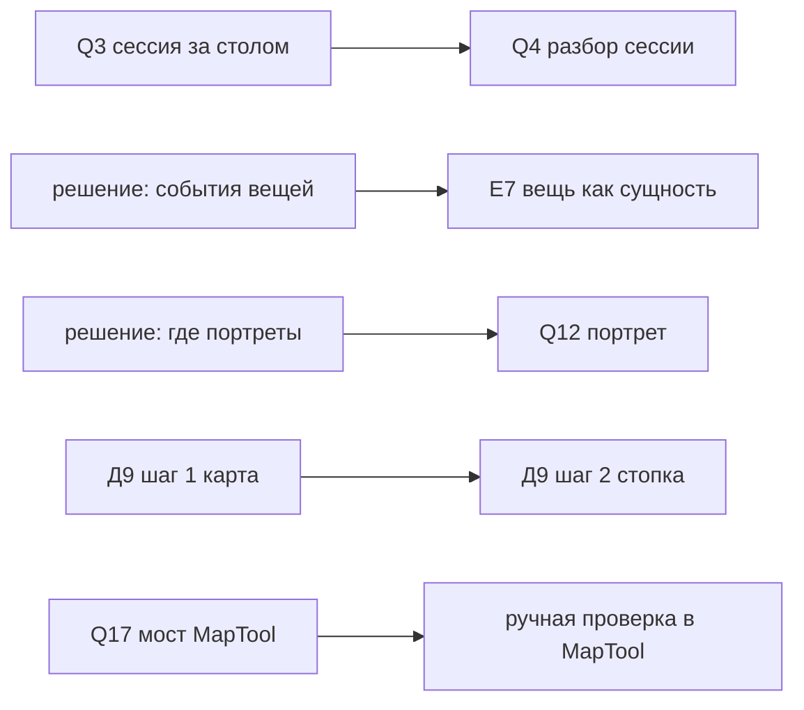

# Очередь работ DM Cockpit

Срез 30.10.2026 по рабочей копии (последний коммит `042a657`, многое не закоммичено — ROADMAP §1) и HANDOFF §11, §14, §15. Порядок — сверху вниз; задача берётся, когда закрыто всё, от чего она зависит. Закрытая задача переносится в HANDOFF §14 с датой и удаляется отсюда.

Кто: **В** — владелец (решение, данные, игра), **А** — агент (код).

Порядок крупными этапами и основы плана — `ROADMAP.md` (порядок — 28.10.2026, состояние — 30.10.2026). Снятые 30.10 закрытые строки — HANDOFF §14, «Разбор очереди 30.10.2026».

## Сейчас

| # | Задача | Кто | Зависит | Готово, когда |
|---|---|---|---|---|
| Q3 | **Отложено 28.10 владельцем** («пока исключаем игровую сессию»): работы этапов 3–4 идут без неё. Сыграть одну полную сессию за реальным столом — ворота §11 («вне MVP не начинается, пока MVP не сыгран») | В | — | файл сессии сохранён («Сохранить» → `dm-cockpit-<дата>.json`), замечания записаны списком |
| Q4 | Разбор сессии: каждое замечание — строка в этой очереди или отказ с причиной | В + А | Q3 | список замечаний пуст |

## Иерархия сущностей (28.10, `ENTITIES.md`)

Два фронта навстречу: сверху (космос → боги) и снизу (атомы правил → персонаж), встреча — церковь, храм, жрец. Карта сущностей, источники и связи — `ENTITIES.md`.

| # | Задача | Кто | Зависит | Готово, когда |
|---|---|---|---|---|
| E7 | Вещь как сущность: карточка, инвентарь на листе, настройка (ROADMAP 1.1) | В → А | решение по событиям `ITEM_GAINED`, `ITEM_LOST`, `ATTUNEMENT_CHANGED` (ROADMAP §15) | вещь на листе открывает карточку с текстом SRD |
| К | Держава — вид `kingdom:` (решение пользователя 30.10, `ENTITIES.md` E11). **Сделано 30.10:** карточка (столица, правитель на год, правление, народ, вера, торговля, вехи до года, связи группами), компендиум «Державы» с линзой года 1492 / 1479 / 1372, история державы из обоих слоёв хронологии; правитель без дат — только в срезе 1492 DR (решение пользователя). Щелчок по подписи державы на схеме карты открывает её карточку (30.10, по `kingdom.label` — 117 держав; подпись под значком места уступает щелчок значку). «В кампанию фракцией» у державы (30.10) — тем же путём, что у организации: предложение `newFaction` со ссылкой `kingdom:`, после «Принять» держава в «Державах» стола, её карточка показывает «В кампании» и известность. Осталось: «Родом из» на листе персонажа | А | — | на листе персонажа «Родом из» ссылкой на державу |

## Симуляция мира (`SIMULATION.md`, просьба пользователя 30.10)

| # | Задача | Кто | Зависит | Готово, когда |
|---|---|---|---|---|
| С | Процессы мира на всех масштабах: войны, торговля, отношения городов, голод и восстания, Blood War. **С1 (ядро) сделано 30.10:** `campaign/processes.ts`, `campaign/rng.ts`, патчи `process` / `removeProcess` / `batch`, «Сводка мира» в сводке шага. **С2 (граф мира) сделано 30.10:** `scripts/graph-from-grids.py` → `maps/tiles/toril/graph.json` (820 поселений, рёбра по дорогам 395, по воде 603, напрямик 880; 747 мест в одном куске), `world/graph.ts` (путь по цене идущего), `kingdomsOfPlace`, `campaign/worldGraph.ts` (место справочника в кампанию патчем). Дальше: С3 торговля → С4 война держав → С5 города и внутренние → С6 космос и планета → С7 где видно → С8 слухи. Виды процессов — отдельным куском: основной — 499 из 500 КБ | А | С2 — для С3 и С4 | караван из Waterdeep в Neverwinter идёт по дорогам днями и меняет цены на обоих концах; война Luskan с Neverwinter — сводкой, если партия далеко |

| L8 | Ночная разметка держав для симуляции (задание 30.10): из полного текста статей 442 держав (дамп вики на внешнем диске, не выжимка — в ней нет военных разделов) — предложения с числом и словом войска (army, troops, soldiers, warriors, knights, legion, militia, guard, fleet, ships, warships); модель — пары «кто — сколько — чего (войско, флот, стража) — на какой год»; число обязано стоять в тексте (`number_in`, как у L2), иначе review; итог `maps/llm/L8.jsonl` со ссылкой и лицензией CC BY-SA. Население и торговлю модель не трогает: население — правилом из поля карточки («1,347,680 in 1372 DR; up to 2,000,000…» — число и год читаются без модели), экспорт и импорт — после решения о товарах торговли | А | решение о товарах торговли (С3): `GOODS` — шесть товаров снаряжения искателей приключений, «silk, wine, fish» в них не ложатся | у Cormyr есть Purple Dragons числом с цитатой; ни одного числа, которого нет в тексте |
| L9 | Ночная разметка вида событий слоя летописей (задание 30.10): `ChronoKind` для 1 581 события `content/chronology/articles/`; сначала правила по виду источника (карточка Conflict → conflicts, Event → по слову), модель — закрытым списком, как L1 через `/v1/classify`. Закрывает решение о виде раздела слоя летописей (ROADMAP §15) | А | — | у каждого события слоя вид; вид «Хроника» показывает слой с фильтром по виду |

## Механики за столом (И6, `research/game-mechanics.md`; решения пользователя 30.10.2026 — по рекомендациям)

Все механики — открытые правила дословно, своё помечено «правило стола».

| # | Что | Кто | Зависит | Готово, когда |
|---|---|---|---|---|
| Д10 | Промежуток между сессиями: период — десятидневка, внутри 5 рабочих дней (A5E downtime); долгий перерыв — месяц, сезон, год — свёрткой дословно по A5E; «развеяться» снимает стресс Д11 — в укрытии, раз за период (правило стола) | А | Д7 (слой отдыха A5E) | десятидневка промежутка — одна запись журнала с исходами занятий по A5E |
| Д11 | Стресс A5E Strife: второе состояние с уровнями 1–7 рядом с истощением SRD, тем же `CONDITION_ADDED` с уровнем и `source: a5e`; последствия — таблица Mental Stress Effects A5E. Предлагается, только если тема «стресс, безумие, ужас» включена (переключатель — с С8) | А | С8 (переключатель тем) | Strife 3 на листе с эффектом из таблицы A5E; тема выключена — не предлагается |
| Д12 | Отношение NPC к партии: всем NPC — три отношения SRD 5.2.1 (Influence, провал — 24 часа до повтора); спутникам — счёт PF1 Relationships (OGL), подарок — раз в десятидневку (правило стола); фракции — поле `standing` −3…+3 рядом с известностью | А | — | отношение NPC меняется проверкой Influence и видно на карточке |
| Д13 | Голоса навыков (идея Disco Elysium на пассивных проверках SRD): строка только мастеру «кто из партии знает то, что на экране», раскрытие — прежнее `KNOWLEDGE_REVEALED`, новых событий нет; пометка «красная проверка — один раз» — после проверки за столом (Q3) **Сделано 30.10:** строка «Знают без броска» на карточке сущности мира у мастера (`SkillVoices`, `passiveVoices` в `campaign/knowledge.ts`: 10 + модификатор против Сл знаний; никто — лучший и разрыв), кнопка «пассивно» в форме «Узнать» ставит итог без броска; Проницательность против Обмана NPC и Восприятие — следующим шагом | А | — | на карточке места или NPC мастер видит, кто из партии знает факт пассивно |
| Д14 | Слава A5E Prestige: второе число у фракции рядом с известностью (E10), центр славы — место кампании; проверка `d20 + Prestige` против `12 + 2 × ступень региона` (`content/a5e/journey.json`) — вход слухов С8 «вас узнали» | А | С8 | в чужом регионе стол предлагает «вас узнали» по проверке Prestige |
| Д15 | Часы — форма показа процессов и нитей (С7, ПР8; Blades, CC BY 3.0): нить без внимания десятидневку сдвигается на деление — предложением во входящих, не фактом; фронты Dungeon World — как образец «что случится, если партия не вмешается» | А | С7 | у нити и процесса видны часы; тик приходит мастеру предложением |

Решено там же: розыск городов (жар Blades) — вместе с С5; стресс, безумие и ужас — тема кампании, выключатель вместе с С8, как работорговля; ORC (открытый Pendragon, BRP) пока не берём — страсти и черты NPC только идеей и правилом стола; оракул Ironsworn — первый источник для П11.

## Хронология канона (ROADMAP Х)

| # | Задача | Кто | Зависит | Готово, когда |
|---|---|---|---|---|
| Х | Хронология канона (ядро Д5, идея владельца 29.10): **Х1–Х3 сделаны 29.10** — 6837 событий статей-годов вики, 8 эпох, слепок мира на год и выгрузка JSON (`src/world/chronology.ts`), вид «Хроника» (H) с линзой года для карточек и карты. 30.10 — данные сверх статей-годов: слой `content/chronology/articles/` (1 581 событие из летописей, разделов History держав, карточек Conflict и Event; `scripts/import-chronology-articles.py`), ссылки `kingdom:` в событиях (1 640, только там, где ссылка раньше не разрешалась) и державы `content/world/kingdoms.json` (442, `scripts/import-kingdoms.py`); в вид «Хроника» слой ещё не подключён (читает только история державы). Осталось: одна ось с журналом кампании (Х4: стол прошлого дня и выгрузка уже есть — Д5, Х3) и решение о виде раздела для слоя летописей | А | — | выбор 1479 DR даёт события года по датам, места на карте и статусы NPC; «Выгрузить» — JSON слепка |

## Хвосты сделанного — брать, когда понадобится за столом

Задачи закрыты (HANDOFF §14), но в каждой осталась часть — она здесь, чтобы не потерялась.

| # | Что осталось | Кто | Зависит | Готово, когда |
|---|---|---|---|---|
| Q7 | Правила симуляции: встречи от сезона и опасности, активность церкви в святые дни | А | — | предложение с `causeId` от сезона и от святого дня |
| Q8 | «Пульс»: граф пантеона кампании — в карточках вики нет отношений богов | А | данные | граф пантеона в «Пульсе» |
| Q20 | Групповая проверка из подвала партии одним броском за всех отмеченных (ROADMAP 1.5) | А | — | «Скрытность группой» пишет броски выбранных одной записью журнала |
| Д8 | Повышение уровня: черта вместо увеличения и новые заклинания — нужен редактор в режиме «повышение»; Изобретатель не повышается — нет кости хитов SRD | А | — | повышение предлагает черту и заклинания |
| Д7 | «Смена слоя — предложение»: первый второй слой — отдых A5E с укрытием (haven) рядом с SRD, переключатель кампании, по умолчанию SRD; признак «укрытие» — у места (решение пользователя 30.10, И6) | А | — | переключатель слоя отдыха меняет восстановление по A5E; по умолчанию — SRD |
| M12 | Карточки мест со статусом review — после разбора глазами | В | — | — |
| M10 | Здания с координатами плана Neverwinter — ни одного | В → А | данные | здание на плане открывает карточку |
| Q13 | Логово на полосе инициативы — ни у одного блока SRD, Black Flag и A5E нет lair actions | А | данные | слот логова с первой библиотекой, где они есть |

## Пробелы листа

| # | Задача | Кто | Зависит | Готово, когда |
|---|---|---|---|---|
| Q12 | Портрет картинкой: поле листа и файл (ROADMAP 1.4) | В → А | решение, где лежат файлы (предложение — каталог кампании вне git) | портрет в корешке карты, окне партии и редакторе |

## Карта мира — направление 1 (владелец, 27.10)

Сделано 27.10: тайлы Toril, карта на уровнях планеты, континента, региона и поселения, пины мест, знак партии, гексы по шесть миль, линейка с днями пути по SRD; поход по карте (`PARTY_TRAVELED`, с галочкой трудной местности), факты на пинах, туман знаний (`PLACE_REVEALED`), глобус планеты по маске — бывшие M3–M6 (HANDOFF §7, §14 шаг 11). Дальше — по порядку полезности за столом.

Сделано 27.10 (ночь), иконки листа персонажа (решение владельца): набор вырос до 183 — `ab-*` характеристики, `cls-*` 13 классов, `race-*` 38 рас, `school-*` 8 школ, `kind-*` 13 видов умений; умения класса, особенности расы, черты и заклинания на карточке — рядом иконок (`IconGrid`): наведение — имя, щелчок — текст, Esc закрывает; раса и класс — иконками в шапке, характеристики — иконкой у кода. Подбор вида — `src/components/sheetIcons.ts` (вид особенности из таблицы, эффекты черты, ключевые слова умения); у умений классов «прочее» 16 % — в основном строки списков заклинаний подклассов без текста.

Сделано 27.10 (вечер), по шагам «материалы для разметки»: Toril GIS (Geospatial Grimoire, фан-контент, авторов указываем) скачан в `maps/gis/` (не в git); его координаты к растру HandsomeRob напрямую не ложатся (основа — карты 2e, расхождение ~30–50 px), поэтому справочник мест `content/maps/toril-places.json` (863 места, 753 по значку, точность 0–3 px на 22 опорных) снят с самого растра: Vision читает подписи, рядом ищется значок, GIS даёт имя, класс и русское имя (`scripts/gazetteer-from-map.py`, `scripts/ocr-labels.swift`); калибровка миль уточнена до 0,37 по маршруту Waterdeep → Baldur's Gate из официальной серии D&D Beyond (бывшая M1); местность по цвету растра (`scripts/terrain-from-map.py` → `maps/tiles/toril/terrain.png`), линейка и поход сами считают мили по лесу, болоту, горам и льду (бывшая M9).

Сделано 27.10 (ночь), визуальная разметка V1, V3, V4: снимок подписей `scripts/map_ocr.py` → `maps/ocr/toril-labels.json` (не в git; Vision по всему растру — 2 минуты один раз, справочник из снимка — 30 секунд, результат тот же до пикселя): 7564 строки Vision, 4939 подписей без дублей, многострочные склеены (`rows`), у каждой цвет букв, кегль, капитель, разрядка; имена стран и морей вразрядку (CORMYR, CALIMSHAN, THE SHINING SEA), которые Vision на карте не читает, собираются по цвету букв в полоску — 93 имени; значки по эталонам `content/maps/toril-icons.json` (столица, город, крепость, руины, храм, шахта, вершина, источник, постройка) — 633, проверено глазами по 12 на вид. Справочник берёт значок по эталону, где белого кружка нет: 45 мест перешли с подписи на значок, Candlekeep — на свой (опорная точка 0–3 px). Не сделано: V2 (наклонные подписи), V5 (имена областей местности), многословные имена вразрядку лежат по словам. V6 (дороги) — сделано 29.10 (ROADMAP 6.3): пунктир растра по цвету, `scripts/roads-from-map.py`.

Реестр карты (27.10, ночь): `scripts/map-registry.py` → `maps/ocr/toril-registry.json` / `.md`, 7034 записи. Точки GIS 1343: в справочнике 863, OCR прочёл иначе 157 (значок прилип, опечатки OCR и самого GIS — Tezilr/Teziir; нестрогое сравнение в справочнике вернёт большую часть), подпись далеко от подсказки 50 (Chult, мало опорных), не найдено 201, Подземье 70. Области GIS 506: подпись найдена 128, прочитана иначе 82, не найдено 255 (чёрный курсив вразрядку — Calim Desert — и наклонные подписи гор: расширить проход букв на тёмный цвет, V2). Подписей только на растре 3063 (+326 обрывков) — вход L1; значков без подписи 1796, из них 1130 «город» — проверить детектор кружков. Итоги ночной разметки реестр подтягивает из `maps/llm/*.jsonl` по id записи.

Сделано 27.10 (поздний вечер), по списку владельца «делай по порядку» после реестра ресурсов (`SOURCES.md`): весь SRD 5.1 в данных — 334 блока монстров (было 45; четыре расхождения API с печатным SRD исправлены в FIXES импортёра) и 239 магических предметов (`content/srd/magic-items.json`, `src/rules/srd/magicItems.ts`); поход по A5E SRD (CC BY 4.0) поверх темпа SRD — `content/a5e/journey.json`, `src/rules/a5e/journey.ts`: путь по карте режется на регионы A5E по классам местности (лес — Tangled Forest, горы — Lofty Mountains…), у региона DC занятий по уровню опасности (по умолчанию — ступень партии), в панели похода — регионы пути, припасы на путь и кнопка «встреча» (d100 по таблице региона → бросок и строка журнала). Монстры для разнообразия встреч: Black Flag SRD (360) и A5E Monstrous Menagerie (586), обе CC BY 4.0, через Open5e — в списке «Добавить» с подписью библиотеки, бонусные и легендарные действия на карточке (у драконов SRD легендарные тоже появились). Источники под OGL не брали — первых трёх хватает. Реестр локаций мира — `scripts/world-registry.py` → `maps/world/` (11 478 записей: вики + GIS по лестнице масштабов).

Сделано 28.10: уровни лестницы выше планеты получили свои виды. «Звёздная система» Realmspace — планетарий (F4.3): солнце, восемь планет по порядку от солнца, Selûne и Tears у Toril, цвет — стихия тела, ползунок дней вперёд, ближайшее сближение выбранной планеты, у тела — книга и страница; «Спуститься: Toril» ведёт на глобус. «План» — схема течений флогистона (F4.2): треугольник Realmspace ↔ Greyspace → Krynnspace → Realmspace (53 дня), Arcane Inner Flow (Refuge 7 дней, Pirtelspace, Darnannon), Moragspace, Winterspace, Shadowspace, Clusterspace, Vodoni Empire; рёбра различаются рисунком линии. Всё — из FR Wiki с цитатами и книгами (`scripts/import-spelljammer.py` → `content/cosmos/`); углы орбит на день 0 и раскладка схемы — свои, карта Nerik — только сверка.

Сделано 28.10 (вечер), уровень «космология» — Великое колесо (HANDOFF §3: «граф планов кольцом по мировоззрению»): 16 внешних планов на кольце по их сетке мировоззрения из вики (закон слева, хаос справа, добро сверху, зло снизу), Outlands и Sigil в середине, спицы — 16 городов-врат по статье Gate-town (их порядок по часовой стрелке совпадает с порядком по мировоззрению — тест), Материальный с Ethereal, стихиями, энергией и отражениями, Astral к кольцу; карточка плана (вид, мировоззрение, форма, гравитация, время, изменчивость, стихии, магия, слои, город-врата, книга) — и на уровне «план» над схемой течений. Данные — `scripts/import-planes.py` → `content/cosmos/great-wheel.json`. Попутно: подписи всех трёх видов космоса были набраны Press Start 2P (только вордмарк по CLAUDE.md) — теперь Forum и Plex Mono, кегль под ~13 px на экране. Осталось: русские карточки планов L4 подтянуть повторным импортом, когда ночная разметка их сделает; реки Styx и Oceanus — с цитатами, если понадобятся. Тем же вечером — Великое древо (World Tree, 1372 DR) вторым видом уровня «космология», переключатель «Колесо / Древо»: небесные планы на самом Древе (корни, ствол, ветви, вершина — по статье), дьявольские по River of Blood в порядке течения, нейтральные — только на ветвях Astral, Cynosure и Fugue Plane вне Древа, корни — стихийные и энергетические планы; 22 портала с цитатами, у выбранного плана — на схеме и в карточке.

| # | Задача | Кто | Зависит | Готово, когда |
|---|---|---|---|---|
| M13 | Места растра, которых нет в GIS: 3579 подписей (1421 со значком) лежат в `maps/ocr/toril-rest.json` с цветом, кеглем, значком и местностью — класс правилами и локальной LLM (llm-gateway), ночной прогон L1 | А | — | у подписей из `toril-rest.json` есть класс; справочник покрывает Selgaunt, Teziir, Ordulin |
| M16 | Глобус → схема → карта (задумка владельца 29.10.2026). Глобус Toril приближается колесом до масштаба региона; стартовый вид — не растр, а векторная схема: регионы местности полигонами, дороги линиями, места точками; настоящая карта — отдельной кнопкой, как режимы Google Maps. Порядок: (1) схема на плоской карте и переключатель «Схема / Карта»; (2) колесо на глобусе; (3) переход глобус → плоская карта без скачка на пороге масштаба. **Сделаны все три 29.10** (ROADMAP M16): `scripts/schema-from-grids.py` → `schema.json` рядом с тайлами (суша, 7 классов кольцами, дороги линиями; 0,9 МБ, секунды), режим «Схема» по умолчанию, «Карта» — растр; колесо на глобусе приближает к точке до разрешения маски, дальше — плоская карта той же точкой и тем же градусом на экране, отдаление с целой карты — обратно на глобус. **Вторая половина 30.10:** подписи на схеме — державы и области (56 полигонов Toril GIS + 11 держав подписью растра из карточек), континенты, моря, леса и горы, 863 места справочника и 250 поселений подписью растра: `scripts/labels-from-gis.py` → `content/maps/toril-labels.json` (1 560 подписей, 57 КБ, отдельный кусок), отбор по масштабу и значимости без наложений (`map/schemaLabels.ts`; пины, партия и панели заняты — по DOM); легенда схемы под панелью карты справа, сворачивается, при слоях «Опасность» и «Погода» прячется; дороги без разрывов — перемычки пунктира в `roads-from-map.py` (клеток 36 377 → 46 001, 2 833 перемычки) и скелет без ступенек в `schema-from-grids.py` (линий 2 397 → 3 692): High Road Luskan → Neverwinter → Leilon → Waterdeep и Long Road — сплошные; глобус на последних двух шагах колеса и на пределе рисует ту же схему с подписями (`map/globeSchema.ts`). Не сделано: реки; Triboar Trail на растре HandsomeRob не нарисован (только отросток к западу от Triboar) — линии нет и не выдумана; переход «клетки → схема» на глобусе — сменой картинки между шагами 1,2 и 1,44; масштаб глобуса и карты совпадает только по долготе у центра (вдали от центра орфография сжимает). **Перепроверка 30.10 (вечер), замер против растра** (скрипты замера — scratchpad агента, не в репо): берег схемы → растр медиана 4 → 2 px, p95 12 → 4; берег растра → схема медиана 8 → 2, p95 122 (предел замера) → 4, дальше 20 px — 24 % → 0,4 % точек; острова 16×16…50×50 px — 44 → 561 из 561, 50…158 px — 137 → 187 из 187; озёра 16…50 px — 1 → 197 из 199 (суша — по воде тайлов z6 клеткой 4 px, а не сетка 8 px с большинством вместе с водой); реки сделаны — по цвету воды z7 (5 724 линии; 66 % длины рек Toril GIS в 50 px от них; бледные серые ручьи не сняты); дороги: блики гор сняты в roads-from-map.py (линий без места рядом 265 → 121, из них в горах 106 → 12; глазами по 48 точкам дорог в горах ложных ~35 → ~20), пунктир roads.png под линиями 92,5 → 95,4 %; подписи: за краем карты 3 → 0, одно имя дважды ближе 300 px 10 → 0, озёра и моря на суше схемы 45 → 25 из 96, города в воде схемы 9 → 0, городки 47 → 7; классы — без изменений по сути (схема ↔ terrain.png 94,2 → 94,0 %; классификатор ↔ глубина полигонов GIS 37 % — предел terrain-from-map.py). Глобус: клетки до векторных шагов — цветами схемы (маска совпадала со схемой у 81 % клеток экстента: путала равнины с пустыней), схема проявляется за 240 мс; масштаб перехода — с cos широты и средним осей карты (у Waterdeep карта была в 1,7 раза крупнее глобуса, стала ±6 %). Triboar Trail нет ни на растре, ни в слое Pathways GIS — не нарисован. Границы держав сделаны 30.10 (вечер): бордовый штрих-пунктир растра по цвету, `scripts/borders-from-map.py` → `borders.png` (подписи держав и долин того же цвета сняты по форме букв), в схеме — поле `borders` (877 линий ≈ 44 300 миль), легенда «граница»; глазами 39 из 40 точек на штрих-пунктире, Cormyr, Amn/Tethyr, Thay и провинции Shou Lung есть. Не сделано: 140 висячих концов на суше (разрывы под буквами и вдоль рек — там граница точками в синем), вдоль рек местами две параллельные линии, на масштабе континента граница бледная; глобус глазами не проверен. | А | — | стол открывается схемой; «Карта» показывает растр; колесо с глобуса доводит до региона |
| M17 | Карта без текста и значков (пользователь 30.10.2026): растр Toril, очищенный от подписей и значков мест, — подложка, поверх которой подписи (`toril-labels.json`) и значки (справочник мест) кладутся по координатам. Маска — рамки OCR Vision, буквы по цвету (наклонные подписи гор тоже), значки по эталонам; замазанное дорисовывается по окружению, дороги, границы и берег под буквами — продолжаются. *Начато 30.10 агентом:* пилот на трудных участках с замером, затем полный проход → `maps/tiles/toril-clean/` и маска `clean-mask.png`. Только внутри (растр HandsomeRob — «стол», `SOURCES.md`). Дальше: режим «Карта · чистая» на столе и слой подписей и значков поверх растра **Сделано 30.10** (`scripts/clean-map.py`, внешний venv; LaMa на CPU окнами 704 px, линии по схеме дорисовываются в стиле растра): маска — 2,5 % пикселей; на шести срезах OCR 0 строк и 0 значков, дороги, границы и реки непрерывны; тайлы `maps/tiles/toril-clean/` z0–z7, черновой паспорт `content/maps/toril-clean.json` (в список карт не подключён), маска `maps/tiles/toril/clean-mask.png`. Остаётся: бурые следы вдоль дорог, где подпись шла по дороге; на серой «неисследованной» земле текст снят только там, где его прочёл OCR. Без координат в наших данных — 1 947 подписей-имён, 443 значка из 633 и 2 484 белых маркера поселений из 3 277: их поверх чистой карты положить пока нечем | А | — | повторный OCR очищенной карты не находит подписей; линии под бывшими подписями целы; подписи и значки, которых нет в наших данных, посчитаны |
| M18 | Ядро карты на WebGL2 (решение кокпита 30.10, `MAP_ENGINE_RESEARCH.md`): схема, тайлы растра и глобус одним шейдером, отдельным куском; растр перетекает в шар колесом между масштабами планеты и континента; вращение глобуса мышью с ограниченным наклоном; подписи, пины, туман, гексы, линейка и поход — как есть; Canvas2D — запасной путь. Замер кадра до и после на Mac и один раз на Windows. **Шаг 1 сделан 30.10:** схема плоской карты на WebGL2 (`map/schemaGl.ts`: заливка even-odd стенсилом веерами, классы по маске суши, линии квадами в px экрана, штрих-пунктир границ в шейдере), подписи — Canvas2D поверх; нет WebGL2 или контекст потерян — Canvas2D, `?renderer=canvas` — принудительно; картинка совпадает с Canvas2D (расходится 0,77 % пикселей — сглаживание краёв). Замер кадра на видеокарте не сделан: видеокарту заняли LM Studio и очистка карты, в Chromium с Metal кадры анимации не приходят ни у одного рендера — повторить на свободной машине. Дальше: шаг 2 — тайлы растра в том же слое; шаг 3 — глобус смешением и вращение | А | — | весь мир на плотности 2 — 60 кадров (сейчас ~9); переход глобус → карта без смены картинки; основной кусок не растёт |
| M19 | Догенерация слоёв карты до тактического (пользователь 30.10.2026): растр Toril — 0,37 мили на пиксель, это предел для региона; ниже — поселение, здание, бой (клетка 5 футов) — в десятки тысяч раз мельче, поднять «качество» растра туда нельзя, можно только порождать детали. Порождение по нашим данным и с зерном от координат (одно место — всегда одна карта): местность класса, реки, дороги, границы, места справочника и их описания; канон сильнее порождённого (план Neverwinter, описание «город за стенами на реке»), мастер закрепляет или правит; порождённое — «правило стола», своё и раздаваемое. Шаги: (1) регион — уточнение берегов, рек и опушек шумом по классу, деревни и хутора по плотности населения (И3) — рисуется шейдером ядра M18 на любом приближении; (2) округа — гексы с рощами, прудами, руинами по таблицам встреч; (3) поселение — план по размеру и классу места (алгоритмы Azgaar, MIT; Watabou — только вывод, код GPL); (4) здание и подземелье (OpenDnD aedificia, MIT); (5) боевая карта 5 футов из местности клетки и её объектов, выгрузка в MapTool (`.dd2vtt`). Повышение резкости самого растра нейросетью (в 2–4 раза) — отдельно и только для режима «Карта»: новых сведений оно не добавляет | А, решения — В | M17 (чистая карта), M18 (ядро), И3 (плотность населения), И4 (генерация) | у любой точки Toril есть план до клетки 5 футов, тот же при каждом открытии; канонический план места побеждает порождённый |
| M20 | Реестр поселений (пользователь 30.10.2026): все города и поселения справочника Toril и поселения GIS, которых в нём нет, — что заполнено и что пусто, чтобы искать незаполненные и добавлять карты городов | **сделано 30.10** — Компендиум → «Поселения» (`pages/compendium/PlaceTable.tsx`, расчёт `world/registry.ts`): 1 358 строк, заполненность по 11 полям (на карте, карта города, карточка, вики, держава, товары, жители, вера, организации, граф, позиция), щелчок по полю — пустые по нему, «только с замечаниями» (нет на карте с причиной, позиция по GIS, тёзки, вне графа), CSV под фильтром, карточка места со ссылкой `place:…` для паспорта карты города; пропущенные GIS — `scripts/missing-places.py` → `content/maps/toril-missing.json`. Дальше по желанию: те же реестры для держав, организаций, NPC | В | — | у каждого поселения видно, чего у него нет; ссылка места копируется в паспорт плана |
| Д9 | Физичные карточки и колода (задумка владельца 29.10.2026, референсы — пиксельная карточка Бо и раскладки Warden/Archer). Карточка фиксированных пропорций (63 × 88, как игральная карта — решение агента, владелец поправит), содержимое без прокрутки (навыки в две колонки, шапка сжата). Сводка на кромках, для старта: верхняя — имя и класс, боковая — хиты, КД, ресурсы пипками, подвал — состояния. Стопка — карточки, сдвинутые так, что видны только кромки; из персонажа — отдельные карты (предметы, заклинания, умения, ресурсы). Порядок: (1) одна карточка персонажа без прокрутки; (2) стопка по кромкам. **(1) сделано 29.10** (ROADMAP Д9): `components/CharacterCard.tsx` (ленивая часть) и проекция `campaign/characterCard.ts`; персонаж с листом открывается картой 360 × 503, «Лист» — полная карточка, «Карта» — обратно; характеристики иконками, под каждой — её навыки иконками с модификатором (владелец: так «на порядок читаемее»); на лице ещё атаки и строка заклинаний; на всех четырёх персонажах сида ничего не обрезано. Длинные тексты (предыстория, журнал) — в «Листе» с прокруткой. Ждёт правок дизайна владельцем *30.10.2026 — по образцу владельца `dnd-character-card.jsx`:* корешок, полоса боя, ряд хитов с уроном и лечением числом (события `DAMAGE_APPLIED`/`HEALING_APPLIED`, Ctrl+Z), строка статуса (умения класса и черты расы иконками, пипки ресурсов, «…» — сетка состояний), вкладки «Обзор» / «Снаряжение» / «Заклинания» / «История» (предыстория и хроника из журнала), подвал — состояния и эффекты; навыки рядами по характеристике, модификатор крупно. Боковой кромки больше нет — её числа в полосе боя. Стиль образца — на всю тему через `design/tokens.json`: сливовые поверхности, числа и коды пиксельным Press Start 2P (8/12/16/24 px), бронзовая черта под плитой. Нет: спасбросков от смерти (в состоянии их нет — новое событие решает владелец), черт характера (на листе нет); редактор-карточка сделан тем же днём (`src/pages/editor/EditorCard.tsx`, справа в редакторе; шаги для подрасы, уровня, подкласса, божества, умений, заклинаний и снаряжения — прежние). Образцы — `design/reference/`. Дальше — шаг 2, стопка. | А | M16 | лист персонажа помещается в карточку без прокрутки; колода раскладывается стопкой, кромки читаются |
| M11 | Вторая кампания: паспорт и тайлы Planetos из `maps/ASOIAF/`. **Отложено 29.10.2026** (решение за владельца): вернуться, когда система достроена и отлажена на материалах Forgotten Realms. Уже решено: время второй кампании — счёт дней («день N кампании»), без месяцев Harptos — канонического календаря с месяцами у Planetos нет. Растр — `maps/ASOIAF/i.webp` («El Mundo Conocido», 3000×2246, по нему сделана маска глобуса); `396c…jpg` — фанатский Эссос, не он | А | — | карта Planetos на своём сиде |

## Данные владельца

| # | Задача | Кто | Зависит | Готово, когда |
|---|---|---|---|---|
| Q14 | Исправить исходные таблицы: спасброски у «Борца» (Grappler), строки 155–158 расового листа, дубли «Стихийный адепт» и «Подвижный»; с 27.10 ещё: Драконорождённый +2 STR +2 INT (в SRD +2 STR +1 CHA, строки SRD-дракорождённого нет), у барда 10-го уровня 3 заговора (в SRD 4), «Разговор с животными» дважды у домена Природы, нет «Удвоенного заклинания» (Twinned, SRD) в метамагии, боевые стили следопыта стоят на листе друида, у Гибрида симиков шесть «1» вместо «+2 CON и +1 на выбор», у Метки Обнаружения две «2»; затем переимпорт | В, затем А | — | `content/compendium/report.md` без замечаний, сверка в `build.test.ts` пуста |
| Q19 | Обогатить таблицы для создания персонажа (разбор 27.10, отчёт агента): колонка английского имени у заклинаний подклассов и рас (связь с SRD), список инвокаций колдуна и предметов договора отдельным блоком, подписи вариантов у круга Земли и Гения, число выборов у блоков («2 приёма на 3-м, +2 на 7-м…»), стартовое снаряжение Изобретателя вариантами, явная отметка «на выбор» у гибких бонусов вместо шести «1», условия черт (раса, уровень) колонками | В, затем А | — | импортёр связывает заклинания подклассов с SRD, редактор предлагает инвокации и приёмы |
| Q15 | Нарисовать вордмарк «DM Cockpit» вместо заглушки | В | — | вордмарк на заставке |

## Мост к столу

| # | Задача | Кто | Зависит | Готово, когда |
|---|---|---|---|---|
| Q17 | Шаг 12 · Мост к MapTool (`vtt-maptool.md`). *Сделано 29.10.2026, ждёт ручной проверки в MapTool:* событие `TOKEN_MOVED` (решение владельца), ретранслятор в сервере разработки, аддон `scripts/maptool/bridge/` → `build-bridge.sh`; ходы токенов — в журнал, хиты и состояния — на токены | А | Q16 или решение В | критерий шага 12 в HANDOFF §14 |

## Продукт: правила, сеттинги, платформы (пользователь 30.10.2026)

Порядок внутри раздела не задан — решает владелец. Лицензии каждого источника — в `SOURCES.md` до импорта: дословно переносится только открытое (SRD 5.1 и A5E — CC BY 4.0, вики fandom — CC BY-SA 3.0 с указанием авторов); книги и правила издателей без открытой лицензии — нет.

| # | Задача | Кто | Зависит | Готово, когда |
|---|---|---|---|---|
| П1 | Классификация SRD: у каждой записи SRD 5.1 — тип (монстр, заклинание, предмет, черта класса, правило, состояние, снаряжение…) и раздел книги; один каталог вместо разрозненных импортёров | А | — | каталог покрывает весь SRD 5.1, у каждой записи тип и раздел; компендиум фильтрует по типу |
| П2 | Импорт SRD по типу: по импортёру на тип из одного реестра источников, повторный запуск даёт то же | А | П1 | любой тип пересобирается одной командой; расхождение с печатным SRD — в FIXES импортёра |
| П3 | Другие сеттинги: сеттинг — пакет данных (карта, календарь, хронология, сущности, лестница масштабов) на общем ядре; Forgotten Realms — первый пакет того же формата | В → А | решение владельца о формате пакета | FR грузится как пакет; второй сеттинг подключается без правки кода ядра |
| П4 | Импорт сеттингов — раздел ниже | В + А | П3 | см. раздел |
| П5 | Конвертер материалов между редакциями (3.5 / 4e / 5e и дальше): монстры, заклинания, предметы; у результата отметка «сконвертировано» и что потеряно | А | П1; решение владельца о правилах конверсии | блок 3.5 из открытого источника даёт блок 5e с перечнем расхождений |
| П6 | Импорт персонажей, монстров, подземелий и локаций из файлов (Foundry, 5etools, Universal VTT `.dd2vtt`, MapTool) | А | П1 | импорт каждого формата — предложением во входящие, а не прямой записью |
| П7 | Генерация персонажей, монстров, подземелий и локаций: правила SRD + локальная LLM, результат — предложение, у чисел источник | А | П1, П6 | сгенерированный монстр проходит проверку CR по SRD; мир меняется только «Принять» |
| П8 | Редактор мира и сеттинга: свои места, державы, боги, календарь, хронология — поверх пакета | А | П3 | своё место и держава живут рядом с каноном, правка канона — слоем, а не перезаписью |
| П9 | Магазин материалов для игр на базе кокпита (пользователь 30.10.2026, шире прежнего «по сеттингу»): правила (SRD и другие открытые системы картриджами), сеттинги, кампании, ваншоты, отдельные руководства (мастеру, по механикам, по местам), карты, генераторы — всё пакетами формата И1 (`research/setting-package.md`: правила, сеттинг, кампания), которые стол открывает сам. В продаже и раздаче — только `open` и своё: CC BY 4.0 с авторством, материалы авторов по договору; CC BY-SA вики — никогда (решение пользователя 30.10) | В → А | П3; формат пакета (И1); решения: модель (бесплатно, продажа, авторы со стороны), лицензия своего контента, оплата и доставка; сайт П13 | пакет кампании из магазина ставится на стол одной кнопкой и открывается без правки кода; проверка распространения проходит у каждого пакета |
| П10 | Мобильное приложение: сначала решение — PWA или нативное; экран мастера и экран игрока на телефоне | В → А | решение владельца | стол открывается на телефоне без горизонтальной прокрутки, сессия синхронна со столом |
| П11 | Соло-режим: игра без мастера — оракулы и таблицы событий, мир движется симуляцией (`SIMULATION.md`). Оракулы — Ironsworn: Ask the Oracle и пять таблиц SRD (CC BY 4.0 подтверждена в И6; решение пользователя 30.10), атрибуция — в манифест пакета | В → А | С3–С5 | один игрок проходит сцену: вопрос оракулу, ответ, событие в журнале |
| П12 | Конвертер карт игрового мира (пользователь 30.10.2026). Вход: растр карты любого сеттинга, Azgaar Fantasy Map Generator (JSON / GeoJSON), Watabou, Wonderdraft / Dungeondraft, сцены Foundry, Universal VTT `.dd2vtt`, GeoJSON и GIS-слои. Выход — наш паспорт карты и весь набор слоёв тем же конвейером, что у Toril: тайлы, местность, дороги, реки, границы, схема, подписи, граф мира; привязка к лестнице масштабов (план города, регион, континент, планета на глобус); обратно — сцена для MapTool и Foundry. Скрипты Toril сейчас настроены на цвета растра HandsomeRob — их правила цвета и пороги выносятся в профиль карты | А, решение — В | П3; исследование движка карт (`MAP_ENGINE_RESEARCH.md`) | карта второго сеттинга (растр или Azgaar) открывается на столе схемой с дорогами, границами и подписями без правки кода скриптов — только профилем; карта Toril уходит сценой в MapTool |
| П13 | Сайт проекта (пользователь 30.10.2026): что такое кокпит, снимки и короткие ролики стола, установка на Mac и Windows, документация, новости; позже — витрина материалов (П9) и вход в мобильное приложение (П10). Вовне — только раздаваемое: на снимках и в демо — открытый пакет (SRD 5.1, A5E, Black Flag и своё), без данных вики под CC BY-SA и без растра HandsomeRob (решение пользователя 30.10; пакет `open` — `research/setting-package.md`) | В → А | решение пользователя: адрес, хостинг, что показываем; открытый демо-пакет (И1, шаг миграции) | сайт открывается по адресу; проверка «только внутри» (`check-distribution`, И1) проходит по всем его файлам |

## Импорт сеттингов (пользователь 30.10.2026)

Литературные и кино-сеттинги включены наравне с игровыми — **решение пользователя 30.10.2026**. Для каждого: какой источник открыт (вики под CC BY-SA, тексты в общественном достоянии, открытые правила), что ложится на лестницу масштабов (космология → система → планета → … → бой), что только справкой. Сеттинги с планетами (Star Wars, Mass Effect, Halo, StarCraft, Starfield, EVE) проверяют уровни «система» и «планета», которые у FR почти пусты.

| # | Задача | Кто | Зависит | Готово, когда |
|---|---|---|---|---|
| ИС1 | Политика источников: по каждому сеттингу — лицензия вики, правообладатель, что можно перенести дословно, что только ссылкой; строка в `SOURCES.md` | А, решение — В | — | у всех сеттингов списка строка в `SOURCES.md` с лицензией |
| ИС2 | Конвейер «вики → пакет сеттинга» из скриптов FR (места, державы, организации, боги, хронология, календарь) — общий, с картой полей на сеттинг | А | П3, ИС1 | второй сеттинг собирается тем же конвейером, отличия — в карте полей |
| ИС3 | Пилот: один сеттинг целиком (выбор владельца) | В → А | ИС2 | пакет пилота открывается на столе: карта, год, хроника, карточки |

Список (имена — по сообщению пользователя, с поправкой написания; пункт «evequest» прочитан как EverQuest — уточнить, не EVE Online ли):
- **настольные ролевые со своими правилами:** Pathfinder (правила под ORC / OGL — механика переносима), Warhammer (Fantasy и 40k), Shadowrun, Spire, Deadlands, World of Darkness, Cyberpunk (2020 / RED), Star Wars, Dune, сеттинг Лавкрафта (Call of Cthulhu; сами тексты Лавкрафта до 1929 года — общественное достояние в США);
- **видеоигры:** World of Warcraft, Fallout, The Elder Scrolls, Heroes of Might and Magic, Diablo, S.T.A.L.K.E.R., Mass Effect, Halo, The Legend of Zelda, Mortal Kombat, Gothic, Disco Elysium, Dishonored, Elden Ring, Dark Souls, BioShock, Dragon Age, Pillars of Eternity, Tyranny, NieR, EverQuest, Kenshi, Arcanum, Horizon Zero Dawn, Deus Ex, God of War, Divinity, Path of Exile, StarCraft, Starfield, Cyberpunk 2077;
- **литература и кино:** «Властелин колец», «Песнь льда и пламени», «Малазанская книга павших», «Колесо времени», «Ведьмак», «Дюна», «Безумный Макс», Лавкрафт.

## Интерфейс: тяжесть и приборы (идея пользователя 30.10.2026)

Источник — сообщение пользователя 30.10 и прототип `design/reference/dm-world-cards.html`. Условие для всего раздела: прибор годится, только если его кольца кодируют настоящее состояние и ими можно управлять руками — иначе это обои. Орнамент — только на раме (камень, железо), данные — на плоских плитах (кожа, пергамент); свет падает с одной стороны; всё читается с расстояния стола. Ассетов нет: многослойные тени, SVG-фильтры фактуры, Web Audio для щелчков; цвета — токенами, углы 0, Press Start 2P — только вордмарк (CLAUDE.md; в прототипе он везде — так не переносим). Канвас и SVG с тенями дороже плоского — замер кадра до и после у каждого прибора.

| # | Задача | Кто | Зависит | Готово, когда |
|---|---|---|---|---|
| ПР0 | Выбрать первый прототип: астролябия-часы вместо полосы времени вместе с кольцом эр на карте — или шары хитов и магии и «пояс» в духе Diablo 2 на карточке персонажа. Рекомендация — астролябия: время, луна и праздники уже в модели (календарь, `holyDays`), прибор сразу управляет состоянием | В | — | выбор записан в ROADMAP §15 |
| ПР1 | Астролябия: время суток, дата, сезон, фаза Selûne, праздники; поворот решётки (rete) — шаг времени тем же путём, что кнопки темпа; кольцо эр — линза года карты и карточек | А | ПР0 | поворот на сутки даёт тот же TIME_ADVANCED, что кнопка «день»; Ctrl+Z возвращает |
| ПР2 | Компас и роза ветров: курс партии, ветер из погоды, направления в бою радиальным меню, стрелка на цель квеста | А | ПР0 | стрелка показывает на цель с карты, ветер — из погоды дня |
| ПР3 | Армиллярная сфера: кольца лестницы уровней (план → мир → регион → поселение), смена уровня — поворот кольца вместо хлебных крошек | А | ПР0 | каждый уровень лестницы доступен с кольца; крошки остаются для клавиатуры |
| ПР4 | Орерий фракций и богов: тела на орбитах, влияние — радиусом (сейчас `Planetarium` — только звёздная система) | А | ПР0, С7 | влияние фракции из модели мира меняет радиус после принятого предложения |
| ПР5 | Песочные часы: таймер хода, короткий и долгий отдых | А | ПР0 | отдых с часов идёт тем же событием, что кнопка «Отдых» |
| ПР6 | Секстант: углы и дистанции, шаблоны конуса и линии в бою (SRD Areas of Effect) | А | ПР0 | конус 15 фт с секстанта накрывает те же клетки, что по SRD |
| ПР7 | Весы: известность у фракций, торговый баланс места, мировоззрение | А | ПР0, С3 | чаши — из модели мира, не украшение |
| ПР8 | Зубчатая передача — такт симуляции: видно, как торговля крутит политику, а политика — войну (каскад причин процессов) | А | С7 | шестерня процесса крутится на шаге времени, где у него было предложение |
| ПР9 | Шары хитов и магии, «пояс» на карточке персонажа (вариант ПР0) | А | ПР0 | шар убывает с уроном из журнала |
| ПР10 | Отклик: звук щелчка (Web Audio, без файлов), лёгкая посадка элемента; выключатель звука | А | ПР0 | звук выключается одной кнопкой и не играет у игроков без согласия |
| ПР11 | Сменная пластина астролябии — картридж редакции правил (3.5 / 4e / 5e) на общем ядре | В → А | П5 | смена пластины меняет редакцию правил стола |
| ПР12 | Физическое кольцо на столе: энкодер сдвигает время мира (WebHID / WebMIDI) | В → А | ПР1; железо у владельца | поворот настоящего кольца — тот же шаг времени, что с экрана |

## Исследования (план пользователя 30.10.2026, «начинай по порядку»)

Каждое — агентом в фоне, по одному, итог — файлом `research/<тема>.md` с источниками и вопросами пользователю. Исследование движка карт идёт отдельно (`MAP_ENGINE_RESEARCH.md`).

| # | Тема | Статус |
|---|---|---|
| И1 | Формат пакета сеттинга: ядро и пакет, данные Foundry / 5etools / Fantasy Grounds; флаг «только внутри» у материалов CC BY-SA (решение пользователя 30.10), где данные выходят с машины | **сделано 30.10** — `research/setting-package.md`: три вида пакетов (правила, сеттинг, кампания), манифест с лицензией и `distribution` на слой, 17 путей выхода с машины и проверка на каждом; 15 вопросов пользователю |
| И2 | Синхронизация между устройствами: журнал событий на столе мастера, телефонах игроков и в MapTool по локальной сети без сервера | **сделано 30.10** — `research/device-sync.md`: один хозяин журнала — стол мастера, без CRDT; игрокам — проекция по аудитории (стол, место игрока), а не журнал; SSE и команды через сервер стола, QR с одноразовым токеном; найдено: `--lan` отдаёт весь `dist/` и (с `--dev`) `content/`; две вкладки стола перетирают журнал; переполнение localStorage молчит; 10 вопросов пользователю. **Исправлено 30.10:** стол пишет одна вкладка (Web Locks, `pages/desk/DeskLease.tsx`: вторая показывает «Стол уже открыт в другой вкладке» и «Открыть здесь», закрыли хозяина — открывается сама); сохранение сообщает о неудаче (`EventStore.save` → false, `saveFailed` стора), стол показывает полосу «Журнал больше не сохраняется» с «Сохранить файлом»; проверено в Chromium. `--lan` — ещё открыт |
| И3 | Модели мира для симуляции с прецедентами и калибровкой: демография и торговля, владения (ACKS, Birthright), Dwarf Fortress, Crusader Kings, Victoria, Azgaar's Fantasy Map Generator (державы, культуры, поселения с населением) | **сделано 30.10** — `research/world-models.md`: цены из запаса (наценка 15 % на ступень от нормы 5, предел ±75 %), караван 12,8 мили в день (A5E Wagon 16 и день отдыха из пяти — медиана семи канонических путей), бой держав — ядро Mass Combat PF1 (OGL), счёт войны и зимний совет, голод и эпидемия по SRD Sewer Plague; 12 товаров со старыми id (144 из 145 строк экспорта разложены); 8 вопросов пользователю |
| И4 | Генерация и конвертация без выдуманной механики: открытые правила построения монстров и CR, проверка вывода локальной модели; порождение слоёв карты до тактического (M19); генераторы как прецедент — Azgaar's Fantasy Map Generator, Fantasy Town Generator и список генераторов в `SOURCES.md` §6 (OpenDnD, fantasy-content-generator, Watabou и др., 30.10) | **сделано 30.10** — `research/generation-conversion.md`: открытая таблица построения по CR — A5E Monstrous Menagerie (CC BY 4.0), её же правила дают ±1 ступень у 67–77 % блоков SRD, A5E, BF — проверка CR с допуском; конвертация редакций — пересборкой по строке целевого CR и словарям, а не переводом; импорт — Foundry dnd5e (MIT) и Universal VTT, D&D Beyond и Aurora — нет; генерация — числа правилом, модель только слова (сама ошибается в 5 из 8 проверок); M19 — порождённое как проекция от места и версии, в журнал только «закрепить»; OpenDnD aedificia пуст. Найдено и исправлено: XP у четырёх блоков SRD (сторож в `monsterLibraries.test.ts`); 10 вопросов пользователю |
| И5 | Приборы в интерфейсе: читаемость с расстояния стола, цена отрисовки — скорее прототип ПР1, чем чтение | **сделано 30.10** — `research/instruments.md`, прототипы `research/instruments/` (песочница `/research/instruments/index.html`, 11 тестов): астролябия ПР1 на SVG слоями с CSS-поворотом (0,03 мс растра на кадр против 9,9 у одного листа; Canvas и WebGL не нужны), жест — одно TIME_ADVANCED при отпускании, поворот на сутки = «Шаг» с темпом «День», Ctrl+Z отменяет; кусок 15,1 КБ, основной +0,4; читаемость с 2 м — форма от 175 px, текст от 67 px, точные числа — плитой под прибором; рекомендация ПР0 — астролябия, затем шар хитов; 7 вопросов пользователю |
| И6 | Игровые механики — кандидаты на импорт: Mount & Blade II: Bannerlord, Total War, Crusader Kings, Baldur's Gate, Disco Elysium и подобные; что из них ложится на модель кампании и стол | **сделано 30.10** — `research/game-mechanics.md`: 38 механик, 13 разборов; на каждую тему нашлось открытое правило дословно — стресс (A5E Strife, SRD Madness, BF Dread), укрытие и лагерь (A5E haven, Ironsworn), промежуток между сессиями (A5E downtime — готовая свёртка крупного шага), отношение NPC (SRD 5.2.1 Influence, BF, PF1 Relationships), известность (A5E Prestige по лестнице масштабов), часы и статус фракций (Blades, CC BY 3.0), фронты (Dungeon World), оракул (Ironsworn, CC BY 4.0) для соло П11; «внутренний голос» Disco Elysium ложится на пассивные проверки SRD; предложены строки Д10–Д13; найдено и исправлено: слой правил `wiki` был `public: true`; 12 вопросов пользователю |
| И7 | Симуляция процессов игрового мира целиком (пользователь 30.10.2026). И3 дал модели трёх этапов (торговля, война, города), И6 — механики отдельных игр; И7 — как устроить сам мир процессов, чтобы он жил годами и оставался читаемым мастеру. Вопросы: подход — агенты, системная динамика, правила-события, «рассказчик» (RimWorld), генерация истории (Dwarf Fortress, Caves of Qud), экосистемы (Ultima Online, S.T.A.L.K.E.R. A-Life), мир без игрока (Kenshi, Bannerlord); уровень детализации ближнего и дальнего мира и переход между ними; связи процессов и каскад масштабов от космоса до здания; устойчивость за десятилетия (мир не вымирает, не взрывается, не застывает); канон против расхождения; детерминизм, ветки и откат; как мастер видит и правит процессы, а игроки узнают о них слухами; цена шага в год на всём Toril. Сверка с ядром С1 и графом С2 — что в них менять до С4–С8 | **сделано 30.10** — `research/world-simulation.md`, замеры `research/world-sim/`: слои — равновесие полей, машины стадий, правила-события, «рассказчик» только для частоты; ближнее и дальнее — одна модель на разных тактах (`fold`, тест неотличимости); шаг «год» на всём Toril ядром как есть — 2,8 с счёта и +9,2 МБ журнала, с рабочей копией и сжатым патчем — 32 мс и 0,27 МБ; Монте-Карло 64 × 100 лет — без потолка роста и усталости войны мир застревает в голоде. Правки ядра П0 до С4: относительный патч `adjust` (теряется обновление), предложения отменённого шага не принимать, «Отклонить» с солью броска, ошибка такта — на процесс, `pendingSubject` за один проход; 8 вопросов пользователю |
