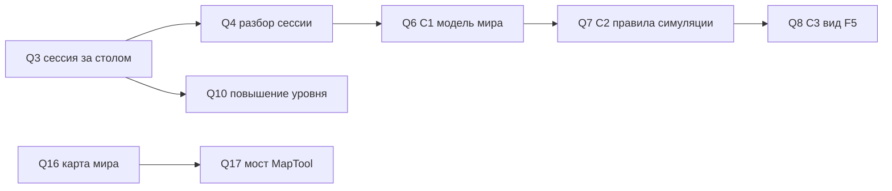

# Очередь работ DM Cockpit

Срез 02.10.2026 по коду `31aec90` (ветка `main`, рабочая копия чистая) и HANDOFF §11, §14, §15. Порядок — сверху вниз; задача берётся, когда закрыто всё, от чего она зависит. Закрытая задача переносится в HANDOFF §14 с датой и удаляется отсюда.

Кто: **В** — владелец (решение, данные, игра), **А** — агент (код).

Порядок крупными этапами и основы плана — `ROADMAP.md` (28.10.2026).

## Сейчас

| # | Задача | Кто | Зависит | Готово, когда |
|---|---|---|---|---|
| Q3 | **Отложено 28.10 владельцем** («пока исключаем игровую сессию»): работы этапов 3–4 идут без неё. Сыграть одну полную сессию за реальным столом — ворота §11 («вне MVP не начинается, пока MVP не сыгран») | В | — | файл сессии сохранён («Сохранить» → `dm-cockpit-<дата>.json`), замечания записаны списком |
| Q4 | Разбор сессии: каждое замечание — строка в этой очереди или отказ с причиной | В + А | Q3 | список замечаний пуст |

## Иерархия сущностей (28.10, `ENTITIES.md`)

Два фронта навстречу: сверху (космос → боги) и снизу (атомы правил → персонаж), встреча — церковь, храм, жрец. Карта сущностей, источники и связи — `ENTITIES.md`.

| # | Задача | Кто | Зависит | Готово, когда |
|---|---|---|---|---|
| E5 | Церкви как фракции, храмы на карте. **Частично 28.10** (ROADMAP 3.4): место → боги места, церкви → бог; осталось — церковь как фракция состояния | А | 3.3 | храм на карте открывает церковь и бога |
| E6 | Единый указатель справочных сущностей и одна карточка для любого атома. **Сделано 28.10** (ROADMAP 0.2–0.4): адресация «вид:id», резолвер `src/entities/` (19 справочных видов + 4 вида состояния, у каждой записи источник — тест), общая карточка на столе (`EntityViewBody`, тип «правило», токен `ent-rule`), «Карточка» у умений, черт расы, черт и заклинаний листа, заклинания SRD — ссылками в журнале. Осталось: чип состояния, пины и узлы схем космоса — тоже через `openEntity` | А | — | черта, умение, заклинание, вещь, состояние открываются одной `EntityCard` |
| E7 | Вещь как сущность: карточка, инвентарь на листе, настройка | А | E6 | вещь на листе открывает карточку с текстом SRD |
| E10 | Партия и фракции: известность у церквей и организаций | А | E5 | известность меняется патчем предложения |

## Шаг C · Пульс мира F5 (утверждён 21.09: A → B → C)

| # | Задача | Кто | Зависит | Готово, когда |
|---|---|---|---|---|
| Q6 | C1 · Модель мира. **Сделано 28.10** (ROADMAP 3.3, до контрольной сессии — решение владельца): фракция → организация вики и отношения −3…+3, место → место справочника, цены товаров и веса встреч; патчи `relation`, `price`, `encounter`, `newLocation`/`removeLocation`; в сиде — ссылки, отношения, две церкви, патчи у цен на оружие и ликантропов. Осталось: пантеон кампании для графа F5 (Q8) | А | — | сид поднимает данные; патчи проверяются редьюсером и откатываются `Ctrl+Z` |
| Q7 | C2 · Правила симуляции над моделью. **Сделано 28.10** (ROADMAP 4.1): цены еды по сезону и праздникам, вражда растущей фракции и сближение через известность партии, ликантропы ×2 в полнолуние и обратно ×1 — каждое с `causeId` и патчем, числа — `SIM_RULES`. Осталось: встречи от сезона и опасности, активность церкви в святые дни | А | — | `simulation.test.ts`: каждое правило даёт предложение с `causeId` и патчем, мир само не меняет |
| Q8 | C3 · Вид F5 «Пульс»: календарь на три десятидневки, графы фракций и пантеона, индексы цен, веса встреч, «требует решения» справа; у игроков вида нет | А | Q7 | сверка с `reference/screens/F5-pulse.png`, блок «пульс» в тесте стола, адверсарный набор игроков |

## Пробелы листа после A и B — брать, когда понадобится за столом

| # | Задача | Кто | Зависит | Готово, когда |
|---|---|---|---|---|
| Q9 | Заклинания SRD: импорт и лист сделаны 27.10 (`content/srd/spells.json`, 319, дословно; заклинания на листе из редактора). Осталось: форма концентрации берёт заклинание и срок из SRD — сначала из листа персонажа | А | — | форма концентрации берёт заклинание и срок из SRD, текст дословный |
| Q10 | Повышение уровня и правка созданного персонажа — новое событие в §7 | В → А | Q3 | событие в §7 и `events.ts`, реплей, `Ctrl+Z` |
| Q12 | Портрет картинкой: поле листа и файл | А | — | портрет в `PcHeader` и редакторе |
| Q20 | Карточка персонажа по макетам 27.10 — сделано: шапка и медальоны HP · AC · ИНИЦ · PP · КХ, характеристики «очко — модификатор — спасбросок», навыки списком с «Владение +N», паспорт данных, подвал партии (отметки, «выбрано N из M», сводка выборки: лучший в проверке, запас, пробелы листов), лист «Сравнение». Осталось: заполнение пробела щелчком из паспорта (нужен Q10 — правка созданного), групповая проверка из подвала одним броском за всех | А | Q10 | щелчок «нет: предыстория» открывает правку; «Скрытность группой» пишет броски выбранных |
| Q13 | Легендарные действия и логово в блоках монстров — вместе с первым таким монстром в импортёре | А | — | слот логова и легендарные пипки на полосе инициативы из блока |

## Карта мира — направление 1 (владелец, 27.10)

Сделано 27.10: тайлы Toril, карта на уровнях планеты, континента, региона и поселения, пины мест, знак партии, гексы по шесть миль, линейка с днями пути по SRD; поход по карте (`PARTY_TRAVELED`, с галочкой трудной местности), факты на пинах, туман знаний (`PLACE_REVEALED`), глобус планеты по маске — бывшие M3–M6 (HANDOFF §7, §14 шаг 11). Дальше — по порядку полезности за столом.

Сделано 27.10 (ночь), иконки листа персонажа (решение владельца): набор вырос до 183 — `ab-*` характеристики, `cls-*` 13 классов, `race-*` 38 рас, `school-*` 8 школ, `kind-*` 13 видов умений; умения класса, особенности расы, черты и заклинания на карточке — рядом иконок (`IconGrid`): наведение — имя, щелчок — текст, Esc закрывает; раса и класс — иконками в шапке, характеристики — иконкой у кода. Подбор вида — `src/components/sheetIcons.ts` (вид особенности из таблицы, эффекты черты, ключевые слова умения); у умений классов «прочее» 16 % — в основном строки списков заклинаний подклассов без текста.

Сделано 27.10 (вечер), по шагам «материалы для разметки»: Toril GIS (Geospatial Grimoire, фан-контент, авторов указываем) скачан в `maps/gis/` (не в git); его координаты к растру HandsomeRob напрямую не ложатся (основа — карты 2e, расхождение ~30–50 px), поэтому справочник мест `content/maps/toril-places.json` (863 места, 753 по значку, точность 0–3 px на 22 опорных) снят с самого растра: Vision читает подписи, рядом ищется значок, GIS даёт имя, класс и русское имя (`scripts/gazetteer-from-map.py`, `scripts/ocr-labels.swift`); калибровка миль уточнена до 0,37 по маршруту Waterdeep → Baldur's Gate из официальной серии D&D Beyond (бывшая M1); местность по цвету растра (`scripts/terrain-from-map.py` → `maps/tiles/toril/terrain.png`), линейка и поход сами считают мили по лесу, болоту, горам и льду (бывшая M9).

Сделано 27.10 (ночь), визуальная разметка V1, V3, V4: снимок подписей `scripts/map_ocr.py` → `maps/ocr/toril-labels.json` (не в git; Vision по всему растру — 2 минуты один раз, справочник из снимка — 30 секунд, результат тот же до пикселя): 7564 строки Vision, 4939 подписей без дублей, многострочные склеены (`rows`), у каждой цвет букв, кегль, капитель, разрядка; имена стран и морей вразрядку (CORMYR, CALIMSHAN, THE SHINING SEA), которые Vision на карте не читает, собираются по цвету букв в полоску — 93 имени; значки по эталонам `content/maps/toril-icons.json` (столица, город, крепость, руины, храм, шахта, вершина, источник, постройка) — 633, проверено глазами по 12 на вид. Справочник берёт значок по эталону, где белого кружка нет: 45 мест перешли с подписи на значок, Candlekeep — на свой (опорная точка 0–3 px). Не сделано: V2 (наклонные подписи), V5 (имена областей местности), V6 (дороги), многословные имена вразрядку лежат по словам.

Реестр карты (27.10, ночь): `scripts/map-registry.py` → `maps/ocr/toril-registry.json` / `.md`, 7034 записи. Точки GIS 1343: в справочнике 863, OCR прочёл иначе 157 (значок прилип, опечатки OCR и самого GIS — Tezilr/Teziir; нестрогое сравнение в справочнике вернёт большую часть), подпись далеко от подсказки 50 (Chult, мало опорных), не найдено 201, Подземье 70. Области GIS 506: подпись найдена 128, прочитана иначе 82, не найдено 255 (чёрный курсив вразрядку — Calim Desert — и наклонные подписи гор: расширить проход букв на тёмный цвет, V2). Подписей только на растре 3063 (+326 обрывков) — вход L1; значков без подписи 1796, из них 1130 «город» — проверить детектор кружков. Итоги ночной разметки реестр подтягивает из `maps/llm/*.jsonl` по id записи.

Сделано 27.10 (поздний вечер), по списку владельца «делай по порядку» после реестра ресурсов (`SOURCES.md`): весь SRD 5.1 в данных — 334 блока монстров (было 45; четыре расхождения API с печатным SRD исправлены в FIXES импортёра) и 239 магических предметов (`content/srd/magic-items.json`, `src/rules/srd/magicItems.ts`); поход по A5E SRD (CC BY 4.0) поверх темпа SRD — `content/a5e/journey.json`, `src/rules/a5e/journey.ts`: путь по карте режется на регионы A5E по классам местности (лес — Tangled Forest, горы — Lofty Mountains…), у региона DC занятий по уровню опасности (по умолчанию — ступень партии), в панели похода — регионы пути, припасы на путь и кнопка «встреча» (d100 по таблице региона → бросок и строка журнала). Монстры для разнообразия встреч: Black Flag SRD (360) и A5E Monstrous Menagerie (586), обе CC BY 4.0, через Open5e — в списке «Добавить» с подписью библиотеки, бонусные и легендарные действия на карточке (у драконов SRD легендарные тоже появились). Источники под OGL не брали — первых трёх хватает. Реестр локаций мира — `scripts/world-registry.py` → `maps/world/` (11 478 записей: вики + GIS по лестнице масштабов).

Сделано 28.10: уровни лестницы выше планеты получили свои виды. «Звёздная система» Realmspace — планетарий (F4.3): солнце, восемь планет по порядку от солнца, Selûne и Tears у Toril, цвет — стихия тела, ползунок дней вперёд, ближайшее сближение выбранной планеты, у тела — книга и страница; «Спуститься: Toril» ведёт на глобус. «План» — схема течений флогистона (F4.2): треугольник Realmspace ↔ Greyspace → Krynnspace → Realmspace (53 дня), Arcane Inner Flow (Refuge 7 дней, Pirtelspace, Darnannon), Moragspace, Winterspace, Shadowspace, Clusterspace, Vodoni Empire; рёбра различаются рисунком линии. Всё — из FR Wiki с цитатами и книгами (`scripts/import-spelljammer.py` → `content/cosmos/`); углы орбит на день 0 и раскладка схемы — свои, карта Nerik — только сверка.

Сделано 28.10 (вечер), уровень «космология» — Великое колесо (HANDOFF §3: «граф планов кольцом по мировоззрению»): 16 внешних планов на кольце по их сетке мировоззрения из вики (закон слева, хаос справа, добро сверху, зло снизу), Outlands и Sigil в середине, спицы — 16 городов-врат по статье Gate-town (их порядок по часовой стрелке совпадает с порядком по мировоззрению — тест), Материальный с Ethereal, стихиями, энергией и отражениями, Astral к кольцу; карточка плана (вид, мировоззрение, форма, гравитация, время, изменчивость, стихии, магия, слои, город-врата, книга) — и на уровне «план» над схемой течений. Данные — `scripts/import-planes.py` → `content/cosmos/great-wheel.json`. Попутно: подписи всех трёх видов космоса были набраны Press Start 2P (только вордмарк по CLAUDE.md) — теперь Forum и Plex Mono, кегль под ~13 px на экране. Осталось: русские карточки планов L4 подтянуть повторным импортом, когда ночная разметка их сделает; реки Styx и Oceanus — с цитатами, если понадобятся. Тем же вечером — Великое древо (World Tree, 1372 DR) вторым видом уровня «космология», переключатель «Колесо / Древо»: небесные планы на самом Древе (корни, ствол, ветви, вершина — по статье), дьявольские по River of Blood в порядке течения, нейтральные — только на ветвях Astral, Cynosure и Fugue Plane вне Древа, корни — стихийные и энергетические планы; 22 портала с цитатами, у выбранного плана — на схеме и в карточке.

| # | Задача | Кто | Зависит | Готово, когда |
|---|---|---|---|---|
| M14 | Поход A5E дальше: уровень опасности у региона карты (мастер задаёт, по умолчанию — ступень партии), занятия в пути (кто что делает в регионе, DC, исходы дословно), погода d20 на регион, припасы как ресурс партии; регионы не только по местности — дороги (Open Roads), поселения (Country Shire / Urban Township), Подземье (Underland Realm) | А | — | мастер видит в походе, кто чем занят и с каким DC; припасы убывают на ночёвках |
| M15 | Бандл: библиотеки монстров Black Flag и A5E по требованию — **сделано 28.10** (основной кусок 5,6 → 2,98 МБ: магические предметы и поход A5E тоже отдельно); список «Добавить» — фильтр по библиотеке («только SRD») и по CR; итог встречи A5E — кнопкой «появился» с блоком A5E того же имени | А | — | первая загрузка стола не тяжелее, чем до библиотек; встреча из таблицы ставит противника в один клик |
| M7 | Слои из референса F1: зоны влияния фракций, торговые пути, погода, опасность (веса встреч) | А | Q6 | слой берёт числа из модели мира, у игроков — только открытое |
| M8 | Новое место щелчком по карте — предложение с `patch` (мир меняется только так) | А | Q6 | место с `geo` появляется после «Принять», `Ctrl+Z` убирает |
| M12 | Справочник мест на столе — сделано 28.10: поиск по имени (латиница и русское имя GIS) ведёт карту к месту, щелчок по значку растра — карточка места (`content/maps/toril-cards.json`: 1057 карточек L3 по-русски, CC BY-SA по вики, `scripts/export-place-cards.py`; без карточки — имя и класс GIS), только мастеру, без событий. Осталось: «новое место щелчком» (M8) берёт имя и класс из справочника; карточки review — после разбора глазами | А | M8 | место из справочника становится местом сида только через предложение с `patch` |
| M13 | Места растра, которых нет в GIS: 3579 подписей (1421 со значком) лежат в `maps/ocr/toril-rest.json` с цветом, кеглем, значком и местностью — класс правилами и локальной LLM (llm-gateway), ночной прогон L1 | А | — | у подписей из `toril-rest.json` есть класс; справочник покрывает Selgaunt, Teziir, Ordulin |
| M10 | Планы городов и зданий — свои растры для поселений (Neverwinter) тем же конвейером | В → А | — | владелец дал растр; уровень поселения показывает план города |
| M11 | Вторая кампания: паспорт и тайлы Planetos из `maps/ASOIAF/` | А | — | карта Planetos на своём сиде |

## Данные владельца

| # | Задача | Кто | Зависит | Готово, когда |
|---|---|---|---|---|
| Q14 | Исправить исходные таблицы: спасброски у «Борца» (Grappler), строки 155–158 расового листа, дубли «Стихийный адепт» и «Подвижный»; с 27.10 ещё: Драконорождённый +2 STR +2 INT (в SRD +2 STR +1 CHA, строки SRD-дракорождённого нет), у барда 10-го уровня 3 заговора (в SRD 4), «Разговор с животными» дважды у домена Природы, нет «Удвоенного заклинания» (Twinned, SRD) в метамагии, боевые стили следопыта стоят на листе друида, у Гибрида симиков шесть «1» вместо «+2 CON и +1 на выбор», у Метки Обнаружения две «2»; затем переимпорт | В, затем А | — | `content/compendium/report.md` без замечаний, сверка в `build.test.ts` пуста |
| Q19 | Обогатить таблицы для создания персонажа (разбор 27.10, отчёт агента): колонка английского имени у заклинаний подклассов и рас (связь с SRD), список инвокаций колдуна и предметов договора отдельным блоком, подписи вариантов у круга Земли и Гения, число выборов у блоков («2 приёма на 3-м, +2 на 7-м…»), стартовое снаряжение Изобретателя вариантами, явная отметка «на выбор» у гибких бонусов вместо шести «1», условия черт (раса, уровень) колонками | В, затем А | — | импортёр связывает заклинания подклассов с SRD, редактор предлагает инвокации и приёмы |
| Q15 | Нарисовать вордмарк «DM Cockpit» вместо заглушки | В | — | вордмарк на заставке |

## После C

| # | Задача | Кто | Зависит | Готово, когда |
|---|---|---|---|---|
| Q16 | Шаг 11 · Карта: тайлы, регион, континент сделаны 27.10 (раздел «Карта мира» выше); глобус с маской — M6 | А | — | критерий шага 11 в HANDOFF §14 |
| Q17 | Шаг 12 · Мост к MapTool (`vtt-maptool.md`) — когда стол в нём понадобится | А | Q16 или решение В | критерий шага 12 в HANDOFF §14 |
| Q18 | Разбить бандл: 1,7 МБ (gzip 408 КБ), компендиум едет в основном чанке. Ленивая загрузка компендиума и редактора — для планшета по `--lan` | А | — | основной чанк < 500 КБ |
