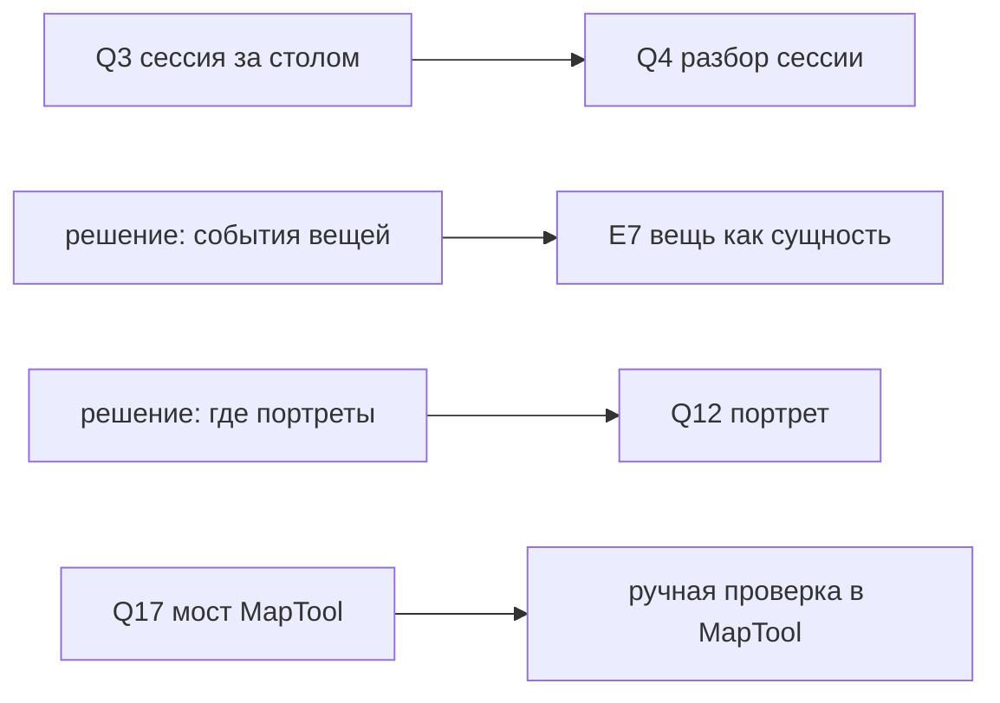

# Очередь работ DM Cockpit

**Уточнение Д10 · 23.11.2026:** узкий Train-срез для изучения одного вручную указанного языка с наставником реализован: мастер подтверждает наставника, приватный обратимый проект хранит прогресс, при применении полного календарного промежутка списывается 50 gp за зачтённый месяц, а завершение добавляет язык в структурированное поле листа. Для него месяц/сезон/год дают 1/3/12 месяцев; десятидневка и проверки отключены. Автономная браузерная приёмка ещё не проводилась. Остальные варианты Train и полная приёмка D10 остаются открытыми.

Актуализация 01.11.2026: художественное направление, наполнение и контекст по рабочей копии (HEAD `7bd54fd`, ветка main, много незакоммиченных изменений). Исторические состояния остальных направлений датированы в строках и HANDOFF §14. Порядок — сверху вниз; задача берётся, когда закрыто всё, от чего она зависит. Закрытая задача переносится в HANDOFF §14 с датой и удаляется отсюда.

Кто: **В** — владелец (решение, данные, игра), **А** — агент (код).

Порядок крупными этапами и основы плана — `ROADMAP.md` (порядок — 28.10.2026, состояние — 30.10.2026). Снятые 30.10 закрытые строки — HANDOFF §14, «Разбор очереди 30.10.2026».

## Сейчас

**Уточнение владельца 02.11:** часы справа в одной строке с «Партия сейчас»; на карте — нижний правый слот. Перенос выполнен, модальное управление и Esc проверены. Отчёт: research/ux-review/clock-party-row-2026-11-02.md.

**Графическое поручение 02.11 (историческая запись):** получен 71 новый исходник Kimi, пилот из 13 классов подключён к карточкам; Codex сгенерировал 23 дополнительные иллюстрации. Галерея: design/art/codex-content-v1/index.html. 1572 теста и build прошли; раскладки из 4 и 6 карточек проверены через CUA. Это частичное выполнение БА26, не закрытие БА12/24/20. Астролябия v2 выбрана владельцем для применения; бриф 3D-приборов: coordination/tasks/KIMI-remaining-3d-models.md. На дату этой записи общий бэклог не перезапускался; владелец возобновил его 06.11.2026.

**Исторический статус 02.11.2026:** общая цель была снята владельцем, обе автоматизации приостановлены. Владелец возобновил работу по полной цели 06.11.2026; текущий приоритет — Q3/Q4. Это не возобновляет прежние остановленные вызовы Kimi batch02 или автоматизации; отдельное продолжение ПР13 запущено новым поручением. Актуальные детали — CURRENT_CONTEXT.md.

Последнее уточнение: карта и party screen взаимоисключающие, нет одиночного PC inspector на карте; до6 compact cards в одной строке, context ниже; правая ladder + map controls, clock68×68 с modal. Код готов,1569 tests/build зелёные. Визуальная CUA-приёмка завершена 20.11 на read-only memory-only QA route: шесть карточек в один ряд при 1280×720, сводка ниже, окно часов открывается и закрывается с возвратом фокуса; детали — research/ux-review/exclusive-world-party-clock-2026-11-02.md.

**Дополнение БА30, 23.11, статическая проверка контраста:** исправлено кольцо клавиатурного фокуса на заполненной пипке ресурса (`#20160a`: 3.58:1 Flat, 3.45:1 Material) и подпись персонажа на бронзовом корешке (`#382500`: 4.77:1 на тёмном стопе Material). Фактические пиксели и вся матрица состояний требуют отдельного визуального подтверждения; БА30 остаётся открыта.

**БА30, проверка масштаба текста 23.11:** Firefox установлен, но окно нельзя получить через доступное управление приложениями; тест 200% только текста не проведён. Масштаб вкладки и мобильное окно не считаются заменой; БА30 остаётся открыта.

**Повторная проверка узкого макета, 23.11:** старая полоса была на историческом `preview-narrow-historical-before-2026-11-23.jpg`. Актуальный HTML открыт в CUA при 320×700: документ и `.desk` — 320×700, карта и шапка не сдвигаются при прокрутке над картой; прокручивается только карточка (296×338, внутреннее содержимое 697 px). В этом кадре также исправлено обрезание `Tambernack`: на ширине до 360 px уменьшены портрет/заголовок и обновлена версия CSS в ссылке страницы; имя полностью видно. БА30 остаётся открыта по увеличению текста до 200% и полной матрице фактических пикселей/состояний. Подробности: `design/mockups/painterly-screen-v1/README.md` и `research/ux-review/verification-BA30-2026-11-22.md`.

| # | Задача | Кто | Зависит | Готово, когда |
|---|---|---|---|---|

### Уточнения по исследованиям 21.11.2026

Основание — [сводка аудита, замеров, дизайна и пилота](docs/WORLD_MODEL_AND_DESK_REVIEW.md). Ниже остаются незакрытые пункты этой очереди; выполненные строки переносятся в HANDOFF §14 с доказательствами. Следующая автономно исполнимая задача — БА30: СО1 требует физического mobile-профиля и пропускается по текущему ограничению; СО4 зависит от полного СО1–СО3; АР4, СО5 и У11 требуют решения или выборки владельца и пропускаются. Пункты с настоящей сессией или решением владельца пропускаются. Пороги и размеры — предложенные ориентиры, пока не проверенные на целевых устройствах.

**Уточнение по БА30, 22.11:** по замечанию владельца иконки персонажей должны стоять в горизонтальном ряду. На основном экране сессии CUA-проверка при 390×844 подтвердила горизонтальный выбор персонажа в `PartySpread`. Отдельная рейка `PartyPortraits` тоже имеет горизонтальную прокручиваемую раскладку, но не монтируется в основном режиме; она не входит в критерии БА30 и не блокирует её закрытие. Статический контрастный аудит скорректировал подписи меток состояний и сводки персонажа в Flat/Material, сохранив цветные нижние канты; отношения на сплошном цвете плиты теперь 5.33:1 в Flat и 4.88:1 в Material, фокус Material — 6.04:1. БА30 остаётся открыта по полной визуальной/пиксельной матрице и увеличению только текста; физический touch требует Nitro мастера и пропускается по инструкции владельца.

**Проверка 23.11:** базовая раскладка `PartyPortraits` больше не зависит от селекторов страницы: компонент сам задаёт горизонтальную верхнюю рейку. Изолированная memory-only фикстура при 390×844 и 320×700 визуально проверена в Flat и Material; четыре кнопки персонажей стоят в одном ряду. Это отдельная поверхность вне критериев БА30. Сенсорный тест на Nitro мастера пропускается по указанию владельца и не блокирует автономную приёмку; БА30 остаётся открыта по нативному увеличению только текста и полной пиксельной матрице.

| # | Задача | Кто | Зависит | Готово, когда |
|---|---|---|---|---|
| АР4 | P2. Контракт времени: сроки эффектов, момент результатов Д10, длина года | А + В | СО2, текущие расчёты Д10 | После решения владельца правило одинаково применяется к прогнозу, журналу, частичным занятиям и високосному году. До решения не автоматизировать неопределённое поведение; эту строку пока пропускать |
| СО1 | P1. Профилирование расчёта, публикации, сохранения и отзывчивости экрана | А | — | **Частично, 22.11:** desktop production-browser p50/p95 для дня, Д10, года, 500-note журнала, 100 часов и двух активных маршрутов; измерены production transaction, serializeLog, реальный custom-key localStorage.setItem, RAF и click→RAF proxy. См. `research/simulation/SO1_BROWSER_PROFILE_2026-11-22.md`. Production cold/reload и desktop browser profile полной ширмы измерены на свежем loopback origin; остаётся физический mobile-профиль, поэтому СО1 не закрывать |
| СО4 | P2. Оптимизация измеренных участков и оценка Worker/Rust/Wasm | А | СО1–СО3 | Повторные профили показывают вклад индексов, путей, публикации и сохранения. Сначала сравнить пакетную публикацию и Worker. Rust/Wasm пробовать только при подтверждённой задержке; учитывать загрузку, обмен данными и совпадение результатов |
| СО5 | P1. Правило конкурирующих экономических последствий | В | Нужен выбор владельца | Определить, какие изменения запаса/цены складываются, какие конфликтуют и как сезонные множители сочетаются с базовой ценой. До решения мастер явно пересчитывает и подтверждает новое предложение; агент не вводит общее правило суммирования |
| У11 | P2. Оценка извлечения литературного корпуса | В + А | У10, решение владельца о конкретном корпусе и допустимом способе обработки | Только на разрешённой владельцем выборке: происхождение/цитата и версия, сущности, ссылки, даты, ручные исправления, пропуски и выдуманные дополнения измерены раздельно. Пока нет выбранной выборки — пропускается |
| БА30 | P1. Две темы, эталонная карточка и глобальный переключатель | А | Действующие компоненты Д17, БА1 | Переключатель постоянно доступен в общей шапке вне настроек, действует на всё приложение и сохраняется. Внутри карточек нет конкурирующего переключателя. Одинаковы данные и геометрия; пустые зоны фиксированы. На телефоне до 700 px видна одна карта и ряд портретов. Проверяются клавиатура, фокус, читаемость и увеличенный текст.   **22.11, частично:** переключатель в общей шапке, клавиатура, reload, Esc с возвратом фокуса, одна активная карта, ряд портретов, wheel/Tab-прокрутка и выбранные контрастные пары проверены в memory-only CUA. Контролируемая сверка Korrin после замены Flat-only layout-границ на inset-обводки подтвердила одинаковые размеры двух тем при 320×700: stage `264×370`, карточная область `248×229`, CharacterCard `248×346.406`, лицевая зона `246×188.406`. Клавиатурный `focus-visible` на плитке навыка визуально подтверждён в обеих темах, без активации игровых действий. В полной карточке проверены hover/focus навыка, владение спасброска, способности, атаки и заклинания; низкоконтрастные золотые бонусы/рамки исправлены. Измеренные пары: Flat текст `#192833` / подложка `#c2d5e2` 9.99:1 и кольцо `#654000` 6.08:1; Material текст `#2b2015` / `#c4a16b` 6.56:1 и кольцо `#382500` 6.04:1. Полные свидетельства — `research/ux-review/verification-BA30-2026-11-22.md` и HANDOFF; это точечная выборка, не полная матрица. Статические отношения контраста: подписи боевой полосы Flat 5.99/5.33 на PN/PL, Material 7.76/4.77 на PN/PL; текст/placeholder поля хитов 13.63/12.82 и 5.35/5.78; кольца ability/save 6.08/6.04; надпись и кольцо переключателя Material 4.77; полного прохода по отрисованным сочетаниям это не заменяет. 22.11 доп. keyboard pass: в memory-only CUA при 1920×1080 пройдены все 195/195 Tab stops в раскрытой раскладке из четырёх компактных карточек в Flat и Material; каждый имел :focus-visible, а computed style — рамку или тень (0 пустых стилей). Для четырёх кнопок «Состояния» отдельно подтверждено кольцо: Flat inset #654000, Material #382500; отсутствовавшее Flat-кольцо исправлено явным правилом. Дополнительно исправлены Material пары: #44351f/#c4a16b 4.88:1, #503300/#c4a16b 4.77:1, #fff4d9/#956317 4.71:1. Детали — в verification-BA30-2026-11-22.md. Остаются нативное увеличение только текста до 200% (запущенное окно Chrome недоступно CUA; CSS и viewport не засчитываются), полная визуальная/пиксельная матрица контраста и состояний (включая оборот карточки, hover/pressed/disabled) и реальная touch-проверка; **Дополнение 22.11:** в том же isolated QA на 320×700 глобальный переключатель виден в общей шапке; раскрытая PartySpread показывает одну активную карточку и горизонтальный ряд портретов. Переключение на Korrin обновило карточку; игровые действия и значения HP не менялись. БА30 остаётся открытой. **Дополнение 22.11:** актуальная PartySpread исправлена после обнаружения вертикальной раскладки: портреты теперь в одной горизонтальной прокручиваемой строке, выбранная карточка ниже. Memory-only Material-проверка шести персонажей при 700×720 и 320×700 подтвердила один горизонтальный ряд и отсутствие горизонтального overflow документа; на 320 строка прокручивается внутри себя, под ней только выбранная карточка. Flat-пара product-contexts с четырьмя персонажами проверена при 320×700 и 700×720: ряд 248×44/628×44, страница 320/320 и 700/700, карточка непосредственно ниже. Во время удержания портретной кнопки Flat и Material подтвердили :active и translateY(1px); игровые действия не запускались. Подробности в verification-BA30 и HANDOFF.  **Дополнение 22.11, свежая сборка:** в memory-only QA при 320×700 выбор Material сохранился после reload. На одной синтетической карточке Bo на обороте → «Снаряжение» размеры обеих тем совпали: stage `264×431`, оболочка `248×290`, CharacterCard `248×346.406` (client `246×344`), сторона `246×188.406`; внутренний список `238×154`, `scrollHeight=631`, max scroll `477`, CUA дошла до нижнего содержимого. Вкладка заклинаний/все визуальные состояния оборота не проверены; полная матрица, нативный text-only 200% и физический touch остаются открытыми. Подробности — в verification-BA30 и HANDOFF.   **Дополнение 22.11, контраст бейджей:** исправлены три провала на сплошных числовых метках. Счётчик уровня статуса на отдельном корешке теперь использует читаемую пару темы карточки: Flat `#f0f4f7/#654000` 8.30:1, Material `#f1e6cb/#5e3f0c` 7.72:1; уровень в PartySpineRow и PcHeader Material — `#382500/#c4a16b` 6.04:1; уровень на отдельном корешке PartySpread Flat — `#fff/#a65e00` 4.97:1. После правок в Material memory-only просмотре ряд портретов остался горизонтальным. Это адресные непрозрачные бейджи; значения получены из цветов токенов, не из выборки текстурных пикселей. Полная визуальная матрица, native text-only 200% и физический touch остаются открытыми; БА30 не закрыта. Подробно — в `research/ux-review/verification-BA30-2026-11-22.md`.    **Дополнение 22.11, оборот карточки на мобильном:** в memory-only фикстуре при 320×700 в Material просмотрены лицевая сторона, слоты снаряжения, ячейки и список заклинаний; описание Cure Wounds раскрывается внутри оборота и прокручивается в пределах карточки. В Flat проверено то же раскрытое текстовое описание на обороте. Ряд портретов остаётся горизонтальным, показана одна выбранная карта Бо. Тема возвращена к Material, временное окно и размер viewport сброшены; игровой журнал, хиты и время не менялись. Это чтение и геометрия, не измерение фактурных пикселей; БА30 остаётся открыта по полной матрице состояний, native text-only 200% и физическому touch. |
| БА31 | P1. Общая оболочка, карта и хронология в двух темах | А | БА30, действующие БА2 и ХЛ1, АР1 | Один контекстный переключатель управляет поверхностями. На карте и в иерархии масштаба сначала виден узнаваемый значок, затем доступная подпись. Инспектор и переходы по хронике сохраняют выбранное место, время, масштаб и фокус в обеих темах.   **Функциональная часть реализована и проверена 22.11.2026; строка остаётся открытой до зависимостей БА30 и БА2.** Memory-only CUA, 320×700, обе темы. Проверены карта → карточка места → закрытие, годовая линза 1493 → «На карте», сохранение выбранного региона Sword Coast North и Neverwinter, времени 15 Mirtul 1492 DR, 08:00, масштаба карты 100 миль и фокуса на области «Мир». Выявленный сброс камеры исправлен: камера хранится в памяти страницы по сеттингу, паспорту, рамке и её границам; переход из глобуса сохраняет приоритет явного старта, команда «Плоская карта» очищает устаревший снимок. Значок на лестнице масштаба предшествует доступному имени; на узком экране подписи компактных ступеней доступны через `aria-label`/`title`. Свидетельства: `research/ux-review/verification-BA31-2026-11-22.md`. |
| БА32 | P2. Перенос общих компонентов на компендиум, лист, Пульс, журнал и Мастерскую | А | БА31, действующие поверхности БА7 и БА19 | Сохранены запрос, фильтры и возврат из листа. Проход карта → событие → карточка → компендиум одинаково работает в двух темах. Размеры приняты на широком и мобильном окне |

### Вне текущей очереди по поручению владельца 20.11.2026

Q3 и Q4 пропущены: для них нужны настоящая игровая сессия и участие игроков в разборе. Задачи остаются незакрытыми.

### Первая очередь Codex / Kimi (01.11.2026)

Владелец разрешил распределять работу между Codex и Kimi и разрешил Kimi запускать собственных
агентов. Распределение/контракты — `coordination/README.md`, статусы — `coordination/assignments.json`.
Codex: интеграция Д17 и общие контракты Д16; Kimi: K01 компонент Д17, K02 независимая проверка
БА2/БА20, K03 исследование контрактов Д16. Это ссылки на существующие задачи, не дубли бэклога.
Kimi CLI подключена; три задания доставлены и запущены в актуальном изолированном снимке.
Результаты проходят приёмку Codex; это ещё не закрытие Д16/Д17/БА2/БА20.
K02/K03 получены: `research/coordination/`. Решение по исследованию Д16/E7 —
`research/coordination/K03-codex-review.md` (принята последовательность, события требуют коррекции).
K01 round2 получен; Kimi остановилась по пятичасовой квоте429. После уточнения владельца
Первая индивидуальная inline-итерация отклонена владельцем02.11.2026. Текущий исправленный вариант: один настоящий корешок/карточка в keyed slot, только общее раскрытие по кнопке, вертикальные панели карты и масштабов; полный лист модальный. Новый вариант проверен:1563/1563 тестов и build; геометрия1280/700 без перекрытий. Отчёт: research/ux-review/party-and-map-panels-2026-11-02.md.
Дополнительно проверены6/8 реальных карточек и выбывание/undo; исправлен устойчивый номер страницы.
Полная матрица БА2/БА20 и E7-инвентари остаются открыты. Приёмка —
`research/coordination/K01-round2-codex-acceptance.md`. Следующий review Kimi K04 подготовлен, не доставлен. По K02 исправлены сообщение недоступной карты и перенос длинных
строк журнала; сохранение плана повышений и визуальная матрица остаются открытыми.

## Иерархия сущностей (28.10, `ENTITIES.md`)

Два фронта навстречу: сверху (космос → боги) и снизу (атомы правил → персонаж), встреча — церковь, храм, жрец. Карта сущностей, источники и связи — `ENTITIES.md`.

| # | Задача | Кто | Зависит | Готово, когда |
|---|---|---|---|---|
| E7 | Вещь как сущность: карточка, инвентарь на листе, настройка (ROADMAP 1.1). **Закрыто 06.11.2026:** ссылки на обычные и магические предметы SRD открывают существующие карточки и из списка снаряжения, и из строк инвентаря; неизвестные id не становятся фиктивными ссылками. Переход из линии партии видим, вкладки/черновики сохраняются. Есть канонические стеки, детерминированная миграция, обратимые события получения/потери/переноса/передачи/настройки/экипировки и равноценного обмена монет; карта, атаки и КД синхронизируются. В карточке мастера доступны выдача/потеря, настройка, надевание/снятие поддержанных SRD-доспехов и щитов, перемещение целых и частичных стеков между личным местом, запасом партии и зарегистрированными контейнерами; частичный перенос/передача создаёт отдельный стек, остаток сохраняется. Добавлены обратимые события создания/удаления пустого контейнера лагеря или транспорта; в контексте партии мастер видит общее имущество и содержимое контейнеров, может перемещать вещи и передавать их персонажу частично или целиком. Игрокам не передаются имена скрытых контейнеров и скрытые стеки. Показаны вес известных переносимых предметов и предел STR×15; кошелёк содержит пять номиналов SRD, баланс, вес монет, равноценный обмен и управление частичным перемещением/передачей монетных стеков. Добавлено секретное обратимое событие `TRADE_COMPLETED`: движок атомарно переносит предмет и точную оплату монетами, требует явный источник цены и проверяет текущие остатки; DM-панель покупки/продажи подключена в контексте партии: мастер выбирает активные стороны, предмет и количество, оплату несколькими стеками монет и явный источник цены; отдельный экран проверки фиксирует подписи предмета и оплаты до явного подтверждения; подтверждение вызывает одно атомарное событие. Автоматические цены и сдача не вводятся. Добавлена явная ссылка лагерного контейнера на существующее место кампании (`locationId`), проверяются reducer и undo/replay; лагерь не выводится из текущей локации или истории похода. Добавлены отдельные именованные сущности транспорта без придуманных характеристик и ссылка на транспорт у новых грузовых контейнеров; удаление связанного транспорта блокируется, старые несвязанные контейнеры остаются совместимыми. CUA: панель хранилищ просмотрена при 1280×720 вместе с линией партии и хронолентой; функциональный поток создания/связи/undo/replay покрыт тестами. Визуальная проверка заполненного хранилища и сквозной поток подтверждены CUA 1280×720: карточка → инвентарь → контейнер → reload → undo; отчёт `research/coordination/E7-codex-acceptance-2026-11-06.md` | В → А | решение по событиям принято (ROADMAP §15); общие контейнеры — Д17 | вещь на листе открывает карточку с текстом SRD; имущество переживает replay/undo/reload без дублирования |

## Унификация субъектов и экранов разных масштабов (решение владельца 02.11.2026)

**Очередь проектирования и разработки.** Аналитическая матрица У1 шести субъектов и пяти экранов подготовлена 05.11: `research/subject-screens-matrix-2026-11-05.md`. Спецификация контракта У2 v1 подготовлена 05.11: `research/subject-meta-contract-2026-11-05.md`; кодовый контракт, валидатор и адаптеры уже есть; У2 закрыта 20.11.2026 после сверки ссылок истории держав и браузерной приёмки шести профилей (HANDOFF §14, отчёт `research/ux-review/U2-source-cross-check-2026-11-20.md`). У3 закрыта 20.11.2026 после браузерной приёмки шести профилей, шестикарточной раскладки, узкого экрана и модального листа (HANDOFF §14, research/ux-review/U3-subject-profile-acceptance-2026-11-06.md). Полная сквозная матрица игрока и клавиатуры для остальных субъектов остаётся в У7. У4 закрыта 20.11.2026 после браузерной и кодовой сверки карты, мировых часов и принятия предложений (HANDOFF §14, отчёт `research/ux-review/U4-scale-runtime-2026-11-07.md`). У5 закрыта 20.11.2026 как контракт и сценарии взаимодействий (HANDOFF §14, `research/subject-interaction-contract-2026-11-06.md`); UI встречи остаётся в Д16. У6 закрыта 21.11.2026 по аудиту типизированных связей и активации; пользовательская сквозная матрица У7 остаётся открытой. Субъекты: **персонаж, божество, группа, организация, город, государство**. Организация и город входят в одну заявленную область масштаба, но требуют разных профилей. Цель — единый **статичный меташаблон** субъектов и согласованные экраны **карты, времени, состояния, боевого и небоевого взаимодействия**, с общими и специализированными блоками.

**Приёмка У3 06.11:** CUA на локальном DM-столе: Bo, группа из 4, Neverwinter, Selûne, Neverwinter Guard и Cormyr. Исправлены сырые подписи Selûne, склонение/единица запаса группы, UUID места и развёрнутый список 38 членов организации; карточка места карты сдвинута от панели инструментов. На масштабе континента подпись Faerûn уточнена до «Континент»; Neverwinter в режиме игроков не выдаёт секретные строки; профиль Bo в аудитории players показывает публичные сведения без секретов и UUID. Для нераскрытого Neverwinter профиль города скрыт по audience-gate — требуется приёмка явно раскрытого места. Esc на одном маршруте закрыл карточку и вернул фокус. По клику на Cormyr открыт shell державы; имена мест исправлены, сырых UUID/`ocr:` ссылок в DOM нет. Полный сценарный проход, player-mode остальных профилей и клавиатурная матрица не проверялись в приёмке 06.11; У3 закрыта 20.11, а остаточная матрица остаётся в У7. Отчёт: `research/ux-review/U3-subject-profile-acceptance-2026-11-06.md`.

Мнение Claude сохранено: [исходный текст](research/coordination/claude-subject-meta-template-2026-11-02.txt). Это проектное предложение по README/ENTITIES, а не аудит кода или утверждённый контракт. Поддержано направление постоянных слотов и разделение справочника / событийного состояния / производных проекций. Типы, события и правила агрегации из предложения требуют проверки.

| # | Задача | Кто | Зависит | Готово, когда |
|---|---|---|---|---|
| У1 | **Матрица субъектов и экранов.** **Закрыто 06.11.2026; матрица подготовлена 05.11:** `research/subject-screens-matrix-2026-11-05.md`. Сверены `ENTITIES.md`, Actor/CharacterSheet, Party, Faction, Location, deity/organization/kingdom и текущие представления; для каждого описаны карта, время, состояние, бой и небой, различия города/организации и божества/аватара/церкви; вид субъекта, масштаб, темп и роль разведены | А | — | матрица всех шести профилей и пяти экранов с ссылками на код; различия города/организации и божества/аватара/церкви явно описаны |
| У7 | **Пилот, миграция и приёмка.** Сначала персонаж + группа, затем организация/город + государство, затем божество с подтверждаемыми данными. Сохранить старые журналы и сохранения; общий contract test для адаптеров и сценарии перехода между экранами. **Интеграционная проверка 07.11:** сериализованный session log проходит `serializeLog` → `parseLog` → `EventLog`, после восстановления строятся валидные envelopes персонажа, группы, божества, организации, города и державы; adapter suite 16/16, shell render suite 3/3, прикладной typecheck прошли. Это проверка seed-сессии, не реальных пользовательских файлов; браузерные переходы и приёмка сохранений пользователя остаются открытыми. **Аудит 22.11:** code review подтвердил, что seed/memory-only маршрут содержит шесть профилей, а existing integration сценарий строит DM/player-envelope и исключает DM-заметки и слот `secrets` из player-envelope; тесты не запускались. Отчёт: `research/ux-review/U7-memory-audit-2026-11-22.md`. Полная browser/keyboard/DOM-матрица, актуальные тесты/build и реальные прежние сохранения остаются незакрытыми. Авторский пилот по шаблонам связан с У8–У10. Приёмка действующих профилей и сохранений остаётся в У7. | А | У3–У6 | browser-матрица профилей/экранов, клавиатура/Esc/фокус, масштабирование и player secrecy проверены; существующие сохранения открываются; целевые тесты, полный suite и build проходят; отсутствие механики отмечено явно |

Последовательность: **У1 → У2 → оболочка/карта/взаимодействия → связи → поэтапный пилот**. У3–У6 уточняют существующие Д16/Д17, E7, П3/П6 и С-задачи, а не объявляют их закрытыми. Автоматизации и остановленная общая цель этим поручением не возобновляются.

## Симуляция мира (`SIMULATION.md`, просьба пользователя 30.10)

**С5, обновление 19.11:** в панели до начала вспышки теперь видны подтверждённые храмы, дневная лечебная мощность и источник по выбранному поселению и году; у активной эпидемии отдельно показан источник сохранённого расчёта. TypeScript и целевые тесты панели/городских правил прошли (13/13); браузерная визуальная приёмка закрыта 20.11.2026 на изолированном memory-only маршруте; предложения не отправлялись.

**С6, обновление 19.11:** на изолированном `127.0.0.1:5191` в браузере осмотрена форма космического сценария при 1280 px: цель Toril и книжные ссылки, тип события, поле текста, срок и переключатель видимости. Форму не отправлял, время и журнал не менялись. Остались браузерная проверка жизненного цикла предложения и узкого экрана.

**С7, обновление 19.11:** штатная карта Toril открылась в браузере; маркеров нет и переключатель слоя «Процессы» не появляется, поскольку в состоянии нет активных принятых процессов. Тестовое событие не создавалось; проверка слоя с маркером и публичных часов остаётся за тестами до изолированного сценария.

**С8, обновление 19.11 (исторический статус):** в штатном браузере открыт планировщик слуха: Waterdeep → Neverwinter, маршрут 216,9 мили и 11 дней при скорости 20 миль/день. Текст не вводился; путь до публикации игрокам оставался подтверждён только целевыми тестами.

**С6–С8 закрыты 20.11.2026:** в memory-only QA пройдены жизненные циклы космического процесса и слуха, показ результата игрокам, карта процессов мастера и явная публикация публичных часов. Формы S6/S8 проверены при 390×844 без горизонтального переполнения; все временные данные очищены перезагрузкой. Сохранённая кампания не затрагивалась. Детали: `research/simulation/C6_COSMIC_PROCESSES_2026-11-15.md`, `C7_PROCESS_DISPLAY_2026-11-15.md`, `C8_RUMORS_2026-11-16.md`.

| # | Задача | Кто | Зависит | Готово, когда |
|---|---|---|---|---|
| С | Процессы мира на всех масштабах: войны, торговля, отношения городов, голод и восстания, Blood War. **С1 (ядро) сделано 30.10:** `campaign/processes.ts`, `campaign/rng.ts`, патчи `process` / `removeProcess` / `batch`, «Сводка мира» в сводке шага. **С2 (граф мира) сделано 30.10:** `scripts/graph-from-grids.py` → `maps/tiles/toril/graph.json` (820 поселений, рёбра по дорогам 395, по воде 603, напрямик 880; 747 мест в одном куске), `world/graph.ts`, `kingdomsOfPlace`, `campaign/worldGraph.ts`. **С3 — торговые линии:** способ пути (любой/суша/вода), контрольные точки и регулярные циклы добавлены; предложения обратимы, автоматическая сеть и новые скорости не вводились. С3 **закрыта 20.11.2026** после браузерной приёмки изолированного планировщика: проверены маршруты, точки, регулярный интервал и предпросмотр; предложение не отправлялось. Отчёт: `research/simulation/S3_TRADE_LINES_2026-11-15.md`. **С4 — фронт и военные последствия, функциональный срез 15.11:** мобилизация, сезонные бои, набег затяжной войны, капитуляция, точное зимнее восстановление силы; бои показывают расчёт броска, а зимний совет — оба броска и пороги с сохранением итога в длинном шаге; пеший путь связанных мест/столиц, A5E Wartorn Kingdom tier 2/3, закрытие торговли на фронте, +15% к оружию/доспехам в сезон кампании, снижение решимости проигравшего при разгроме с отдельным сохранением порядка держав, ручная осада с расходом записанного запаса еды; снятие связанных с войной блокад при её завершении и возобновление открытых рейсов; урегулирование и ручная запись контроля поселения фронта как отдельным предложением, так и условием мира. Подсказка силы использует только население с датой, совпадающей с годом кампании, или резервный тип державы из правила стола §4.2.2; источник показан, мастер подтверждает/редактирует. В review-пилоте L8 доступен только один точный кандидат для Luskan 1370: он предлагается вручную и не становится фактом мира; остальные 14 review-строк и полный набор 544 кандидатов не подключены, принятых военных фактов 0. Порядок хранится отдельным кампанийным слоем; начало войны фиксирует значение мастера, проигранный разгром снижает его на 1, replay/undo восстановление проверены. Битва не меняет контроль автоматически и справочник владений не переписывается. С4 остаётся открытой: L8 — 0 принятых военных фактов; нет автоматической передачи/истории владений; начальный порядок предлагает 6 и +2 только для магократии/теократии, прочие модификаторы остаются мастеру. Слой маршрутов фронтов на карте реализован выключенным по умолчанию для вида мастера; 20.11 форма планирования осмотрена на изолированной памяти, но предложение не отправлялось. Создан `design/qa/war-fronts/` с синтетическим процессом только в `memoryStore()`. 20.11 обнаружено, что тестовая оболочка схлопывала рабочую область карты; 23.11 исправлена flex-обёртка стенда и в браузере при 1360×649 подтверждена видимая линия фронта между узлами Neverwinter и Triboar Trail. Это визуальная приёмка слоя на синтетических данных; фактические правила владения/L8 и решения мастера по С4 остаются открытыми. Активная кампания не открывалась и не менялась. `npx tsc --noEmit -p tsconfig.app.json` проходит; война/L8/планировщик/торговля — 47/47; карта/выборка фронтов — 45/45; player-projection — 6/6; тесты прошли без общей предзагрузки справочников. Временный Vitest config удалён после прогона. Handoff: `research/simulation/C4_WAR_PLANNER_2026-11-15.md`. С5 — функциональный срез 15.11: голод/эпидемии/восстания, городские отношения и обратимые блокады остаются в event log. Версия `/3` добавляет 1d4 инкубации, пятидневное инфекционное течение и лечение до 2 больных в день на подтверждённый храм; караван фиксирует риск при отправлении из активного очага и добавляет заражение при прибытии с остатком инкубации. Успешное восстание снимает однозначно установленное поселение с членства державы кампанийной записью независимости и сохраняет ссылку на прежнюю державу; неоднозначность, наследник власти и изменение справочника не выводятся. **С5 закрыта 20.11.2026:** на изолированном memory-only маршруте визуально проверена панель кризиса, эпидемии, отношений и блокады при 1280×720; предложения не отправлялись. Целевые тесты 31/31 и прикладной typecheck были пройдены ранее. Ограничения модели сохранены в отчёте `research/simulation/C5_URBAN_PROCESSES_2026-11-15.md`. С6 — функциональный срез 15.11: мастер запускает обратимый космический процесс на цели из каталогов планов/Realmspace, задаёт тип, текст и срок; по завершении симуляция предлагает итог отдельным фактом. Активное поле вычисляется по цепочке `parentId` и показывается мастеру в «Пульсе мира» для места партии без отдельных патчей дочерним местам. Каталог даёт только цель и ссылки; автоматические числовые эффекты конфликтов богов, орбит и катаклизмов не выводятся. С6 закрыта 20.11.2026: в memory-only QA принят старт космического сценария и после однодневного шага отдельно принят публичный итог; факт виден в карточке Toril. Широкая форма и 390×844 проверены без горизонтального переполнения; временная кампания сброшена перезагрузкой. Отчёт: `research/simulation/C6_COSMIC_PROCESSES_2026-11-15.md`. С7 — функциональный срез 15.11: «Сейчас» места показывает активные процессы на месте и его предках; игрокам передаются только нейтральная подпись и счётчик явно открытых часов. Карта получила отдельный выключенный слой сгруппированных маркеров процессов по последней записанной точке; только GM, только места с координатами этой карты. В «Пульсе» локализованы виды и стадии процессов; уже имевшийся список сохранён. С7 закрыта 20.11.2026 после memory-only QA: слой карты мастера показал маркеры в Neverwinter и Waterdeep; игрокам видны только явные подписи часов и деления без маршрутов, стадий и сроков. Караваны отдельно не трассируются, у фронтов остаётся слой «Фронты». Отчёт: `research/simulation/C7_PROCESS_DISPLAY_2026-11-15.md`. С8 — функциональный срез 16.11: мастер задаёт содержание, скорость и сухопутный маршрут с контрольными пунктами; после принятия прибытия игрокам показывается только текст в месте слуха. 20.11 промежуточно осмотрена широкая форма; последующий сквозной memory-only проход подтвердил отправку и публикацию. С8 закрыта 20.11.2026 после memory-only QA полного пути до принятого слуха в Neverwinter и проверки формы при 390×844 без горизонтального переполнения; отчёт: `research/simulation/C8_RUMORS_2026-11-16.md`. Тестовые материалы и матрица С3–С8: `research/simulation/TEST_MATERIALS_2026-11-04.md`; архивы остаются локально на внешнем диске. Виды процессов — отдельным куском; лимит основного входа500КиБ сохраняется | А | С2 | С3: `npx tsc --noEmit -p tsconfig.app.json` проходит; 22 целевых теста в трёх файлах прошли, браузерный сервер блокируется `listen EPERM` на 127.0.0.1:5180. С4: typecheck проходит; 98/98 тестов в семи целевых файлах (47 война/L8/планировщик/торговля, 45 карта/выборка фронтов, 6 player-projection) с временным config; браузерная приёмка не выполнена, см. handoff | С6: `npx tsc --noEmit -p tsconfig.app.json` проходит; 7/7 тестов в трёх целевых файлах прошли с временным config; Vite ранее блокировался `listen EPERM`; сквозная browser QA закрыта 20.11 на memory-only маршруте, см. handoff | С7: 10/10 целевых тестов в четырёх файлах и отдельный тест слоя карты прошли; прикладной typecheck проходит; browser QA 20.11 подтвердила маркеры процессов для мастера и публичные часы в player-проекции, см. handoff | С8: 25/25 целевых тестов и прикладной typecheck прошли; browser QA 20.11 подтвердила полный путь до публичного слуха и узкую раскладку, см. handoff |

| L9 ✓ | Ночная разметка вида событий слоя летописей (задание 30.10): `ChronoKind` для 1 581 события `content/chronology/articles/`; сначала правила по виду источника (карточка Conflict → conflicts, Event → по слову), модель — закрытым списком, как L1 через `/v1/classify`. Закрыта 03.11 офлайн-реестром проверенных рубрик вместо автоматической классификации по ключевым словам; см. Х и `research/chronology/README.md` | А | — | у каждого события слоя вид; вид «Хроника» показывает слой с фильтром по виду |

## Механики за столом (И6, `research/game-mechanics.md`; решения пользователя 30.10.2026 — по рекомендациям)

Все механики — открытые правила дословно, своё помечено «правило стола».

| # | Что | Кто | Зависит | Готово, когда |
|---|---|---|---|---|
| Д10 | Промежуток между сессиями: период — десятидневка, внутри 5 рабочих дней (A5E downtime); долгий перерыв — месяц, сезон, год — свёрткой дословно по A5E; «развеяться» снимает стресс Д11 — в укрытии, раз за период (правило стола) | А | Д7 (слой отдыха A5E) | **Частично сделано:** `src/rules/a5e/downtime.ts` фиксирует размеры периода, шаг календарных часов, число зачтённых недель и результат проверки для длинной свёртки по A5E SRD §8 (CC BY 4.0; `research/game-mechanics.md` §4.8). На экране времени мастер может выбрать период, занятие и вручную зафиксировать исход каждого участника. Gather Information/Research показывают цель, категорию obscurity, навык, DC, срок и стоимость; бросок d20 и результат по порогам сохраняются в журнале. При успехе мастер связывает 1 подтверждённый факт, при успехе на 5+ — 2 факта с существующей сущностью кампании; каждый записывается отдельным обратимым `KNOWLEDGE_REVEALED` в тетрадь Д6. Провал, включая провал на 5+, не публикует сведения. С 16.11 точный минимум цены Gather Information/Research списывается из монет, принадлежащих персонажу и хранящихся у него; это отдельные секретные обратимые `ITEM_LOST`. Подходящая библиотека отменяет оплату Research только после явного подтверждения мастером. Для Religious Devotion одной десятидневки добавлены таблица сходства философии/DC/подношений, подтверждение священного места, бросок Nature/Religion, точная оплата из монет персонажа и обратимое начисление favor по божеству; счётчик доступен мастеру и в безопасной проекции игрока; мастер может явно подтвердить отмену подношения по конкретному поступку. Длинная Devotion и трата favor на благо пока остаются ручными. Для месяца, сезона и года форма выводит результат длинной проверки и число зачтённых недель по A5E SRD §8: для Gather Information/Research использует DC obscurity, для остальных занятий мастер вводит DC и итог по источнику. Расчёт попадает в закрытую сводку шага. Прогресс проектов Gather Information/Research теперь хранится между промежутками отдельными обратимыми событиями; повтор шага продолжает проект и не списывает повторно цену. При успешном завершении начисляется личный Key Knowledge по связанной сущности отдельным секретным обратимым событием; это не факт общей тетради Д6. На форме Д6 «Узнать» очко можно потратить на проверку знаний той же сущности с преимуществом; если помеха отменяет преимущество, очко сохраняется. Списание — секретное обратимое событие; 20.11 добавлен выбор связанного субъекта в карточке персонажа для следующей проверки/атаки, расходуется только эффективное преимущество после всех помех. Длинный шаг проходит через существующий предпросмотр, затем добавляется закрытая сводка и обычный обратимый `TIME_ADVANCED` с предложениями симуляции. `research/game-mechanics.md` §4.8 содержит покомпонентную карту официальных предпосылок/эффектов восьми занятий и пробелов движка. **Срез 16.11:** расходы на Gather Information/Research применяются по минимальной стоимости из A5E SRD; оплата точной суммой планируется только из монет персонажа на руках, без создания размена. **Добавлено 20.11:** Key Knowledge применяется к следующей связанной проверке навыка/характеристики или атаке; выбор субъекта хранится только в UI, событие расхода обратимо, очко сохраняется при погашенном преимуществе. Браузерная приёмка 20.11 в memory-only стенде подтвердила выбор, бросок с преимуществом и расход; сохранённая кампания не тронута. **Осталось:** интегрировать автоматические эффекты Craft, Recovery, Spellcraft и Train; для Train работает только изучение одного названного языка с подтверждённым наставником: приватный обратимый проект, 50 gp за зачтённый месяц и добавление языка в лист по завершении; месяц/сезон/год засчитывают 1/3/12 месяцев, десятидневка и проверка исключены. Прочие Train-варианты остаются открыты. Legal Work за одну десятидневку уже включает проверку навыка, доход по таблице и обратимую помеху тому же навыку после результата 5 или ниже; инструменты, длинный период, illegal work, последствия и длительное действие lifestyle остаются открыты. Ручное решение и обратимое расходование favor на утверждённое Narrator благо добавлены через `A5E_FAVOR_SPENT`; 20.11 проверено на memory-only стенде `design/qa/favor/`, сохранённая кампания не затронута. Источник не задаёт множитель favor для длинной Devotion. Полная браузерная приёмка D10 остаётся открытой. Оставшиеся механики, требующие активных игровых эффектов, выбора конкретных целей/предметов либо решения Narrator, пропущены по текущему поручению; Д10 не закрыта. Снятие 1 Strife как правило стола доступно из формы только при включённой теме и в укрытии; reducer сохраняет срок блокировки до конца промежутка, проверяет однократность и отменяет/повторяет её вместе с событием.  **Browser QA 23.11 на `design/qa/downtime/`, только memoryStore:** проверен предварительный просмотр десятидневки, исход Legal Work с провалом, истечение эффектов, сбор сведений с провалом, новая попытка с новым ID, успех на 5+, начисление 2 Key Knowledge и безопасная проекция: игроки увидели только синтетические факты, не вопрос проекта/Key Knowledge. Обнаруженное отображение завершённого проекта как `0/1` исправлено; кнопка новой попытки проверена. Стенд сброшен перезагрузкой, сохранённая кампания не менялась. Длинная свёртка ещё не принята. Read-only разбор 23.11 подтвердил автономность приёмки Gather Information/Research. **Memory-only browser QA 23.11 завершена:** месяц (30 дней) закрыл синтетический Research 1/1; Arcana 10 против DC 10 зачла 4 недели, списала 10 gp однократно, начислила 1 Key Knowledge и опубликовала подтверждённый факт. Время перешло 15 Mirtul → 15 Kythorn. Две пары undo/redo вернули и повторили дату, деньги, проект и знание; предложения мира не принимались. Стенд перезагружен в исходное состояние, сохранённая кампания не использовалась. Исправлен повторный разделитель перед стоимостью в сводке. Тесты и typecheck не запускались. Остаются Craft/Recovery/Spellcraft, прочие варианты Train, длинные Work/Devotion и ручные эффекты; полная приёмка D10 остаётся открытой.|
| Д12 | Отношение NPC к партии: три отношения SRD 5.2.1 (Influence, провал — 24 часа до повтора); спутникам — счёт PF1 Relationships (OGL), подарок — раз в десятидневку (правило стола); фракции — поле `standing` −3…+3 рядом с известностью | А | — | **Частично сделано 31.10:** для активных NPC/монстров мастер задаёт Friendly/Indifferent/Hostile; на карточке выбирает персонажа, один из навыков Influence и просьбу. Бросок берёт Сл max(15, INT), а Hostile даёт помеху; успех исполняет просьбу без автоматической смены отношения, провал той же просьбы тем же навыком блокируется 24 часа. Состояние и блокировка — секретное обратимое событие; проверка — скрытый бросок. Успех не меняет отношение автоматически; Friendly даёт преимущество, Indifferent — обычный бросок, Hostile — помеху. Отдельный `standing` фракции к партии (−3…+3) добавлен в карточку мастера предложением с принятием/отменой; он не смешан с известностью и отношениями между фракциями. SRD 5.2.1 Influence вынесено в структурированную запись `src/rules/srd/influence.ts` и используется формой/обработчиком: навыки, DC max(15, INT), отношение, animal-only restriction и cooldown. **Добавлено:** у NPC в `state.party` мастер может вручную записать raw PF1 Relationship Score; изменение проходит через обратимое/журналируемое `NPC_SOCIAL_UPDATED`, не меняет SRD attitude и не запускает автоматических эффектов. **Добавлено 05.11:** DM передаёт NPC реальный предмет из инвентаря выбранного персонажа; частичная передача создаёт отдельный стек, а предмет, заметка и десятидневный cooldown фиксируются одним обратимым событием `ITEM_GIFTED`. Игроки не получают секретные сведения из DM-журнала; передача не меняет attitude/PF1 score автоматически. **Добавлено 05.11:** PF1 score теперь привязывается к выбранной паре персонаж–NPC; ориентация дружба/соперничество явная, PF1-уровни показываются по score только после выбора ориентации выше Association. Старые общие значения сохранены как legacy без переназначения. Проверка особого подарка/оскорбления реализована по Ultimate Campaign: один шанс на уровень персонажа, DC текущего счёта, навык Diplomacy через Persuasion листа 5e / Intimidate, явная поправка за отыгрыш от −4 до +4, успех даёт +1 или +2 при превышении DC на 10; секретный бросок и обратимое событие фиксируют исход. Это отдельная механика от передачи реального предмета по правилу стола раз в десятидневку. Разворот дружба → соперничество через оскорбление/отказ делит счёт пополам; обратный переход требует подарок и Persuasion против счёта+10, успех переводит тип и делит счёт пополам. При провале менее чем на 10 мастер выбирает, снижать ли счёт на 1; ровно 10 ниже Сл оставляет исход без изменения, поскольку источник не уточняет эту границу. Счёт хранит точное дробное значение после половины. Стартовая запись по умолчанию использует модификатор Харизмы выбранного PC; ручное более высокое значение доступно для связи из предыстории, как допускает источник. **Добавлено 05.11:** справочные `person:`-карточки получили отдельный кампанийный слой PF1-связей по паре персонаж–NPC; канонический справочник не меняется. Секретное обратимое событие поддерживает ручную запись и удаление связи, специальный подарок/оскорбление с проверкой раз на уровень и переходы дружба↔соперничество; проверки учитывают навык листа, A5E/Strife и явную поправку за отыгрыш. **Визуально проверено 05.11:** карточка справочного NPC Old Jerry в локальном стенде «только память», 1280×720, после открытия в двухколоночном модальном виде; PF1-секция доступна во внутренней прокрутке. **Добавлено 05.11:** секретное обратимое событие `PERSON_ITEM_GIFTED` позволяет передать реальный предмет из инвентаря персонажа справочному `person:`-NPC без его активации и без записи в пакет; в кампании хранятся история и общий cooldown одной передачи на десятидневку. Браузерная приёмка 20.11.2026 на `design/qa/npc-gift/` (`memoryStore()`) подтвердила передачу 2 из 5 Arrow Old Jerry, остаток 3 и блокировку на 10 дней. Undo вернул все 5 стрел и снял блокировку; replay снова списал 2 и восстановил блокировку. Сохранённая кампания не использовалась; D12 закрыта. XP и авторские черты автоматически не начисляются. |
| Д13 | Голоса навыков (идея Disco Elysium на пассивных проверках SRD): строка только мастеру «кто из партии знает то, что на экране», раскрытие — прежнее `KNOWLEDGE_REVEALED`, новых событий нет; пометка «красная проверка — один раз» — после проверки за столом (Q3) **Сделано 30.10–31.10:** строка «Знают без броска» на карточке сущности мира у мастера (`SkillVoices`, `passiveVoices` в `campaign/knowledge.ts`: 10 + модификатор против Сл знаний; никто — лучший и разрыв), кнопка «пассивно» в форме «Узнать»; пассивная Проницательность против Обмана на NPC/монстре и сводка пассивного Восприятия партии в сцене мастера. В режиме игроков скрыто, событий журнала нет | А | — | на карточке места или NPC мастер видит, кто из партии знает факт пассивно |
| Д16 | **Система диалогов, торговли и небоевого взаимодействия** (поручение владельца 01.11.2026): единая рабочая поверхность встречи с NPC/группой — разговор, обмен сведениями, просьбы, проверки, услуги, задания и торговые предложения; история и подтверждённые последствия связаны с участниками, местом и нитями. Покупка/продажа использует реальные деньги, количество и владельца вещей, цены текущего места; предложение сделки отделено от её совершения. **Промежуточный этап E7 подключён:** панель партии сначала показывает отдельную проверку условий, сохраняет подписи вещи/монет при обновлении инвентаря и проводит атомарную операцию только после явного второго подтверждения. Снимок проверки живёт только в памяти интерфейса; индекс рынка пока не преобразуется в цену отдельного предмета и отдельное сохраняемое предложение не создаётся **Шаг рынка 07.11:** карточка партии для мастера теперь получает индексы цен текущего поселения и ожидающие значения мировых предложений; свернутый блок доступен в покупке/продаже и явно говорит, что индекс рынка не является готовой ценой предмета. Игрокская проекция не содержит этот контекст. Тесты partyContext и TradePanel 11/11 через временный минимальный Vitest setup; typecheck прошёл. Визуальная браузерная приёмка не выполнена: CUA сообщил, что Mac заблокирован. Реальное ценообразование отдельных вещей и сохраняемые предложения всё ещё открыты. **Проверка stale-сделки 07.11:** добавлен UI→EventLog regression-сценарий: товар продавца теряется после предпросмотра; «Провести сделку» получает ошибку от reducer, сохраняет проверку для исправления, не списывает монеты. TradePanel 6/6 через временный минимальный Vitest setup; штатный Vitest остановлен после зависания на RUN, `npx tsc --noEmit -p tsconfig.app.json` и diff-check прошли. Это проверка текущей защиты, не закрытие Д16: сохраняемое предложение и чтение рыночной цены ещё отсутствуют. **Справочная база цены 07.11:** `TradePanel` показывает стоимость предмета из SRD 5.1 equipment и переводит её в медные монеты; явно предупреждает, что индекс рынка к ней не применён. Для магических предметов без табличной цены значение не создаётся. Целевая UI-проверка 8/8 и отдельный тест конвертации 2/2 прошли на временных минимальных Vitest-конфигах; прикладной TypeScript проходит. Штатный Vitest зависал на RUN, остановлен после успешной изолированной проверки. | А  **Связь с P10 07.11:** безопасный публичный итог теперь проходит из journal filter в сетевой player projection и вкладку «События»; payload предложения/сделки, interactionId и private source остаются на хосте. Удалены неразрешённые ссылки, переносится только allowlist `id/at/worldSec/text`, окно ограничено 20 записями; старые offline snapshots без updates поддержаны. Regression projection + app + connection: 17/17, прикладной TypeScript прошёл.| основа Д12 и Д13 уже есть; E7 и согласованный контракт событий денег/вещей — для завершения сделок; С3 — данные рынка, не готовый интерфейс торговли | разговор и сделка проходят без боя; мастер видит участников, условия, проверку и последствия; деньги/вещи передаются одной проверенной операцией, нехватка средств/товара не допускается; запись, undo и replay согласованы; секреты NPC и нераскрытые сведения отсутствуют у игроков; источник правил указан  **Добавлено в текущем проходе:** сохраняемое предложение торговли как события `TRADE_OFFER_CREATED`/`TRADE_OFFER_WITHDRAWN` с состояниями open/completed/withdrawn, откатом и проверкой, что при принятии условия совпадают с сохранёнными. `TRADE_COMPLETED` атомарно проводит обмен и закрывает связанное предложение; TradePanel показывает список, даёт открыть проверку, отозвать и подтвердить сохранённые условия. Предложения остаются секретными; завершённая сделка по умолчанию секретна, но мастер может явно показать игрокам безопасную сводку покупки уже видимого предмета без данных продавца. Текущая проверка: `npx vitest run --config /private/tmp/cockpit-trade-offer.config.mjs` — 90/90 тестов; `npx tsc --noEmit -p tsconfig.app.json` прошёл. Визуальная браузерная приёмка не выполнена: CUA сообщает, что Mac заблокирован и browser.user недоступен. Для покупки у NPC партией отдельные SRD-цены рассчитываются как база × актуальный индекс текущего поселения (оружие/броня/снаряжение); округление результата — до ближайшей медной монеты. При создании и принятии сохранённого предложения reducer перепроверяет покупателя, продавца, место, категорию, базу, количество и индекс. Продажа партией, неподдержанные категории и предметы без табличной стоимости остаются на ручной цене «правило стола»; курс монет не выдумывается, сумма оплаты должна точно совпасть с ценой. Добавлены UI и reducer регрессии, включая отклонение котировки после принятого изменения индекса без передачи инвентаря. Целевой Vitest: 99/99, прикладной TypeScript проходит. Визуальная браузерная приёмка не выполнена: CUA сообщает, что Mac заблокирован. **Исправлено 20.11.2026:** удалён лишний символ `$` перед суммой оплаты. Полная приёмка встречи и торговли пропущена по поручению владельца до игровой сессии; тесты в этом проходе не запускались. |

Решено там же: розыск городов (жар Blades) — вместе с С5; стресс, безумие и ужас — тема кампании, выключатель вместе с С8, как работорговля; ORC (открытый Pendragon, BRP) пока не берём — страсти и черты NPC только идеей и правилом стола; оракул Ironsworn — первый источник для П11.

### Уточнения Д16 / Д17 — решение владельца 01.11.2026

**Д16 — небоевое взаимодействие.** Этапы: (1) контекст встречи и история разговора, участники и доступные сведения; (2) просьбы/ответы/проверки с опорой на существующее отношение NPC, подтверждение результата мастером; (3) торговля — предложение, количество, цена, покупатель/продавец, источник оплаты и место назначения вещей; (4) услуги, задания, подарки и прочие исходы через те же связи с журналом и нитями. Правила берутся из выбранного слоя. Начатый разговор или просмотр товара сами не меняют мир; перед подтверждением сделки видны её итоговые условия. Полноценное прохождение — поговорить → получить сведения или договориться → совершить обмен → увидеть результат в инвентарях/журнале → отменить и восстановить после перезагрузки.

**Д17 — раскладка партии.** Этапы:

1. В свёрнутом состоянии корешки занимают одну строку. Формат — иконка либо короткая однострочная сводка по ширине карточки. Щелчок по корешку на широком экране раскрывает всю партию, сохраняя выделение выбранного. Кнопка информации и Esc позволяют свернуть область.
2. Все видимые карты имеют общий формат и совпадающие границы секций. Поддержать 1–6 участников и явный выбор остальных при большем ростере. На телефоне показывать одного активного персонажа. Касание портрета заменяет содержимое той же карты. Вся партия не складывается в вертикальную ленту. Макет и переходы проверяются в БА30.
3. Пространство **под карточками** отдать актуальному общему контексту: **поездка** — маршрут, транспорт, длительность/прибытие и припасы; **лагерь** — место, отдых, дежурства и снаряжение; **партия сейчас** — общие ресурсы и необходимые сведения о группе. Использовать доступные данные системы; недостающие механики выделять этапами, не рисовать выдуманные значения.
4. Различать личное имущество, общий запас партии, инвентарь лагеря и груз повозки/транспорта. У каждой вещи видны количество и место хранения; переносы не дублируют вещь и сохраняют владельца. Вес/вместимость показываются, когда есть исходные данные и поддержанное правило. Детализация вещей/кошельков — общая основа с Д16 и E7.
5. Проверить сценарии поездка → стоянка/лагерь → продолжение пути, раскрытие/сворачивание карточек, перемещение груза и расход припасов. Переключение представления не создаёт игровых событий; изменения имущества, ресурсов и подтверждённого состояния проходят через журнал/undo/replay. Пустые секции карты сохраняют место в общем шаблоне. Секретные данные отфильтровываются до передачи в представление игрока (АР1).

Обе задачи открыты. Эта запись уточняет бэклог и контекст; разработка в рамках приостановленной общей цели не запускается.

## Хронология канона (ROADMAP Х)

| # | Задача | Кто | Зависит | Готово, когда |
|---|---|---|---|---|

**Х — доприёмка, 19.11:** линза карты собирает события выбранного года из обоих слоёв (статьи-годы и летописи; публикации не отмечаются как события). В браузере 1479 DR показывает отметки Neverwinter и Neverwinter Wood из двух слоёв; часы кампании остаются на `15 Mirtul 1492 DR, 08:00`, журнал и предложения не меняются. Выгрузка `/2` содержит `placeMentions`: ссылки, названия и годы только тех включённых событий, которые упоминают место; это не датировка существования или принадлежности места. NPC и организации без дат сохраняют статус `undated`. Чистый JSON проверен модульным тестом; не проверен его скачанный файл и ручная сверка карточек нескольких NPC на разных годах. Изменения — `src/world/chronology.ts`, `src/pages/DeskPage.tsx`; 7 тестов `src/world/chronology.test.ts` пройдены.

## Устройства ввода — подготовленная задача

| # | Задача | Кто | Зависит | Готово, когда |
|---|---|---|---|---|
| ПВ1 | **Подключённые дисплеи и Touch p303 как устройства ввода.** Подготовленный бриф: `coordination/tasks/PV1-touch-input-panels.md`. Инвентаризация 07.11: `ioreg`/`hidutil` видят USB HID `Touch p303`, VID/PID `0x1ff7:0x0013`, Digitizers usage `0x0D/0x04`; USB ID Repository/DeviceHunt называют пару CVT Electronics / `CVTouch Screen (HID)`, но этот ID используют несколько рамок/дисплеев, поэтому точная панель не установлена. Сверка каталогов и источники: `coordination/tasks/PV1-touch-input-panels.md`. `system_profiler SPDisplaysDataType` не показал подключённых дисплеев, CUA сообщает, что Mac заблокирован. Остались точная модель/шильдик, два видеодисплея, маршрутизация touch и Pointer Events на физическом стенде | А | физический стенд владельца, подтверждённая идентификация устройств | два дисплея и touch target задокументированы; пальцем проверены цели, прокрутка, drag карты/глобуса/приборов, отмена жеста и возврат фокуса; мышь/клавиатура работают; результаты и ограничения подтверждены на указанном стенде **Пропущено по поручению владельца 20.11.2026:** проверка требует физической панели Touch p303, подтверждения её модели и прямого теста пальцем на подключённом стенде; возобновить при участии владельца. |

## Хвосты сделанного — брать, когда понадобится за столом

Задачи закрыты (HANDOFF §14), но в каждой осталась часть — она здесь, чтобы не потерялась.

| # | Что осталось | Кто | Зависит | Готово, когда |
|---|---|---|---|---|
| Q7 | Правила симуляции: встречи от сезона и опасности, активность церкви в святые дни | А | — | **Частично сделано 31.10:** смена сезона и сезонная цена еды дают предложения с `causeId` шага времени; святые дни богов партии — годовые, ежемесячные и лунные — дают описательное предложение службы/обрядов с тем же `causeId`. Дубликаты одного божества за дату объединяются; числового эффекта и прямого изменения мира нет. **Сверка источника:** A5E SRD §14 задаёт региональную d20-погоду; зимой к броску прибавляют +5, кроме тёплого/тропического климата. Обычная погода описательна и не влияет на персонажей; экстремальная — отдельные exploration challenges. Для путешествия Narrator сам задаёт число встреч (обычно рекомендуется не меньше одной на регион); региональные encounter/Exploring-таблицы и их описания задают типы и ориентиры частоты; A5E допускает больше встреч в беспокойных, значимых для кампании или крупных регионах и отличия под кампанию. Источник не задаёт числовую связь `Location.danger` с частотой или сезонный множитель встреч. 07.11: карта пути уже связывает отрезки с A5E-регионами, даёт мастерскую кнопку броска встречи и d20 погоды; теперь в каждом отрезке прямо показана рекомендация A5E SRD §14 «хотя бы одна встреча на регион», без автоматического броска и выбора типа. `WorldMap.test.tsx` проверяет текст рекомендации и вызов по региону. 16.11: святые дни расширены на богов, явно перечисленных в вере поселений кампании; служба/обряды дают одно описательное предложение на божество и дату, без патча. Разбор сезонных правил и границы записаны в `research/simulation/Q7_RULES_2026-11-16.md`. **Осталось:** источник оставляет число встреч и типы на усмотрение Narrator; формула изменения от сезона/погоды или campaign `danger` не задана. Не менять число или риск без отдельного правила стола. Источник: [A5E SRD §14 Exploration](https://a5esrd.com/s/a5e_srd_14_4_exploration.pdf), стр. 3–4 (weather, encounters, Exploring tables); см. `content/a5e/journey.json` и `research/game-mechanics.md` §4.4. **Пропущено по поручению владельца 20.11.2026:** источник не задаёт числового влияния сезона или `danger` на частоту встреч; потребовалось бы отдельное правило стола. |
| Q13 | **Ограниченный срез 22.11:** для взрослого красного дракона на полосе есть книжный слот инициативы 20 и выбор одного из трёх действий. `LAIR_ACTION_USED` сверяет источник, участника боя, текущий раунд, один выбор за раунд и запрет повторить то же действие в соседних раундах; выбор обратим и скрыт в журнале от игроков. **Осталось:** источники других видов и книжных профилей, автоматическое разрешение целей/спасбросков/урона/состояний и живая игровая проверка. **Сверка источников 23.11:** у страниц D&D Beyond для чёрного/золотого драконов и лича есть действия логова, но их текст не найден в указанных главах Basic Rules и PDF; новых профилей нет до регистрации точного книжного источника. Для локального лича отмечено расхождение с errata MM 2014 (+19 Arcana и `non-undead creature`). См. `research/simulation/Q13_LAIR_ACTIONS_SOURCE_AUDIT_2026-11-20.md`. **Memory-only браузерная приёмка 23.11 после исправления очереди:** слот открывается после всех участников с инициативой 20; редьюсер принимает действие только в фазовом окне. Выбор, undo/redo, запрет повтора в следующем раунде и скрытие деталей в player-view подтверждены. **Новый срез контекста логова:** при запуске боя InitiativeEditor показывает подтверждение только если в итоговом порядке есть монстр с разрешённым профилем. Контекст версии 1 сохраняется в событии/состоянии боя; редьюсер отклоняет `LAIR_ACTION_USED` без подтверждения, а старые события без маркера сохраняют прежний replay. GM видит недоступный слот, player view по-прежнему не получает книжный блок. Для нового среза browser/runtime acceptance и живая проверка ещё не выполнялись. Целевые эффекты не менялись; эффекты целей/спасбросков/урона остаются ручными. | А | книжные источники; браузерная и игровая приёмка | слот следует за всеми участниками с инициативой 20; новый бой требует явного подтверждения логова для выбора действия; старые события без маркера replay-ятся по прежним правилам; правила выбора проверяются в редьюсере; player view скрывает книжные действия; эффект/допущения не приписываются автоматически |
| Д8 | Повышение уровня: черта вместо увеличения и новые заклинания. **Частично сделано 31.10:** форма повышения позволяет выбрать SRD-черту вместо ASI и добавлять выбранные по SRD новые заклинания из списка `known` и в книгу `spellbook`; при повышении `known`-класс может заменить одно известное заклинание 1-го круга и выше на доступное по списку класса/ячейкам. Для `prepared` уровень и модификатор заклинательной характеристики пересчитывают `preparedLimit`; список подготовленных заклинаний при повышении/ASI сохраняется. Изменения входят в снимок `CHARACTER_LEVELED` и отменяются вместе с ним. **Добавлено 05.11:** профиль Tasha’s Cauldron of Everything (2020, `book`) задаёт Изобретателю d8, уровни ASI и источник-помеченную формулу подготовки (INT + половина уровня класса, округление вниз, минимум 1), 2 начальных заговора; дальнейший прирост не подтверждён локальным источником Tasha’s; форма показывает подтверждённые значения и отмечает непроверенную часть таблицы заговоров. Подклассовые имена заклинаний по таблицам остаются источнико-помеченными и не превращаются в неподтверждённые SRD-id. **Исправлено 05.11:** localStorage-валидатор сохраняет и восстанавливает планы с источнико-заданной заменой выбора подкласса (`featureChoiceReplacements`); round-trip и отбраковка повреждённых вложенных значений покрыты тестами. **Сверено 08.11:** официальный UA-2024, описанный как обновление относительно Tasha’s, указывает прирост заговоров на уровнях 10 и 14; прямой текст таблицы Tasha’s в доступном источнике не открыт, поэтому профиль `book` оставлен без изменений (см. `research/D8_ARTIFICER_SOURCE_AUDIT_2026-11-08.md`). **Добавлено 16.11:** исправлен расчёт прироста заклинаний отдельно от уже сохранённых списков: `known` берёт прирост из таблицы класса, волшебник получает шесть записей на 1-м уровне и две на каждом новом независимо от дополнительных находок, а `prepared`-классы выбирают только прирост заговоров. Список подготовки сохраняется, лимит пересчитывается после ASI. Добавлены проверки таблиц, предпросмотра и формы. Typecheck прошёл; целевой Vitest не выдал результата после `RUN` и был остановлен, браузерная проверка заблокирована `listen EPERM`. Handoff: `research/ux-review/verification-D8-spell-gains-2026-11-16.md`. **Добавлено 16.11:** для черты «Крепкий» реализован source-checked HP-эффект: +2 к максимуму за уровень при выборе и +2 на каждый следующий уровень; одинаковую черту повторно выбрать нельзя. Добавлены проверки расчёта приобретения, будущего роста и текста формы; форма показывает импортированные эффекты черты с категориями и отдельно отмечает автоматическое применение. Runtime smoke через vite-node прошёл для «Крепкого», книги волшебника и подготовки жреца. Vitest остаётся заблокирован после `RUN`, визуальная браузерная приёмка не пройдена. Handoff обновлён в `research/ux-review/verification-D8-spell-gains-2026-11-16.md`. **Оставалось на 16.11 (обновление 22.11 ниже):** список заклинаний Изобретателя и его точные варианты выбора не подключены к каталогу; прогрессия заговоров ещё не была сверена с Tasha’s. UA-2025 не подменяет выбранный источник. Требуется связать книжные названия с подтверждёнными записями и завершить сложные черты/выборы; прочие эффекты черт автоматически не применяются | А | — | повышение предлагает доступные выборы по типу списка; замена/ASI сохраняются и отменяются с листом персонажа. **Сверено 22.11.2026 по локальной Tasha’s, pp. 10, 12–13:** таблица заговоров 2/3/4 на уровнях 1/10/14, выбор нового заговора и необязательная замена одного известного при повышении подключены для 14 из 23 имён, которые есть в локальном каталоге. Девять отсутствующих имён явно помечены в форме. 23.11 проведена memory-only браузерная приёмка повышения волшебника 5→6: предпросмотр HP/ячеек/костей хитов, добавление Alarm и Charm Person, применение, Ctrl+Z и Ctrl+Shift+Z; исправлена ошибка предпросмотра `maxSpellLevel is not defined`. Открыты полный список заклинаний 1–5 кругов, недостающие записи, сложные черты/выборы; Д8 не закрыта. Проверка происхождения 23.11: файл Tasha’s на внешнем диске не имеет подтверждения покупки/официального доступа, поставлен в `SOURCES.md` на quarantine; новые данные по нему не переносить до подтверждения владельца. Аудит SRD-выборов выявил ложное предупреждение для поддержанного стиля Defense (+1 AC в доспехе); классификация preview и условие предупреждения в форме исправлены для Defense/Archery, остальные неподдержанные стили сохраняют предупреждение. Для Expertise список уже выбранных значений теперь включает `sheet.expertise`, поэтому старый лист Rogue/Bard без истории `sheet.choices` не предлагает повторно уже экспертный навык/инструмент; число новых выборов не меняется. Повторный read-only разбор 23.11 не выявил другого изолированного SRD-фикса: Grappler требует связи захвативший → цель, остальные неподдержанные выборы затрагивают отдельные механики боя/заклинаний. Эффект Grappler не автоматизировать до появления такой связи. См. `research/D8_ARTIFICER_SOURCE_AUDIT_2026-11-08.md`. |
| M10 | Здания с координатами плана Neverwinter. **Частично 16.11:** Южные ворота привязаны к плану в точке `(455, 905)` и попадают в существующий путь выбора места/карточки. Это ручной визуальный якорь на локальном немаркированном растре, не источник канонической точности; других подтверждённых точек зданий в сиде пока нет. Папка `DND staff` проверена: найденные региональная карта и текст Neverwinter координат зданий не дают. **16.11, Forgotten Maps:** автор сообщает об интерактивной карте города с 50+ картами городских мест и указанием авторов; кандидат для сверки каталога/пинов. **AideDD:** карта помечена Mike Schley, как и локальный растр; это вероятная общая подложка и лучший путь к сопоставлению маркеров, но точная версия и координаты пинов ещё не сверены. Выгрузка координат и права на отдельные карты Forgotten Maps не подтверждены. `5e.tools` исключён действующей политикой источников. Обзор — `research/maps/M10_LOCAL_CITY_SOURCES_2026-11-16.md`. | В → А | данные | несколько зданий с подтверждёнными названиями и координатами открываются с плана карточками. **Проверено 20.11:** AideDD открыл интерфейс, но полотно карты осталось пустым; совпадение подписи Mike Schley не подтвердило общую подложку или координаты. Новых точек нет. Нужны допустимый источник названий и подтверждённая привязка к растру; отчёт: `research/maps/M10_LOCAL_CITY_SOURCES_2026-11-16.md`. **Сверено 23.11:** страница автора подтверждает происхождение растра Mike Schley, но не даёт координат зданий; AideDD показывает функции маркеров без доступных координат и проверяемой подложки, её полотно в браузере оставалось пустым. SCAG — другой план; перенос точек не подтверждён. Новых объектов нет. Для продолжения нужен проверенный источник координат или решение владельца внести авторские `table-rule` точки. |

## Пробелы листа

| # | Задача | Кто | Зависит | Готово, когда |
|---|---|---|---|---|

## Карта мира — направление 1 (владелец, 27.10)

Сделано 27.10: тайлы Toril, карта на уровнях планеты, континента, региона и поселения, пины мест, знак партии, гексы по шесть миль, линейка с днями пути по SRD; поход по карте (`PARTY_TRAVELED`, с галочкой трудной местности), факты на пинах, туман знаний (`PLACE_REVEALED`), глобус планеты по маске — бывшие M3–M6 (HANDOFF §7, §14 шаг 11). Дальше — по порядку полезности за столом.

Сделано 27.10 (ночь), иконки листа персонажа (решение владельца): набор вырос до 183 — `ab-*` характеристики, `cls-*` 13 классов, `race-*` 38 рас, `school-*` 8 школ, `kind-*` 13 видов умений; умения класса, особенности расы, черты и заклинания на карточке — рядом иконок (`IconGrid`): наведение — имя, щелчок — текст, Esc закрывает; раса и класс — иконками в шапке, характеристики — иконкой у кода. Подбор вида — `src/components/sheetIcons.ts` (вид особенности из таблицы, эффекты черты, ключевые слова умения); у умений классов «прочее» 16 % — в основном строки списков заклинаний подклассов без текста.

Сделано 27.10 (вечер), по шагам «материалы для разметки»: Toril GIS (Geospatial Grimoire, фан-контент, авторов указываем) скачан в `maps/gis/` (не в git); его координаты к растру HandsomeRob напрямую не ложатся (основа — карты 2e, расхождение ~30–50 px), поэтому справочник мест `content/maps/toril-places.json` (863 места, 753 по значку, точность 0–3 px на 22 опорных) снят с самого растра: Vision читает подписи, рядом ищется значок, GIS даёт имя, класс и русское имя (`scripts/gazetteer-from-map.py`, `scripts/ocr-labels.swift`); калибровка миль уточнена до 0,37 по маршруту Waterdeep → Baldur's Gate из официальной серии D&D Beyond (бывшая M1); местность по цвету растра (`scripts/terrain-from-map.py` → `maps/tiles/toril/terrain.png`), линейка и поход сами считают мили по лесу, болоту, горам и льду (бывшая M9).

Сделано 27.10 (ночь), визуальная разметка V1, V3, V4: снимок подписей `scripts/map_ocr.py` → `maps/ocr/toril-labels.json` (не в git; Vision по всему растру — 2 минуты один раз, справочник из снимка — 30 секунд, результат тот же до пикселя): 7564 строки Vision, 4939 подписей без дублей, многострочные склеены (`rows`), у каждой цвет букв, кегль, капитель, разрядка; имена стран и морей вразрядку (CORMYR, CALIMSHAN, THE SHINING SEA), которые Vision на карте не читает, собираются по цвету букв в полоску — 93 имени; значки по эталонам `content/maps/toril-icons.json` (столица, город, крепость, руины, храм, шахта, вершина, источник, постройка) — 633, проверено глазами по 12 на вид. Справочник берёт значок по эталону, где белого кружка нет: 45 мест перешли с подписи на значок, Candlekeep — на свой (опорная точка 0–3 px). Не сделано: V2 (наклонные подписи), V5 (имена областей местности), многословные имена вразрядку лежат по словам. V6 (дороги) — сделано 29.10 (ROADMAP 6.3): пунктир растра по цвету, `scripts/roads-from-map.py`.

Реестр карты (27.10, ночь): `scripts/map-registry.py` → `maps/ocr/toril-registry.json` / `.md`, 7034 записи. Точки GIS 1343: в справочнике 863, OCR прочёл иначе 157 (значок прилип, опечатки OCR и самого GIS — Tezilr/Teziir; нестрогое сравнение в справочнике вернёт большую часть), подпись далеко от подсказки 50 (Chult, мало опорных), не найдено 201, Подземье 70. Области GIS 506: подпись найдена 128, прочитана иначе 82, не найдено 255 (чёрный курсив вразрядку — Calim Desert — и наклонные подписи гор: расширить проход букв на тёмный цвет, V2). Подписей только на растре 3063 (+326 обрывков) — вход L1; значков без подписи 1796, из них 1130 «город» — проверить детектор кружков. Итоги ночной разметки реестр подтягивает из `maps/llm/*.jsonl` по id записи.

Сделано 27.10 (поздний вечер), по списку владельца «делай по порядку» после реестра ресурсов (`SOURCES.md`): весь SRD 5.1 в данных — 334 блока монстров (было 45; четыре расхождения API с печатным SRD исправлены в FIXES импортёра) и 239 магических предметов (`content/srd/magic-items.json`, `src/rules/srd/magicItems.ts`); поход по A5E SRD (CC BY 4.0) поверх темпа SRD — `content/a5e/journey.json`, `src/rules/a5e/journey.ts`: путь по карте режется на регионы A5E по классам местности (лес — Tangled Forest, горы — Lofty Mountains…), у региона DC занятий по уровню опасности (по умолчанию — ступень партии), в панели похода — регионы пути, припасы на путь и кнопка «встреча» (d100 по таблице региона → бросок и строка журнала). Монстры для разнообразия встреч: Black Flag SRD (360) и A5E Monstrous Menagerie (586), обе CC BY 4.0, через Open5e — в списке «Добавить» с подписью библиотеки, бонусные и легендарные действия на карточке (у драконов SRD легендарные тоже появились). Источники под OGL не брали — первых трёх хватает. Реестр локаций мира — `scripts/world-registry.py` → `maps/world/` (11 478 записей: вики + GIS по лестнице масштабов).

Сделано 28.10: уровни лестницы выше планеты получили свои виды. «Звёздная система» Realmspace — планетарий (F4.3): солнце, восемь планет по порядку от солнца, Selûne и Tears у Toril, цвет — стихия тела, ползунок дней вперёд, ближайшее сближение выбранной планеты, у тела — книга и страница; «Спуститься: Toril» ведёт на глобус. «План» — схема течений флогистона (F4.2): треугольник Realmspace ↔ Greyspace → Krynnspace → Realmspace (53 дня), Arcane Inner Flow (Refuge 7 дней, Pirtelspace, Darnannon), Moragspace, Winterspace, Shadowspace, Clusterspace, Vodoni Empire; рёбра различаются рисунком линии. Всё — из FR Wiki с цитатами и книгами (`scripts/import-spelljammer.py` → `content/cosmos/`); углы орбит на день 0 и раскладка схемы — свои, карта Nerik — только сверка.

Сделано 28.10 (вечер), уровень «космология» — Великое колесо (HANDOFF §3: «граф планов кольцом по мировоззрению»): 16 внешних планов на кольце по их сетке мировоззрения из вики (закон слева, хаос справа, добро сверху, зло снизу), Outlands и Sigil в середине, спицы — 16 городов-врат по статье Gate-town (их порядок по часовой стрелке совпадает с порядком по мировоззрению — тест), Материальный с Ethereal, стихиями, энергией и отражениями, Astral к кольцу; карточка плана (вид, мировоззрение, форма, гравитация, время, изменчивость, стихии, магия, слои, город-врата, книга) — и на уровне «план» над схемой течений. Данные — `scripts/import-planes.py` → `content/cosmos/great-wheel.json`. Попутно: подписи всех трёх видов космоса были набраны Press Start 2P (только вордмарк по CLAUDE.md) — теперь Forum и Plex Mono, кегль под ~13 px на экране. Осталось: русские карточки планов L4 подтянуть повторным импортом, когда ночная разметка их сделает; реки Styx и Oceanus — с цитатами, если понадобятся. Тем же вечером — Великое древо (World Tree; срез по источнику датирован 1372 DR) вторым видом уровня «космология», переключатель «Колесо / Древо»: небесные планы на самом Древе (корни, ствол, ветви, вершина — по статье), дьявольские по River of Blood в порядке течения, нейтральные — только на ветвях Astral, Cynosure и Fugue Plane вне Древа, корни — стихийные и энергетические планы; 22 портала с цитатами, у выбранного плана — на схеме и в карточке. 1372 DR здесь не обозначает дату возникновения схемы или Древа.

| # | Задача | Кто | Зависит | Готово, когда |
|---|---|---|---|---|
| M18 **04.11:** сфера/плоскость/смешение в общем tile shader; SurfaceHost сохраняет canvas/контекст/текстуры при глобус → карта, CUA1920×1080/DPR2 подтвердил тот же id и рамку, около59FPS. Высокие LOD обходятся иерархически; anchor helper подключён к колесу. Обратный переход и северный край75° проверены: центр и поверхность сохранены; базовый wheel-anchor и context-loss/fallback проверены в браузере. Rolling300: около59FPS,p95кадра17.7мс на данном Mac. 40жестов/6.7с:около59FPS,p95кадра18.4мс,GPU5.69мс; reduced-motion/гонки жестов и pendingloader исправлены. Бюджет ширмы476.3КиБ/500, ложный first-entry gate исправлен. Canvas fallback использует общую проекцию/тайлы; CUA 1280×720 DPR1 сравнил сферу, наклон75°, смешение0.5, плоскость, растр и схему с WebGL2; артефакт грубой сетки глобальной маски исправлен. Оптимизация Canvas fallback: плотность сетки выбирается по экранному/угловому размеру; готовые детальные тайлы убирают дублирующую грубую подложку только при полном видимом покрытии. CUA: 1280×720 schema sphere/tilt75/backingDPR2 — 60 FPS, CPU4.39 мс, p95 4.50; raster sphere/backingDPR2 — 60 FPS, CPU4.15, p95 4.30. 1920×1080 schema morph0.5/tilt75/backingDPR1 — 60 FPS, CPU6.31, p95 6.50; backingDPR2 — 60 FPS, CPU12.70, p95 13.40; p95 кадра17.30/17.50 мс, видимые готовые тайлы: 106/114 и 421/453. DPR2 принудительно задан (devicePixelRatio браузера1); CPU — синхронные команды Canvas, не GPU/композитор. Визуальное сравнение при 1920×1080/DPR2 показало сопоставимую композицию с WebGL2, ошибок браузера нет. **23.11:** native Chrome zoom 125% проверен на изолированном стенде; общий полярный веер при 75° виден в WebGL2 и Canvas2D (не fallback-only). Выборка: WebGL2 60 FPS, p95 кадра 17.6 мс, p95 CPU 0.30 мс, p95 GPU 1.30 мс, 57 тайлов/≈17.6 MiB; Canvas2D 60 FPS, p95 кадра 17.5 мс, p95 draw 0.20 мс, 2/3 тайлов готовы. Это окно 1360×649 на Mac, не полная матрица. Полярная география не подтверждена. Открыты расширенная матрица и реальный Windows-прогон на указанном владельцем Acer Nitro V 15 ANV15-52. Отчёт `research/maps/M18_NATIVE_ZOOM_2026-11-23.md`. **Дополнительный срез 23.11:** viewport overrides 1024×576, 800×600, 640×800 и 390×844: на 1024×576 проверены схема/растр в WebGL2; на 800×600 — схема/растр в WebGL2 и Canvas2D; на 640×800 — схема/растр в Canvas2D; на 390×844 — схема/WebGL2. Горизонтального переполнения нет; FPS на этих размерах не измерялся. Это не Windows-прогон; полная матрица и приёмка на Acer Nitro V 15 ANV15-52 остаются открыты. Матрица компактных окон 05.11: панель карты не перекрывает док на 1280×720, 1024×576 (CSS-эквивалент 125%, не native zoom), 800×600, 640×800 и 390×844; диаграммы космологии выравниваются сверху прокручиваемой области. Тест панели 1/1 на изолированной настройке; native zoom, Windows и полный тестовый setup не подтверждены. Отчёт `research/maps/M18_SCALE_DOCK_CLEARANCE_2026-11-05.md`. Состояние графического fallback: `research/maps/M18_CANVAS_FALLBACK_PROGRESS_2026-11-05.md`. Матрица: `research/maps/GOAL_ACCEPTANCE_2026-11-04.md`. Подробности: `research/maps/M18_M19_PROGRESS_2026-11-04.md`. | Ядро карты на WebGL2 (решение кокпита 30.10, `MAP_ENGINE_RESEARCH.md`): схема, тайлы растра и глобус одним шейдером, отдельным куском; растр перетекает в шар колесом между масштабами планеты и континента; вращение глобуса мышью с ограниченным наклоном; подписи, пины, туман, гексы, линейка и поход — как есть; Canvas2D — запасной путь. Замер кадра до и после на Mac и один раз на Windows. **Шаг 1 сделан 30.10:** схема плоской карты на WebGL2 (`map/schemaGl.ts`: заливка even-odd стенсилом веерами, классы по маске суши, линии квадами в px экрана, штрих-пунктир границ в шейдере), подписи — Canvas2D поверх; нет WebGL2 или контекст потерян — Canvas2D, `?renderer=canvas` — принудительно; картинка совпадает с Canvas2D (расходится 0,77 % пикселей — сглаживание краёв). Замер кадра на видеокарте не сделан: видеокарту заняли LM Studio и очистка карты, в Chromium с Metal кадры анимации не приходят ни у одного рендера — повторить на свободной машине. **Шаг 2 подключён 03.11:** `RasterLayer` использует `tilesGl` в WorldMap для чистого/исходного растра: единый отбор тайлов, DOM-подложка до покрытия нижнего уровня, возврат при ошибке/потере контекста, `?renderer=canvas` для сравнения. Отмена запросов, освобождение декода и ресурсов при ошибках проверены. CUA: 1280×720, GPU без DOM-тайлов после загрузки; принудительный DOM — 20/20 загруженных тайлов, картинка сопоставлена визуально. Дальше: глобус смешением и вращение, единый жизненный цикл контекстов, замер GPU/кадра и плотность 2; 60 FPS пока не подтверждены. Отчёт: `research/maps/WORLD_MAP_PROGRESS_2026-11-03.md`  Повторный CUA-срез 05.11: при 75° и одинаковой камере рисунок есть и в схеме, и на растре, сфера заполнена; прежнее объяснение только границей экстента не подтверждено. Наблюдение разделено на ночное затенение и схождение высокоширотных деталей к полюсу; в маске 73/940 клеток `u` вне экстента, поэтому замена всей внешней области на «не нанесено» не подходит. Остаётся сверить видимые полярные фрагменты с источниками и отделить ожидаемую проекцию от артефактов; `research/maps/M18_HIGH_TILT_REVIEW_2026-11-05.md`. **Повторная живая Mac-приёмка 20.11:** изолированный стенд 1280×720/DPR1, схема и растр, наклон 0°/75°, WebGL2 и Canvas fallback. В обоих рендерах при 75°/morph 0.5 сохранилось общее полярное схождение; в WebGL2 и Canvas это одинаковый артефакт поверхности, а не проблема одного fallback. WebGL2: 60 FPS, p95 18 мс; Canvas fallback: 60 FPS, CPU draw 2.97 мс, p95 кадра 16.8 мс, 24/26 тайлов готовы. Flat endpoint: 60 FPS, без пустого кадра. M18 остаётся открытой: 21.11 проверка показала одно полярное схождение в обоих рендерерах, но у исходного TIFF нет CRS/geotransform, границы назначены вручную, а Toril GIS не откалиброван к этому растру. Нельзя достоверно восстановить полярную географию или выбрать no-data-представление без решения владельца. Остаются нативный zoom/расширенная матрица и Windows-проверка; см. `research/maps/M18_VISUAL_RECHECK_2026-11-20.md`. | А | — | весь мир на плотности 2 — 60 кадров (сейчас ~9); переход глобус → карта без смены картинки; основной кусок не растёт |
| M19 **Пилот04.11:** кнопка «Черновик поселения», отдельная авторская геометрия → здание/комнаты/сетка5ft; закрепление полным снимком только принятым world patch, replay/undo/reload и канонический приоритет проверены. Собственный PNG и `.dd2vtt`0.2 с LOS/дверями скачаны и проверены; реальный импорт MapTool1.18.7 выполнен; исправлен масштаб8px→10px/клетку, совмещение стен/дверей подтверждено владельцем04.11. **Добавлен первый слой редактора 05.11:** локально редактируются имена, состояние дверей, положение и размер здания; внутренние помещения и двери трансформируются вместе. Названия комнат видны на схеме и в PNG-рендере. **Добавлено 05.11:** в UI появились координаты/размеры комнат, разбиение комнаты пополам с добавлением связующей двери, координаты концов дверей и выбор соединяемых комнат; изменение проверяется валидатором полного плана и не предлагается к закреплению/экспорту, пока геометрия некорректна. Валидация блокирует предложение при некорректной геометрии, закрепление остаётся предложением мира. CUA: локальный стенд «только память», Neverwinter, 607×672; переименование обновляет подписи дверей, изменение ширины/высоты/координат проходит валидатор. Типы приложения прошли. 05.11: добавлены создание дополнительной наружной двери и перенос существующей на выбранную комнату/стену; 16/16 целевых тестов прошли. Встроенный UVTT-экспорт скачан из браузера: PNG 1940×2320, 10 px/клетку, формат 0.2, 578 LOS-сегментов и 107 порталов; портал перемещённой наружной двери совпал с геометрией. 05.11: генератор v3 принимает описание, население и форму; линейная/компактная геометрия и явно названная река/побережье поддержаны ограниченными подсказками как правило стола. Реки/побережье показаны полосой воды 60 футов; стороны света поддержаны, улицы отступают от берега. Профиль хранится в черновике и участвует в детерминированном выводе; старые v2-снимки совместимы. 18/18 targeted Vitest, tsc и diff-check прошли. CUA QA-стенд «только память», 1270×718: «компактное поселение у реки на севере», 500 жителей — компактный план и вода у северного края; ничего не закреплялось. `research/maps/M19_GENERATION_V3_2026-11-05.md`. **Генерация v4 05.11:** явное «река протекает через город» создаёт детерминированное русло через весь план, свободная полоса исключает здания, SVG и PNG используют один маршрут; 20 целевых тестов проходят, CUA 980×690 memory-only визуально подтверждён (`research/maps/M19_GENERATION_V4_2026-11-05.md`). Повторная CUA-сверка текущего v4 05.11, standalone memory-only QA 865×678: описание «компактное поселение, река протекает через город на севере», 5 000 жителей → компактный план, русло через весь план, 10 зданий, 775×1 095 футов; без закрепления. Отчёт `research/maps/M19_GENERATION_RECHECK_2026-11-05.md`. 23.11: явное отрицание «река не протекает через город» больше не порождает внутреннее русло; неизвестная проза по-прежнему не разбирается автоматически. Этот узкий срез не обобщает смысл описания и не меняет campaign plan. Проверки не запускались. Отчёт `research/maps/M19_NEGATED_RIVER_CUE_2026-11-23.md`. 23.11: для полосы реки/побережья у края добавлен ручной выбор стороны света в текущем черновике; маршрутное русло не меняется. Отчёт `research/maps/M19_EDGE_WATER_SIDE_2026-11-23.md`. Остаются свободный смысловой разбор произвольной прозы, стены и рельеф. **Добавлено 20.11:** авторские мосты через явно заданное русло редактируются как отрезок с двумя концами и шириной в футах; проверяются пересечение русла и выход обоих концов за берега; визуализация входит в PNG/UVTT без LOS/порталов/игровых эффектов, генерация не угадывает мост. `npx tsc --noEmit -p tsconfig.app.json` и `git diff --check` прошли; тесты и браузерный проход не запускались. M19 открыта; отчёт `research/maps/M19_AUTHORED_BRIDGES_2026-11-20.md`. CUA 05.11 повторно создал memory-only v4-план по описанию реки и населению 500 (в одном проходе — 10 зданий, 615×935 футов), подготовил UVTT и подтвердил скачивание; затем отдельная воспроизводимая генерация «Река протекает через город», 500 жителей: 6 зданий, 690×880 футов, UVTT 138×176 клеток/PNG 1380×1760, LOS 130, порталы 24. Свежий `(4).dd2vtt` импортирован в MapTool 1.18.7 с 5 футами/клетку и 10 px/клетку, LOS преобразован в стены; видны комнаты и двери. Встроенный PNG с руслом проверен целиком; после импорта MapTool весь план визуально проверен при 21.899% в окне 1360×640: русло проходит через город и уличные линии, шесть зданий и двери видны. На CUA-приближении MapTool 48.519% светлые маркеры дверей совпадают с проёмами в видимых зданиях; поточечное численное совмещение всех 24 порталов/130 LOS-сегментов остаётся непроверенным; кампания не сохранялась. Подробности: `research/maps/M19_UVTT_EXPORT_MANUAL_2026-11-05.md`. Zoom Chrome 300% дал один узкий срез (~453 CSS px эффективной ширины), вертикальную раскладку и независимую прокрутку редактора; это не нативная эмуляция телефона и не закрывает адаптивную матрицу. Подробности: `research/maps/M19_VISUAL_125_PARTIAL_2026-11-05.md`. **Ручная проверка UVTT 05.11:** реальный JSON скачан из CUA QA-стенда и открыт в TextEdit; UVTT 0.2, `map_size` 194×194 клеток, `pixels_per_grid` 10, встроенный PNG, LOS и порталы видимы. Этот новый экспорт дополнительно импортирован в MapTool 1.18.7: 5 футов/клетку, 10 px/клетку, стены LOS преобразованы, карта с комнатами и дверями визуально открылась; roundtrip и точное совмещение всех порталов не проверялись. См. `research/maps/M19_UVTT_EXPORT_MANUAL_2026-11-05.md`. **Архитектурное исследование открытых решений 05.11:** Azgaar FMG и Watabou годятся как upstream для мира и макроплана. **Проверка открытого экспорта 05.11:** Watabou JSON v0.11.5 реально сохранён и изучен: 14 слоёв GeoJSON-подобной векторной геометрии (улицы, здания, стены, районы, вода и др.), fixture 242 КБ; макроплан можно брать как upstream вместо генерации с нуля. Формат пока проверен на одном городе, стабильность между версиями не подтверждена; нет комнат/дверей/LOS/UVTT. 05.11 добавлена совместимость форматов: Wonderdraft — растровый PNG/JPEG для подложки с явной привязкой; Dungeondraft — `.dd2vtt`/UVTT как тактический обмен (изображение, сетка, LOS/порталы/свет); нативные проектные форматы не считать контрактом без стабильной спецификации. У Watabou не заявлены CRS и физические единицы координат; сохранять исходные единицы, а UVTT/сетку 5 ft разрешать только после явной калибровки масштаба автором. Следующий форматный spike: проверить локальный Wonderdraft PNG/JPEG как подложку с ручной калибровкой масштаба и опорных координат; затем пройти Dungeondraft `.dd2vtt` через MapTool и сверить сохранность изображения, сетки, LOS, порталов и света. Нативные проекты не импортировать без публично описанной схемы и допустимого способа использования. 05.11 добавлено ядро ограниченного парсера MFCG (`src/map/watabouMfcg.ts`): реальный экспорт v0.11.5 прочитан (13 слоёв, 580 зданий-контуров, 8 районов), открытые полигоны нормализованы; 2 теста, tsc и diff-check прошли. UI импорта добавлен: JSON до 2 МиБ открывается локально как read-only SVG-предпросмотр; перечислены 13 слоёв и 8 районов, а принятие в кампанию и UVTT заблокированы до калибровки. CUA Chrome QA-стенд, 1280×720: загружен реальный экспорт, детали сворачиваются ради карты; масштаб и позиция явно помечены неопределёнными. 23/23 адресных теста, tsc и diff-check прошли. Масштабная калибровка, фильтры слоёв и проверка города/деревни/реки остаются. Собственными оставить тактическую детализацию, кампанийное принятие и валидацию UVTT. По кандидатам MapCreator, Tiled, uMap, Maputnik/Fresco, OpenFreeMap, HERE XYZ Maps, OpenLayers/Leaflet, Open Map Maker и Rapid проведено сравнение 05.11: интеграция полных приложений в основном не оправдана; ориентир — переносимые GeoJSON/изображения/UVTT/TMX и тонкий собственный кампанийный слой. MapCreator оставлен единственным кандидатом на короткий spike импорта/экспорта геометрии и изоляции компонента; MIT лицензия приложения подтверждена, third-party notices и фактический формат/границы UI-backend проверить в spike. Решение и матрица: `research/maps/M19_OPEN_SOURCE_GENERATORS_2026-11-05.md` §«Кандидаты на повторное использование и интеграцию». Отчёт и лицензионные границы: `research/maps/M19_OPEN_SOURCE_GENERATORS_2026-11-05.md`. Разрыв карты→тактический план измерен: 0,37 мили/пиксель = 1 953,6 фута против клетки 5 футов (≈391×); план 970 футов занимает ≈0,50 исходного пикселя. Нужна явная процедурная детализация, не увеличение растра. При двухкратном тайловом LOD-разбиении это 9 переходов/8 внутренних промежуточных слоёв, которые не обязаны быть отдельными кнопками. `research/maps/M19_SCALE_GAP_2026-11-05.md`. CUA 05.11 дополнительно: 980×690 CSS px, план 4 комнат с дверями и сеткой; верхние действия доступны, правая панель редактора прокручивается отдельно и показывает наружную дверь/координаты. По горизонтали кадр помещается; CUA Chrome 05.11: нативный zoom 125% на окне 1340×637, верхние действия видимы, горизонтального обрезания нет, внутренняя прокрутка списка зданий не уводит заголовок. Отчёт `research/maps/M19_VISUAL_125_PARTIAL_2026-11-05.md`. На пересечении комнат CUA подтвердил русское сообщение «Комнаты пересекаются», закрепление и UVTT заблокированы; тест в `SettlementPlanView.test.tsx`. Дополнительный низковысотный срез CUA Chrome 05.11, окно 1340×640 и zoom100%: действия, общий план, список и нижняя сводка видны без горизонтального обрезания. Выбрано здание: сетка 5 футов/комнаты/двери видимы, редакторская панель независимо прокручивается до управления комнатами и дверями при фиксированных заголовке и сводке; отчёт `research/maps/M19_VISUAL_125_PARTIAL_2026-11-05.md`. Полная матрица остаётся открыта: другие ширины/высоты, малая высота, карта поселения. CUA Chrome адаптивный режим 05.11: при 390×844 и 640×844 мобильная раскладка складывает список зданий под картой; прокрутка страницы открывает редактор, его список прокручивается самостоятельно. При 800×844 карта и список стоят рядом без горизонтального обрезания. Дополнено 05.11: найдено лишнее переполнение 800×600 из-за box sizing корня; исправлено, документ теперь ровно 800×600 с доступными действиями/подвалом и внутренней прокруткой списка. CUA IAB дополнительно проверил 390×500: после выбора «Постройка 01» страница прокручивается к редактору, поля позиции доступны, горизонтального переполнения нет. Остались native zoom на мобильном размере, остальные состояния, реальный экран кампании и карта поселения. `research/maps/M19_EXTERIOR_DOOR_2026-11-05.md`. Это не полный редактор геометрии: здания можно добавлять из шаблона на свободное место и удалять; улицы редактируются координатами, ориентиры создаются/редактируются/удаляются; внутренние двери добавляются между соседними комнатами и удаляются, последний наружный выход защищён от удаления. Слияние доступно для двух соседних прямоугольных комнат, если после перестройки дверей весь план остаётся валидным; геометрия наружных дверей редактируется с проверкой полной геометрии плана. Нет автоматической генерации всего Toril или свободной подгонки плана под произвольное описание; v3/v4 поддерживают только ограниченные явные подсказки и диапазоны населения. Отчёт по текущему шагу: `research/maps/M19_EXTERIOR_DOOR_2026-11-05.md`; общий прогресс: `research/maps/M18_M19_PROGRESS_2026-11-04.md`.  **Приёмка моста 20.11:** memory-only CUA подтвердила пересечение русла; UVTT PNG содержит мост, JSON — 376 LOS, 70 порталов, 0 источников света, без сущности моста. Кампания не менялась. Отчёт `research/maps/M19_AUTHORED_BRIDGES_2026-11-20.md`. **Добавлено 24.11:** авторские линии стен добавлены в план/PNG и UVTT `line_of_sight`; ручные горизонтали рельефа — в SVG/PNG и изображение UVTT без семантической высоты/LOS/движения. Старые черновики совместимы, генератор не выводит объекты из прозы. SVG-метка высоты приведена по размеру/обводке/отступу к PNG-контракту. CUA не приняла создание/редактирование горизонтали; SVG/PNG/UVTT и walls round-trip требуют повторной браузерной приёмки. Тесты/typecheck не запускались. См. `research/maps/M19_AUTHORED_WALLS_2026-11-24.md` и `research/maps/M19_AUTHORED_RELIEF_CONTOURS_2026-11-24.md`.| Догенерация слоёв карты до тактического (пользователь 30.10.2026): растр Toril — 0,37 мили на пиксель, это предел для региона; ниже — поселение, здание, бой (клетка 5 футов) — в десятки тысяч раз мельче, поднять «качество» растра туда нельзя, можно только порождать детали. Порождение по нашим данным и с зерном от координат (одно место — всегда одна карта): местность класса, реки, дороги, границы, места справочника и их описания; канон сильнее порождённого (план Neverwinter, описание «город за стенами на реке»), мастер закрепляет или правит; порождённое — «правило стола», своё и раздаваемое. Шаги: (1) регион — уточнение берегов, рек и опушек шумом по классу, деревни и хутора по плотности населения (И3) — рисуется шейдером ядра M18 на любом приближении; (2) округа — гексы с рощами, прудами, руинами по таблицам встреч; (3) поселение — план по размеру и классу места (алгоритмы Azgaar, MIT; Watabou — только вывод, код GPL); (4) здание и подземелье (OpenDnD aedificia, MIT); (5) боевая карта 5 футов из местности клетки и её объектов, выгрузка в MapTool (`.dd2vtt`). Повышение резкости самого растра нейросетью (в 2–4 раза) — отдельно и только для режима «Карта»: новых сведений оно не добавляет | А, решения — В | M17 (чистая карта), M18 (ядро), И3 (плотность населения), И4 (генерация) | у любой точки Toril есть план до клетки 5 футов, тот же при каждом открытии; канонический план места побеждает порождённый |
| M20 | Реестр найденных картографических материалов и приоритетная детализация по маршрутам. Первый охват — Toril/Forgotten Realms: данные и карты Geospatial Grimoire/Toril GIS, FRIA и региональных источников, общественные карты; отдельно инвентаризировать локальные материалы на внешнем диске и то, что передали знакомые. Ссылки по Planetos/ASOIAF и SIFRP учитывать в отдельных реестрах будущих сеттингов; запись материалов не возобновляет отложенную кампанию M11. Для каждого источника фиксировать покрытие, масштаб/разрешение, проекцию/привязку, эпоху/редакцию, происхождение, качество и ограничения использования; строить матрицу пробелов от планеты до тактического плана. В интерфейсе задавать маршрут/участок и радиус коридора вокруг него; независимо выставлять и сортировать два приоритета: внутриигровую важность (значение местности и маршрута в мире/кампании) и игровую ценность за столом (вероятность и значимость посещения, сцены и зацепки). По этим приоритетам сводить доступные карты в пределах радиуса и ставить пробелы в очередь генерации с нужной детализацией вокруг маршрута и точек интереса. Векторная география, растровые тайлы и процедурные/авторские реконструкции должны иметь явные источники и раздельный статус; реконструкция не становится каноном автоматически. Для матрицы источников включить переносимые форматы Wonderdraft/Dungeondraft: растровый экспорт, `.dd2vtt`, геометрические слои и экспериментальную проверку нативных файлов без зависимости от самих редакторов. Дополнительный список открытых картографических средств (`research/maps/M19_OPEN_SOURCE_GENERATORS_2026-11-05.md`) классифицировать по назначению и оправданному способу интеграции: MapCreator — кандидат на ограниченный обмен геометрией; uMap/Open Map Maker — внешняя подготовка географических линий через GeoJSON/GPX; Tiled — отдельные тайловые сцены; Maputnik/Fresco — стили; OpenFreeMap — тайлы/инфраструктура; OpenLayers/Leaflet/XYZ Maps — библиотеки или экспериментальные основы, а не автоматическая замена текущей поверхности. Сравнить файловый обмен, запуск внешнего приложения, плагин/экспортёр и глубокое встраивание; ни один вариант не получает приоритет без проверяемого формата, изолируемого потока и измеримого пробела Cockpit. Это исследование интерфейса и рабочего процесса, не продажа или распространение собранных материалов. Срез 16.11.2026: `research/maps/M20_CARTOGRAPHIC_REGISTER_2026-11-16.md`; добавлены реестр, маршрутные приоритеты и DM-планировщик коридора с экспортом JSON-черновика; 7 целевых тестов прошли. M20 остаётся открытой. **Добавлено 20.11:** локальные точки `marker`/`icon` выбираются по расстоянию к поисковой ломаной в общей пиксельной сетке; `label` центры вынесены в отдельные подсказки. Кандидаты попадают в UI и JSON-черновик, без записи в мир. Типы прошли, тесты и live CUA не запускались. Точное пространственное пересечение footprints источников с буфером ещё не рассчитывается, генератор недостающих слоёв не подключён, архивы Neverwinter не осмотрены. **Добавлено 23.11:** memory-only CUA приёмка панели покрытия прошла: проверены радиус, два независимых порядка приоритета, категории кандидатов и сведения об источнике; географическая точность этим не подтверждена. Toril GIS GeoPackage есть, но валидированной связки его Toril GCS с пиксельной сеткой HandsomeRob нет, поэтому точное пересечение пока небезопасно. Поиск в дереве проекта не нашёл локальные `Neverwinter_Maps.zip`/`guide-to-neverwinter.module`; содержимое остаётся недоступным. Отчёт `research/maps/M20_CUA_ACCEPTANCE_2026-11-23.md`. **Добавлено 23.11:** JSON-черновик сохраняет эффективные пользовательские оценки маршрутов и пробелов, выбранные оси и текущий порядок; независимый просмотр кода замечаний не выявил, браузерная загрузка не проверялась. | В → А | M16–M19, И4; П12; инвентаризация источников идёт параллельно | Реестр источников и матрица покрытия/пробелов; на пилотном маршруте видны коридор, оба независимых приоритета, исходные карты и недостающие слои; очередь сводит и генерирует только нужные области в порядке приоритета; стыки и происхождение проверяемы, канонические данные не перезаписываются; конвертер и список кандидатов имеют проверенную матрицу форматов/слоёв, ограничений и оправданного способа интеграции |
| M21 | Разметка Подземья как отдельной **многоуровневой** картографической структуры Forgotten Realms. Инвентаризировать уже имеющиеся записи Toril GIS и доступные карты/схемы подземных регионов; выделить уровни/ярусы глубины и их известную вертикальную последовательность. Сверить названия, типы мест, входы с поверхности, переходы между уровнями, связи и маршруты только там, где их подтверждает источник; не выводить связи или геометрию из одних названий. Подготовить координатную привязку и типы объектов для отдельных уровней, явно показывать подтверждённые вертикальные переходы и сохранять редакцию, происхождение, уверенность и ограничения каждого фрагмента. Не смешивать подземные маршруты с поверхностными. | В → А | M17, M20; реестр подземных GIS-записей уже существует | Проверяемые отдельные планы уровней Подземья со связями по глубине и привязанными к источникам местами, входами и маршрутами; неподтверждённые уровни, переходы и связи остаются явно неизвестными; слой включается отдельно и не меняет наземную географию. Срез 16.11: прототип готов; уровни области отделены от подтверждённого уровня маршрута, четыре связи без геометрии. Браузер 19.11: просмотрены три яруса и список связей; базовая визуальная приёмка пройдена. **Добавлено 20.11:** области и места выбираются Tab/Enter/Space; интерактивная SVG помечена `group`, кнопки имеют доступные имена/состояние и видимый фокус. Проверка типов прошла. **Добавлено 23.11:** memory-only CUA показала три набора (28/38, 33/51, 27/32 областей/мест), четыре связи без геометрии и выбор области клавишами Enter/Space. Исправлены два устаревших запроса `img` → `group` в тестовых селекторах; тесты не запускались. Отчёт `research/maps/M21_CUA_ACCEPTANCE_2026-11-23.md`. **Добавлено 23.11:** детали областей и мест показывают общую страницу источника, когда точная страница объекта отсутствует; источник остаётся явно обозначен как общий. Безопасный срез дополнительно проверен в memory-only браузере: Arnwolt Domain и Tomb Tapper Tomb показывают общую страницу источника при отсутствии точной ссылки. Тесты не запускались. Адаптивность проверена на 390×844 и 320×700: без горизонтального переполнения, диалог прокручивается внутри. Осталось: геопривязка/входы и первичные страницы источников; физический touch/Windows остаётся условием мастера; см. `research/maps/M21_UNDERDARK_REGISTER_2026-11-16.md`. **Добавлено 24.11:** Earth's End → Underchasm добавлена как подтверждённая текстовая связь, `surfaceAccess: false`, без геометрии, назначения глубины маршрута или координаты входа; GIS Lowerdark остаётся контекстом города. Источник — статья FR Wiki со ссылкой на Campaign Guide p.226; первоисточник отдельно не сверялся. См. `research/maps/M21_EARTHS_END_UNDERCHASM_RELATION_2026-11-24.md`. **Дополнение 24.11:** проверена печатная стр. 89 *Lost Empires of Faerûn* для Lowroad: текст подтверждает торговую связь через Fardrimm, но не точную трассу, входы или глубину; геометрия не добавлялась. Сейчас в JSON пять текстовых связей (ранние четыре — исторический срез); Earth's End → Underchasm остаётся вторично подтверждённой. Открыты геопривязка/входы и первичная сверка остальных связей; Windows/touch остаётся условием мастера. См. `research/maps/M21_PRIMARY_SOURCE_CHECK_2026-11-24.md`. |
| M11 | Наполнение GM-базы Planetos для «Песни льда и пламени» (возобновлено владельцем 24.11; историческое решение об отложении 29.10 сохраняется). Пакет `.41`: 1 107 карточек (535 персонажей, 229 мест, 41 организация, 302 события), 67 слоёв. AGOT — 73 главы/2 593 связи/621 ref; ACOK — 70/1 059/370; ASOS — 82/1 095/455. Все три корпуса пока secondary-indexed-partial, без первичной сверки; ASOS имеет 219 активных gap-отношений; 26 отношений мест P1 сняты с очереди создания карточек после triage; 146 строк остаются отдельно неоднозначными/исключёнными. Остаточные 35 P1-локаций триажированы без новых карточек; 8 P0/P1 персонажей добавлены в `.41`. Следующий шаг — продолжить по главам ясные P2-появления и сюжетные упоминания, затем закрыть disposition ASOS и перейти к `A Feast for Crows`, потом `A Dance with Dragons`. Сеттинг остаётся GM-only до безопасного chapter frontier для полей, связей, поиска, событий и хроники. Не копировать текст романов и защищённые карты/изображения. Издание/перевод, выбор правил, тест на Acer Nitro V 15 ANV15-52 и настоящая игровая сессия — владельческие пункты; редакторское наполнение ими не блокируется. План и источники: `research/planetos/population-plan.md`, `research/planetos/README.md`, `research/planetos/audits/asos/2026-11-24/global/`. | А | — | Мастер может готовить книгу/главу по высокоуровневым карточкам персонажей, мест, домов и событий с отдельным раскрытием по главам; доля покрытия оценивается только по очищенным знаменателям, без смешения канона, адаптаций и домыслов. Игроковая выдача закрыта до реализации и проверки chapter frontier; реальная сессия и устройство подтверждаются отдельно владельцем. |

## Данные владельца

| # | Задача | Кто | Зависит | Готово, когда |
|---|---|---|---|---|
| Q19 | Обогатить таблицы для создания персонажа (разбор 27.10, отчёт агента): колонка английского имени у заклинаний подклассов и рас (связь с SRD), список инвокаций колдуна и предметов договора отдельным блоком, подписи вариантов у круга Земли и Гения, число выборов у блоков («2 приёма на 3-м, +2 на 7-м…»), стартовое снаряжение Изобретателя вариантами, явная отметка «на выбор» у гибких бонусов вместо шести «1», условия черт (раса, уровень) колонками. **Частично сделано 20.11:** таблица требований показывает импортированные уровень, владение доспехом/оружием, заговор и заклинательство; альтернативы характеристик соединены «или», исходная строка условия сохранена рядом. Неизвестный расовый критерий не додумывался. Дополнение 20.11 при Q14: для Круга Земли импортированы английские имена и SRD id доступных заклинаний 3-го уровня, а для Гения — варианты и ссылки на исходные ячейки. **Срез 23.11:** матрица рас теперь показывает уже импортированный `asiChoice` — сколько бонусов выбрать, их величину и допустимые характеристики; редактор ранее уже давал сделать этот выбор. Также таблица класса показывает существующие `CharacterClass.options` отдельными блоками; выбор открывает детали с источником и исходной ячейкой, фильтр источников сохранён. В таблице уровней подклассов показаны только уже проверенные английские имена и SRD ID (14 записей Круга Земли). Колдуну показан отдельный справочный список 32 Eldritch Invocations из SRD 5.1, отдельно от предметов договора. **Добавлено 24.11:** все 32 связаны с локальными feature-записями SRD по точным ID; карточки показывают исходное поле уровня SRD и структурированные level/feature/spell prerequisites. Метка не объявляет эффективный ранний уровень выбора; несколько условий показаны как совместные. 21/32 имеет условия, а 11 пустых наборов помечены как «не указаны», без вывода об их отсутствии. Импортёр обновлён для повторяемого извлечения; сеть/генератор, тесты, typecheck и браузер не запускались. Это справочник, не механика выбора.  **Дополнение 24.11:** стартовое снаряжение Изобретателя структурировано по исходной ячейке `Навыки и владения!I7`: оружейные пункты сохранены раздельно, только явные а)/б) доспехи представлены как варианты, «Либо» — как альтернатива списку. Сырая строка и происхождение видимы; UI ничего не выбирает и не добавляет в лист. Тесты/typecheck/browser/importer не запускались. См. `research/compendium/Q19_TABLE_PRESENTATION_2026-11-23.md`. **Добавлено 24.11:** `ClassGrid` выводит рядом с Метамагией расписание из локального SRD: 2 выбора на 3-м уровне и ещё по 1 на 10-м и 17-м; отображается только при включённом источнике SRD, помечено как справка и не меняет лист персонажа. В трёх записях общий набор из 8 SRD-вариантов. Локальные данные сверены; тесты/typecheck/браузер не запускались. Остаются неподтверждённые связи заклинаний рас и подклассов с SRD, полноценная модель выбора и числа выборов, а также источниковые данные для расовых требований черт. Изменение представления не добавляет правил или источников; тесты и браузер не запускались. **Дополнение 24.11:** условия черт выведены отдельными колонками «Уровень», «Раса», «Другие требования». Для расы показано «Не размечена» с пояснением: текущие данные не содержат структурированного поля, это не утверждение об отсутствии ограничений; исходная строка условия сохраняется. Новые требования не выводились; тесты/typecheck/browser не запускались. Отчёт `research/compendium/Q19_TABLE_PRESENTATION_2026-11-23.md`. | В, затем А | — | импортёр связывает заклинания подклассов с SRD, редактор предлагает инвокации и приёмы |
| Q15 | Нарисовать вордмарк «DM Cockpit» вместо заглушки. **Сделано 07.11:** оригинальный масштабируемый знак компаса и типографический вордмарк в `company-site/assets/dm-cockpit-wordmark.svg`; заменён текстовый placeholder в шапке и подвале лендинга, размер адаптируется на мобильном. SVG прошёл XML-проверку. **Визуально проверено 08.11:** шапка 1280×720; адаптивный первый экран и подвал 390×844 — логотип не обрезан, навигация переносится на две строки. Общий браузерный прогон приложения этим не подтверждён | В | — | вордмарк на заставке |

## Мост к столу

| # | Задача | Кто | Зависит | Готово, когда |
|---|---|---|---|---|
| Q17 | Шаг 12 · Мост к MapTool (`vtt-maptool.md`). **Дополнено 07.11:** ретранслятор отвергает пустые ID/имена, небезопасные целочисленные координаты и повторные ID токенов; форма вида проверяет tokenId, целочисленные HP, уникальные управляемые состояния и их соответствие списку `managed`. Невалидный обмен сохраняет последний валидный снимок/вид. `bridge.test.ts` — 7/7 в диагностическом Vitest-конфиге без глобального preload; прикладной TypeScript проходит. Существующий `.mtlib` прошёл проверку целостности архива, точное сравнение шести payload-файлов с исходниками и состава архива; генератор в общей копии не запускался. `git diff --check` проходит. *Фактический обмен закреплён в `vtt-maptool.md`: polling-снимок раз/сек и relay только в dev-сервере. Ручная приёмка остаётся владельцу на Acer Nitro V 15 ANV15-52 с Windows: проверить MapTool → `TOKEN_MOVED` и Cockpit → хиты/состояния токена; записать версию MapTool. Fog, создание токенов и concentration/temp effects не входят в текущий мост.* **Добавлено 24.11:** переход на карту с другим именем принимается как новый базовый снимок без `TOKEN_MOVED` относительно предыдущей карты; одинаково названные карты различить нельзя. Код и контракт статически просмотрены; тесты/build/live MapTool не запускались. Отчёт `research/vtt/Q17_MAP_SWITCH_GUARD_2026-11-24.md`. | А | Q16 или решение В | критерий шага 12 в HANDOFF §12 |

## Продукт: правила, сеттинги, платформы (пользователь 30.10.2026)

Порядок внутри раздела не задан — решает владелец. Лицензии каждого источника — в `SOURCES.md` до импорта: дословно переносится только открытое (SRD 5.1 и A5E — CC BY 4.0, вики fandom — CC BY-SA 3.0 с указанием авторов); книги и правила издателей без открытой лицензии — нет.

| # | Задача | Кто | Зависит | Готово, когда |
|---|---|---|---|---|
| П3 | Другие сеттинги: сеттинг — пакет данных (карта, календарь, хронология, сущности, лестница масштабов) на общем ядре; Forgotten Realms — первый пакет того же формата | В → А | И1; решение владельца о формате пакета | **Основа П3, 16.11:** format-1 манифест и package-aware calendar adapter; `check-packages.mjs` проверяет типы/ссылки и назначение всех файлов `content/` ровно одному слою. **Добавлено 20.11:** сезонное предложение симуляции берёт переход и подписи из календаря выбранного кампанией пакета; название мира показывается только если в состоянии ровно одна планета. FR-специфичные наценка Neverwinter, лунное событие, сезонные цены и праздники теперь не применяются к другому пакету. Это временная безопасная граница: данные этих механик ещё не параметризованы манифестом. Загрузчики сущностей теперь выбирают кэш по setting package: FR-наборы `cosmos`, `places`, `world`, `kingdoms` загружаются только для `fr`; карточки персонажа, места и entity overlay передают выбранный пакет. Генератор `scripts/check-packages.mjs` теперь сохраняет runtime-описания слоёв `{id,path,kinds}`, а `packageLayersForKind()` возвращает только объявленные манифестом слои. Выбор паспорта и плана карты теперь сверяет владельца из манифеста с `state.settingPackageId`; вызовы из `levelMap`, `LevelZone` и генератора имён NPC передают пакет кампании, а статичные FR-каталоги сохраняют FR по умолчанию. Для иных пакетов FR-вью остаются пустыми до generic entity projection. **Добавлено 21.11:** «Пульс», дата/сезон сцены, сроки процессов и годовой шаг используют календарный адаптер пакета; FR-праздники, Selûne, погода, хроника, tension canon и панели войн/городов/космических процессов остаются только у `fr`. Реализован строгий общий проектор `cockpit.entity-layer/1` с проверкой формы, ссылок и дубликатов; данные FR по-прежнему идут через специализированные loaders. **П3 открыта:** подключить формат к реальным слоям второго setting package; сделать package-aware хронику; параметризовать оставшиеся FR/Toril-зависимые механики tension/economy/caravan/process и загрузчики; контракт эффектов и приёмка второго пакета. Дополнительно 21.11: экран времени, временная лента, карты и карточки больше не показывают Selûne/Харптос/Toril и FR subject projection в другом пакете; общий экран даты берёт календарный адаптер. Приёмка второго пакета всё ещё требует владельческого выбора и реальных данных. Пакетная приёмка второго сеттинга остаётся открытой. Историческая граница M11 — см. обновление 24.11 ниже: владелец возобновил её для наполнения GM-базы; `packages/planetos` `.31` и глававый индекс есть, но player chapter frontier, package-aware chronology и общая приёмка ещё открыты; подробности — `research/package-p3-implementation.md`. |
| П4 | Импорт сеттингов — раздел ниже | В + А | П3 | см. раздел. **Основа 16.11:** `packages/fr/import-profile.json` фиксирует источник/ограничение распространения CC BY-SA, карты полей места/державы/организации/NPC/божества/хронологии и порядок из 10 проходов с повторным разрешением циклических ссылок; `scripts/setting-import-plan.mjs` проверяет зависимости и строит план. `scripts/wiki-field-extract.py` — общий staging-извлекатель whitelist-полей MediaWiki XML для профиля с явно разрешённой внутренней обработкой; без тела статьи и записи в пакет. **ИС1, первый проход 16.11:** все кандидаты получили строку в `SOURCES.md` с правообладателем/пределом подтверждения и явным статусом лицензии вики; конкретные вики не выбраны, поэтому точные лицензии ещё предстоит сверить. **Добавлено 20.11:** `scripts/wiki-field-extract.py` пишет результат в соседний временный каталог и публикует его после полного разбора XML и записи manifest; ошибки убирают только временный каталог, а блокировка публикации защищает параллельные запуски по тому же пути. Успешный вывод по-прежнему состоит из whitelisted JSONL и manifest; Python AST parse прошёл, `content/**` не менялся; автотесты не запускались. **П4 открыта:** staging-извлекатель не подключён к FR-импортёрам, выводы оставшихся скриптов не перенаправляются; второй сеттинг не прогнан; для ИС3 нужен выбор владельца. **Добавлено 23.11:** IS2-планировщик проверяет и показывает `alsoWrites`; запуск импорта и перенаправление реальных выходов ещё не реализованы |
| П5 | Конвертер материалов между редакциями (3.5 / 4e / 5e и дальше): монстры, заклинания, предметы; у результата отметка «сконвертировано» и что потеряно | А | П1; решение владельца о правилах конверсии | **Основа 16.11:** 3.5 SRD Wolf → кандидат 5e/2014 с журналом полей, потерями, суждениями и оценкой CR; точный матч Magic Missile; явный алиас Protection +1 → Ring of Protection (`src/rules/convert/`). Magic Missile и Ring of Protection привязаны к точным записям каталога П1; производный Wolf помечен по типу/разделу П1, но не притворяется SRD-каталоговой записью и сохраняет неразрешённое состояние составной лицензии. Исходники 3.5 классифицируются отдельно. Результаты только `internal-review`, без приёма в кампанию. Протокол: `research/conversion-p5-prototype-2026-11-16.md`. **П5 открыта:** по одному монстру и заклинанию, один вариант предмета; профиль — черновик без решения владельца; нет 4e/2024, UI предложений и приёмки в кампанию; лицензии при экспорте не согласованы; целевые проверки/раннер описаны в протоколе |
| П7 | Генерация персонажей, монстров, подземелий, локаций и новых механик: SRD + локальная LLM; результат — предложение с provenance. **Вертикаль 1 (16.11):** описательный reskin SRD-монстра; CR и числовые/формульные поля копируются из точного SRD-блока и сверяются по JSON Pointer; версия SRD 5.1, CC BY 4.0, каталог и дата снимка записаны. Локальная классификация П6; цитаты сверяются с source fingerprint; сбой классификатора не отменяет предложение. Принятие сохраняет каталоговую запись, активация монстра отдельная. **Вертикаль 2 (16.11):** имя и биография по SRD-шаблону; лист пересчитывает `pcActor`; числовые claims ссылаются на шаблон и расчёты; отдельное действие создаёт актёра вне партии. **Вертикаль 3 (16.11):** качественный HB-черновик D&D 5e с выбором версии 2014/2024 и явным слоем `HB`; модель предлагает назначение, триггер, эффект, ограничения и восстановление/длительность без цифр, числительных, кубов, DC, частоты, дистанции или формул; клиентский валидатор блокирует числительные. После локальной классификации и ручного принятия он хранится как `mechanic` с `execution.executable=false`, `reviewStatus=pending-review`, пустой numeric attribution; модель/prompt записаны как источник предложения, не как подтверждение правил. В runtime не исполняется и на листы не влияет. Все генераторы и классификатор используют локальный llm-gateway. **Вертикали 4–5 (16.11):** локальные черновики подземелья/локации сохраняют связный граф и детерминированную геометрию `p7-graph-layout-v1` в условной сетке; топология, bounded-координаты и типы узлов проверяются, SVG-план имеет подписи и не выдаёт схему за геопривязанную карту. Каталог принимает запись без мирового эффекта. Отдельное предложение активации требует масштаба/родителя и создаёт `Location` по тому же ID только после принятия; место скрыто (`revealed=false`), координат карты пока нет. Затем мастер может на открытой карте выбрать активное место и точку: отдельное предложение сохраняет ID паспорта карты и пиксельные координаты исходного растра через обратимый патч `locationGeo`; широта/долгота не выводятся. JSON-импорт локаций/подземелий П6 теперь тоже сначала только каталоговый. **Тактическая геометрия (16.11):** для новых черновиков подземелий добавлен `cockpit.dungeon-tactical/1`, версия раскладки `p7-dungeon-tactical-v1`: проверяемые комнаты 4×4 клетки, проходы шириной в клетку, сегменты стен и дверные порталы выводятся из графа; клетка = 5 футов, комната = 20×20 футов, проход = 5 футов. Размеры и положение дверей явно обозначены как процедурное правило стола, двери по умолчанию открыты; это не канонический план и не геометрия из исходного файла. Предпросмотр доступен до и после принятия каталожной записи; мастер может переключить двери перед скачиванием `.dd2vtt` (UVTT 0.2: PNG, LOS, порталы и provenance). Эти переключения влияют только на экспорт, не создают события и не активируют место. Старые черновики остаются совместимыми; геометрия файловых импортов пока не нормализуется. **Вертикаль 2 — произвольная сборка (17.11):** редактор персонажа открыт из генератора; механические источники зафиксированы на SRD, point buy из PHB скрыт. Пользователь выбирает лист в существующем пошаговом редакторе; локальная модель получает концепт и пишет только имя/биографию без чисел. В снимке отдельно атрибутированы числовые вводы пользователя и пересчитанные движком поля; происхождение привязано к выбранным записям и локальным формулам. Результат — предложение каталоговой записи, принятие и отдельное создание актёра с подтверждением прав сохранены раздельными шагами; введённые пользователем биографические детали произвольной сборки сохраняются. **Вертикаль 6 — новый CR-монстр (17.11):** кандидат `cockpit.generated-cr-monster/1` строится локально из выбранной строки таблицы A5E SRD 19.1 (CC BY 4.0); характеристики/скорость/атака задаются мастером, все числа снимка ввода, диагностической двухосевой оценки и статблока имеют provenance refs. Локальная модель получает отдельный narrative-prompt и возвращает только прозу без цифр/числительных. Общий локальный классификатор обрабатывает предложение, принятие сохраняет только `importedContent`. Значительное расхождение с целевым CR блокируется; расхождение в две строки предупреждается. Черновик неполный и остаётся HB: без особенностей, спасбросков, сопротивлений, полёта и заклинаний; оценка CR диагностическая, не официальное правило. Runtime-активации пользовательского блока нет, браузерная приёмка не проведена. **HB-числа (17.11):** добавлен отдельный ручной ввод чисел для HB-механики с привязкой к пункту механики; происхождение фиксируется как авторский ввод (система/версия/слой HB), опубликованный источник (название, система, версия, слой, локатор) или расчёт (формула и ссылки на входы). Эти поля не отправляются генератору прозы и не меняют его качественный текст; общая классификация остаётся отдельным локальным этапом, записи — неисполняемыми до проверки. **Runtime HP (17.11):** отдельное предложение подключает атрибутированное положительное целое из поля «Эффект» к одному из трёх ограниченных адаптеров — урон, лечение или временные хиты. Принятие хранит активную связку event-sourced; применение требует ручного выбора цели и использует существующее обратимое событие HP. Редьюсер сверяет ID механики, тип эффекта и точное число с принятой связкой; отключение — отдельное обратимое предложение. Черновая запись остаётся `execution.executable=false`; player projection не сериализует runtime-связку. Кубы, триггеры, расходы, дальность, атаки, спасброски, состояния и длительность не поддерживаются. **Открыто:** браузерная приёмка генераторов, формы HB-чисел, геопривязки, UVTT-экспорта и экспорта во внешний VTT; нормализация геометрии файловых импортов; расширение runtime за пределы трёх HP-адаптеров и поддержка кубических выражений. Браузерная приёмка не выполнена | А | П1, П6 | Reskin CR совпадает с точным SRD-блоком; новый CR-кандидат строится по версии таблицы A5E SRD, все числовые поля и вводы имеют ссылки на источник/снимок; модель не добавляет механику и числа; классификация остаётся черновой; принятие импорта меняет только каталог, активация и геопривязка — отдельные принятые предложения; координаты хранят ID карты и пиксели исходного растра; исполняемое HB-правило требует отдельной реализации и проверки |
| П8 | Редактор мира и сеттинга: свои места, державы, боги, календарь, хронология — поверх пакета | А | П3 | своё место и держава живут рядом с каноном, правка канона — слоем, а не перезаписью |
| П9 | Магазин материалов для игр на базе кокпита (пользователь 30.10.2026, шире прежнего «по сеттингу»): правила (SRD и другие открытые системы картриджами), сеттинги, кампании, ваншоты, отдельные руководства (мастеру, по механикам, по местам), карты, генераторы — всё пакетами формата И1 (`research/setting-package.md`: правила, сеттинг, кампания), которые стол открывает сам. В продаже и раздаче — только `open` и своё: CC BY 4.0 с авторством, материалы авторов по договору; CC BY-SA вики — никогда (решение пользователя 30.10) | В → А | П3; И1; П14 как эталон пакета; решения: модель (бесплатно, продажа, авторы со стороны), лицензия своего контента, оплата и доставка; сайт П13 | пакет кампании из магазина ставится на стол одной кнопкой и открывается без правки кода; проверка распространения проходит у каждого пакета |
| П10 | Мобильное приложение: сначала решение — PWA или нативное; экран мастера и экран игрока на телефоне. **Вертикаль синхронизации 07.11:** положительная player projection теперь переносит последние 20 отфильтрованных публичных записей журнала отдельным allowlist DTO; TradePanel раскрывает безопасную сводку только после явного подтверждения, секретные сделки и NPC-детали остаются вне пакета. В PWA добавлена вкладка «События», старые offline snapshots без поля продолжают работать. Проверки projection/app/connection 17/17 и прикладной TypeScript прошли. Остались решение владельца PWA/native, браузерная/телефонная визуальная приёмка, реальный HTTPS и офлайн | В → А | решение владельца | стол открывается на телефоне без горизонтальной прокрутки, сессия синхронна со столом |
| П11 | Соло-режим: игра без мастера — оракулы и таблицы событий, мир движется симуляцией (`SIMULATION.md`). Оракулы — Ironsworn: Ask the Oracle и пять таблиц SRD (CC BY 4.0 подтверждена в И6; решение пользователя 30.10), атрибуция — в манифест пакета | В → А | С3–С5 | один игрок проходит сцену: вопрос оракулу, ответ, событие в журнале |
| П12 | Конвертер карт игрового мира (пользователь 30.10.2026). Сначала сравнить оправданность уровней интеграции Wonderdraft / Dungeondraft: импорт/экспорт файлов, запуск установленного редактора с передачей проекта, плагин/экспортёр и глубокое встраивание. Не считать эти редакторы открытым исходным кодом; оценить зависимости, лицензии, поддержку и UX, после чего выбрать минимальный уровень, покрывающий сценарии кокпита. Вход: растровые экспорты; Dungeondraft Universal VTT `.dd2vtt` с изображением и метаданными тактической сцены; Azgaar JSON / GeoJSON, Watabou, Foundry, GeoJSON и GIS-слои. Для Wonderdraft и Dungeondraft отдельно оценить нативные проекты (`.wonderdraft_map`, `.dungeondraft_map`) как экспериментальные источники, не гарантировать совместимость и не изменять исходники; проверить извлечение геометрии/слоёв, зависимости от паков ассетов и сохранение привязки. Выход — наш паспорт карты и слои тем же конвейером, что у Toril: тайлы, местность, дороги, реки, границы, схема, подписи, граф мира; привязка к лестнице масштабов; обратно — сцена для MapTool и Foundry. Учитывать, что Dungeondraft заявляет растровый экспорт PNG/JPEG/WEBP и Universal VTT, а моддинг API допускает собственные экспортеры; Wonderdraft заявляет собственный редактируемый формат и экспорт карты, но форматы слоёв и переносимость нужно подтвердить на примерах. Скрипты Toril сейчас настроены на цвета растра HandsomeRob — их правила цвета и пороги выносятся в профиль карты | А, решение — В | П3; исследование движка карт (`MAP_ENGINE_RESEARCH.md`) | карта второго сеттинга открывается на столе схемой с дорогами, границами и подписями без правки кода скриптов — только профилем; экспорт Dungeondraft `.dd2vtt` переносит изображение и поддержанные метаданные; для нативных файлов составлена матрица сохраняемых/теряемых слоёв и зависимостей; карта Toril уходит сценой в MapTool |
| П13 | Сайт проекта (пользователь 30.10.2026): что такое кокпит, снимки и короткие ролики стола, установка на Mac и Windows, документация, новости; позже — витрина материалов (П9) и вход в мобильное приложение (П10). Вовне — только раздаваемое: на снимках и в демо — открытый пакет (SRD 5.1, A5E, Black Flag и своё), без данных вики под CC BY-SA и без растра HandsomeRob (решение пользователя 30.10; пакет `open` — `research/setting-package.md`) | В → А | решение пользователя: адрес и хостинг; П14 как открытый демо-пакет; проверка `check-distribution` (И1) | сайт показывает демо-пакет; проверка распространения проходит по всем опубликованным файлам |
| П14 | Демо-приключение как первый запуск и эталон авторского пакета: короткая кампания или ваншот связывает карту, маршруты, места, NPC, сцены, встречи и нити; пакет показывает разницу сведений мастера и игроков и открывается на столе без правки кода. Для публикации — оригинальный или явно разрешённый контент с машиночитаемыми источниками и лицензией; SRD — по CC BY 4.0 с атрибуцией. Фанделвер можно использовать только как локальный референс структуры, не включая его охраняемые материалы в открытый пакет | В + А | П3; И1; П6 или ручная сборка исходных данных; пользователь выбирает/создаёт открытое приключение | новый пользователь устанавливает пакет и запускает короткий сценарий; карта ведёт к связанным местам и сценам; NPC и факты открываются по ссылкам; секреты мастера отсутствуют в представлении игроков; `check-distribution` проходит |
| П15 | Состав игровой сессии и жизненный цикл стола как отдельный манифест поверх пакетов: кампания + система/редакция правил (например, SRD), мастер и роли, версии/зависимости, активные ваншоты и модули, кастомные механики, ссылки на персонажей/монстров/сцены/карты и диапазон хроноленты; приглашения, добавление/вывод участников, передача роли мастера и режим большого стола | В + А | П3; П6; П8; П9; П14; БА19; Д17 | ссылка на стол восстанавливает точную совместимую сборку и статус зависимостей; пользовательская библиотека хранит entitlement и локально установленную версию, но не копирует и не раздаёт исходный пакет сверх лицензии; права участников и секретность проверены на каждом ответе/API и в DOM; вход/выход игрока и передача мастера сохраняют event log, время, знания и обратимость изменений; нагрузочные цели для партий на десятки/сотни участников сформулированы отдельно и подтверждены профилем/тестом до обещания масштаба |

**Уточнение владельца 05.11.2026 — модель пачек/колод:** материалы группируются в версионированные пакеты по авторству, правообладателю, лицензии, аудитории и зависимостям; «полка/витрина» — каталог открытия и приобретения, «Библиотека» — личная коллекция доступов и установленных версий, игровой стол — выбранная сборка пакетов плюс собственный журнал событий кампании. Это развитие П9/П15 и БА19, не основание смешивать право на покупку с правом перепродажи или распространения файлов. Детальная схема и открытые решения — `research/package-ecosystem.md`.

## Рекомендации, лаборатория механик и режиссура сессии (решение владельца 17.11.2026)

Это три связанные продуктовые возможности, а не три обязательные верхнеуровневые страницы. Рекомендации — каталоговая выдача по аналогии с рекомендательными системами игр, фильмов и книг, не подсказки действий внутри текущей сцены. У игрока и мастера разные цели и допустимый контекст. Игровая лаборатория изолирована от кампании; постановка сессии опирается на принятые материалы и живой журнал. Рекомендация или результат моделирования ничего не активирует и не меняет в кампании без отдельного явного принятия. Детали игрокового сценария ожидают отдельного уточнения владельца.

| # | Задача | Кто | Зависит | Готово, когда |
|---|---|---|---|---|
| П16 | **Общий контракт рекомендательной системы.** Определить рекомендуемые объекты, роли и отдельные цели ранжирования: личная заинтересованность игрока и пригодность материала для стола/кампании мастера. Зафиксировать объяснение «почему показано», происхождение и редакцию материала, доступность/лицензию, пользовательские действия с рекомендацией и границы профилей | В + А | П3; П9; П15 | есть спецификация общей модели кандидата и выдачи, раздельных критериев игрока и мастера, объяснений и обратной связи; игроковая проекция не содержит закрытых данных мастера; рекомендация не выбирает, не импортирует и не активирует материал; точный сценарий игрока помечен до отдельного решения владельца |
| П17 | **Метаданные каталога для рекомендаций.** Подготовить подтверждённые признаки материалов: система/редакция, сеттинг, жанр/тон, формат и длительность, сложность, размер группы, темы/ограничения содержания, требования к правилам, объём подготовки, лицензия, версия и доступность. Неизвестные значения хранить как неизвестные, а не достраивать предположениями | А | П1; П3; П6; П9; П14 | пилотная выборка каталога размечена нормализованными полями с источником каждого подтверждаемого факта; происхождение, версия и права видны; неизвестные и выводные поля различаются; фильтрация работает без обязательного заполнения всей схемы |
| П18 | **Рекомендации игроку: обнаружение игр и материалов.** Сценарий по аналогии с рекомендациями Steam/фильмов/книг: игрок исследует каталог и находит потенциально интересные варианты. Конкретный рекомендуемый объект, допустимые сигналы предпочтений и способ их получения задаются отдельным уточнением владельца; до него не фиксировать форму профиля и не подключать поведенческий сбор | В + А | П16; П17; П10; П15; уточнение владельца | после решения владельца игрок получает выдачу с понятными причинами, может уточнять предпочтения и отклонять рекомендации; проверено, что в API/DOM и карточках отсутствуют секреты мастера; профиль и обратная связь работают только в согласованных владельцем границах |
| П19 | **Рекомендации мастеру: пригодность материала для стола.** Находить приключения, модули и иные доступные материалы по совместимости с кампанией, системой/редакцией, составом и предпочтениями стола, ожидаемой длительностью и затратами на подготовку. Показывать совпадения, ограничения, неподходящие условия и источники, не выдавая оценку совместимости за гарантию | А | П14; П15; П16; П17 | мастер видит объяснимый список материалов с требованиями, ограничениями, версиями и правами; закрытая информация доступна только в мастерской проекции; «добавить в подготовку» создаёт черновик/предложение, но не меняет кампанию и не активирует актёров или сцены |
| П20 | **Оценка качества и обратная связь рекомендаций.** Задать базовый алгоритм и проверку качества до внедрения сложного ранжирования; отдельно оценивать холодный старт, личный интерес игрока, соответствие материалу стола и смешанные предпочтения группы. Сбор сигналов — только в пределах принятого профиля и согласия | А | П18; П19 | описан воспроизводимый набор примеров и метрик для обеих аудиторий; результаты сравниваются с простым каталоговым baseline; причины выдачи и ошибки доступны для разбора; отказ, скрытие или исправление профиля учитываются без изменения игрового журнала |
| П21 | **Контракт изолированной игровой лаборатории.** Спроектировать среду для моделирования и проверки механик/сущностей на сохранённых входах, конкретных источниках, версиях и слоях правил. Запуск не должен писать события в активную кампанию; результат — воспроизводимый отчёт и, при необходимости, отдельное предложение для мастера | А | `SIMULATION.md`; П1; П3; П6; П7; П8 | одинаковые входные данные и версии дают воспроизводимый результат; каждое число имеет явный источник/редакцию/слой или помечено как HB; входы, допущения, изменения и неопределённость видны; лаборатория не меняет состояние и журнал кампании |
| П22 | **Набор сценариев тестирования механик и сущностей.** Подготовить типовые сценарии для персонажей, монстров/NPC, предметов, сцен и мест; поддержать сравнение вариантов механики, состава и правил на одинаковых входных условиях. Отделять проверку известных правил от авторских гипотез | А | П21; П1; П2; П7; П8 | сценарии с фиксированными входами покрывают согласованный набор семейств механик и сущностей; каждый результат можно повторить и сопоставить по версии; пропущенные правила и неразрешённые взаимодействия отмечаются явно, а не заполняются выдуманными значениями; отчёты не активируются в мире автоматически |
| П23 | **Подготовка и режиссура сессии.** Дать мастеру рабочую партитуру: последовательность сцен, переходы, развилки, темп/время, задействованные места, NPC, предметы, карты и подсказки проведения. Связать элементы с материалами каталога и кампанией, сохраняя подготовку как черновик до принятия | В + А | П14; П15 | мастер собирает и переставляет сцены, видит зависимости, длительность и недостающие материалы; секретные заметки доступны только мастеру; карта/сцены/правила имеют источники и версии; планирование не считается свершившимся событием мира |
| П24 | **Ведение сессии по партитуре.** Поддержать работу мастера во время игры: текущая сцена и её состояние, быстрый переход между сценами/ветвями, нужные карточки и реквизит, заметки и сигналы аудио/вибрации там, где они включены пользователем. Сохранить действующий event log для фактических игровых изменений и не создавать события от навигации по плану | А | П23; БА2; БА16; П10 | сценарий можно вести на основном и мобильном интерфейсах без потери быстрого доступа к партии и времени; переходы и просмотр плана не пишутся в журнал; реальные изменения оформляются существующими обратимыми событиями; полная приёмка учитывает результаты Q3/Q4, когда настоящая сессия и её разбор будут проведены |

## Импорт сеттингов (пользователь 30.10.2026)

Литературные и кино-сеттинги включены наравне с игровыми — **решение пользователя 30.10.2026**. Для каждого: какой источник открыт (вики под CC BY-SA, тексты в общественном достоянии, открытые правила), что ложится на лестницу масштабов (космология → система → планета → … → бой), что только справкой. Сеттинги с планетами (Star Wars, Mass Effect, Halo, StarCraft, Starfield, EVE) проверяют уровни «система» и «планета», которые у FR почти пусты.

| # | Задача | Кто | Зависит | Готово, когда |
|---|---|---|---|---|
| ИС1 | Политика источников: по каждому сеттингу — лицензия вики, правообладатель, что можно перенести дословно, что только ссылкой; строка в `SOURCES.md`. **Срез 24.11:** официальный EVE SDE внесён в реестр как ссылка-only/no-import по консервативному прочтению CCP DLA; отдельное разрешение для Cockpit не подтверждено. Это не выбор второго сеттинга и не закрытие ИС1; остаются выбор вики/источников и проверка прав по остальным кандидатам. **Дополнение 24.11:** для EverQuest по актуальным официальным ToS/EULA зафиксированы только ссылки и самостоятельно изложенные факты; ограниченное разрешение фан-приложений нельзя автоматически распространить на Cockpit, API/игровые данные не импортировать. Пилот не выбран; «evequest» остаётся неоднозначным. | А, решение — В | — | у всех сеттингов списка строка в `SOURCES.md` с лицензией |
| ИС2 | Конвейер «вики → пакет сеттинга» из скриптов FR (места, державы, организации, боги, хронология, календарь) — общий, с картой полей на сеттинг | А | П3, ИС1 | второй сеттинг собирается тем же конвейером, отличия — в карте полей. **Срез 23.11:** валидатор профиля проверяет `alsoWrites` как относительные пути внутри проекта; граф учитывает их как выходы предшествующих этапов, а план печатает «также создаёт» (read-only запуск плана FR показал оба побочных выхода). Сам импорт не запускается. Ограничение: планировщик остаётся декларативным и не перенаправляет выводы импортёров. Реальная сборка второго сеттинга по-прежнему требует выбора источника и профиля. **Добавлено 23.11:** `placeFaiths` зарегистрирован как `content/world/place-faiths.json`, производитель — `organizations-seed`; второй вызов `organizations-resolve-leaders` передаёт `--skip-place-faiths`, сохраняя старое поведение импортёра по умолчанию. Это убирает повторную запись независимого слоя после импорта NPC. Read-only review CLI и профиля прошёл без замечаний; импортеры и тесты не запускались. **Добавлено 24.11:** preflight связывает placeholders с artifact/read/write, валидирует нормализованные пути и столкновения; профиль явно перечисляет 8 NPC и оба набора по 10 хроно-shards, а `placeFaiths` оформлен как прямой writes. Read-only план FR прошёл; запуск/перенаправление, второй источник и сборка остаются открытыми. См. `research/setting-package.md` §12. **Добавлено 24.11:** `reads` покрывает статические уровни космологии, карты, NPC shards и хроно event/article shards; `mapData.requiredArtifacts` связаны с `existing-layer` и обязаны читаться этапом. Seed-проходы организаций/хроники/держав пропускают старые NPC/kingdom/article shards; финальные проходы связывают свежие данные. Редакторский паспорт классификаций хроники объявлен `existing-layer`. **Добавлено 24.11:** `--content-root` и общий `DM_COCKPIT_CONTENT_ROOT` поддержаны всеми шестью FR-импортёрами; статический обзор не нашёл оставшихся прямых путей `ROOT/content`. Классификации хроники и GeoPackage оформлены явными входами; без places JSONL stage использует только профильный файл. `scripts/setting-import-run.mjs` готовит пустой root вне checkout, копирует зарегистрированные content-слои, запускает этапы из временного cwd, сверяет неизменность read-only источников и проверяет изменения результата по `writes`/`alsoWrites`. Runner и импортёры не запускались, фактическая изоляция не принята. **Добавлено 24.11:** runner также сверяет временный `scratchRoot` по `writes`: разрешает только объявленные `temporary-output`, отклоняет лишние файлы и требует обычный файл на выходе. Статически просмотрено, без запуска конвейера. Открыты реальная сборка/проверка FR, общий профиль второго сеттинга и выбор источника/профиля. См. `research/setting-package.md` §14. |
| ИС3 | Пилот: один сеттинг целиком (выбор владельца) | В → А | ИС2 | пакет пилота открывается на столе: карта, год, хроника, карточки |

Список (имена — по сообщению пользователя, с поправкой написания; пункт «evequest» прочитан как EverQuest — уточнить, не EVE Online ли):
- **настольные ролевые со своими правилами:** Pathfinder (правила под ORC / OGL — механика переносима), Warhammer (Fantasy и 40k), Shadowrun, Spire, Deadlands, World of Darkness, Cyberpunk (2020 / RED), Star Wars, Dune, сеттинг Лавкрафта (Call of Cthulhu; статус текстов H. P. Lovecraft проверяется для конкретного произведения, издания и юрисдикции; не распространять его на общий Mythos и тексты других авторов);
- **видеоигры:** World of Warcraft, Fallout, The Elder Scrolls, Heroes of Might and Magic, Diablo, S.T.A.L.K.E.R., Mass Effect, Halo, The Legend of Zelda, Mortal Kombat, Gothic, Disco Elysium, Dishonored, Elden Ring, Dark Souls, BioShock, Dragon Age, Pillars of Eternity, Tyranny, NieR, EverQuest, Kenshi, Arcanum, Horizon Zero Dawn, Deus Ex, God of War, Divinity, Path of Exile, StarCraft, Starfield, Cyberpunk 2077;
- **литература и кино:** «Властелин колец», «Песнь льда и пламени», «Малазанская книга павших», «Колесо времени», «Ведьмак», «Дюна», «Безумный Макс», Лавкрафт.

## Цельный визуальный стиль: «Бронзовый атлас» (пользователь, 31.10.2026)

**Пересмотр 01.11.2026:** владелец отклонил пиксельную стилизацию и подтвердил стиль/образы [живописного этюда](design/mockups/painterly-screen-v1/index.html). Скрытность — плащ/капюшон, сапог — скорость, классовый лук не означает следы. Подробности: [контекст](CURRENT_CONTEXT.md), [контракт v2](design/BRONZE_ATLAS_SPEC.md), [семантика](design/ICON_SEMANTICS.md), [план этапов](design/BRONZE_ATLAS_PLAN.md), [план наполнения](design/CONTENT_AND_ART_PLAN.md).

БА21 **закрыта 01.11.2026**: два новых образа, реестр ролей и исправленный этюд проверены (research/ux-review/verification-BA21.md). БА1 **переоткрыта** для внедрения нового контракта. БА9/БА10 сохраняются в истории выполненных проб, их художественный результат заменён новым решением; глифы и незаконченные 71 записи v2 не засчитываются как новая живописная графика. БА11 — выполненная техническая основа, последние правки её потребителей в незавершённой БА12 ещё требуют проверки. Последний полный прогон 1440 относится к завершению БА11, не к сегодняшнему полному worktree.

БА12 разделена: первая очередь 22 позиции остаётся БА12; 32 изображения пакета — БА13; Core61 (61 знак) по БА24 закрыто 17.11.2026; расширение семейств — БА25. Объём не потерян и не считается дважды. Структурированный пакет — БА22/БА23; связи ассетов с реальными сущностями — БА26. Все строки ниже открыты. Q3/Q4 возобновлены активной целью владельца 06.11.2026; реальная игровая сессия и последующий разбор ещё не проведены. П12 отложена. Q12 о пользовательских файлах закрыта 05.11.2026 и не блокирует встроенную графику.

| # | Приоритет | Задача | Кто | Зависит | Готово, когда |
|---|---|---|---|---|---|
| БА2 | P1 Актуальные параметры макета и критерий мобильной партии уточнены в БА30–БА31 и Д17. | Завершить адаптивный каркас реального стола: партия, один инспектор, карта, решения. Ручной проход 13.11: инспектор боя заполнен выбранной карточкой; управление партией опущено под строку ростера при ширине ≤1100px. Полный ход — research/ux-review/verification-BA2.md. 22.11.2026: после CSS-резерва 64 px для правой шкалы при 1280×720 проверены обе темы и Колесо/Древо/планетарий/синтетический бой с карточкой Korrin. Дополнительный срез: 1366×768 — Колесо и Древо Material, документ 1366/1366 px, действия x=1063…1254, лестница x=1271…1313; 1512×982 — система/планетарий и четыре карты Flat, Колесо/Древо Material, документ 1512/1512 px, действия x=1209…1400 и лестница x=1417…1459; 1920×1080 — Flat: система/планетарий, четыре раскрытые карточки и лента; обе темы: синтетический бой с карточкой Korrin; Material: Neverwinter с панелью карты и Колесо/Древо; документ 1920/1920 px, действия x=1439…1524, лестница x=1541…1583 и правая панель от x=1596. Панель карты Neverwinter (x=1624…1816) отделена от лестницы 9 px; в бою карточка x=12…388 и сетка от x=400; графические узлы Колеса/Древа остаются вне шкалы. Повторная клавиатурная проверка 22.11: Escape закрывает «Управление партией» с фокуса на управляющей кнопке, затем возвращает фокус на неё; изменение внесено в DeskPage.tsx и подтверждено memory-only CUA. БА2 остаётся открытой до нативного 125% и полного прохода сочетаний раскрытых панелей; частичный срез без карты при 1280×720 проверен для «Времени», «Пульса», «Хроники» и «Журнала» без горизонтального переполнения. Кампания не использовалась; бой проверялся только в синтетическом memory-only QA. 22.11 доп. матрица при 1920×1080: «Время», «Пульс», «Хроника» и «Журнал» в Flat/Material (8 сочетаний), без развернутой карты. Документ везде 1920×1080; главная зона x=0…1596 и правая панель x=1596…1920 не пересекаются. Мирное время осталось 15 Mirtul 1492 DR, 08:00; восстановлены «Стол» и Material. Дополнительная матрица без карты при 1280×720: 14 состояний в Flat/Material — «Время», «Пульс», «Хроника» с панелью журнала закрытой/открытой и «Журнал» как основной режим; документ 1280×720, рабочая зона/панель/рейка не пересекались. У режима «Журнал» отдельной панели нет; карту не открывали. Восстановлены Material, «Стол», закрытая рейка; синтетический бой и время не изменились. БА2 остаётся открытой: native 125% и полная матрица панелей/представлений не проверены; окно Chrome недоступно CUA. Дополнительная ячейка 1920×1080, Flat: раскрытые слои карты Sword Coast North при открытом журнале; документ 1920/1920 px, карта x=0…1596, журнал x=1596…1920, блок слоёв x=1348…1524 y=526…710 внутри карты без пересечения. Панель слоёв свёрнута; «Стол» и Flat восстановлены, мир не изменён. Матрица без карты при 1366×768 дополнительно пройдена в обеих темах (14 состояний): «Время», «Пульс», «Хроника» с журналом закрытым/открытым и «Журнал» как основной режим. Документ 1366×768, переполнения/наложения нет; при открытом журнале зона x=0…1002, журнал x=1002…1326, рейка x=1326…1366. В «Пульсе» шапка сдвигает содержимое на 38 px. Восстановлены Material, «Стол», закрытая рейка и исходная вкладка; время осталось 15 Mirtul 1492 DR, 08:00; мир не менялся. В 1920×1080 дополнительно проверены оба космологических вида в Flat при открытом журнале: документ 1920/1920 px, главная зона x=0…1596, журнал x=1596…1920 без наложения; Колесо внутри зоны, Древо визуально также остаётся в главной области. Возвращена карта Sword Coast North; исходные Flat, «Стол» и открытый журнал восстановлены. Парная проверка в Material при 1920×1080: раскрытая группа слоёв при открытом журнале; документ 1920/1920 px, главная зона x=0…1596, журнал x=1596…1920, меню x=1348…1524 y=526…710 внутри карты. После проверки меню свернуто, Flat и исходный вид восстановлены; мир/время не менялись. Карта/слои/журнал также проверены при 1280×720 в обеих темах: главная зона x=0…916, журнал x=916…1240, рейка x=1240…1280; документ 1280/1280 × 720/720. Внутренняя прокрутка панели карты открывает все 6 слоёв; её нижняя граница y=631, лента начинается y=643, наложения нет. Восстановлены Material, исходная вкладка, «Стол», закрытая правая панель; Sword Coast North и 15 Mirtul 1492 DR, 08:00 сохранены, мир не менялся. При 1512×982 дополнительно пройдены 14 no-map состояний в обеих темах. Документ 1512/1512 × 982/982; закрыто: зона x=0…1472, рейка x=1472…1512; открытый журнал — unpinned overlay data-overlay x=1148…1472 с «Закрепить», без выхода за рейку/ленту. «Пульс» сдвигает рабочую зону вниз на 38 px. Восстановлены Material, «Стол», закрытая панель и время; мир не менялся. 22.11: карта/слои/журнал при 1366×768 проверены в Flat и Material: документ 1366×768, зона x=0…1002, журнал x=1002…1326, рейка x=1326…1366; скролл-панель карты x=746…938/y=240…675 раскрывает все шесть слоёв и нижние инструменты собственной прокруткой (594/435 px), без пересечения журнала и ленты. Восстановлены Material, «Стол», региональная карта и закрытая панель; время 15 Mirtul 1492 DR, 08:00, мир не изменён. 22.11: при 1512×982 Material журнал перекрывал toolbar карты; правило CSS сдвигает инструменты к x=12…204, шесть слоёв видны/доступны рядом с overlay журнала x=1148…1472; документ без переполнения, toolbar имеет внутренний скролл 594/510 px. Временная вкладка закрыта, синтетическое состояние и время не менялись. 22.11: при 1512×982 Material раскрыты 4 карточки и открыт журнал: все карточки одинаковы (234×326.84 px, x=16/258/500/742), оверлей x=1148…1472 до y=808, пересечений с карточками/лентой нет, документ без переполнения; карта при раскладке заменяется карточками. Перед закрытием временной вкладки на ней восстановлены региональная карта, Material и время; исходная вкладка вернулась к прежнему синтетическому бою, состояние не менялось. 22.11 парный Flat-срез 1512×982: карта/слои и четыре раскрытые карточки рядом с журналом также без переполнения и пересечений; карта toolbar x=12…204, 6 слоёв доступны, карточки 234×326.84 px, журнал x=1148…1472, лента начинается y=808. Обе проверенные комбинации при 1512×982 теперь пройдены в двух темах. БА2 остаётся открытой по нативному zoom и полной матрице.  22.11: при 1280×720 Flat и Material раскрыты все 4 карточки рядом с открытым журналом в отдельной колонке: карточки одинаковы 215×300.31 px (x=16/239/462/685), журнал x=916…1240/y=138…685, лента начинается y=685; документ без переполнения. Полная партия заменяет карту; временная вкладка возвращена к региональной карте, исходный синтетический бой не менялся. 22.11: карта/слои/журнал при 1512×982 Material: панель инструментов `scrollHeight/clientHeight=594/510`, прокрутка достигает конца (84 px); нижние «Линейка», «Место», «Привязать место» и «Поход» видимы полностью и проходят DOM hit-test без активации. Документ 1512×982. Панель возвращена наверх, слои свёрнуты, журнал закрыт, карта и время сохранены. 22.11: партия+журнал при 1366×768 в Flat/Material: четыре карточки `234×327 px` при x=16/258/500/742, y=206; правая колонка x=1002…1326, заголовок журнала y=624; документ 1366×768 без переполнения. В этой раскладке карта заменяется карточками; время и мир не менялись. 22.11: при 1920×1080 Flat и Material раскрыты 4 карточки и открыт свободный overlay журнала: карточки `234×326.84 px` при x=16/258/500/742, y=206; журнал x=1556…1880, y=138…906; между карточками и overlay 580 px, низ панели совпадает с началом ленты y=906. Документ 1920×1080, 4 записи журнала видимы в панели. Партия заменяет карту; временная вкладка восстановлена и закрыта, синтетический бой Korrin и время не изменились.  22.11: бой + выбранная полная карточка Korrin + журнал при 1280×720 Material: правая панель-колонка `x=916…1240`, `y=138…571`; поле боя `x=0…916`, `y=232…571`, внутренняя прокрутка `608/339 px` (диапазон 269 px); список журнала `522/58 px` (диапазон 464 px). Документ `1280×720` без переполнения. При открытой панели единственный инспектор карточки скрывается, но остаётся выбранным; закрытие журнала возвращает карточку Korrin в инспектор `x=0…400`. После проверки прокрутки сброшены, карточка и журнал закрыты; бой, инициатива и время не менялись. 22.11: парный срез боя + выбранная полная карточка Korrin + журнал при 1280×720 Flat: геометрия совпала с Material — панель x=916…1240/y=138…571, поле боя x=0…916/y=232…571, прокрутка поля 608/339 px (269 px диапазон), список журнала 522/58 px (464 px диапазон), документ 1280×720; открытая панель скрывает единственный инспектор, карточка остаётся выбранной и возвращается после закрытия журнала. Пять записей журнала доступны, поле и список прокручены до конца и восстановлены наверх. Flat/Material-пара завершена; исходный синтетический бой и время не менялись. 22.11: бой + выбранная полная карточка Korrin + журнал при 1366×768 в Flat и Material: документ 1366×768 без переполнения; колонка журнала x=1002…1326/y=138…619, рейка x=1326…1366, поле x=0…1002/y=198…619. Сетка прокручивается внутри 608/387 px (диапазон 221 px), список журнала 522/75 px (диапазон 447 px, 5 записей); обе прокрутки проверены до конца и восстановлены наверх. Журнал скрывает единственный инспектор при сохранённом выборе Korrin; после закрытия карточка возвращается в x=0…400. Временный memory-only стенд/вкладка закрыты; исходный бой и 15 Mirtul 1492 DR, 08:00 не менялись. 22.11: бой + карточка Korrin + журнал при 1512×982 Flat/Material: документ 1512×982 без overflow; в свободном overlay журнал x=1148…1472/y=138…694, поле боя x=0…1472/y=198…694, сетка x=400…1472/y=232…694; наложение на правые 324 px сетки подтверждено hit-test — точки под панелью получает журнал, хотя карточка x=0…400 видна. Кнопка «Закрепить» превращает панель в колонку x=1188…1512 и сужает сетку до x=400…1188 без перекрытия. Свободный overlay намеренно перекрывает основную поверхность; для одновременного просмотра журнала и доступа ко всем клеткам панель следует закрепить. Это фиксируем как компромисс текущей модели, а не дефект вне существующего критерия БА2; глобальное overlay-поведение не менять без отдельного требования. 22.11: бой + карточка Korrin + свободный журнал при 1920×1080 Flat/Material: документ 1920×1080 без переполнения; overlay x=1556…1880/y=138…792, поле x=0…1880, сетка x=400…1880, перекрытие справа 324 px подтверждено hit-test. Инспектор x=0…400 остаётся доступен. Сетка 608/560 (диапазон 48 px), журнал 522/134 (диапазон 388 px, 5 записей); Flat-пара прокручена вниз и возвращена наверх, в Material измерены диапазоны. При закрытом overlay обычная карточка возвращена/закрыта; временные стенд/сервер закрыты, исходный synthetic tab52 и часы не менялись. 22.11: в закреплённом режиме при 1920×1080 Flat/Material панель занимает x=1596…1920/y=138…792, поле боя — x=0…1596, сетка — x=400…1596, инспектор Korrin — x=0…400; перекрытия и overflow нет. Сетка 608/560 (48 px), список журнала 501/131 (370 px, 5 записей); обе области независимо прокручены до конца и возвращены наверх в обеих темах. Восстановлены Material, закрытые тестовые панели, viewport и исходный tab52/часы. 22.11: раскрытая full-party раскладка + журнал при 1512×982 Flat/Material: карточки неизменны `234×326.84 px`, x=16/258/500/742, y=206; свободный overlay `x=1148…1472/y=138…808`, закреплённая колонка `x=1188…1512/y=138…808`. Край четвёртой карты x=976, поэтому в pinned-режиме остаётся 212 px зазора; нижний край панели точно совпадает с лентой y=808. Переход free→pinned→free не сворачивает партию; документ 1512×982 без overflow. Временный origin/сервер закрыты, tab52/time сохранены. 22.11: full-party + закреплённый журнал при 1920×1080 Flat/Material: четыре карты `234×326.84 px`, x=16/258/500/742, y=206, край x=976; колонка `x=1596…1920/y=138…906`, лента начинается y=906. Между картами и колонкой 620 px; документ 1920×1080 без overflow. Обе темы сохраняют ту же раскладку/стык. Временная вкладка закрыта, tab52/time не менялись. 22.11.2026: ручной memory-only CUA-срез при 1366×768: управление партией + Журнал в Flat/Material без пересечений (компактная панель x=11…331; подробные размеры в verification-BA2.md; карточки при этом свёрнуты взаимоисключающим режимом). Колесо/Древо × Flat/Material при открытом Журнале и раскрытой ленте: документ 1366×768, зона космологии x=0…1001, журнал x=1001…1325, лента y=552…768; без взаимного перекрытия, время 15 Mirtul 1492 DR, 08:00. При 1366×768 и 1280×720 все четыре сочетания Колесо/Древо × Flat/Material проверены с Журналом и раскрытой лентой; нижние узлы, легенда и детали доступны через внутреннюю прокрутку без пересечений/переполнения. Исправлены заголовок выбранной модели и сброс прокрутки к началу при переключении; доказательства в research/ux-review/verification-BA2.md. При 1512×982 и 1920×1080 также проверены Колесо/Древо × Flat/Material с закреплённым Журналом и раскрытой дневной лентой: нижняя легенда и карточка Плана видимы, пересечений нет. На 1512 свободный overlay перекрывает часть карточки Плана; закрепление сохраняет её доступность. Подпись левой карточки «Великое Колесо» относится к каноническому фокусу и не меняется с визуальной моделью. Touch не входит в критерии. Остались native zoom 125% и незакрытые сценарные циклы; управляемое окно Chrome недоступно CUA. HP-цикл при 1280×720 в Flat/Material закрыт: урон 5, временные 5, лечение 3, три undo возвращают 41/49 и исходную концентрацию; журнальные события и отсутствие временного сдвига проверены в synthetic memory-only QA. Подробности: research/ux-review/verification-BA2.md. Шаг времени День ×1 при 1280×720 Flat/Material закрыт: предпросмотр → применение (Hunter's Mark/Mage Armor истекли) → undo вернул 15 Mirtul 08:00 и длительности 38 мин/7 ч; предложений 0. Synthetic memory-only, сохранённая кампания не менялась; см. research/ux-review/verification-BA2.md. Предложение с patch и сообщение без patch закрыты при 1280×720 Flat/Material: `d-iron-prices` менял только индекс оружия 110→120, `d-owl-well-rumor` числовые цены не менял; два undo вернули 4 входящих и все цены 110. См. verification-BA2.md; обновление исторической матрицы 17.11 добавлено как addendum. 22.11.2026: объединённый K02 «Снаряжение + Путь» пройден на memory-only seed при 1280×720 в Flat/Material. Бо: Scale Mail надет; Longbow +6/1d8+3, Shortsword +6/1d6+3 ×2, Arrow ×20, Explorer's Pack, вес 71/180; карточка и полный лист совпадают. «Путь»: Следопыт 5, подкласс не выбран, следующий 6-й, видны все 20 уровней/сводка; ветвь и план повышения не применялись. Кампания, лист и время не менялись; доказательство — research/ux-review/verification-BA2.md. 22.11.2026 дополнительно закрыты концентрация/undo и просмотр player view при 1280×720 в Flat/Material. В player view наблюдены только названия открытых нитей тестового сида; текущая проекция не имеет явного visibility-фильтра, поэтому универсальная приватность этих названий не подтверждена. В 1280×720 Flat/Material дополнительно закрыты: выбор участника в синтетической сетке боя (Korrin/Bo/Lyra; без бросков, ходов и перемещений), компактное «Управление партией + Журнал», Escape с возвратом фокуса на триггер и Escape модального просмотра карточки с возвратом на кнопку развёртывания. Одно Escape закрывает обе боковые панели; требование по одному слою за раз не задано. QA seed перезагружен до baseline. Названия открытых нитей в player view считаются публичными по текущему контракту; индивидуального audience-гейта для задачи нет и сейчас не требуется. БА2 остаётся открытой: 700×720, непроверенные custom sizes и нативный Chrome zoom 125% нельзя зачесть, потому что текущий CUA API не предоставляет точный viewport override, а нативное окно Chrome недоступно; настоящий активный стол пропускается по поручению владельца. Touch не входит в формальные критерии. Подробно: research/ux-review/verification-BA2.md. 22.11: флажок «Карточка» поля боя дополнительно проверен при выборе Korrin/Bo/Lyra в Flat/Material; содержимое и боевые показатели карточки следуют за выбором, без игровых действий; нижние секции карточки скроллом не проверены. 22.11.2026: memory-only CUA при 320×700 подтвердила переключение компактного управления партией и Журнала в Flat/Material: управление x=12…276, правая рейка 40 px, Журнал x=0…280; панели не перекрываются, ширина документа 320/320 px. Управление скрывается на время Журнала и возвращается после его закрытия; тема Flat, синтетическая Тетрадь и часы 15 Mirtul 1492 DR, 08:00 восстановлены. Полная матрица БА2 остаётся открытой. Proof: research/ux-review/verification-BA2.md. **22.11 memory-only QA при 600×720, Flat/Material:** свободный Журнал (кнопка «Закрепить») и управление партией не пересекаются; визуально управление x≈12…244, Журнал x≈320…560. В Flat document/body width 600/600 px; закрытие Журнала возвращает панель управления. Восстановлены Flat, карточка Korrin и обычный viewport; игровые данные не менялись. Детали: research/ux-review/verification-BA2.md. БА2 остаётся открытой. **22.11 закреплённый Журнал в Flat при 600×720:** управление партией слева, правая колонка Журнала внутри viewport; document/body width 600/600 px, переполнения нет. После закрытия Журнала управление остаётся доступно; состояние fixture восстановлено. Дополняет ранее проверенный Material-срез. Подробно: research/ux-review/verification-BA2.md. **22.11 при 700×720 в Flat** проверены управление партией с плавающим и закреплённым Журналом: панели разделены, document/body width 700/700 px, после закрытия Журнала управление остаётся видимым. Данные фикстуры не менялись; восстановлены Flat и Korrin. Вместе с ранее проверенным Material теперь закрыта эта панельная матрица на 700 px. Proof: research/ux-review/verification-BA2.md. **22.11 связка карточка+Журнал при 700×720, Material:** Bo остаётся выбранной при free/pinned, панели не перекрываются, document/body width 700/700 px; после закрытия Журнала карточка возвращается. HP 49/49, Neverwinter и часы прежние; восстановлены Flat/Korrin. Подробно: research/ux-review/verification-BA2.md. **22.11 связка карточка Bo+Journal при 700×720, Flat:** Bo остаётся выбранной с free/pinned Journal, document/body width 700/700 px, панели раздельны; закрытие сохраняет карточку. HP/место/часы не менялись, восстановлена карта Korrin. Вместе с Material закрыта эта карточная ячейка в обеих темах; proof: research/ux-review/verification-BA2.md. **22.11 карта/слои/закреплённый Журнал при 700×720, Material:** список шести слоёв доступен через внутреннюю прокрутку; карта и инструменты остаются слева, Журнал и нижняя лента — в своих границах. `innerWidth/document/body.scrollWidth=700`, горизонтального скролла нет; значения слоёв, Neverwinter и часы не менялись. Восстановлены Flat и закрытые панели. Proof: research/ux-review/verification-BA2.md. **22.11 Cosmos/Journal/Timeline при 700×720, Material:** закреплённый Journal справа и раскрытая лента снизу не расширяют документ (`700/700 px`); World/Great Wheel остаётся во внутренней прокрутке (`376×160` viewport, `1051 px` content). Видна часть диаграммы, остальное доступно scroll. Время/место/партия не менялись; восстановлены Region/Flat. Proof: research/ux-review/verification-BA2.md. **22.11 Great Tree/Material при 700×720:** pinned Journal + timeline без горизонтального overflow; диаграмма `376×160` требует внутренней прокрутки, SVG около `329×400`, подписи мелкие. Подтверждено: «Великое Древо» — линза, карточка «Великое Колесо» — канонический объект кампании; функционального дефекта нет, можно уточнить подписи для ясности. Proof: research/ux-review/verification-BA2.md. **22.11 Great Tree/Flat при 700×720:** закреплённый Журнал + раскрытая лента; диаграмма доступна внутренней прокруткой, поле `376×160`, SVG около `329×400`, подписи мелкие. Без overlap/горизонтального overflow; каноническая карточка «Великое Колесо» при линзе Древа ожидаема. Proof: research/ux-review/verification-BA2.md. **22.11 Great Wheel/Flat при 700×720:** pinned Journal + раскрытая лента; карта мира `376×160`, контент схемы `1051 px` прокручивается; выбранный план и часы без изменений, `700/700 px`, без overflow. Proof: research/ux-review/verification-BA2.md. **22.11 map layers + pinned Journal, Flat, 700×720:** верх/низ панели доступны прокруткой, все шесть флажков в исходных значениях, нижние инструменты доступны; карта/Journal/лента раздельны без видимого overflow. Proof: research/ux-review/verification-BA2.md. **22.11 map layers + pinned Journal, Flat, 600×720:** `600/600 px`, no horizontal overflow; world area `276×131`, layer panel `173×136` over `594 px` content. All six untouched; map readability is severely constrained. Proof: research/ux-review/verification-BA2.md. **22.11 map layers + pinned Journal, Material, 600×720:** пара Flat/Material совпала (`600/600`, `276×131` world, `173×136` layer panel, `594 px` content); no overflow; all six untouched; карта плохо обозревается. Proof: research/ux-review/verification-BA2.md. **23.11 memory-only:** Великое Колесо + закреплённый Журнал + раскрытая лента просмотрены при 600×720 в Material; при 480×720 в Flat и Material закреплённый Journal переходит в оверлей, нижняя лента остаётся видимой. На снимке горизонтального переполнения не видно, точные DOM-замеры не снимались; время и кампанию не меняли. БА2 остаётся открытой. **23.11 карта при 480×720, обе темы:** раскрытые слои + закреплённый Journal + открытая лента; документ 480×720 без переполнения. Оверлей закрывает карту/toolbar (x=224…416, y=231…479); сворачивание Journal возвращает доступ к карте и слоям. Все флажки слоёв и время/кампания без изменений. Подробности: research/ux-review/verification-BA2.md. БА2 остаётся открытой. | А | БА1 для новой темы; имеющийся каркас доступен | проверены 1280×720, 1366×768, 1512×982, 1920×1080 и нативный 125%; завершена матрица боя/панелей, дополнительные космические виды и отсутствие карты; нет общего горизонтального скролла |

| БА6 | P1 | Перенести карточку и редактор на новый язык с пропорциями обоих HTML; ясные навыки, бюджет выбора, последствия смены происхождения/класса. Часть редактора Luna выполнена: полные названия классов, бюджет обязательных выборов, видимые объяснения сбросов; proof — research/ux-review/luna-parallel-integration-2026-11-01.md. В карточке навыки раскрываются полными названиями с модификаторами/владением, атаки видны перед списком, обрезание устранено; добавлена явная кнопка раскрытия навыков и одноколоночный режим для компактной партии. Редактор получил предпросмотр портрета 96×96; полноразмерная карточка — портретный заголовок 112×112. По отдельному поручению полный лист открывается модальным окном с возвратом к карте и восстановлением фокуса. Ручные проверки: компактная партия и навыки — research/ux-review/verification-BA6-card-editor-2026-11-13.md; редактор 390×844/375×812, keyboard/Esc и встроенная проекция — research/ux-review/verification-BA6-card-editor-2026-11-14.md. БА6 остаётся открытой: PWA игрока/заголовок 112×112 в нём, нативный 125%, полный клавиатурный проход редактора, 320×700 и покрытия живописной графикой не приняты. **Доп. наблюдение 22.11 в memory-only 320×700:** модальное окно редактора высотой 236 px оставляет 24 px рабочей области выбора после шапки/навигации/нижней панели; при раскрытой «Карте развития класса» содержимое почти целиком уходит во внутреннюю прокрутку. Это открытая проблема компоновки, отдельная мобильная приёмка ещё не пройдена. **Уточнение владельца 18.11:** историю и профиль открывать в полном листе; снаряжение и заклинания временно разместить на обороте; атаки и доступные заклинания показать пиктограммами в панели действий. | А | БА1, БА2; БА26 для графики (Д9 — отдельное взаимодействие колоды) | крупные имя/числа и читаемые подробности; класс в узкой колонке различим; есть клавиатура/фокус, объяснение сброшенных выборов, версия правил; изображения не заменяют текст; обзор карточки помещает основные блоки без прокрутки, оборот отделяет заклинания и снаряжение, панель действий показывает доступные атаки/заклинания с понятными состояниями |
| БА27 | P1 | Карта развития класса 1–20 по таблицам владельца: основная линия + ветвь подкласса, автоматические умения/выборы, ресурсы, инспектор и предпросмотр листа. Сделан первый этап: интерактивный «Путь» и просмотр в редакторе, 13 классов × 20 уровней /112 ветвей, source/choice/ресурсы; proof — research/ux-review/verification-BA27.md. Добавлен точный предпросмотр ближайшего повышения через Д8, ошибки/незавершённые выборы, UI apply/reload/undo/reload проверены; proof — research/ux-review/verification-BA27-preview.md. Добавлен последовательный локальный план будущих уровней: ранняя правка отбрасывает зависимые шаги, неполный шаг не входит в итог, сворачивание сохраняет черновик. **22.11 закрыт автономный срез «Добыча охотника»:** явная связь Следопыт/Охотник/3-й уровень с тремя option ID из SRD 5.1; путь показывает русские варианты, форма повышения использует существующий информационный выбор и сохранение ID/source/ruleset, боевые эффекты не рассчитываются. Memory-only просмотр при 320×700 подтвердил три варианта в инспекторе; доказательство — research/ux-review/verification-BA27.md. **22.11 исправлена provenance-подпись Боевого мастера:** вместо ошибочного SRD показаны «Книга», владелецкие таблицы `2026.10.31`, точное издание не размечено; выбор 3 и 22 варианта. Подтверждено в memory-only при 1280×720 без сохранения; детали — research/ux-review/verification-BA27.md. БА27 остаётся открытой: другие текстовые выборы/усиления, итоговый предпросмотр листа и финальный живописный вид/приёмка. План — design/CLASS_PROGRESSION_PLAN.md | А | данные импорта уже есть; применение через Д8 | проекция покрывает все классы/подклассы на исходных уровнях, source и неполнота видны; сравнение/будущий уровень не меняют лист; поддержанное повышение использует существующие проверки/событие/undo; нет придуманных очков талантов или зависимостей |
| БА7 | P1 | Карта задач и навигации четырёх контекстов: Сессия, Живой мир, Мастерская, Библиотека. Ручной проход маршрутов, `#/compendium`, Back/Forward, reload и режима игроков проведён 14.11; та же партия и часы сохраняются. Сохранение измеряемой поверхности исправлено; возврат из Мастерской и Библиотеки восстановил карту при 1280×720. Proof: research/ux-review/verification-BA7-four-contexts-2026-11-14.md. **22.11:** memory-only fixture с явно синтетической записью визуально принят в «Тетради» при 320×700; игровые события не создавались. Стенд: `design/qa/product-contexts/index320.html` и `?fixture=notebook`. **Доп. узкий цикл 717×670:** Сессия → Живой мир → Мастерская → Библиотека → Сессия; Back/Forward восстановили Сессию с той же партией, картой и часами. Reload QA-обёртки возвращал её фиксированный `#/session/notebook`; поэтому 22.11 приложение отдельно перезагружено напрямую при `717×670` на memory-only origin `127.0.0.1:4175`. URL/`#/session/desk`, партия Bo/Korrin/Lyra/Aldric, Sword Coast North, выбранное Neverwinter и часы `15 Mirtul 1492 DR, 08:00` сохранились; после отложенной отрисовки карта доступна. Масштаб сбросился со 100 до 50 миль, но сохранение zoom через reload в критерий БА7 не входит и камера живёт до конца страницы (это не проверка перехода БА31 карта↔хроника). Proof: `research/ux-review/verification-BA7-four-contexts-2026-11-14.md`. Узкая reload-проверка завершена; остаётся полная интеграционная матрица БА2. | А | БА2 | у каждого контекста основной вопрос/поверхность/действие; выбор и кампания сохраняются; Хроника/Журнал/Тетрадь различимы; меню этюда не считается реализацией |
| БА8 | P1 | Сценарное сравнение настоящего стола и перенесённого нового интерфейса без реальной сессии. 14.11 повторён один экспертный проход на seed-стенде `design/qa/product-contexts` (memory-only), 1280×720: Bo 41/49 и `Hunter's Mark`; 3 урона → DC10/70%, случайный результат 7, потеря концентрации; два `Ctrl+Z` вернули концентрацию и 41/49. Neverwinter открыл карточку поселения (23k, средняя опасность, +10% цены), без события. «Слух в таверне» принят (входящие 4→3) и отменён (3→4); сообщение явно указало, что без `patch` мир не меняется. В «Игроках» AX не содержит секретных карточек/DM-панелей/входящих. 15 действий; около18,4с суммарного wall time вызовов CUA, 0 ошибок интерфейса; провал спасброска — игровой исход. 17.11 добавлена парная качественная матрица физических и цифровых шагов; выводы ограничены экспертной реконструкцией и наблюдениями 14.11, текущий исходник в браузере не перепроверен. Отчёт `research/ux-review/verification-BA8-scenario-comparison-2026-11-14.md`, дополнение «Сравнительный разбор». БА8 остаётся открытой до парного пользовательского замера времени/ошибок/помощи на физическом комплекте и доступном экземпляре интерфейса; CUA wall time за пользовательскую метрику не выдавать | А | БА3–БА7 | на одном сиде проверены раненый, концентрация, место, предложение, undo и вид игроков; записаны результаты и границы доказательств; для сравнительных выводов есть парная база |
| БА23 | P1 Существующий пакет — основа авторского пилота У8–У10 по выбору владельца. Пилот переиспользует стартовую цепочку и её ID. | Связный пакет ключевых узлов частей 1–4 Lost Mine of Phandelver, не полный импорт. **16.11:** `first-vertical.json` v0.4.0 — 163 узла/254 связи одной компонентой; 20 сцен, 31 предмет. Для входной вертикали добавлены DM-процедуры с PDF-ссылками: засада, следы/ловушки, вход, переговоры, логово Кларга; сундук Кларга, припасы Львиного Щита, возврат груза и отдельное предложение исхода. `adventureSceneRunSheet` связывает место → план → участников/статблоки → факты → предметы → нити/исходы через явные рёбра; переходы не меняют state, раскрытие/исход используют существующий event log. Частичные линии/двери остаются редакторскими, не принимаются за LOS/collision; боевое движение остаётся в MapTool. Четыре SRD binding сохранены, семь профилей без точной привязки. Исходные растры не встроены. **22.11, статический аудит:** уникальность ID, связи, evidence, источники/страницы и 4 binding/плана согласованы с паспортом; browser acceptance 0.3.0 (159 записей) явно отделена от ожидающей приёмки 0.4.0 (163 узла). Добавлена авторская подсказка к `arrival` по существующим ID, без нового игрового результата; её отображение и переход к Эльмару проверены memory-only при 717×670. Ссылка `mine` на PDF p.3 остаётся не перепроверенной. Подробности и границы — `research/content-phandelver/BA23-linkage-audit-2026-11-14.md`. **22.11, свежий read-only браузерный срез v0.4.0:** memory-only `#/workshop` при 1280×720 показал `lmop-ru-phantom-2015-local@0.4.0`, 163 записи и 254 связи. Лист `arrival` связал `barthen`, `town-plan` (PDF 17), `elmar`, DM-факты `job/missing`, `delivery-thread` и узел предложения `delivery-resolution`; игроковая проекция содержит 2 публичные раздатки без этих фактов. `lionshield-return` показывает `lionshield`, `town-plan`, `linene`, `lionshield-stolen-goods` и отдельное предложение исхода. Текущая страница не имеет runtime-обработчиков без активной сессии; пакет не импортировался и не запускался, событий/кампаний не меняли. Это выборочная UI-проверка, не полная приёмка 163 узлов. Proof: research/content-phandelver/BA23-linkage-audit-2026-11-14.md. **Приёмка открыта:** тесты версии 0.4 и браузерная проверка не завершены; попытки Vitest зависали до запуска кейсов, `tsc --noEmit -p tsconfig.app.json` показывает три существующие ошибки A5E в `src/engine/reduce.ts` и `src/pages/desk/helpers.ts`. Точность трассы, естественный край убежища, проломы и игровой импорт геометрии остаются не приняты. Основной и альтернативный PDF отсутствуют в проверенных локальных путях; координаты не менялись без изображения. Исторический отчёт `research/content-phandelver/BA23-linkage-audit-2026-11-14.md` и актуальный паспорт источника | А | БА22; основа П3/П6 | сущности/связи и источник/страницы/аудитория проверены; цепочка карта → место → сцена → участники → правила/вещи → последствия прослеживается; ограничения выборки и неразрешённые источниковые/геометрические пробелы отражены |
| БА12 | P1 | Первая графическая очередь нового стиля: 4 портрета партии + 12 ключевых знаков + 6 материалов = 22 позиции; подходящие исходники можно переиспользовать после проверки. **14.11:** четыре портрета связаны с персонажами; 4 эмблемы классов, 6 знаков характеристик, Скрытность и Выживание загружены в карточки; раскладка проверена при масштабе браузера 125%, QA-галерея показала 6/6 материалов. **17.11:** редактор предлагает выбрать каждый из четырёх встроенных портретов; reducer принимает все четыре ID для сохранения/реплея. Все 12 знаков остаются подключены к карточкам и редактору. Шесть материалов подключены к рабочим поверхностям: тёмное дерево — шапка партии, сливовая кожа — карточка персонажа, тёплая бумага — журнал, бронзовая полоса — заголовок полного листа, бронзовый уголок — рамка предпросмотра портрета, восковой оттиск — счётчик сведений в тетради. Арт-статусы сохранены: Bo approved; Korrin/Lyra/Aldric, 12 знаков и шесть материалов остаются concept/working-direction. **22.11, свежий memory-only срез:** при 1280×720 все четыре карточки визуально открыты в Flat/Material и имеют одинаковую геометрию; показаны четыре портрета, четыре знака классов, шесть характеристик и два знака навыков. При 320×700 переключение идёт по четырём портретам, отображается одна активная карточка. В Material свежо осмотрены кожа карточки, бумага Журнала, бронзовый заголовок полного листа и уголок редактора. **23.11, тёмное дерево шапки:** memory-only осмотр при 1280×720/320×700 в Flat/Material. В Material слой 512×512 виден как мягкая тёплая фактура; Flat его скрывает. Рейка на 320 остаётся горизонтальной (четыре иконки по 44 px; три одновременно в 144 px, четвёртая открывается горизонтальной прокруткой); документ 320/320 px. Контраст по пикселям и crop/resample не измерялись; художественный статус не менялся. Proof: research/ux-review/verification-BA12-portraits-signs-2026-11-14.md. **БА12 открыта:** остаются зависимость БА1, художественное утверждение владельцем, полная матрица фактур/контраста и проверка на Windows на Acer Nitro V 15 ANV15-52 (полный SKU, системный масштаб и браузер ещё не зафиксированы). Детали и ограничения зафиксированы в `research/ux-review/verification-BA12-portraits-signs-2026-11-14.md` | А | БА1, БА21; основа БА11 | один стиль в партии/карточке, согласованные лица/свет/масштаб; новый смысловой словарь соблюдён; source/alpha/кроп/размеры проверены в реальном UI вместе с БА26; пользовательские файлы остаются Q12 |
| БА13 | P1 | 32 изображения первого пакета: 8 NPC + 6 противников + 6 сцен + 12 вещей; значения количества уточняются по размеченному материалу. **17.11:** 7 именных NPC, шесть типов противников и шесть атмосферных иллюстраций сцен связаны с точными узлами графа БА23 и видны в `AdventurePreview`; нейтральный торговец доступен у места Barthen с явной оговоркой, что это не портрет Elmar/Elmina. Двенадцать предметных мотивов привязаны к точным SRD item ID и видны в инвентаре/форме выдачи; generic-зелье связано только с шестью узлами Potion of Healing. Сцены не являются картами; токены, география и состояние кампании не менялись. Статусы исходников сохранены. Отчёт `research/ux-review/verification-BA13-first-pack-art-2026-11-17.md`. **22.11, свежий частичный CUA-срез:** memory-only `#/workshop` при 1280×720: выбраны 7 именных NPC, запись места «Припасы Бартена» с нейтральным торговцем (без портрета Эльмара), 6 сцен с привязками; в записи противника «Скелет» отображается связанная иллюстрация. **23.11, инвентарь/выдача:** в memory-only notebook-фикстуре при 1280×720 все 12 целевых предметов выбраны по ID в форме выдачи; у каждого preview загружена иллюстрация 40×40 px, подпись и источник соответствовали выбору. В четырёх листах партии в текущем стартовом инвентаре найдены 8 мотивов из набора (Chain Mail, Dagger, Amulet, Longbow, Shield, Shortsword, Spellbook, Warhammer), их изображения загружены по 32×32 px. Rations, Rope, Potion of Healing и Lantern отсутствуют в начальных списках, но доступны в форме. «Получить» не нажималась; состояние партии/кампании и время не менялись. БА13 открыта: нужны полная матрица размеров/кропа/контраста, физический прогон на Windows на Acer Nitro V 15 ANV15-52 (SKU, масштаб и браузер ещё не зафиксированы), зависимости БА1/БА23 и художественное решение владельца. | А | БА1, БА23; основа БА11 | изображения привязаны к сущностям и сценам, образ персонажа сохраняется между портретом/токеном; география неизменна; раздатки/обложки и размеры производятся без отдельного счёта исходников |
| БА26 | P1 | Связать встроенные ассеты с сущностями/ролями и настоящим рендером. Портреты партии уже имеют явные ссылки, выбор/очистку в редакторе, fallback и проверку сохранения/replay. **17.11 snapshot:** полный каталог 245 ассетов с поиском/фильтрами и продуктовыми ролями; тогда 194/245 были явно связаны и рендерились, 51 оставался только в каталоге. Семейный разбор и причины — `research/ux-review/verification-BA26-art-bindings-2026-11-17.md` (срез на 17.11). **22.11 БА26 закрыта:** свежая визуальная приёмка memory-only стенда при 1280×720 в Flat/Material подтвердила текущие 245 ассетов, 202 связанные и 43 каталог-only; фильтры и все 8 страниц выборок прошли, миниатюры показаны. На продуктовой поверхности в обеих темах видны связанные изображения партии и player view. `ArtImage`/явные role-ID карты просмотрены; существующие проверки fallback, lazy/srcset/sizes и portrait replay не запускались в этом проходе. Все 43 оставлены без автоматических назначений, статусы concept/comparison сохранены; точная актуальная разбивка 43 по семействам не пересчитывалась. Подробно — `research/ux-review/verification-BA26-art-bindings-2026-11-17.md` | А | БА1, БА21; основа БА11 | явные ссылки вместо угадывания по имени/id; fallback неизвестной ссылки/ошибки; сохранение и повторная загрузка portrait ref проверены; lazy/srcset/размеры и проекция игроков сохранены; нет автоматического назначения чужого лица; каталог показывает все статусы и места использования |
| БА18 | P1 | Подключить размеченный пакет и графику к настоящему первому запуску, а не только отдельному HTML. **14.11:** изолированный браузерный проход: пакет принят в каталог; закрытый запуск создаёт source-indexed AdventureSession с snapshot 65 typed nodes; DM-секрет скрыт до раскрытия; предложение после сцены принято и отменено. Время/геометрия/статы не меняются. Отчёт `research/ux-review/verification-BA18-first-run-2026-11-14.md`. БА18 открыта: права пакета table-only/unverified, нужен публично пригодный пакет; канонические координаты и статблоки остаются отдельным явным связыванием | А | БА5–БА8, БА12, БА13, БА23, БА26; основа П3/П6 | связный проход 5–10 минут: партия, место/маршрут/сцена, секрет, предложение, принять/undo/раскрыть; загруженный материал становится игровыми сущностями разрешённым путём; публичный показ использует подходящий пакет |
| БА25 | P2 | Расширять семействами: 38 видов происхождений, 13 групп умений, 9 слотов, 12 времени/погоды, маркеры, 8–12 типов мест; вещи до 20–30 с включением первых 12. **17.11:** 38 родительских происхождений покрыты; для 62 подрас действует явное наследование от родителя, у 3 есть отдельные образы. 13 точных item ID уже рендерятся; все 9 слотов связаны (6 новых + 3 проверенных повтора); подключены 13 групп особенностей, 12 времени/погоды и 8 классов источника места в поиске/карточке и DM-пинах по `place:<id>`. Остаток: 7 дорожных рисунков без точного item ID, 4 рисунка мест без соответствующего typed-класса в выборке, 6 маркеров без поля роли. 17.11 браузерная приёмка не прошла из-за `EPERM`; **23.11, частично:** memory-only браузер подтвердил образ Neverwinter в поиске и карточке места, а также выявил и исправил сжатие длинной карточки на узком экране. Карточка теперь прокручивается внутри; document width не превышает 390 px при 390×844 и 320 px при 320×700 (Flat на 390; Flat/Material на 320). Typed DM-pin и pixel-crop не проверены. Полный отчёт — `research/ux-review/verification-BA25-family-expansion-2026-11-17.md`. | А | БА24; БА23 для региональной выборки | у каждого семейства реестр/источник/роль/проверка, подрасы/подклассы наследуют образ по явному правилу; редкости не вытесняют частые потребности; нет заявки на уникальный арт всех 20 тысяч NPC |
| БА15 | P2 | Сравнить приборы с обычным управлением и выбрать первый продуктовый прототип. **17.11:** владелец выбрал пару для интерфейса — часы Харптоса и астролябия времени; проведено экспертное сравнение с обычным путём по действиям, точности и sandbox-площади. В двух временных сценариях совпали `TIME_ADVANCED` и undo; секундомер и пользовательский error rate не снимались. Выбор распространяется только на эти два прибора. Отчёт `research/instruments-BA15-selection-2026-11-17.md`. **23.11, live footprint снят частично:** memory-only экран Flat при 1280×720: верхняя ClockBar 1280×48 px, мировой циферблат в закреплённом dock 68×68 px; документ без переполнения. Обе панели времени открыты без игровых действий: общий диалог 960×648 px; Харптос внутри прокручивается 857/648 px, астролябия — 714/648 px, сам диск 340×340 px. После закрытия время осталось 15 Mirtul 1492 DR, 08:00. **Открыта:** парное пользовательское сравнение БА8 требует участия мастера и по инструкции владельца пропускается; БА15 не закрывается и не заявляет метрики скорости/ошибок. | А | БА8, БА14; ПР0 | выбор ПР0 записан по скорости/ошибкам/площади; предпочтение астролябии не означает приёмку всех приборов |
| БА16 | P2 | Включить выбранные часы Харптоса и астролябию в общую оболочку с многослойной графикой, доступным управлением и измерением производительности. **17.11:** `ClockBar` показывает две именованные опции в общем диалоге; мини-циферблат открывает полные часы Харптоса/календарь, второй режим — астролябию. Обычный темп/шаг/отдых сохранены; невыбранные песочные часы убраны из переключателя. Отчёт `research/instruments-BA16-selected-device-integration-2026-11-17.md`. **23.11, частичная мобильная приёмка:** устранено горизонтальное переполнение календаря, контекста и астролябии; memory-only Flat 320×700: viewport/document 320/320 px, диалог 296/296 px, календарная таблица 222 px, SVG астролябии 264 px. Длинное содержимое прокручивается внутри диалога, состояние времени осталось 15 Mirtul 1492 DR, 08:00; viewport восстановлен. В этом срезе локальный Vite доступен; прежний `listen EPERM` больше не воспроизвёлся. **Открыта:** runtime performance не измерена; незавершённая БА15 зависит от парного пользовательского сравнения БА8, которое пропускается по инструкции владельца; известные ошибки app typecheck находятся в A5E. | А | БА15; основа БА11, соответствующая ПР-задача | жест/кнопка дают одинаковое событие, есть preview/undo/клавиатура/reduced-motion; проверена производительность |
| БА17 | P3 | Физический прототип аксессуара без электроники: выбранный сценарий, печатный/сборочный образец | А | БА14, БА15 | проверены размеры/устойчивость и предметный сценарий; подключение оборудования остаётся ПР12 |
| БА19 | P2 | Поверхности Мастерской/Библиотеки поверх реальных пакетов и единой графики. **23.11, частичная live-приёмка:** memory-only фикстура в Flat/Material при 1280×720 и 320×700: `documentElement.scrollWidth` совпал с окном (1280/320 px), поверхность — 1240/280 px; карточка Phandelver — 1208/248 px. Видны пакет `lmop-ru-phantom-2015-local@0.4.0` (163 узла, 254 связи), четыре явные иллюстрации и read-only preview; каталог показывает версии, права/распространение, зависимости и слои. Текущий каталог — 6 манифестов/89 слоёв; снимок от 17.11 с 5/69 устарел, причина расхождения не установлена. Графический каталог показывает 245 ассетов: 202 связаны, 43 только каталог. Кампания/журнал/время не менялись, черновики не сохранялись и не экспортировались. Отчёт `research/ux-review/verification-BA19-workshop-library-2026-11-17.md`. **Открыта:** BA7/BA23 и П9 требуют незавершённых интеграционных/источниковых и owner-решений; 43 изображения нельзя автоматически привязать без точного ID/роли; не вся графика принята художественно. | А | БА7, БА23, БА26; П8, П9 | видны черновик/пакет/версия/зависимости, изменения автора и предпросмотр аудитории; прототип не выдаёт неподключённую продажу за работающую |
| БА20 | P1 | Приёмка первой реально включённой вертикали нового интерфейса; повторяется при расширении. **14.11:** физический ввод дайса принят как ручная интерфейсная вертикаль; автоматическая интеграция Pixels/BLE не заявляется. 15.11: добавлены регрессии ручного ввода, границы кости, скрытого режима, live-region и Esc; изолированный целевой прогон — 5/5 вместе с БА23. Повторной браузерной проверки не было; Pixels/BLE не заявляется. Отчёт `research/ux-review/verification-BA20-physical-dice-2026-11-14.md` | А | БА8, БА18; БА16 только для включённых приборов | пройдены сценарии и целевые окна/125%, длинные имена, состояния/ошибки, контраст, фокус/Esc и исключение секретов; снимки/остатки сохранены; закрытие первой вертикали не закрывает БА24/БА25 |

### Производство графики с Kimi — поручение 02.11.2026

Отдельно разрешена проба и последующая ограниченная генерация Kimi; общий бэклог и автоматизации остаются остановлены. Новое изображение владельца — референс качества предметной рисовки/объёма, палитра берётся из утверждённого painterly-стиля. Журнал реального запуска: `coordination/runs/art-2026-11-02.json`.

| # | Работа | Исполнитель | Готово, когда |
|---|---|---|---|
| БА28 | Проверить доступность image generation именно в Kimi CLI; 3 варианта капюшона + зелье. Сравнить с действующими референсами, выбрать стиль по реальным изображениям | Kimi → Codex | PNG и provenance/промпты получены, визуально проверены 32/48/64px, alpha/поля/смысл; при недоступности инструментов записан блокер, не подставлены программные рисунки |
| БА29 | Адаптировать БА12/13/24/25 в очереди Kimi/Codex. Серийные предметы, знаки и материалы — Kimi после БА28; ключевые портреты, сюжетные сцены и сложные приборы — Codex. Готовые образы переиспользовать после проверки | Codex + Kimi | очередь со стабильными id, источниками, исполнителем и статусом; нет повторного учёта 22/32/61; реальные партии принимаются по одному семейству, без автоматической замены графики продукта |
| ПР13 | **Пилот compass-v1 технически принят в Blender 5.2.3 LTS.** Партия 1 (hourglass-v1, seal-v1, stones-v1) получена; независимый read-back всех шести GLB подтвердил версии/чанки, байты, число вершин/треугольников, материалы, узлы, отсутствие внешних URI/расширений/анимаций и соответствие manifest. В Blender визуально проверены оба hourglass и оба seal, но lite печати импортирован поверх основного; stones ещё не просмотрены. Основной и lite hourglass выглядят корректно. Kimi исправила описания alpha 0.22→0.28 без изменения GLB; её read-back подтвердил кольцо и шестигранный рельеф матрицы seal, а добавленное underlit-превью показывает геометрию. Превью stones просмотрены Codex и читаются, но это не заменяет открытие GLB. Blender GUI пока недоступен (Mac заблокирован); background-запуск Blender 5.2.3 аварийно завершился при инициализации Metal. Партия 1 технически и стилистически пока не принята; партию 2 не начинать. Ревью: `research/coordination/PR13-codex-pilot-review-2026-11-06.md`. Fallback: прозрачный `front-128.png`/WebP для режима без GLB/WebGL; lite GLB — только облегчённый 3D-вариант. После партии 1 остаются ещё семь моделей; астролябия/армиллярная сфера/орерий зарезервированы за Codex. 07.11: Codex собрал изолированный орерий `design/models/orrery-codex-v1/` (main/lite GLB, 3 pivot-пары, 128px fallback, генератор и model-info; 8 704/3 408 треугольников; независимый read-back и winding-проверка прошли). Реальная Blender-приёмка отложена: Mac заблокирован; отчёт `research/coordination/PR13-orrery-codex-handoff-2026-11-07.md`. 07.11 Codex дополнил комплект armillary-codex-v1: полный фронт/3⁄4, 128px fallback и видимый 45° pivot-кадр; ось pivot исправлена с нормали трека на `[1,0,0]`, read-back main/lite и бюджеты прошли. Blender-открытие не подтверждено; handoff `research/coordination/PR13-armillary-codex-handoff-2026-11-07.md`. UI-логика, физическая печать и продуктовая интеграция вне задачи | Kimi → Codex | все 11 моделей включая компас реально открываются в 3D; проверены mesh, иерархия/pivots, статистика/материалы/UV, лимиты, lite/fallback и читаемость; рендер не выдан за модель; ограничения и проверки записаны в handoff |

### Следующий блок после графики

| Код | Приоритет | Задача | Кто | Зависит | Готово, когда |
|---|---|---|---|---|---|
| У4-К | **Космология как подробная хронология**, закрыта 23.11.2026. Отдельное окно со сведениями о выбранной схеме и проверенными событиями; 1372 DR обозначен как срез источника о Древе, не дата возникновения; убраны неподтверждённые заявления о принятии Колеса в 1492 DR; окно показывается только мастеру; шкала уровней не перекрывает окно. Memory-only приёмка при 1280×720 и 390×844: закрытие возвращает фокус, время осталось `15 Mirtul 1492 DR, 08:00`; журнал не меняется по коду. Подробности — HANDOFF §14 и `research/ux-review/U4-K-cosmology-chronology-2026-11-23.md`. | Codex | У4; Х; ХЛ1; проверенные записи `src/cosmos/` | **выполнено** |
| У4-Л | **Аудит редакционных линз космологии — закрыт 23.11.2026.** Сверены существующие 3e/4e/5e линзы с первичными книжными источниками и границами утверждений. 4e FR требует отдельного представления post-Spellplague, Axis-compatible; само *Forgotten Realms Campaign Guide* не называет его World Axis. Подтверждены только точечные опоры 1385/1479 DR; интервал «принятия» модели не выведен. 3e World Tree — отдельная схема Торила и снимок из PGtF 1372–1373, не происхождение Древа. 5e DMG говорит о моделях как о версиях-представлениях; не найден единый точный рубеж FR 5e. 1e/2e не заданы отдельными эрами и не получают вымышленной модели. Диаграммы остаются общими данными сеттинга, детальная лента У4-К — только мастеру. Источники и ограничения — `research/cosmology/edition-lens-audit-2026-11-23.md`. | Codex | У4-К | **аудит и рекомендация выполнены** |
| У4-М | Добавить отдельное представление `FR 4e post-Spellplague` по *Forgotten Realms Campaign Guide* 4e, гл. 4, с явной меткой «срез источника 1479 DR; Axis-compatible, название World Axis не приписывается FR-источнику». Не заменять им Великое Древо/Колесо и не кодировать неподтверждённый период принятия; сделать модель выбираемой как визуальную линзу, без изменения времени, мира или журнала. Сохранять первичные ссылки каждого узла/связи. | Codex | У4-Л | в 4e-lens появляется отдельная схема; визуально и доступно показаны Торил/Абеир, Астральное море, Элементальный Хаос, Feywild/Shadowfell и вложенный Abyss; тексты — краткий пересказ источников; 3e/5e сохраняют существующие виды; выбор линзы не пишет кампанийных событий; модели не раскрывают DM-only event timeline игрокам |

## Интерфейс: тяжесть и приборы (идея пользователя 30.10.2026)

Источник — сообщение пользователя 30.10 и прототип `design/reference/dm-world-cards.html`. Условие для всего раздела: прибор годится, только если его кольца кодируют настоящее состояние и ими можно управлять руками — иначе это обои. Орнамент — только на раме (камень, железо), данные — на плоских плитах (кожа, пергамент); свет падает с одной стороны; всё читается с расстояния стола. Уточнение 31.10 (БА1, БА9–БА16): допустимы согласованные растровые иллюстрации и слои приборов; грани, текст, числа и состояния остаются кодовыми. Ранее предполагались только многослойные тени, SVG-фильтры фактуры, Web Audio для щелчков; цвета — токенами, углы 0, Типографика и материалы пересмотрены 01.11 в design/BRONZE_ATLAS_SPEC.md v2: живописное направление, обычные числа; внедрение через переоткрытую БА1. Размеры и мелкие подписи этюда проверяются, не копируются автоматически. Канвас и SVG с тенями дороже плоского — замер кадра до и после у каждого прибора.

| # | Задача | Кто | Зависит | Готово, когда |
|---|---|---|---|---|
| ПР0 | Выбрать первый прототип: астролябия-часы вместо полосы времени вместе с кольцом эр на карте — или шары хитов и магии и «пояс» в духе Diablo 2 на карточке персонажа. Рекомендация — астролябия: время, луна и праздники уже в модели (календарь, `holyDays`), прибор сразу управляет состоянием | В | — | выбор записан в ROADMAP §15 |
| ПР1 | Астролябия: время суток, дата, сезон, фаза Selûne, праздники; поворот решётки (rete) — шаг времени тем же путём, что кнопки темпа; кольцо эр — линза года карты и карточек | А | ПР0 | поворот на сутки даёт тот же TIME_ADVANCED, что кнопка «день»; Ctrl+Z возвращает |
| ПР2 | Компас и роза ветров: курс партии, ветер из погоды, направления в бою радиальным меню, стрелка на цель квеста | А | ПР0 | стрелка показывает на цель с карты, ветер — из погоды дня |
| ПР3 | Армиллярная сфера: кольца лестницы уровней (план → мир → регион → поселение), смена уровня — поворот кольца вместо хлебных крошек | А | ПР0 | каждый уровень лестницы доступен с кольца; крошки остаются для клавиатуры |
| ПР4 | Орерий фракций и богов: тела на орбитах, влияние — радиусом (сейчас `Planetarium` — только звёздная система) | А | ПР0, С7 | влияние фракции из модели мира меняет радиус после принятого предложения |
| ПР5 | Песочные часы: таймер хода, короткий и долгий отдых | А | ПР0 | отдых с часов идёт тем же событием, что кнопка «Отдых» |
| ПР6 | Секстант: углы и дистанции, шаблоны конуса и линии в бою (SRD Areas of Effect) | А | ПР0 | конус 15 фт с секстанта накрывает те же клетки, что по SRD |
| ПР7 | Весы: известность у фракций, торговый баланс места, мировоззрение | А | ПР0, С3 | чаши — из модели мира, не украшение |
| ПР8 | Зубчатая передача — такт симуляции: видно, как торговля крутит политику, а политика — войну (каскад причин процессов) | А | С7 | шестерня процесса крутится на шаге времени, где у него было предложение |
| ПР9 | Шары хитов и магии, «пояс» на карточке персонажа (вариант ПР0) | А | ПР0 | шар убывает с уроном из журнала |
| ПР10 | Отклик: звук щелчка (Web Audio, без файлов), лёгкая посадка элемента; выключатель звука | А | ПР0 | звук выключается одной кнопкой и не играет у игроков без согласия |
| ПР11 | Сменная пластина астролябии — картридж редакции правил (3.5 / 4e / 5e) на общем ядре | В → А | П5 | смена пластины меняет редакцию правил стола |
| ПР12 | Физическое кольцо на столе: энкодер сдвигает время мира (WebHID / WebMIDI) | В → А | ПР1; железо у владельца | поворот настоящего кольца — тот же шаг времени, что с экрана |

## Исследования (план пользователя 30.10.2026, «начинай по порядку»)

Каждое — агентом в фоне, по одному, итог — файлом `research/<тема>.md` с источниками и вопросами пользователю. Исследование движка карт идёт отдельно (`MAP_ENGINE_RESEARCH.md`).

| # | Тема | Статус |
|---|---|---|
| И1 | Формат пакета сеттинга: ядро и пакет, данные Foundry / 5etools / Fantasy Grounds; флаг «только внутри» у материалов CC BY-SA (решение пользователя 30.10), где данные выходят с машины | **сделано 30.10** — `research/setting-package.md`: три вида пакетов (правила, сеттинг, кампания), манифест с лицензией и `distribution` на слой, 17 путей выхода с машины и проверка на каждом; 15 вопросов пользователю |
| И2 | Синхронизация между устройствами: журнал событий на столе мастера, телефонах игроков и в MapTool по локальной сети без сервера | **сделано 30.10** — `research/device-sync.md`: один хозяин журнала — стол мастера, без CRDT; игрокам — проекция по аудитории (стол, место игрока), а не журнал; SSE и команды через сервер стола, QR с одноразовым токеном; найдено: `--lan` отдаёт весь `dist/` и (с `--dev`) `content/`; две вкладки стола перетирают журнал; переполнение localStorage молчит; 10 вопросов пользователю. **Исправлено 30.10:** стол пишет одна вкладка (Web Locks, `pages/desk/DeskLease.tsx`: вторая показывает «Стол уже открыт в другой вкладке» и «Открыть здесь», закрыли хозяина — открывается сама); сохранение сообщает о неудаче (`EventStore.save` → false, `saveFailed` стора), стол показывает полосу «Журнал больше не сохраняется» с «Сохранить файлом»; проверено в Chromium. `--lan` — ещё открыт |
| И3 | Модели мира для симуляции с прецедентами и калибровкой: демография и торговля, владения (ACKS, Birthright), Dwarf Fortress, Crusader Kings, Victoria, Azgaar's Fantasy Map Generator (державы, культуры, поселения с населением) | **сделано 30.10** — `research/world-models.md`: цены из запаса (наценка 15 % на ступень от нормы 5, предел ±75 %), караван 12,8 мили в день (A5E Wagon 16 и день отдыха из пяти — медиана семи канонических путей), бой держав — ядро Mass Combat PF1 (OGL), счёт войны и зимний совет, голод и эпидемия по SRD Sewer Plague; 12 товаров со старыми id (144 из 145 строк экспорта разложены); 8 вопросов пользователю |
| И4 | Генерация и конвертация без выдуманной механики: открытые правила построения монстров и CR, проверка вывода локальной модели; порождение слоёв карты до тактического (M19); генераторы как прецедент — Azgaar's Fantasy Map Generator, Fantasy Town Generator и список генераторов в `SOURCES.md` §6 (OpenDnD, fantasy-content-generator, Watabou и др., 30.10) | **сделано 30.10** — `research/generation-conversion.md`: открытая таблица построения по CR — A5E Monstrous Menagerie (CC BY 4.0), её же правила дают ±1 ступень у 67–77 % блоков SRD, A5E, BF — проверка CR с допуском; конвертация редакций — пересборкой по строке целевого CR и словарям, а не переводом; импорт — Foundry dnd5e (MIT) и Universal VTT, D&D Beyond и Aurora — нет; генерация — числа правилом, модель только слова (сама ошибается в 5 из 8 проверок); M19 — порождённое как проекция от места и версии, в журнал только «закрепить»; OpenDnD aedificia пуст. Найдено и исправлено: XP у четырёх блоков SRD (сторож в `monsterLibraries.test.ts`); 10 вопросов пользователю |
| И5 | Приборы в интерфейсе: читаемость с расстояния стола, цена отрисовки — скорее прототип ПР1, чем чтение | **сделано 30.10** — `research/instruments.md`, прототипы `research/instruments/` (песочница `/research/instruments/index.html`, 11 тестов): астролябия ПР1 на SVG слоями с CSS-поворотом (0,03 мс растра на кадр против 9,9 у одного листа; Canvas и WebGL не нужны), жест — одно TIME_ADVANCED при отпускании, поворот на сутки = «Шаг» с темпом «День», Ctrl+Z отменяет; кусок 15,1 КБ, основной +0,4; читаемость с 2 м — форма от 175 px, текст от 67 px, точные числа — плитой под прибором; рекомендация ПР0 — астролябия, затем шар хитов; 7 вопросов пользователю |
| И6 | Игровые механики — кандидаты на импорт: Mount & Blade II: Bannerlord, Total War, Crusader Kings, Baldur's Gate, Disco Elysium и подобные; что из них ложится на модель кампании и стол | **сделано 30.10** — `research/game-mechanics.md`: 38 механик, 13 разборов; на каждую тему нашлось открытое правило дословно — стресс (A5E Strife, SRD Madness, BF Dread), укрытие и лагерь (A5E haven, Ironsworn), промежуток между сессиями (A5E downtime — готовая свёртка крупного шага), отношение NPC (SRD 5.2.1 Influence, BF, PF1 Relationships), известность (A5E Prestige по лестнице масштабов), часы и статус фракций (Blades, CC BY 3.0), фронты (Dungeon World), оракул (Ironsworn, CC BY 4.0) для соло П11; «внутренний голос» Disco Elysium ложится на пассивные проверки SRD; предложены строки Д10–Д13; найдено и исправлено: слой правил `wiki` был `public: true`; 12 вопросов пользователю |
| И7 | Симуляция процессов игрового мира целиком (пользователь 30.10.2026). И3 дал модели трёх этапов (торговля, война, города), И6 — механики отдельных игр; И7 — как устроить сам мир процессов, чтобы он жил годами и оставался читаемым мастеру. Вопросы: подход — агенты, системная динамика, правила-события, «рассказчик» (RimWorld), генерация истории (Dwarf Fortress, Caves of Qud), экосистемы (Ultima Online, S.T.A.L.K.E.R. A-Life), мир без игрока (Kenshi, Bannerlord); уровень детализации ближнего и дальнего мира и переход между ними; связи процессов и каскад масштабов от космоса до здания; устойчивость за десятилетия (мир не вымирает, не взрывается, не застывает); канон против расхождения; детерминизм, ветки и откат; как мастер видит и правит процессы, а игроки узнают о них слухами; цена шага в год на всём Toril. Сверка с ядром С1 и графом С2 — что в них менять до С4–С8 | **сделано 30.10** — `research/world-simulation.md`, замеры `research/world-sim/`: слои — равновесие полей, машины стадий, правила-события, «рассказчик» только для частоты; ближнее и дальнее — одна модель на разных тактах (`fold`, тест неотличимости); шаг «год» на всём Toril ядром как есть — 2,8 с счёта и +9,2 МБ журнала, с рабочей копией и сжатым патчем — 32 мс и 0,27 МБ; Монте-Карло 64 × 100 лет — без потолка роста и усталости войны мир застревает в голоде. Правки ядра П0 до С4: относительный патч `adjust` (теряется обновление), предложения отменённого шага не принимать, «Отклонить» с солью броска, ошибка такта — на процесс, `pendingSubject` за один проход; 8 вопросов пользователю |
| И8 | Осмотреть демо Foundry VTT ([demo.foundryvtt.com](https://demo.foundryvtt.com/)): пройти основные сценарии мастера и оценить сцены/карты, журнал, актёров и компендиум, встречи и управление сессией; выделить решения, полезные для DM Cockpit, ограничения и вопросы интеграции | ожидает исследования; результат — `research/foundry-demo-review.md` с наблюдениями, примерами и рекомендациями; фиксировать только то, что подтверждено в демо |

### Прогресс генерации 02.11.2026 — мир и путешествия
24 выбранных оригинала получены:4 вида,12 типов мест,8 походных объектов; design/art/world-and-travel-v1/manifest.json и gallery index.html. Зарегистрированы в общем конвейере:87 ассетов/257 WebP.6 тестов конвейера и production build с проверкой поставки прошли. Лошадь v2 исправляет кадрирование. БА25 остаётся открыта: эта партия закрывает выборку типов мест и походных предметов, но не все семейства. БА26/БА20 автоматически не закрыты. Coverage-аудит: research/coordination/extended-art-coverage-review.md; точные соответствия и переиспользование ещё сверяются, provisional89 не считать утверждённой квотой.

03.11.2026: к этой серии добавлены12 выбранных изображений заклинаний активнойпартии (по4Bo/Lyra/Aldric), design/art/party-spells-v1; sourceRefs/промпты/хеши сохранены, Thaumaturgyv2. Остальные60core/items Kimi зарегистрированы, всего73Kimiвреестре. Общаяпоставка159ассетов/473WebP/3725458bytes,6тестовконвейера иproductionbuild/check-art-delivery успешны. БА25/БА26/БА20 сохраняютоткрытыеостатки, всягенерация незакрыта. Reuseаудит13kind/9slots: research/coordination/extended-art-reuse.md.

03.11.2026, продолжение: производство 13 групп особенностей и 9 слотов покрыто 19 новыми PNG и 3 повторно используемыми Kimi-предметами. Реестр/coverage/галерея: design/art/traits-and-slots-v1. CUA 1280×720, 176/176 изображений загружены, без горизонтального переполнения; alpha/SHA проверены. Итог конвейера 178 иллюстраций/530 WebP; 6 тестов и production build успешны. Это прогресс БА25, не закрытие всей БА25 или UI-приёмки.

### 03.11.2026 — разработка БА27 / П10 / П13 (не закрытие)

- БА27: интегрированы source-aware решения существующих SRD-схем, provenance выбранных вариантов и первая инициализация spellcasting. Остаток: generic book/subclass choices с явными уровнями/числами/адаптерами, полное оформление и браузерная приёмка.
- П10: создано отдельное приложение `/player/`, allowlist DTO, одноразовый join, server-side actor binding, revoke/expiry, master publication/heartbeat, отдельный storage и scoped offline shell. Остаток: проверка полной связки в браузере, install/offline на телефоне с HTTPS, адрес и поставка. См. `docs/PLAYER_PWA.md`.
- П13: подготовлен локальный сайт `/company-site/` в палитре ширмы и включён в production entries. Остаток: подтверждение бренда, реальные материалы/ссылки установки/документации, мобильная приёмка; публикация отдельно разрешается владельцем.

### 03.11.2026 — генерационная очередь закрыта

Выполнена генерационная часть БА12/БА13/БА24/БА25: последними добавлены 34 основы происхождений и 3 отдельных гоблиноида. Теперь покрыты 38 родителей и 62 роли подрас с явным наследованием; общая эмблема гоблиноидов не наследуется детям. Поставка: 245 записей реестра (включая исторические пробы), 727 WebP. `check:art-generation`, 7 тестов конвейера/альфа-аудита и production build прошли; CUA — 328/328 ancestry-превью загружены, без переполнения. Результаты и полный перечень: `research/art/GENERATION_CLOSURE_2026-11-03.md`; общая галерея `design/art/generation-review-v1/index.html`.

**Открытые остатки БА12/13/24/25 относятся к включению и приёмке в продукте по БА26/БА20, а не к отсутствующим PNG указанной очереди.** Статусы concept/comparison не повышены автоматически до production approval. 20 вещей = 12 inventory + 8 travel objects; шесть материалов включают четыре material и два декоративных emblem. Производство и интеграция 3D остаются отдельными задачами.

### БА25 — расширение семейств, 17.11.2026

В продукт подключены 9/9 слотов (6 оригиналов и 3 повтора по reuse-аудиту), все 13 видов особенностей, 12 рисунков времени/погоды/луны и 8 типов места по точному `kind` справочника. Рисунок места показывается в поиске/карточке мастера и у кампанийного пина лишь при явном `place:<id>`; player pins не получают более подробный тип. В инвентаре точными item ID связаны первые 12 вещей и бурдюк (13 ID). Семь других дорожных изображений не получили item ID; четыре изображения мест ждут typed-класса; шесть сюжетных маркеров ждут typed-поля. Подробная матрица — `design/ICON_SEMANTICS.md`; браузерная приёмка остановлена из-за запрета открыть локальный порт (`EPERM`), полный `tsc --noEmit -p tsconfig.app.json` показывает три несвязанные существующие ошибки в `src/engine/reduce.ts` и `src/pages/desk/helpers.ts`. БА25 остаётся открыта.

### Хронологическая лента физичной ширмы — 03.11.2026

| Код | Задача | Владелец | Зависимости | Приёмка |
|---|---|---|---|---|
| ХЛ1 ✓ | **04.11: встроена первая версия** в DeskPage: день/год/эпоха, канон/кампания/pending/календарь и такты процессов, источники, линза и возврат к сейчас; только DM. **19.11:** планы мастера с источником, датами/диапазонами, отменой и replay; интервалы на ленте, wheel/drag. **22.11 CUA, memory-only:** wheel и drag проверены при 1280×720; два перекрывающихся плана отображаются раздельными рядами при 1280×720 и 1920×1080; при обоих размерах карта/партия/часы не перекрываются, документ не переполнен. Escape закрывает подробности и возвращает фокус, часы не меняются. 24 целевых теста прошли. Общий Vitest setup всё ещё блокируется preload 48 lazy imports; полная suite не подтверждалась. Отчёт `research/chronology/RIBBON_2026-11-04.md`; ручная линза 1479 DR принята 20.11, `research/chronology/acceptance-H-2026-11-20.md`. | Codex | Х; Д17; дизайн физичной ширмы | Нет дублей и секретов в player projection/DOM; навигация не пишет события; доступна клавиатура и нет собственной анимации, мешающей reduced motion; карта/карточки/часы не перекрыты. Приёмка 1280×720 и 1920×1080 завершена; целевой регресс 24/24 под временным setup. Полный Vitest остаётся непроверенным из-за блокировки общего setup, который не является частью данного критерия. |

## Уточнение evidence БА30/БА2 — 22.11.2026

Эти результаты новее прежних формулировок в строках таблицы и заменяют соответствующие ограничения «заклинания не проверены» и «CUA не задаёт точный viewport».

- **БА30:** на memory-only QA при 320×700 проверена карточка Bo, «Оборот → Заклинания» в Flat и Material. Stage `264×370 px`, оболочка карточки `248×229 px`, список `154/238 px`; конечный Pass Without Trace достижим после прокрутки карточки. Игровые действия не запускались. В обеих темах видны одна активная карта и горизонтальный ряд портретов; отключённые кнопки получили общий `--op-disabled`, активное нажатие карточки, полноразмерного корешка и внешнего мобильного `.party-spread-spine-btn` — общий сдвиг 1 px. Focus-visible вкладки «Заклинания» проверен в Material, в Flat — ранее. Полная матрица и удержание `:active` остаются открытыми. Нативный Chrome доступен, но его View меню не содержит text-only; touch требует физического устройства. Подробно: `research/ux-review/verification-BA30-2026-11-22.md`.
- **БА2:** текущая CUA предоставляет viewport override, если применить размер в отдельной вкладке до навигации. При 700×720 в Flat и Material ширина документа совпала с `innerWidth=700`, горизонтального переполнения нет; выбрана карточка Bo с горизонтальным рядом четырёх портретов. В Material видимая область карточки `628×362 px`, статичный шаблон `613×856 px` доступен через внутреннюю вертикальную прокрутку. Игровые действия не выполнялись. Позднее в нативном Chrome на memory-only карте подтверждён browser page zoom 125% и сброс к 100%; это одна визуальная ячейка при окне около 1360×650, не полная приёмка. Настоящий игровой стол пропускается по поручению пользователя. Подробно: `research/ux-review/verification-BA2.md`.

### БА2 — управление партией рядом с Журналом при 700×720 и 600×720, 22.11.2026

На memory-only стенде `design/qa/six-party/index.html` открыты Управление партией и Журнал. Исправлена раскладка: при 560–700 px панель управления привязана к колонке карты, а её ширина ограничена остатком до правой панели Журнала. При 700×720 управление (`x=12…332`) не пересекает плавающий Журнал (`x=371…645`) или закреплённый (`x=361…685`). При 600×720 закреплённый Журнал занимает `x=261…585`, управление — `x=12…244`; пересечений и горизонтального переполнения нет. Ниже 560 px и остальные состояния БА2 этим срезом не покрыты; задача остаётся открытой. Игровое время и мир не менялись, игровые действия не выполнялись. Полная запись — `research/ux-review/verification-BA2.md`.

### БА2 — страница без внешней прокрутки при 480×720, 23.11.2026

На свежей memory-only вкладке с менеджером партии и Журналом проверены Flat и Material при 480×720. В обоих режимах корневой документ ровно 480×720, без горизонтального и вертикального переполнения. Управление партией (`x=12, y=181, 320×134`) не вытесняет страницу; Журнал (`x=0, y=125, 440×518`) открывается оверлеем, затем закрепляется и сворачивается обратно в полосу. После сворачивания менеджер остаётся доступен, внешняя прокрутка не появляется. CUA зафиксировала потерю фокуса на `body`; код теперь возвращает фокус по стабильному ID пункта рейки, но повторный runtime-проход не выполнен. Проверка затрагивала только memory-only UI, не меняла кампанию и не выполняла игровых действий. БА2 остаётся открытой для остальных размеров и состояний.

### БА2 — бой, Управление партией и Журнал при 700×720, 23.11.2026

В отдельной memory-only фикстуре начат и затем завершён синтетический бой. При одновременном открытии «Управления партией» и «Журнала» панели занимают `x=12…332, y=150…284` и `x=380…660, y=94…571`; пересечения нет. Документ остаётся ровно 700×720 без внешней прокрутки. Это одна тематическая ячейка, не полная проверка боевой карты и инспектора. Игровые данные кампании не менялись.

### БА30 — клавиатурный фокус и disabled-состояния на обороте, 22.11.2026

На memory-only стенде при 320×700 проверен выбранный персонаж Бо: в Flat и Material Tab/Shift+Tab перемещают фокус между вкладками «Снаряжение» и «Заклинания», на обеих виден `:focus-visible`. Disabled-кнопки урона и лечения на обеих вкладках, а также «Получить» без выбранного предмета в снаряжении сохраняют нативное отключение и opacity `0.4` в обеих темах. Известные заклинания только просматривались. Тема и раскладка возвращены к исходным; игровые данные не менялись. БА30 остаётся открытой по hover/удерживаемому `:active`, фактурным пикселям, native text-only 200% и физическому touch. Подробности — `research/ux-review/verification-BA30-2026-11-22.md`.

## Дополнение к БА30 — повторная проверка ряда и фактур, 23.11.2026

- В основном карточном пути `PartySpread` memory-only QA при 390×844 и 320×700 портреты подтверждены в одной горизонтальной строке; при раскрытии под рядом остаётся одна выбранная карточка. QA `PartyPortraits` проверяет альтернативный компонент, не основной карточный путь. Вертикальная раскладка в текущей сборке не воспроизвелась, CSS не менялся.
- Pixel-модель исходных 512×512 WebP `plum-leather`/`warm-paper` для Material-текста `#503300` дала min/median 6.18:1/6.67:1 на тёмном краю и 7.82:1/8.22:1 на светлом. Точный browser-frame замер после crop/resample и полная матрица hover/focus/pressed/disabled остаются открытыми.
- Touch на Nitro явно пропускается по инструкции владельца и не блокирует BA30. Нативное увеличение только текста до 200% недоступно в управляемом Chrome; не засчитывается как проверенное. Детали в `research/ux-review/verification-BA30-2026-11-22.md`.
- **Уточнение по режиму листа, 23.11:** в memory-only `PartyPortraits` на 320×700 горизонтальная рейка видна и в свёрнутом, и в раскрытом состоянии. На телефоне `PartyPanel` больше не дублирует её вертикальными строками `PartySpine`: показывается подсказка переключать персонажей по горизонтальным портретам, карточка открывается нажатием. Чтобы сохранить групповые действия, у открытой мобильной рейки появились отдельные доступные чекбоксы на портретах; memory-only проверка подтвердила выбор двух участников, активную кнопку сравнения и сброс выбора. Все четыре портрета остаются в одной верхней строке; «Свернуть» закрывает оверлей. На широком экране закрепление полной панели сохранено по коду. БА30 остаётся открыта.
- **Уточнение после замечания владельца, 23.11:** прежний список `PartySpine` в широкой раскрытой `PartyPanel` заменён на встроенную горизонтальную строку `PartyPortraits`, чтобы и там персонажей выбирали по иконкам. В изолированной memory-only QA-панели при 1280×720 подтверждены четыре иконки в одном ряду, переключение выбранного персонажа кликом, ноль вертикальных строк и сохранённые чекбоксы групповых действий. Основная карточная раскладка и мобильная рейка не менялись. БА30 остаётся открыта по остальной визуальной/контрастной матрице и недоступным текстовому увеличению и физическому touch.
- **Клавиатурное уточнение, 23.11:** независимый review заметил, что «Закрыть» в компактном управлении партией не возвращала фокус после размонтирования. Обработчик теперь возвращает его на кнопку-триггер в следующем кадре. Код просмотрен; live-проверка также требует свежей сборки.
- **Прокрутка и увеличенный текст, 23.11:** в живописном макете вся страница ограничена высотой окна; прокручиваются внутренние панели. Изолированная браузерная проверка при 1280×720 и 320×700 подтвердила, что колесо над картой не сдвигает страницу. В компактной карточке персонажа разрешены перенос и локальная прокрутка длинных областей, а в карте — перенос подписей и внутренний скролл сведений о месте. Это кодовая коррекция, не свидетельство Firefox Text Only 200%; БА30 остаётся открыта до браузерной проверки увеличенного текста и полной визуальной/контрастной матрицы. Touch на Nitro пропущен по указанию владельца.
- **Замечание о скролле, 23.11:** внешняя страница и правда закреплена, но полный лист имел монолитный «Обзор»: 1398 px содержимого в видимой области 294 px. Это и создавало длинный проход. Полный лист разделён на «Обзор», «Действия», «Навыки» и «Умения»; обзор на широком экране использует две колонки, ресурсы перенесены к действиям. В актуальной memory-only проверке при 1304×983 обзор имеет `scrollHeight=clientHeight=239 px`, а документ — `983=983 px`; длинная вкладка «Действия» прокручивается только внутри панели (`611/266 px`). Подробности — `research/ux-review/verification-BA30-2026-11-22.md`.
- **Мобильное подтверждение, 23.11:** в Material memory-only `index320.html` при 320×700 выбранный Bo на обороте не увеличивает документ: `scrollWidth/clientWidth=320/320`, `scrollHeight/clientHeight=700/700`. Длинный контент прокручивается внутри карточки/списка. Это подтверждает отсутствие гигантского скролла страницы в тестовой сборке; touch на Nitro отдельно пропускается.
- **Полный лист на телефоне, 23.11:** найдено и исправлено ограничение `desk-overlay-host`, из-за которого диалог имел 334 px высоты, а вкладка «Действия» — только 24 px. На свежей memory-only QA-рамке 320×700 полный лист занимает 296×676 px, «Действия» — 365/587 px с внутренней прокруткой; внешняя страница остаётся 320×700 без переполнения. Число вкладок прокручивается в одной горизонтальной строке. Подробности в verification-BA30. Touch на Nitro и native text-only 200% остаются недоступны/пропускаются; полная матрица состояний ещё открыта.
- **Контрастные правки, 23.11:** дорожка мини-полосы хитов переведена на `bg-hp-track` (минимум заливка/дорожка 3.55:1 в Material, 3.98:1 в Flat); семантические 3px канты характеристик используют более тёмные оттенки, минимум 3.13:1 в Material и 4.82:1 в Flat на концах градиента. Наведение на «Карточка» в Material получает `#382500` (минимум 6.04:1 на градиенте). Значения рассчитаны по цветам токенов; пиксельная проверка и полная матрица BA30 остаются открытыми.
- **Дополнительная проверка текста, 23.11:** класс поля ввода HP приведён к его фактической светлой подложке `bg-wl` (CSS задавал `--wl`): текст/placeholder дают 13.13/4.99:1 в Flat и 12.82/5.78:1 в Material. Material-пара `--gd` на `--cd` сама по себе даёт 4.04:1, но карточка уже переводит `.text-gd` в `#503300` (9.08:1 на `--cd`, 4.77:1 на `--pl`); отдельный полный спасбросок усилен до `#382500` (6.04:1 на `--pl`). Для счётчиков состояний полноразмерного корешка контраст поднят с 1.27/1.61:1 до 9.96/6.56:1 в Flat/Material. Это расчёты сплошных токенов, не фактурных пикселей.
- **Модель фактур, 23.11:** для активных Material WebP после center-crop `object-fit: cover` до 246×344 px и расчётного CSS compositing (`--cd` + градиент + leather `soft-light` + warm-paper `multiply .18`) слабейший текст `#503300` даёт 6.46:1 min, 7.43:1 median, 8.43:1 max; подробности и метод в `research/ux-review/verification-BA30-2026-11-22.md`. Это воспроизводимая модель по точным 512-WebP и ресемплингу, но не browser-frame sample после аппаратного композитинга; фактический растр, DPR и полная матрица hover/focus/pressed/disabled остаются непроверенными.

### БА30 — чистая мобильная перепроверка полного листа, 23.11.2026

Новая изолированная Vite-сборка текущего checkout, memory-only `index320.html`, 320×700. В Flat и Material полный лист Bo одинаково занимает 296×676 px, host и документ — 320×700; «Действия» прокручивается внутри панели (587/365 px), восемь вкладок — в одной горизонтальной строке (754/296 px). На старом процессе 5182 CSS ещё не содержал мобильное правило, и он повторил 334/24 px; для приёмки использована свежая сборка. Скриншоты просмотрены в CUA, не сохранены файлами. Только UI-состояния; кампания, журнал, хиты и время не менялись. Touch на Nitro пропускается; БА30 остаётся открыта по нативному увеличению текста 200% и полной пиксельной/состояниевой матрице.

По повторному замечанию о длинном мобильном экране в живописном макете `.desk` дополнительно закреплена на viewport (`position: fixed; inset: 0`), touch-overscroll страницы отключён, версия CSS обновлена для сброса кеша. Внешний скролл по коду исключён; свежий браузерный кадр после этого уточнения ещё не подтверждён, поэтому оно не закрывает критерии БА30.

**Повторное замечание владельца о вертикальной прокрутке всей страницы, 23.11:** свежий CUA-кадр `index320.html` показал внешний scrollbar у QA-оболочки. Он появлялся из-за 20 px подписи плюс iframe высотой 700 px; оболочка `index717.html` имела такую же сумму 690 px при тестовой высоте 670 px. Приложение внутри iframe уже ограничено viewport и имеет внутренние панели прокрутки. Обе QA-оболочки теперь точно соответствуют высоте iframe, подпись убрана из потока, внешний document scroll отключён. Размер оболочки адаптируется, если фактический viewport меньше тестового, чтобы не обрезать iframe при zoom. Текущий браузерный preview обслуживается отдельным checkout, поэтому свежий кадр именно этого изменения ещё не подтверждён; БА30 остаётся открытой.

Независимый статический аудит каскада подтвердил: мобильный блок перекрывает исходные правила `main`/`.atlas`, которые растили страницу; прокручиваемой остаётся только карточка. Если внешний скролл ещё виден, браузер, вероятнее всего, использует старый CSS или прокручивает внешнюю оболочку; подтвердить фактически отданный CSS и DOM-метрики без live-кадра нельзя.

Повторный доступ 23.11: управляемое браузерное окно получить не удалось; обе локальные страницы в панели браузера показывают отказ соединения, а Chrome/Firefox недоступны через управление приложениями. Поэтому после изменения CSS нет кадра актуальной ревизии. БА30 остаётся открыта; дальнейшие задачи очереди зависят от её закрытия.

После возобновления цели сделана свежая проверка: документированный просмотр макета `127.0.0.1:5181` и сервер приложения `127.0.0.1:5180` сейчас недоступны; CUA снова показывает локальные страницы как ошибки подключения. Повторно проверен порядок таблицы: автономных задач между БА30 и БА31 нет; БА31 ждёт БА30 и БА2, БА32 — БА31, БА7 и БА19. Сервер не запускался, обход к браузеру не применялся; критерии остаются открытыми до реальной проверки.

Сверены артефакты: все сохранённые кадры страницы живописного макета датированы 01.11; текущие `index.html`/`screen.css` изменены 23.11. Отчёт о CUA-проверке говорит, что актуальные кадры просмотрены, но не сохранены. Ни один локальный скриншот не подтверждает последнюю viewport-lock ревизию или полную матрицу БА30.

**Уточнение после замечания о скролле всей страницы, 23.11:** проблема была не только в телефонном breakpoint: карточка могла растягивать страницу и в широкой раскладке, а при 741–1150 px входящие переносились на второй ряд. Теперь внешняя оболочка во всех ширинах ограничена `100dvh`, длинные карточка и входящие прокручиваются внутри себя, планшетная ширина использует компактную четырёхколоночную сетку, узкая (до 960 px) — горизонтальный ряд портретов и карточку поверх карты. Кэш CSS обновлён. Свежий статический предпросмотр из основного checkout при 1280×720 показывает весь стол в пределах окна и локальные полосы прокрутки карточки/входящих; 961–1150 и узкие ширины в браузере ещё не проверены. Firefox в memory-only QA показал метку масштаба 200% в дереве доступности, но снимок остался на 120%, поэтому native text-only результат не засчитан; браузер возвращён к обычному масштабу. БА30 остаётся открытой до надёжной проверки 200% и полной pixel/state матрицы.

**Точечный live-срез карточки, 23.11:** в свежем memory-only `index320.html?fixture=notebook` при 320×700 визуально просмотрены Korrin на лицевой стороне Flat и на обороте Flat/Material. Горизонтальный ряд из четырёх портретов сохраняется; открытая карточка и снаряжение прокручиваются внутри рабочего окна, внешней прокрутки документа не видно. Disabled «Урон», «Лечение» и «Заклинания» остаются приглушёнными. Время 15 Mirtul 1492 DR, 08:00; реальные кампанийные данные не открывались, theme Material и свёрнутая партия восстановлены. Это только выборка, не полная матрица; hover/pressed и фактурные пиксели не закрыты.

## Дополнительный пласт: локальные 3D-ассеты и геопространственные пробы (05.11.2026)

Задачи добавлены по `Реестр_3D_ассетов.xlsx`, заметкам владельца и `files.zip`. Это не разрешение распространять локальные паки. Для 3D1 сделан публичный аудит карточек/метаданных (отчёт `research/3d-asset-audit-2026-11-05.md`); локальные файлы, права конкретных приобретений и геометрия остаются непроверенными. География Toril не меняется от экспериментальной визуализации. Lost Mine of Phandelver остаётся в БА23, чтобы не дублировать уже открытую задачу по пакету приключения.

| Код | Приоритет | Задача | Кто | Зависит | Готово, когда |
|---|---|---|---|---|---|
| 3D1 ◐ | P2 | Провести аудит 16 кандидатных статических ассетов из `Реестр_3D_ассетов.xlsx`: первоисточник, лицензия/условия, состав, геометрия, формат, масштаб, материалы, LOD/коллизии и совместимость с целевым рендером. Отдельно отметить 4 DEM/рельефных источника; не считать записи доступными к использованию до проверки. Публичные карточки/метаданные исследованы. 05.11: реестр подтверждён; распакованных исходников A-001–A-016 в доступных Downloads/DND staff нет; `files.zip` — отдельный прототип DEM/горизонта. Локальная геометрия и права конкретных приобретений не приняты | Codex | — | по каждой позиции есть ссылка на первичный листинг, подтверждённые условия и техпараметры либо явный статус «не проверено/не подходит»; отобран короткий набор для изолированного импорта; исходные паки и полные книги не попадают в git/public/дистрибутив |
| 3D2 ◐ | P2 | Исследовать референс 3D-карты Побережья Мечей на Toril GIS DEM; проверить пример и доступность данных, CRS/оси, разрешение/высоты, точки интереса и путь QGIS → qgis2threejs. Сопоставить с существующим M18/M19 и определить, нужна ли отдельная поверхность или достаточно референса. 05.11: public live demo проверена через CUA при 1280×720; manifest `2026-11-01_2`, геометрия DEM, версии QGIS/qgis2threejs, ограничения CRS/батиметрии и безопасное место интеграции описаны в `research/3d-sword-coast-review-2026-11-05.md` | Codex | 3D1; M18/M19 | **Открыто:** локальный QGIS→qgis2threejs export/import не воспроизведён (QGIS отсутствует); привязка точек и производительность не проверены. Референс не заменяет карту/глобус и не меняет канонические координаты; лицензии данных и демонстрации разделены |
| 3D3 | P3 | Проверить прототип цифрового телескопа для смартфона/Cardboard на синтетическом наборе, затем на подходящем рельефе Toril: профиль горизонта, направление/ориентация, поле зрения и калибровка высот. Сценарий из локального архива считать исследовательским черновиком **Синтетическая проверка 07.11:** `research/3d-telescope-prototype-review-2026-11-07.md`; азимут 0° на север подтверждён; добавлено изолированное NumPy-ядро `research/3d-telescope-v2/horizon.py`: сферическая сагитта, остановка лучей на краю DEM, дальность покрытия, проверка параметров и синтетический RGB-силуэт с независимыми H/V FOV, pitch и высотой глаза; угол делится на тангенциальную дальность R·sin(d/R), луч ограничен передней полусферой, а geometry_limited отмечает превышение запрошенного радиуса; проверено независимое аналитическое значение −30° на дуге 60°; 8 unit-тестов прошли. Исходные CLI/PNG/GeoTIFF-вход и устройство не проверены, реальный Toril DEM отсутствует (Pillow/SciPy/Rasterio отсутствуют) | Codex | 3D2 | профиль и вид воспроизводимы на зафиксированных входных данных; допущения и ошибки DEM видимы; реальный небесный/географический эффект не заявляется без проверки; прототип работает без переноса архивных ассетов в продукт |
| 3D4 | P3 | Сформировать малый художественно-интерактивный прототип слухов и предметных зацепок для скрытности, расследования и общения; первая сцена-кандидат — таверна. Связать только с действующими понятиями сцены/заметок, не вводя механику без источника  **Прототип 07.11:** добавлен локальный стенд `research/3d4-tavern-prototype/` с авторской CSS/SVG сценографией, тремя точками внимания, сценарием и сравнением списка/статичной иллюстрации/интерактивной сцены/полной 3D. Нераскрытые детали удаляются из DOM, публичная формулировка отделена от DM-текста; `node --test research/3d4-tavern-prototype/prototype.test.mjs` — 1/1. Это локальный UX-мок, все фикстуры загружаются в браузер и не являются player projection или готовым 3D mesh. Реальный браузерный просмотр и сравнение с участниками стола не проведены. | Codex | БА2; БА6; БА19 | короткий сценарий показывает визуальные/тактильные пропсы и действия мастера; каждый материал имеет источник/лицензию или отмечен авторским; секреты не попадают в проекцию игроков до раскрытия; объём и полезность подтверждены сценарным сравнением без реальной сессии |
| 3D5 | P2 | Сопоставить гипотетические 3D-глобусы Planetos (ASOIAF) с книжной географией: канонически известное, выводы из карт/масштаба, фанатские гипотезы о Sothoryos, Ulthos, востоке и полюсах; отдельно оценить пригодность Sketchfab-модели/текстур и пути визуального прототипа **Исследование 07.11:** `research/3d-planetos-globe-review-2026-11-07.md` отделяет книжный канон от координатных допущений маски; Sketchfab карточка блокирует чтение метаданных, модель/текстуры и лицензия не подтверждены, не скачивались; 3D-сцена не строилась | Codex | — | короткий отчёт разделяет канон, вывод и предположение; отмечает противоречия проекций и масштаба, неизвестные области и лицензии каждого визуального источника; 3D-демо изолировано от Toril/FR и не выдаётся за канон; ссылки владельца: [Sketchfab — hypothetical globe](https://sketchfab.com/3d-models/asoiaf-planetos-hypothetical-globe-1809d6646f4548799960839ff85006d9), [A Wiki of Ice and Fire — Known World](https://awoiaf.westeros.org/index.php/Known_world), [Reddit — авторская попытка глобуса](https://www.reddit.com/r/asoiaf/comments/4ezhey/spoilers_everything_my_attempt_at_a_planetos/), [Forum of Ice and Fire — Regarding Planetos](https://asoiaf.westeros.org/index.php?/topic/153160-regarding-planetos/), [Atlas of Ice and Fire — Globe of Ice and Fire](https://atlasoficeandfireblog.wordpress.com/2016/12/18/globe-of-ice-and-fire-circling-the-square/) |

### Дополнение 24.11 — M19, авторские мосты на узком экране

На memory-only стенде при ширине 390 px невалидный мост с концом внутри русла отклонён, а корректный добавлен и виден на плане. При 390×500 горизонтального переполнения нет; боковая панель прокручивается отдельно, но документ остаётся вертикально прокручиваемым. Река у края и смена стороны в этом проходе не подтверждены из-за сбоя локальной вкладки. Кампания не менялась, закрепление не нажималось. Отчёт: research/maps/M19_AUTHORED_BRIDGES_2026-11-20.md.

### Дополнение 24.11 — IS2, порядок записи выходов

Валидатор проверяет порядок всех этапов, записывающих в один путь, включая обычные артефакты из `writes`. Повторные записи остаются допустимыми, когда граф зависимостей задаёт их порядок; несвязанные владельцы пути должны отклоняться. Read-only план FR проверен после изменения; импортёры не запускались. Детали: research/setting-package.md §12.

### Дополнение 24.11 — IS2, явный GIS-вход и полный корень пакета

`import-kingdoms.py` теперь завершается с ошибкой, если `--gis-package` передан явно, но `ogr2ogr` отсутствует; fallback `--skip-gis` остаётся допустимым. Runner теперь выдаёт полный корень пакета с `package.json` и `content/`, защищает исходный манифест и проверяет наличие всех 58 объявленных слоёв и отсутствие неманифестных файлов `content/`. Профиль включает все статические слои для копирования. Синтаксис двух скриптов и соответствие 58 путей профилю сверены статически. Pipeline/importers/planner/tests/typecheck не запускались; фактическая сборка, второй setting и выбор ИС1 остаются открыты. Детали: `research/setting-package.md` §14.

### Дополнение 24.11 — M19, авторские линии стен

В `SettlementDraft` добавлено совместимое необязательное поле `walls` для явных координатных полилиний. Черновик валидирует ID, точки в границах плана, ненулевые сегменты и общий лимит геометрии. UI показывает и редактирует стены на общей карте; SVG/PNG отображают их, а UVTT 0.2 включает их как линии блокировки обзора. Стены не выводятся из прозы, не блокируют перемещение в кампании и не создают порталы/эффекты; в кампанию они могут попасть только вместе с явным принятием всего черновика. Тесты, typecheck, browser и импорт MapTool не запускались. M19 остаётся открытой; описание: research/maps/M19_AUTHORED_WALLS_2026-11-24.md.

**Дополнение 24.11:** успешное добавление, применение и удаление стены теперь объявляются как доступный статус. Редактирование очищает старое сообщение; ошибки по-прежнему отдельные. Живой браузер не проверялся.

### Дополнение 24.11 — M19, авторские горизонтали рельефа

В `SettlementDraft` добавлены необязательные ручные горизонтали `reliefContours` с отметкой высоты целыми футами относительно местного нуля. Код связывает ввод, валидацию, SVG и PNG/изображение UVTT; контуры не попадают в LOS, не влияют на движение/симуляцию, высоты не интерполируются и не выводятся из прозы. Старые черновики совместимы. Memory-only CUA показала поля, но add/edit/remove и экспорт не удалось принять: нажатия по активным кнопкам/Enter/Space не дали видимого изменения. Закрепление не нажималось; тесты и typecheck не запускались. Отчёт: `research/maps/M19_AUTHORED_RELIEF_CONTOURS_2026-11-24.md`.

### Дополнение 24.11 — M20, JSON-черновик покрытия маршрута

По read-only review JSON берёт тот же порядок маршрутов/пробелов и те же эффективные оценки, что и UI. Для download link добавлены attach/click/remove и отзыв Blob URL через 1 секунду после клика. Memory-only fixture загружена, но панель «Покрытие» не открылась через CUA click/keyboard; фактический JSON-файл и его содержимое не приняты. Тесты и typecheck не запускались; M20 остаётся открытой по скачиванию и географической проверке. Подробности: `research/maps/M20_CUA_ACCEPTANCE_2026-11-23.md`.

**Добавлено 24.11:** скачиваемый JSON использует schema v2 и сохраняет все метаданные источников реестра: тип, покрытие, разрешение, систему координат, редакцию, права, происхождение, форматы, группы маршрутов, опорные места и примечание. Браузерная панель покрытия в текущем предпросмотре не раскрылась, поэтому сам скачанный файл не проверен; тесты/typecheck не запускались.

**Дополнение 24.11:** в schema v3 в отдельный `unlocatedSourcePool` добавлен реестровый пул источников без `routeGroups` с теми же полями метаданных и явной пометкой `not-assigned-to-route`; он не выдаётся за кандидата покрытия. Тип очереди экспортируемых пробелов теперь использует полный `MapDetailGap`, включая маршрутные группы, опорные места и минимальный радиус. Скачивание в браузере, тесты и typecheck не проверялись.

### Дополнение 24.11 — M19, явное отсутствие водного объекта

Генератор больше не трактует ограниченный набор прямых отрицаний («не у реки», «без реки», «нет реки», «реки нет», «без побережья», «нет побережья», «не у моря» и заданные английские эквиваленты) как подтверждение водного объекта. Другое положительно названное окружение всё ещё может быть выбрано. Произвольный смысловой разбор прозы не добавлялся. SVG/Canvas теперь явно согласуют круглые стыки горизонталей и miter-предел стен. Код и документация статически сверены; тесты/typecheck/браузер не запускались. Приёмка горизонталей и UVTT остаётся открытой. Отчёты: `research/maps/M19_NEGATED_RIVER_CUE_2026-11-23.md`, `research/maps/M19_AUTHORED_RELIEF_CONTOURS_2026-11-24.md`.

### Дополнение 24.11 — Q19, прямые варианты SRD

`ClassGrid` показывает точные SRD-записи с числом выбора и перечнем вариантов, включая Circle of the Land, Fighting Style, Hunter options, Dragon Ancestor и Pact Boon. Метамагия исключена из дублирующего блока: её расписание уже отображается отдельно. Показ подписан как справка, не заявляет доступность подкласса и не выполняет выбор. Локальные записи сверены статически; тесты, typecheck и браузер не запускались. Связи заклинаний, книжные варианты, снаряжение Изобретателя и требования черт остаются открытыми. Отчёт: `research/compendium/Q19_TABLE_PRESENTATION_2026-11-23.md`.

### Дополнение 24.11 — Q19, заклинания Круга Преданности

Для всех десяти заклинаний `paladin-predannosti` в локальном SRD подтверждены ID, английское имя и уровень. Значения `nameEn`/`srdId` внесены в существующие строки; русские имена, ячейки источника и уровни сохранены. Два заклинания 17-го уровня связаны по имени/ID, не по позиции списка. Тесты/typecheck/браузер не запускались. Отчёт: `research/compendium/Q19_TABLE_PRESENTATION_2026-11-23.md`.

**Граница данных 24.11:** остаются 413 подклассных строк без точного SRD ID/английского имени (351 книжная и 62 SRD-строки других групп), плюс 117 строк заклинаний книжных подрас без ID. Read-only аудит не нашёл новых exact-name связей; десять связей Преданности выше подтверждены прямым `subclassSpells.devotion` и совпадающими уровнями. Четыре варианта Предмета договора и таблица счётчиков воззваний по уровням уже отображаются. Новые связи требуют первичного списка, а снаряжение Изобретателя и требования черт — точных структурированных источников. Детали — в Q19 отчёте.

### Дополнение 24.11 — M20, актуализация чисел Подземья

В M20-реестре исправлены устаревшие «28 областей» и p90 111 px. По текущему `toril-underdark.json` насчитывается 40 уникальных областей и 87 уникальных точек; по отображаемым горизонтам — Upperdark 28/38, Middledark 33/51, Lowerdark 27/32 (области/точки). Ошибка привязки по той же выборке 60 опорных мест: медиана 37 px, p90 110 px. Это согласование метаданных с текущим M21-слоем, не географическая переоценка и не закрытие M20/M21. Отчёт: `research/maps/M20_UNDERDARK_COUNTS_2026-11-24.md`.

### Дополнение 24.11 — IS2, проверка пустых выходных директорий

`setting-import-run.mjs` теперь проверяет расположение результата до создания новых родительских папок. Снимок изменений учитывает пустые директории и не позволяет оставить неманифестную пустую папку в `content/`. Проверены только синтаксис и diff; runner/importers/planner/tests/typecheck не запускались. IS2 остаётся открыта до реальной изолированной сборки и ручной проверки пакета.

**Уточнение после независимого review:** canonical `stat`/`realpath` сохраняет работу через системный `/tmp` alias; все текущие FR manifest paths проверяются как обычные файлы, чтобы пустая директория не прошла как слой.

**Уточнение IS2, внешний дамп:** FR-профиль помечает wiki dump как `outsideRepository`. Runner отвергает и файл внутри checkout, и symlink на внутренний файл, используя canonical realpath; `setting-import-plan.mjs` проверяет корректность политики. XML не хэшируется между этапами, реальный импорт не запускался.

Валидатор также требует, чтобы `sources.wiki.dumpPath` ссылался на обязательный `external-input` с `outsideRepository: true`; ограничение закреплено схемой, а не только текущим FR-профилем.

### Дополнение 24.11 — M21, проверка первичного источника

Повторный поиск не нашёл доступного первичного фрагмента *Forgotten Realms Campaign Guide*, p.226. Текст Earth's End → Underchasm остаётся ссылкой уровня вторичного реестра; геометрия, вход и уровень маршрута по-прежнему неизвестны. Ничего географического не добавлено. Отчёт: `research/maps/M21_EARTHS_END_UNDERCHASM_RELATION_2026-11-24.md`.

### Дополнение 24.11 — M19, сетка UVTT для старых черновиков

Экспортное PNG-окно округляется вверх до целого числа 5-футовых клеток, а масштаб остаётся точным целым числом пикселей на клетку. Если старый черновик имеет размеры не кратные 5 футам, справа/снизу появляется пустая полоса; исходные границы и геометрия черновика не переписываются, а стены и двери остаются в исходных координатах. Берег на восточной/южной стороне протягивается до края экспортной рамки. Для размеров, уже кратных 5 футам, размеры экспорта сохраняются. Код статически просмотрен; тесты/typecheck/browser/MapTool round-trip не запускались. Отчёт: `research/maps/M19_UVTT_GRID_ALIGNMENT_2026-11-24.md`.

### Дополнение 24.11 — M19, браузерная приёмка стен и горизонталей

На свежем memory-only стенде при 1280×720 проверены add/edit/remove стен и горизонталей, доступные статусы и отображение линий на плане. С черновиком, содержащим обе геометрии, редактор подготовил UVTT и показал ссылку скачивания. Текущая политика браузера запретила читать временный `blob:` URL, поэтому содержимое этого файла, встроенный PNG и импорт MapTool не подтверждены. Кампания не открывалась, предложение не принималось; тесты/typecheck не запускались. Детали: `research/maps/M19_AUTHORED_WALLS_2026-11-24.md`, `research/maps/M19_AUTHORED_RELIEF_CONTOURS_2026-11-24.md`.

### Дополнение 24.11 — M19, точность cues описания

Сужены подстрочные совпадения русских дорожных/портовых слов, добавлены явные отрицания для воды/формы, а маршрут реки требует прямой связи реки с городом в одной clause. Memory-only browser-примеры подтвердили, что «дорогой город», «портретная галерея», «вдали от реки», `not a river town` и `not coastal town` не создают ложную воду/форму; положительные русские/английские port и river-through-town cues сохранились. Это ограниченный словарь, не свободное понимание произвольной прозы. См. `research/maps/M19_BOUNDED_CUE_PRECISION_2026-11-24.md`.

**Уточнение 24.11 после перезапуска стенда:** contrastive и double-negative cues проверены вручную: при явном положительном coast/river вода остаётся; `not on coast`, `not harbor`, «не морской», «не у побережья» её не создают. `will not flow`, «не могла/не смогла протекать» и `crosses the town boundary` не создают внутреннее русло и не открывают мост; `the river flows through the town` сохраняет явный маршрут и управление мостом. Свободный NLP-разбор и экспортный round-trip не закрыты.

### Дополнение 24.11 — M19, сторона водного объекта

`inferSettlementFeatureSide()` теперь ограничивает cues clause с распознанным выбранным водным объектом. Полные русские/английские стороны света и явные края карты/плана/схемы задают сторону; `правила`, `правый берег` и общий «верхний район» — нет. Порядок выбора сохранён; defaults остались восток для реки и юг для побережья. Статический просмотр кода и caller; tests/typecheck/browser/importers не запускались. Детали: `research/maps/M19_BOUNDED_CUE_PRECISION_2026-11-24.md`.

### Дополнение 24.11 — M18, матрица 390×844

В изолированной карте при 75° вручную проверены четыре сочетания: WebGL2/схема, WebGL2/растр, Canvas2D/схема, Canvas2D/растр. В каждом видны карта и контролы; body/document width равна viewport width 390 px. WebGL2 показал 60 FPS/p95 кадра 17.6 мс, Canvas2D — около 59 FPS/p95 17.7 мс. Это Mac viewport, не Windows/Nitro-приёмка; полярный веер остаётся географически неподтверждённым. Детали: `research/maps/M18_NATIVE_ZOOM_2026-11-23.md`.

### Дополнение 24.11 — M18, матрица 1024×576 и смешение поверхности

В Chrome responsive viewport override 1024×576 вручную проверены все четыре renderer/layer сочетания. При наклоне 0° и 75° карта и контролы оставались видимы; при 75° общий полярный веер присутствовал в WebGL2/Canvas2D и схеме/растре. Для WebGL2/схемы дополнительно просмотрены morph 0/0.5/1 и поворот 111°→121°: изображение сохранялось; на morph 1 карта сжималась в небольшую прямоугольную поверхность с яркой полосой у полюса. Это визуальные наблюдения без вывода о географической точности. 640×800 на момент этой попытки осталось непроверенным после сбоя поля ширины до значения 1 (`cgWindowNotFound`); отдельная проверка позднее 24.11 приведена ниже. M18 остаётся открытой по этой матрице, общей приёмке и Windows на Acer Nitro V 15 ANV15-52. Подробности: `research/maps/M18_NATIVE_ZOOM_2026-11-23.md`.

### Дополнение 24.11 — M19, повторный запуск UVTT-экспорта

В свежем memory-only браузерном стенде подтверждены создание стены и горизонтали, их успешные статусы и подготовка ссылки UVTT. Среда автоматизации не предоставляет доступ к `blob:` через навигацию или page-evaluate (`fetch`/`Blob`/`URL` недоступны), поэтому содержимое файла, PNG, LOS, некратная 5-футовой сетке рамка и MapTool round-trip остаются непроверенными. Кампания не менялась. M19 остаётся открытой также по свободной интерпретации произвольной прозы. Отчёт: `research/maps/M19_BOUNDED_CUE_PRECISION_2026-11-24.md`.

### Дополнение 24.11 — M20, происхождение точек High Road

Все 9 остановок четырёх вариантов High Road получили `sourcePlaceId`, соответствующие четырём записям-ориентирам в `content/maps/toril-places.json`. По статическому сопоставлению совпали ID, имя и X/Y; выбор маршрута сохраняет ID в JSON-модели. Это подтверждает происхождение локальных пиксельных координат, не CRS и не геометрию дорог. Браузерный экспорт, точные коридорные запросы, слои и архивы остаются открытыми. Подробности: `research/maps/M20_ROUTE_ANCHOR_PROVENANCE_2026-11-24.md`.

### Дополнение 24.11 — M20, живая панель и версии Neverwinter UVTT

В локальной карте открыта панель «Покрытие». Для Leilon → Neverwinter проверены радиусы 1/16/64 миль: 2/2/5 пинов-кандидатов, 4/5/5 элементов очереди и ноль центров подписей. Выбор маршрута обновляет опорные остановки; кнопка JSON-экспорта нажата, но файл не прочитан из браузерной среды. Кампания/журнал/время не менялись. Внешняя библиотека содержит две версии одной UVTT-сцены: обе 194×232 клеток, с одинаковыми 578 LOS и 107 порталами; 8 px/grid даёт PNG 1552×1856, 10 px/grid — 1940×2320. Массивы геометрии совпадают. 10 px/grid уже принят в MapTool 1.18.7 в M19 и становится рабочим профилем, 8 px/grid остаётся исторической версией. Файлы не копировались. Архивы Neverwinter не найдены; точная пространственная проверка footprints и фактическая генерация слоёв остаются открыты. См. `research/maps/M20_CUA_ACCEPTANCE_2026-11-23.md` и `research/maps/M20_CARTOGRAPHIC_REGISTER_2026-11-16.md`.

**Уточнение M20, JSON download · 24.11:** кнопка была нажата, но файл не появился в системной Downloads-папке. IAB также отклонил переход к `chrome://downloads/` по URL-политике и запретил альтернативный способ доступа; обход не предпринимался. Поэтому M20 JSON-файл и его содержимое остаются непроверенными.

**Дополнение M20, структурированные ссылки в JSON · 24.11:** реестр получил необязательные `references` (подпись и URL из списка первичных ссылок картографического реестра) и `localOrigin` (точный путь и автор из `content/maps/toril.json` / `content/maps/neverwinter.json`); экспорт сериализует их и переведён на schema v4. Неопознанным архивам Neverwinter, UVTT и общей внешней библиотеке ссылки/истоки не приписывались. Это улучшает самостоятельную проверяемость черновика, но реальное скачивание, права и география остаются непроверенными. Тесты, typecheck, браузер, планировщик и экспорт не запускались. Подробности: `research/maps/M20_CUA_ACCEPTANCE_2026-11-23.md`.

### Дополнение 24.11 — M18, 640×800

В изолированной карте при 75° проверены WebGL2 и Canvas2D со схемой и растром; во всех четырёх сочетаниях карта и контролы видимы. Это Mac responsive viewport, не физический Windows-прогон. При QA-оверлее статистики Canvas2D тот касался нижних контролов; чистый вид без оверлея показывал их полностью. География полярного веера не подтверждена, приёмка Acer Nitro V 15 ANV15-52 остаётся открытой. Подробности: `research/maps/M18_NATIVE_ZOOM_2026-11-23.md`.

### Дополнение 24.11 — Q19, осмотр представления в браузере

В библиотеке на ширине 1280 px просмотрены вкладки «Уровни × подклассы» и «Черты × эффекты». Таблица черт визуально разделяет требования уровня, расы и прочие, явно сообщает о неразмеченных данных и имеет собственную прокрутку рядом с панелью подробностей. Это проверка представления, не полноты сопоставления источников. Состояние кампании не менялось; тесты/typecheck не запускались. Отчёт: `research/compendium/Q19_TABLE_PRESENTATION_2026-11-23.md`.

### Дополнение 24.11 — IS1, политика Fandom

В `SOURCES.md`, паспорте пакета и реестре закреплено: обычная CC BY-SA 3.0 Fandom относится только к текстовым вкладам при проверке конкретной вики; атрибуция/указание изменений обязательны, изображения и чужие материалы имеют отдельные права. Для FR Wiki сохранено внутреннее использование производного текста; внешнее распространение не разрешается одной лишь публикацией на Fandom. Это документирует границы, но не выбирает второй сеттинг и не завершает проверку всех кандидатов. Подробности: `research/setting-source-policy-fandom-2026-11-24.md`.

### Дополнение 24.11 — IS2, чтение внешних входов по закреплённому дескриптору

Независимый review нашёл окно TOCTOU между проверкой пути и открытием внешнего файла. Хэширование теперь идёт через закреплённый файловый дескриптор с повторной сверкой dev/inode/режима/размера/времён относительно исходного снимка; где доступен `O_NOFOLLOW`, он включён. Реальный runner и импортёры не запускались. Детали и ограничение параллельных записей: `research/setting-import-input-integrity-2026-11-24.md`.

### Дополнение 24.11 — M18, 640×800

В изолированной карте при 75° проверены WebGL2 и Canvas2D со схемой и растром; во всех четырёх сочетаниях карта и контролы видимы. Это Mac responsive viewport, не физический Windows-прогон. При QA-оверлее статистики Canvas2D тот касался нижних контролов; чистый вид без оверлея показывал их полностью. География полярного веера не подтверждена, приёмка Acer Nitro V 15 ANV15-52 остаётся открытой. Подробности: `research/maps/M18_NATIVE_ZOOM_2026-11-23.md`.

### Дополнение 24.11 — Q19, осмотр представления в браузере

В библиотеке на ширине 1280 px просмотрены вкладки «Уровни × подклассы» и «Черты × эффекты». Таблица черт визуально разделяет требования уровня, расы и прочие, явно сообщает о неразмеченных данных и имеет собственную прокрутку рядом с панелью подробностей. Это проверка представления, не полноты сопоставления источников. Состояние кампании не менялось; тесты/typecheck не запускались. Отчёт: `research/compendium/Q19_TABLE_PRESENTATION_2026-11-23.md`.

### Дополнение 24.11 — IS1, политика Fandom

В `SOURCES.md`, паспорте пакета и реестре закреплено: обычная CC BY-SA 3.0 Fandom относится только к текстовым вкладам при проверке конкретной вики; атрибуция/указание изменений обязательны, изображения и чужие материалы имеют отдельные права. Для FR Wiki сохранено внутреннее использование производного текста; внешнее распространение не разрешается одной лишь публикацией на Fandom. Это документирует границы, но не выбирает второй сеттинг и не завершает проверку всех кандидатов. Подробности: `research/setting-source-policy-fandom-2026-11-24.md`.

### Дополнение 24.11 — IS2, чтение внешних входов по закреплённому дескриптору

Независимый review нашёл окно TOCTOU между проверкой пути и открытием внешнего файла. Хэширование теперь идёт через закреплённый файловый дескриптор с повторной сверкой dev/inode/режима/размера/времён относительно исходного снимка; где доступен `O_NOFOLLOW`, он включён. Реальный runner и импортёры не запускались. Детали и ограничение параллельных записей: `research/setting-import-input-integrity-2026-11-24.md`.

### Дополнение 24.11 — Q19, точный счётчик выбора

В исходной таблице классов найдено прямое «выберите один из следующих вариантов» у двух блоков «Боевой стиль» — Воин (`Воин!A22`, варианты `A23:K23`) и Паладин (`Паладин!A23`, варианты `A24:G24`). Импортёр сохраняет `choose: 1` только при точном совпадении фразы; ClassGrid показывает число при каждом получении блока. Число пунктов в списке не используется как вывод о выборе. Остаток Q19 — 413 несвязанных строк заклинаний подклассов, 117 расовых/подрасовых строк и отсутствие отдельного структурированного поля расовых требований черт; новые точные источники не найдены. См. `research/compendium/Q19_CHOICE_COUNT_REVIEW_2026-11-24.md`.

### Дополнение 24.11 — M21, локальный аудит источников Подземья

Повторно просмотрены имена/метаданные локальной библиотеки и выбранные архивы: официальные копии *The North* pp.56/61, *Underdark* 3e p.181, *Forgotten Realms Campaign Guide* p.226, *Serpent Kingdoms* и *Extinction* не обнаружены. Найденный русский *Underdark* — сторонний перевод; семистраничный `Underdark_WE_2.pdf` не идентифицирует нужное издание. Страница 89 *Lost Empires of Faerûn* остаётся единственным напрямую проверенным источником связи Lowroad; точные линии, входы и глубины не добавлялись. См. `research/maps/M21_LOCAL_SOURCE_AUDIT_2026-11-24.md`.

### Дополнение 24.11 — M20, источники точек маршрута и независимые приоритеты

Все остановки четырёх вариантов High Road теперь разрешаются из `content/maps/toril-places.json` через `sourcePlaceId`; валидатор требует ровно один позиционированный marker. Дублирующие имена/координаты убраны, геометрия не сдвинута. Сортировка маршрутов и пробелов учитывает только выбранную ось приоритета; равные значения разрешаются по ID без подмешивания второй оценки. Это поддерживает происхождение пиксельных опор и независимость оценок, но не задаёт CRS, геометрию дороги или права. Тесты/typecheck/browser/planner/export не запускались. Отчёты: `research/maps/M20_ROUTE_ANCHOR_SOURCE_LINK_2026-11-24.md`, `research/maps/M20_PRIORITY_AXIS_SORT_2026-11-24.md`.

### Дополнение 24.11 — Q17, снимок после перезапуска relay

Снимок MapTool теперь пропускается как повторный только при совпадении `seq`, имени карты и всего payload токенов. Это не теряет первый снимок другой карты, когда счётчик `seq` после dev-relay restart повторно использует старое значение. Одноимённые карты всё ещё нельзя различить. Статическая проверка; tests/typecheck/add-on/MapTool не запускались. Обязательная физическая приёмка остаётся мастеру на Windows Acer Nitro V 15 ANV15-52: записать версию MapTool и проверить TOKEN_MOVED в обе стороны с HP/состояниями. Отчёт: `research/vtt/Q17_RELAY_RESTART_GUARD_2026-11-24.md`.

### Дополнение 24.11 — M19, самосоединённые двери

Валидатор плана теперь явно отвергает `connects` с одинаковыми концами: room→same room и outside→outside. Ранее второй вариант мог упасть `TypeError` при поиске отсутствующей комнаты; теперь обе формы дают понятную ошибку структуры. Статический review также зафиксировал границы: поддерживаются только ограниченные cues, один авто-объект river/coast, прямоугольные комнаты и ручные линии стен/горизонталей. Остаются свободный NLP-разбор и проверка реального UVTT/LOS/порталов в MapTool. Тесты/typecheck/browser/MapTool не запускались. Отчёт: `research/maps/M19_STATIC_VALIDATION_REVIEW_2026-11-24.md`.

### Дополнение 24.11 — M18, опубликованная Toril GCS и локальные VRT

Документация Toril GIS описывает собственную эллипсоидальную GCS и различает FRIA storage meridian и Myth Drannor display coordinates; её DEM v3 сам имеет предупреждение о CRS/sidecar несогласованности. Локальные M17 VRT задают единицы в пикселях и не содержат SRS; это не географическая привязка исходного HandsomeRob TIFF. Не назначал CRS и не менял полярное отображение. Возможная геопривязанная коллекция отмечена только как кандидат с отдельными non-commercial условиями. Отчёт с первичными ссылками: `research/maps/M18_TORIL_GCS_SOURCE_CHECK_2026-11-24.md`.
