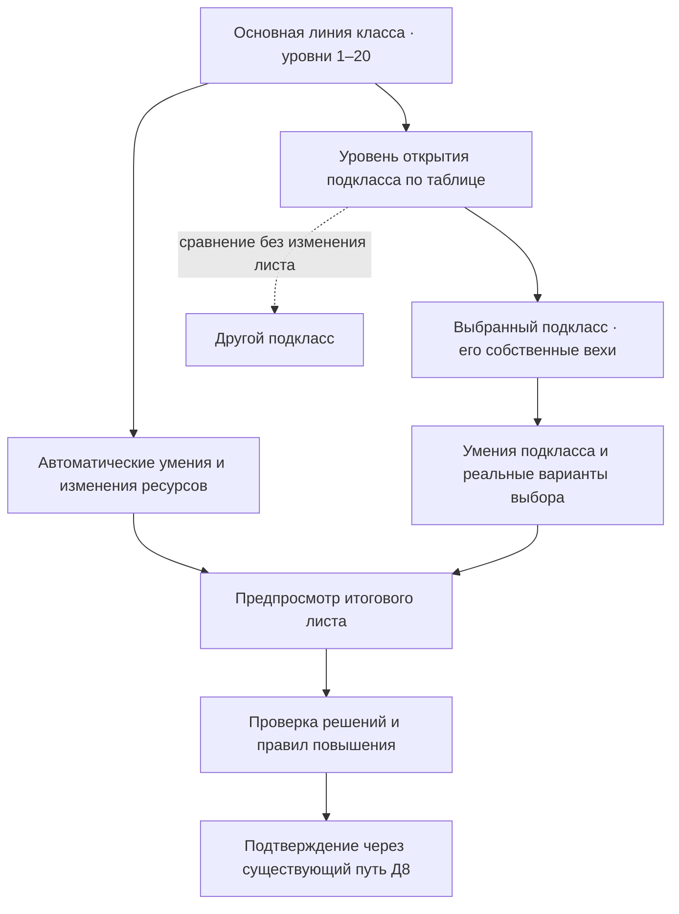

# Карта развития класса по таблицам владельца
01.11.2026. Идея владельца: использовать собственную компактную выжимку руководств с 20 уровнями как основу визуального дерева класса/подкласса, по образу деревьев развития WoW. Задача — БА27; первый рабочий этап внедрён 01.11.2026, полный целевой экран ещё не завершён.

## Проверенная основа
В корне проекта найден workbook «Копия файла _Копия Классы.xlsx_.xlsx» (фактическое имя содержит Unicode-нормализацию); через workbook.xml проверены 17 листов, включая сводки и листы классов. Отдельно есть «Копия расы.xlsx». Импортёр — scripts/import-compendium.py, функция import_classes.

В content/compendium/classes.json уже есть:
- 13 классов; у каждого ровно 20 строк с последовательными level=1…20.
- В строке уровня: proficiencyBonus, features (id/name/text и местами choice), resources.
- 112 записей подклассов: gainedAt и features с конкретным level.
- source, sheet, options, levelColumn и другие поля импорта; происхождение записи сохраняется.

Это даёт проекцию одного источника в таблицу, карточку и граф. Вторая вручную поддерживаемая копия дерева не нужна. Наличие 20 строк не доказывает полноту всех условий/вариантов и ступеней усиления: некоторые сведения остаются текстом.

Примеры по текущему импорту:
- Воин, 1: «Второе дыхание» автоматически, «Боевой стиль» с choice; 2: «Всплеск действий»; подклассы открываются на 3.
- Следопыт → Охотник: узлы подкласса на 3, 7, 11, 15.
- Волшебник → Воплощения: открытие на 2, узлы 2, 6, 10, 14.
Это структура текущих таблиц, не утверждение, что все редакции правил используют те же уровни.

## Как выглядит экран
Центр — вертикальная шкала 1–20 с основной линией класса. Рядом — ветвь выбранного подкласса. На уровне открытия подкласса показываются доступные варианты; выбор в предпросмотре позволяет сравнить ветви и не меняет лист автоматически.

Уровни без нового умения остаются на шкале: могут изменяться ресурсы, ячейки, известные заклинания и бонус мастерства. Не обязательно рисовать по большой рамке на каждый уровень; крупные узлы — важные вехи, остальные строки компактные.

Справа — инспектор выбранного узла: полное имя, текст из таблицы, источник/версия, уровень, основная/подклассовая принадлежность, автоматическое получение или требуемый выбор, изменения листа и проверяемые условия. Внизу — сводка предпросмотра на выбранном уровне и перечень незавершённых решений.

На узлах разные визуальные состояния:
1. Уже получено персонажем.
2. Текущий уровень.
3. Доступно при следующем повышении, выбор ещё не сделан.
4. Будущая веха с явным условием уровня.
5. Другая ветвь подкласса в режиме сравнения.
6. Не хватает данных/не поддержан расчёт — информация доступна, автоматическое применение не обещано.

Линии показывают принадлежность и хронологию. Прямые зависимости между умениями рисуются только при наличии такого требования в правилах/данных. Очки талантов, ранги и взаимоисключения не заимствуются из WoW автоматически.

## Модель и взаимодействие
Проекция собирает из class.levels и subclass.features упорядоченные узлы со ссылками на исходные feature/subclass/option. Вычисления персонажа и применения повышения остаются в существующих campaign/derive, build и levelUp; граф не становится вторым движком правил.

Выбор узла, подкласса для сравнения или будущего уровня — навигация/предпросмотр. Реальный переход использует обычную форму повышения и её проверки, затем существующее событие CHARACTER_LEVELED и undo. Неподдержанные расчёты, в том числе ограничения текущей Д8 для Изобретателя, показываются явно. Для создания нового персонажа используется существующий путь редактора, не серия фиктивных повышений.

«20 уровней» — уровни конкретного класса. В текущей одноклассовой модели они совпадают с уровнем персонажа; возможный будущий мультикласс требует отдельного контракта.

## Что проверить в исходных данных
- Автоматическое получение и выбор отделены; наличие слова «выберите» в тексте само по себе ещё не полноценная машиночитаемая схема.
- Слитые альтернативные наименования, например варианты через «/», не выдаются персонажу как два автоматически полученных умения.
- Усиление уже полученного умения на позднем уровне не теряется только потому, что не выделено отдельной строкой features.
- Ресурсы в исходнике местами строки: механические значения берутся из типизированных правил/проверенного разбора; текст отображается без выдуманного расчёта.
- Source и редакция видны; таблицы/подклассы разных источников не смешиваются незаметно.

Эти замечания не блокируют первый информационный макет по уже импортированным данным. Неполные узлы можно показывать с пометкой и полным исходным текстом.

## Этапы БА27
1. Чистая проекция и информационный прототип: Воин и Следопыт, выбор подкласса, все 20 уровней, инспектор; затем покрытие всех 13 классов и 112 записей подклассов.
2. Состояния относительно настоящего листа и сравнение будущих уровней; сводка отличий и незавершённых выборов.
3. Встраивание в «Развитие»/«Путь» карточки и редактора (БА6), применение поддержанного повышения через Д8 с отменой и сохранением.

Стиль — понравившийся живописный интерфейс. Небольшие изображения узлов выбираются по семейству/виду умения, не требуется генерировать сотни индивидуальных иллюстраций до проверки дерева.

## Приёмка
Все классы имеют шкалу 1–20, особенности подкласса стоят на исходных уровнях, выбор открытия не захардкожен на 3. Автоматическое/выбираемое различимо без одного только цвета; узлы доступны с клавиатуры и списком, источник и текст доступны. Просмотр будущей ветви не меняет персонажа; применение поддержанного уровня даёт тот же результат, что обычная Д8, переживает перезагрузку и отменяется. Покрытие проекции проверяется по фактическому каталогу, а неполнота данных не скрывается.

## Рабочая реализация 01.11.2026
Проекция и просмотр работают в настоящем «Путь» и в редакторе, покрывают все13 классов/112 ветвей. Инспектор адаптивно раскрывается под выбранным уровнем; источник/текст/выборы/ресурсы и состояния относительно листа доступны. Поддержанное повышение осталось в Д8, его форма свёрнута в отдельное действие. Текущая сводка — возможности таблицы, не рассчитанный будущий лист. Остаток и доказательства перечислены в research/ux-review/verification-BA27.md; БА27 не закрыта.

Следующий этап того же дня: форма Д8 показывает рассчитанный результат ближайшего повышения до записи события, неполные решения и ошибки. Общая проекция с редьюсером устраняет расхождение расчёта и применения. UI apply/reload/undo/reload проверены; старая форма после повышения удаляется. Доказательства — research/ux-review/verification-BA27-preview.md. Дальний будущий уровень пока остаётся проекцией таблицы, без полного расчёта всех решений по пути.

## Последовательный план, 01.11.2026
Добавлен локальный план поддержанных повышений через Д8. Он не применяет уровни к листу. Ранняя правка отбрасывает зависимые шаги; неполное решение остаётся кандидатом вне итогового листа. Имена берутся из компендиума. План закрыт под деревом до «Планировать развитие» и сохраняет черновик при сворачивании. Ветвь сравнения не меняет план текущего листа. Сложные исходные выборы и окончательная графика остаются в БА27.
