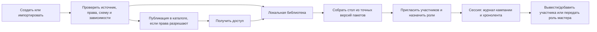

# Пачки материалов и состав игровой сессии

Черновик концепции по предложению владельца от 05.11.2026. Опирается на пакетный контракт П3/И1 (`src/packages/manifest.ts`, `research/setting-package.md`) и задачи П9, П14, БА19. Это архитектурный контур, не реализация магазина, платежей или сетевого стола.

## Модель

«Колода» — удобная пользовательская метафора, но единица данных — версионированный пакет с машиночитаемым манифестом и ссылками на записи. Пакеты могут содержать картриджи правил/редакций, сеттинги, кампании, ваншоты, карты, сцены, справочники, генераторы и отдельные авторские модули. Один каталог может показывать пакет карточкой-корешком; физическая форма UI не меняет гранулярность прав, источников и версий внутри.

| Область | Что хранит | Что не означает |
|---|---|---|
| Авторство и происхождение | автор/правообладатель, источники, лицензия на каждый слой/запись, версия, подписи/хеш, аудитория и зависимости | факт наличия файла не подтверждает право на перепродажу |
| Витрина | опубликованные версии, описание, совместимость, цена/бесплатность, условия доступа | не является рабочим каталогом мастера и не раскрывает локальные материалы |
| Библиотека пользователя | доступ/entitlement, приобретённая или полученная версия, локальная установка, доступные обновления и состояние зависимостей | личный доступ не даёт права раздать исходный пакет игрокам |
| Сборка стола | ссылка на конкретные версии пакетов и выбранные модули; роли мастера/игроков и политика видимости | не копирует содержание источников и не включает секреты в публичную ссылку |
| Журнал кампании | собственные event-sourced изменения мира, состава/участия, времени и принятых последствий | не является редактируемым содержимым авторского пакета |

## Путь материала к столу

Проверка распространения остаётся при каждом выходе. Для магазина подходят только пакеты/слои с явным правом коммерческого распространения; `table` и `internal` остаются локальными и не появляются на витрине. Владение экземпляром, право запуска, право локальной правки, право совместной доставки игрокам и право перепродажи — разные гранты. Покупка одного не подразумевает остальные. Купленные владельцем книги и чужие личные материалы не преобразуются автоматически в продаваемые или доставляемые пакеты.

## Состав игровой сессии

Ссылка на сессию разрешается в отдельный session manifest: базовая кампания и система/редакция правил (например, SRD); назначенный мастер; список дополнительных пакетов и их точных версий; кастомные механики со своими источниками/областью действия; включённые ваншоты/сцены; ссылка на ростер персонажей и профили противников; карты/места и связанный диапазон хроноленты. Данные пакетов остаются неизменяемыми, а журнал событий конкретного прохождения — собственностью кампании.

Ссылка — приглашение в конкретную сборку, а не экспорт сохранения всем подряд. До входа игроку сервер/локальный хост должен выдать только разрешённую проекцию: секреты мастера не попадают в payload, метаданные, ссылки и DOM. Проверка прав выполняется на каждом запросе; скрытая карточка не должна присутствовать в клиентском ответе. Выход игрока и смена мастера отражаются как события членства/ролей, не пересоздают кампанию и не стирают журнал, время, раскрытые сведения или владение персонажем.

## Границы реализации и приёмки

- П3/И1 уже задают виды `rules`, `setting`, `shared`, `campaign`, версии, зависимости, лицензии и уровни распространения; П9 уже задаёт магазин; П14 — открытый демонстрационный пакет; БА19 — поверхности Мастерской и Библиотеки. П15 уточняет межпакетную сборку запущенного стола и жизненный цикл участников.
- Запуск на устройстве означает установку/проверку зависимостей из Библиотеки и выбор версии. Сам манифест не разрешает исполнять произвольный код из пакета: исполняемые правила требуют отдельно подписанного, проверенного runtime-плагина и явного разрешения.
- До реализации магазина владелец должен выбрать модель оплаты, авторские выплаты, налоги/возвраты, регион поставки, обновления ранее полученных версий, приватность каталога, хостинг и восстановление доступа. П13/П9 уже фиксируют необходимость этих решений.
- «Десятки/сотни игроков» — цель для отдельного измерения: модель членства/ролей, конкурирующие записи журнала, области видимости, reconnect, синхронизация хроноленты, лимиты передачи и нагрузочное испытание. До такого испытания это желаемый масштаб, не гарантия.

## Смежные задачи

- **П9:** storefront, авторские пакеты, разрешённое распространение и получение материалов.
- **П15:** манифест активного стола, точная сборка, приглашения, membership/GM handoff и оценка массовых игр.
- **БА19/П8:** личная библиотека, создание/редактирование собственных пакетов, импорт и просмотр аудитории.
- **П14/БА23/БА26:** реальный демонстрационный пакет, связность приключения и его иллюстраций.
- **Д17/Q17:** партия в пространстве и интеграционный путь внешнего стола; эти задачи не заменяют серверную синхронизацию/масштабирование П15.
